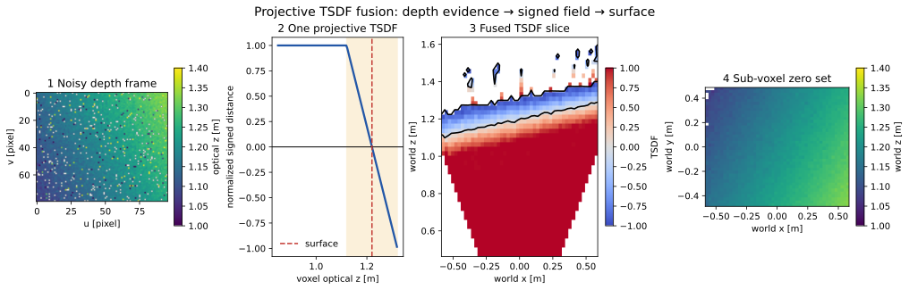
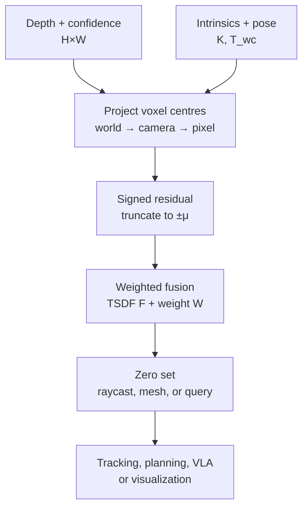

# Projective TSDF Fusion: From Depth Frames to a Persistent 3-D Surface

**Date:** 2026-10-25  
**Category:** 3-D Reconstruction and Mapping  
**Level:** Advanced foundational  
**Implementation:** [NumPy reference, checks, ablations, and robot application](../../examples/tsdf-fusion/)  
**Executed evidence:** [VALIDATION.md](../../examples/tsdf-fusion/VALIDATION.md)

## 0. Evidence map and scope

This lesson uses four labels deliberately:

- **Paper says** — a statement made by a cited primary source.
- **Inference** — a consequence derived from equations, sources, or measured output.
- **My interpretation** — engineering advice or a conceptual model, not a quoted result.
- **Unknown** — something not established by the cited work or executed code.

Primary sources and official implementations:

1. Curless and Levoy, **“A Volumetric Method for Building Complex Models from Range Images,” SIGGRAPH 1996**: [project page](https://graphics.stanford.edu/papers/volrange/) · [paper PDF](https://graphics.stanford.edu/papers/volrange/volrange.pdf) · [ACM DOI](https://dl.acm.org/doi/10.1145/237170.237269).
2. Newcombe et al., **“KinectFusion: Real-Time Dense Surface Mapping and Tracking,” ISMAR 2011**: [Microsoft Research PDF](https://www.microsoft.com/en-us/research/wp-content/uploads/2016/02/ismar2011.pdf).
3. Oleynikova et al., **“Voxblox: Incremental 3D Euclidean Signed Distance Fields for On-Board MAV Planning,” IROS 2017**: [paper PDF](https://helenol.github.io/publications/iros_2017_voxblox.pdf) · [official repository](https://github.com/ethz-asl/voxblox).
4. **Open3D TSDF integration**: [official RGB-D integration tutorial](https://www.open3d.org/docs/latest/tutorial/pipelines/rgbd_integration.html) · [ScalableTSDFVolume API](https://www.open3d.org/docs/latest/python_api/open3d.pipelines.integration.ScalableTSDFVolume.html).
5. **NVIDIA nvblox**: [official repository](https://github.com/nvidia-isaac/nvblox) · [Isaac ROS technical documentation](https://nvidia-isaac-ros.github.io/v/release-5.0/concepts/scene_reconstruction/nvblox/technical_details.html).

**Paper says.** Curless and Levoy introduced incremental volumetric fusion of aligned range images through weighted signed-distance observations. KinectFusion adapted a projective TSDF to a dense GPU volume, raycast its zero set, and tracked each depth frame against the accumulated model. Voxblox separated the reconstruction-oriented TSDF from the Euclidean signed distance field needed by motion planners.

**Scope.** The runnable code reconstructs the fusion module. It assumes calibrated depth and known camera poses. It does not implement ICP tracking, loop closure, voxel hashing, Marching Cubes, or a certified collision map.

---

## 1. Research problem

Yesterday’s stereo lesson produced one disparity or depth estimate per pixel. A robot needs more than its latest camera view. It needs a stable world-frame answer to questions such as:

- Where is the surface after the camera moves?
- Which regions have been observed as free?
- How can noisy, incomplete frames reinforce one another?
- How can a renderer, tracker, mesh extractor, or planner query accumulated geometry?

Let frame $k$ provide a depth image and calibrated pose:

$$
D_k \in (\mathbb{R}_{>0}\cup\{\bot\})^{H\times W},
\qquad
\mathbf{T}_{wc,k}\in SE(3).
$$

**Symbols.** $D_k$ is optical-axis depth in metres; $H,W$ are image height and width; $\bot$ denotes a missing measurement; $\mathbf{T}_{wc,k}$ maps camera coordinates to world coordinates; $SE(3)$ is the group of 3-D rigid transforms; $k$ indexes time.

The desired persistent implicit field satisfies

$$
F(\mathbf{p}_w)\approx 0 \text{ on a surface},
\quad
F(\mathbf{p}_w)>0 \text{ in observed free space},
\quad
F(\mathbf{p}_w)<0 \text{ just behind a surface}.
$$

**Symbols.** $F$ is the signed-distance-like field; $\mathbf{p}_w=[x_w,y_w,z_w]^\top\in\mathbb{R}^3$ is a world point; the sign convention is positive in front of a measured visible surface and negative immediately behind it.

The word “like” matters. A projective TSDF generally stores distance along a camera viewing direction, not exact Euclidean distance to the closest surface.

---

## 2. Motivation and prior limitations

### 2.1 Why not keep only a point cloud?

A point cloud stores surface samples but does not by itself encode a continuous surface or distinguish free, occupied, and never-observed space. Multiple scans create duplicates and inconsistent thickness. Meshing every frame independently also makes incremental fusion and visibility reasoning awkward.

### 2.2 Why not average depths pixel by pixel?

Pixels belong to the camera frame. After camera motion, pixel $(u,v)$ observes a different world ray. Fusion must first establish a common coordinate frame. Averaging unwarped depth images is geometrically meaningless except for a stationary camera and static scene.

### 2.3 Why not use occupancy alone?

Occupancy is valuable for probabilistic free/occupied reasoning, but does not directly provide a smooth sub-voxel surface. Gradient-based planners often want distance and distance gradients. Voxblox therefore constructs an ESDF from a TSDF rather than pretending that the projective TSDF is already a global Euclidean distance field.

### 2.4 Key insight

Each depth measurement constrains an interval along its ray:

1. space before the measured surface is observed free;
2. the surface is a zero crossing;
3. a narrow band behind the surface receives negative evidence;
4. farther-behind space stays unknown because the camera cannot see through the first surface.

Truncate this signed evidence to a local band, place every observation in a common volume, and maintain a weighted running average. Noise is reduced without retaining every frame.

---

## 3. Module contracts

| Object | Shape | Frame / units | Purpose |
|---|---:|---|---|
| depth $D_k$ | $[H,W]$ | camera optical $z$, metres | surface measurement |
| confidence $C_k$ | $[H,W]$ | unitless, non-negative | relative update precision |
| intrinsics $\mathbf K$ | $[3,3]$ | pixels | camera projection |
| pose $\mathbf T_{wc,k}$ | $[4,4]$ | camera → world | place frame in map |
| voxel centres | $[N_z,N_y,N_x,3]$ | world metres, coordinates $(x,y,z)$ | query positions |
| TSDF $F$ | $[N_z,N_y,N_x]$ | normalized to $[-1,1]$ | implicit geometry |
| weight $W$ | $[N_z,N_y,N_x]$ | accumulated relative precision | support state |

**My interpretation.** Put transform direction in the variable name. `world_from_camera` is harder to misuse than `pose`. Document storage order separately from coordinate order: this implementation stores `[z,y,x]` arrays but `(x,y,z)` metric points.

---

## 4. Mathematics: projection and signed evidence

### 4.1 Voxel centres

For integer voxel index $(i,j,l)$,

$$
\mathbf{p}_w(i,j,l)=\mathbf{o}_w+s
\begin{bmatrix}
i+\tfrac12\\
j+\tfrac12\\
l+\tfrac12
\end{bmatrix}.
$$

**Symbols.** $\mathbf{p}_w\in\mathbb{R}^3$ is a voxel centre in world coordinates; $\mathbf{o}_w\in\mathbb{R}^3$ is the minimum volume corner; $s>0$ is isotropic voxel size in metres; $i,j,l$ are integer $x,y,z$ indices; the half-voxel offset places samples at cell centres.

### 4.2 World to camera

Projection needs the inverse of the input pose:

$$
\mathbf{T}_{cw,k}=\mathbf{T}_{wc,k}^{-1},
\qquad
\widetilde{\mathbf p}_{c,k}=\mathbf{T}_{cw,k}\widetilde{\mathbf p}_w.
$$

**Symbols.** $\mathbf{T}_{cw,k}\in SE(3)$ maps world to camera; $\widetilde{\mathbf p}=[x,y,z,1]^\top\in\mathbb{R}^4$ is a homogeneous point; $\mathbf p_{c,k}=[x_c,y_c,z_c]^\top$ is the voxel centre in camera coordinates.

A translation-sign error can still produce a visually smooth map—at the wrong location.

### 4.3 Camera projection

For $z_c>0$,

$$
u=f_x\frac{x_c}{z_c}+c_x,
\qquad
v=f_y\frac{y_c}{z_c}+c_y.
$$

**Symbols.** $u,v$ are continuous pixel coordinates; $f_x,f_y$ are focal lengths in pixels; $c_x,c_y$ are principal-point coordinates; $x_c,y_c,z_c$ are camera-frame coordinates in metres.

The reference uses nearest-neighbour depth lookup after rounding $(u,v)$. KinectFusion motivates nearest-neighbour lookup to avoid blending foreground and background at discontinuities. Bilinear sampling may be differentiable, but it can smear an occlusion boundary unless it is discontinuity aware.

### 4.4 Projective signed distance

Let sampled optical-axis depth be $d_k=D_k(\lfloor u\rceil,\lfloor v\rceil)$. Then

$$
\delta_k(\mathbf p_w)=d_k-z_c.
$$

**Symbols.** $\delta_k$ is signed projective distance in metres; $d_k$ is measured camera $z$-depth; $z_c$ is the voxel’s camera-frame optical depth; $\mathbf p_w$ is the voxel being updated.

- $\delta>0$: the voxel is before the measured surface and observed free.
- $\delta=0$: it lies on the surface.
- $-\mu\le\delta<0$: it is within the narrow band behind the surface.
- $\delta<-\mu$: no update; this space is occluded, not proven occupied.

Normalize and truncate:

$$
f_k(\mathbf p_w)=
\operatorname{clip}\!\left(\frac{\delta_k(\mathbf p_w)}{\mu},-1,1\right),
\qquad \delta_k(\mathbf p_w)\ge -\mu.
$$

**Symbols.** $f_k\in[-1,1]$ is one frame’s normalized TSDF observation; $\mu>0$ is truncation distance in metres; $\operatorname{clip}$ limits its argument to the interval; the condition prevents carving unseen space farther than $\mu$ behind the first surface.

If $d_k=1.20$ m and $\mu=0.10$ m:

| voxel $z_c$ | $\delta=d_k-z_c$ | $f$ | interpretation |
|---:|---:|---:|---|
| 0.90 m | +0.30 m | +1.0 | confidently observed free |
| 1.15 m | +0.05 m | +0.5 | just in front |
| 1.20 m | 0 | 0 | surface |
| 1.25 m | −0.05 m | −0.5 | just behind |
| 1.35 m | −0.15 m | no update | occluded / unknown |

### 4.5 Why weighted averaging is the optimizer

At one voxel, suppose observations $f_i$ have non-negative weights $w_i$. The pointwise objective is

$$
J(F)=\sum_{i=1}^{n}w_i(F-f_i)^2.
$$

**Symbols.** $J(F)$ is scalar reconstruction cost; $F$ is the unknown fused TSDF at this voxel; $f_i$ is observation $i$; $w_i\ge0$ is relative precision; $n$ is the number of valid observations.

Differentiate and set the result to zero:

$$
\frac{\partial J}{\partial F}
=2\sum_i w_i(F-f_i)=0
\quad\Longrightarrow\quad
F^*=\frac{\sum_i w_i f_i}{\sum_i w_i}.
$$

**Symbols.** $\partial J/\partial F$ is the derivative with respect to the scalar field value; $F^*$ is the minimizing weighted mean; the remaining symbols keep their definitions above. The solution requires $\sum_iw_i>0$.

Maintain the sufficient statistics through an online update:

$$
F_k=\frac{W_{k-1}F_{k-1}+w_k f_k}{W_{k-1}+w_k},
\qquad
W_k=\min(W_{k-1}+w_k,W_{\max}).
$$

**Symbols.** $F_{k-1},F_k$ are previous and updated TSDF values; $W_{k-1},W_k$ are accumulated weights; $f_k,w_k$ are the new observation and weight; $W_{\max}$ caps historical inertia and numeric growth.

For $F_{k-1}=0.4$, $W_{k-1}=3$, $f_k=-0.2$, and $w_k=1$,

$$
F_k=\frac{3(0.4)+1(-0.2)}{4}=0.25.
$$

**Symbols.** Three units of previous support at (0.4) combine with one new unit at (-0.2), moving the field toward the new observation without replacing history.

**Inference.** With equal weights and independent zero-mean noise, repeated aligned views reduce variance. Averaging cannot remove systematic calibration or pose bias; it reinforces it.

**Implementation detail.** After the stored weight reaches $W_{\max}$, this reference updates with the capped old weight and then caps again. It behaves like a bounded-memory moving average and no longer equals the mean of the complete history.

### 4.6 Weight design

Constant $w_k=1$ is common. If a sensor provides meaningful confidence $c_k$, one possible model is

$$
w_k=\frac{c_k}{\sigma_z^2(d_k)+\epsilon}.
$$

**Symbols.** $w_k$ is relative precision; $c_k\ge0$ is sensor confidence; $\sigma_z(d_k)$ is predicted depth standard deviation at depth $d_k$; $\epsilon>0$ prevents division by zero.

**My interpretation.** Do not call an arbitrary neural confidence score a calibrated inverse variance. Validate reliability first. The demo’s confidence is synthetic and tags injected outliers, so its benefit tests the mechanism rather than a real confidence model.

### 4.7 Stereo uncertainty enters before fusion

For rectified stereo,

$$
Z=\frac{fB}{d},
\qquad
\sigma_Z\approx\left|\frac{\partial Z}{\partial d}\right|\sigma_d
=\frac{fB}{d^2}\sigma_d.
$$

**Symbols.** $Z$ is depth in metres; $f$ is focal length in pixels; $B$ is stereo baseline in metres; $d$ is disparity in pixels; $\sigma_d$ is disparity standard deviation; $\sigma_Z$ is first-order depth standard deviation.

Far depth has small disparity and rapidly increasing metric uncertainty. Constant TSDF weight treats unequal stereo measurements as equally precise.

### 4.8 Recover a sub-voxel surface

If adjacent samples satisfy $F_a>0$ and $F_b\le0$, linear interpolation gives

$$
\alpha=\frac{F_a}{F_a-F_b},
\qquad
\mathbf p_0=\mathbf p_a+\alpha(\mathbf p_b-\mathbf p_a).
$$

**Symbols.** $F_a,F_b$ are adjacent TSDF samples; $\alpha\in[0,1]$ is interpolation fraction; $\mathbf p_a,\mathbf p_b\in\mathbb{R}^3$ are their world positions; $\mathbf p_0$ is the estimated zero crossing.

The demo’s height-field extractor applies this only along world $z$. General scenes require Marching Cubes over all cell edges or camera-ray traversal with trilinear interpolation.

Near the zero set, a normal follows the field gradient:

$$
\mathbf n(\mathbf p)=\frac{\operatorname{grad}F(\mathbf p)}{\|\operatorname{grad}F(\mathbf p)\|_2}.
$$

**Symbols.** $\mathbf n\in\mathbb{R}^3$ is a unit surface normal; $\operatorname{grad}F=[\partial F/\partial x,\partial F/\partial y,\partial F/\partial z]^\top$ is the spatial gradient; $\|\cdot\|_2$ is Euclidean norm.

---

## 5. Implementation reconstruction

The core is [tsdf_fusion.py](../../examples/tsdf-fusion/tsdf_fusion.py).

| Component | Input → output | Purpose |
|---|---|---|
| `PinholeCamera` | six scalars → $\mathbf K$ and resize-safe intrinsics | projection contract |
| `VolumeConfig` | origin, dimensions, $s,\mu,W_{max}$ | metric map bounds |
| `TSDFVolume.integrate` | depth, confidence, pose → updated $F,W$ | projective fusion |
| `extract_zero_crossings_z` | $F,W$ → $[N_y,N_x]$ height map | sub-voxel validation |
| `surface_metrics` | estimate, truth, mask → coverage/MAE/P95 | synthetic evidence |

The principal update remains visible in code:

~~~python
signed_distance = sampled_depth - z_camera
valid = signed_distance >= -truncation
new_tsdf = np.minimum(1.0, signed_distance[valid] / truncation)

denominator = old_weight + new_weight
fused = (old_weight * old_tsdf + new_weight * new_tsdf) / denominator
weight = np.minimum(denominator, max_weight)
~~~

### Tensor, coordinate, temporal, and precision flow

1. Depth enters as NumPy `float64 [H,W]`; missing depth is `NaN`.
2. Voxel centres are `float64 [Nz,Ny,Nx,3]` world-metre points.
3. The inverse rigid transform produces camera-frame points.
4. Projection and residual arithmetic remain `float64` for clarity.
5. Persistent `tsdf` and `weight` are `float32 [Nz,Ny,Nx]`.
6. Frames update the same state sequentially; order is temporal state, not a batch axis.
7. The extractor interpolates in `float64` and returns world-metre surfaces.

**My interpretation.** Mixed precision needs an error budget. FP16 TSDF storage may be adequate for normalized values, but pose matrices, projection, and accumulation need separate evaluation. “TensorRT supports FP16” does not validate a stateful mapping kernel.

---

## 6. Executed experiments and evidence

All following numbers were produced by the committed code, not copied from papers. The analytic sloped plane is rendered into eight $80\times96$ depth maps. Each frame receives 12 mm Gaussian noise, 4% holes, and 2.5% signed 22 cm outliers. The volume uses 25 mm voxels.

### 6.1 Fixed-seed results

| Variant | Coverage | Surface $z$ MAE | P95 error | Observed voxels |
|---|---:|---:|---:|---:|
| one frame, unit weights | 92.873% | 13.965 mm | 27.498 mm | 38.019% |
| eight frames, unit weights | 100% | 4.519 mm | 14.861 mm | 52.535% |
| eight frames, tagged-outlier confidence | 100% | 3.190 mm | 7.587 mm | 52.535% |
| same, every pose shifted +4 cm in $z$ | 100% | 39.988 mm | 46.654 mm | 53.158% |
| confidence, truncation $2s$ | 100% | 3.186 mm | 7.494 mm | 48.408% |
| confidence, truncation $8s$ | 100% | 3.219 mm | 7.744 mm | 60.822% |

**Inference.** More frames suppress independent noise and fill missing support. Confidence helps because this synthetic channel knows which points were corrupted. The pose-bias row is the critical warning: a complete-looking map can be metrically wrong.

**Inference.** On this plane, changing $\mu$ from $2s$ to $8s$ barely changes MAE but changes touched voxels substantially. Truncation bandwidth is a compute and topology parameter, not merely an accuracy knob.

### 6.2 Paired eight-seed ablation

| Variant | Median MAE | Worst MAE | Median P95 | Worst P95 | Minimum coverage |
|---|---:|---:|---:|---:|---:|
| one frame | 16.192 mm | 18.287 mm | 34.300 mm | 125.348 mm | 89.932% |
| eight frames, unit | 4.283 mm | 4.519 mm | 13.646 mm | 14.861 mm | 100% |
| eight frames, confidence | 3.203 mm | 3.266 mm | 7.778 mm | 7.972 mm | 100% |
| confidence + 4 cm pose bias | 40.085 mm | 40.149 mm | 46.537 mm | 47.062 mm | 100% |

All eight paired seeds completed without failure. This is deterministic regression evidence, not confidence intervals, statistical significance, or real-domain generalization.

| Change | Hypothesis | Observed result | Not proved |
|---|---|---|---|
| 1 → 8 frames | aligned averaging reduces random error | MAE decreased | robustness to real dynamics |
| unit → tagged confidence | downweight known outliers | tail error decreased | learned confidence calibration |
| correct → biased poses | fusion cannot repair pose bias | error followed bias | every pose-error mode is linear |
| $\mu:2s→8s$ | wider bands update more voxels | observed fraction increased | best real-scene truncation |

---

## 7. Integrated application: robot sweep-volume gate

The application fuses six views of a table at $z=1.30$ m with a box front at $z=0.88$ m. A motion planner or VLA supplies a metric end-effector sweep region; the TSDF module supplies geometry only.

Executed output:

- requested sweep columns: 200;
- accepted columns with enough support: 156;
- coverage: 78%;
- 10th-percentile surface $z$: 0.877837 m;
- intrusion threshold: 1.15 m;
- decision: `STOP` because a fused surface enters the sweep volume.

**My interpretation.** A VLA may say “move the gripper across the table,” but language does not certify clearance. Convert intended motion into a metric swept volume and ask a dedicated geometric layer to check it.

**Unknown.** The demo does not establish a safe threshold, false-stop rate, or real robot performance. Calibration drift, timestamp error, dynamic objects, unobserved space, and emergency response require system-level treatment.

---

## 8. Failure modes an engineer must recognize

### 8.1 Pose drift and transform direction

Fusion assumes alignment. Pose drift thickens or duplicates surfaces; coherent bias shifts the entire zero set. Loop closure may change historical poses, but a running average cannot automatically “unfuse” old observations unless the system retains history or supports deformation and reintegration.

### 8.2 Depth discontinuities

A projected voxel can sample the wrong side of a foreground boundary. Nearest-neighbour lookup avoids linear blending but not all aliasing. Ray-centric integration, discontinuity masks, and finer voxels address different parts of the problem.

### 8.3 Thin structures

If thickness is comparable to $\mu$ or voxel size, front and back evidence can interfere. Wide bands are dangerous for thin surgical tools, wires, tactile markers, and transparent structures.

### 8.4 Dynamic scenes and stale evidence

An ordinary TSDF assumes a static world. A moving hand can become several ghost surfaces. Weight caps, decay, dynamic masks, object-centric maps, or explicit de-integration may be needed.

### 8.5 Projective TSDF is not an ESDF

A TSDF is exact at its zero crossing but generally is not the Euclidean distance to the nearest obstacle away from the surface. Feeding raw magnitude to a trajectory optimizer as guaranteed clearance is unsafe. Voxblox and nvblox maintain a separate ESDF layer for planning queries.

### 8.6 Unknown is not free

Voxels behind the truncation band receive no update. Treating zero weight as free space creates collisions in occluded regions. The application rejects insufficiently observed sweep regions for this reason.

### 8.7 Difficult sensing

Stereo fails on textureless or repetitive areas; active depth fails on absorptive, reflective, transparent, or multipath surfaces. Fusion can make repeated sensor bias look more confident.

---

## 9. Computation, memory, and deployment

For a dense volume, persistent storage is approximately

$$
M=N_xN_yN_z(b_F+b_W).
$$

**Symbols.** $M$ is bytes; $N_x,N_y,N_z$ are voxel counts; $b_F,b_W$ are bytes per TSDF and weight value.

With two FP32 values, a $512^3$ volume alone needs

$$
512^3(4+4)=1{,}073{,}741{,}824\ \text{bytes}=1\ \text{GiB}.
$$

**Symbols.** $512^3$ is voxel count; each `float32` uses 4 bytes; GiB means $2^{30}$ bytes. This excludes color, hash tables, meshes, temporaries, allocator overhead, and camera data.

Dense voxel projection costs roughly $O(N_xN_yN_z)$ per frame and is memory-bandwidth dominated. Scalable systems allocate blocks near observations, group rays, or update only blocks in the view frustum.

### Jetson and CUDA

- Keep depth, poses, active blocks, and integration on-device; avoid frame-by-frame host transfers.
- Use block-sparse or hashed storage beyond a small fixed workspace.
- Budget TSDF, weight, color, ESDF, mesh, and temporary memory together.
- Add CUDA streams only after dependency and lifetime analysis; mapping is stateful.
- NVIDIA’s official nvblox is a GPU TSDF/ESDF library intended for robotics and documented for Jetson-class devices. This lesson did **not** benchmark it.

### ONNX and TensorRT

TSDF integration contains persistent mutable state, projection, indexed reads, and scatter-like updates. It is usually a poor fit for a conventional stateless ONNX graph. A practical split is:

1. learned stereo/depth/confidence in TensorRT;
2. geometric fusion in CUDA/C++ or a mapping library;
3. ESDF or collision queries in a planner-specific representation.

**Unknown.** FP16, INT8, TensorRT, CUDA, nvblox, Open3D, Jetson latency, power, and memory were not executed here. Quantizing the depth model does not automatically preserve surface accuracy; validate the final zero set and clearance decisions.

---

## 10. Connections to robotics, VLA, tactile sensing, and surgery

### VLA and manipulation

A TSDF can be geometric memory beneath semantic reasoning. The VLA chooses a task and approximate region; metric fusion maintains surfaces and observed support; an ESDF or collision checker constrains motion. Semantic and geometric uncertainty should remain separately inspectable.

### Visual-tactile sensing

For an optical elastomer sensor, multi-view TSDF is not automatically appropriate: the camera may be fixed, the gel deforms, and the visible marker layer is not the contact surface. The useful transfer is the *implicit-field discipline*: define coordinate frame, zero set, sign, confidence, and update law explicitly. A learned deformation or height field may be better than a static-world TSDF.

### Surgical imaging

TSDF-style fusion can aggregate stereo-endoscopic depth, but tissue deformation violates static-scene assumptions and specular highlights corrupt depth. Rigid fusion is a local baseline. Non-rigid tracking, tool masks, confidence modeling, and freshness limits become central.

---

## 11. Reproduction

~~~bash
cd CV/examples/tsdf-fusion
python -m pip install -r requirements.txt
python checks.py
python demo.py
python demo.py --ablations
python application.py
python make_figure.py ../../assets/tsdf-fusion/projective-tsdf-fusion.svg
~~~

Expected invariants, not exact last digits:

1. all 16 checks pass;
2. eight-frame unit fusion beats one frame on synthetic MAE;
3. tagged-outlier confidence beats unit weighting;
4. 4 cm pose bias produces much larger error than depth noise;
5. the obstacle application emits `STOP`;
6. the SVG visibly retains depth noise and residual TSDF artifacts.

For real reproduction, add RGB-D or stereo data, externally estimated poses, calibration, and timestamp checks. Report voxel size, $\mu$, weighting, depth range, pose source, map bounds, missing-depth policy, and extraction method.

---

## 12. Final engineering checklist

- [ ] Is depth optical-axis $z$ or Euclidean ray range?
- [ ] Is the pose `world_from_camera` or `camera_from_world`?
- [ ] Are `[z,y,x]` storage and `(x,y,z)` coordinates documented?
- [ ] Are intrinsics rescaled with pixel-centre convention after resize or crop?
- [ ] Is unknown space distinct from observed free space?
- [ ] Is confidence calibrated, or merely heuristic?
- [ ] Are dynamic objects masked, decayed, or modeled separately?
- [ ] Are $\mu$, voxel size, depth noise, and thin structures jointly tested?
- [ ] Is pose error measured as well as depth error?
- [ ] Does planning use an ESDF or collision model rather than raw TSDF magnitude?
- [ ] Are freshness, coverage, and emergency stops enforced outside the VLA?

The essential lesson is not “average depth in a grid.” Every pixel contributes a visibility-aware signed constraint in a declared coordinate system. TSDF fusion becomes reliable only when projection, uncertainty, occlusion, pose accuracy, and downstream semantics stay explicit.
