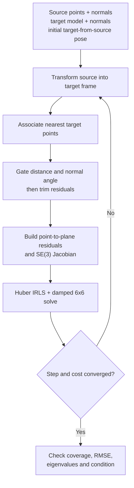
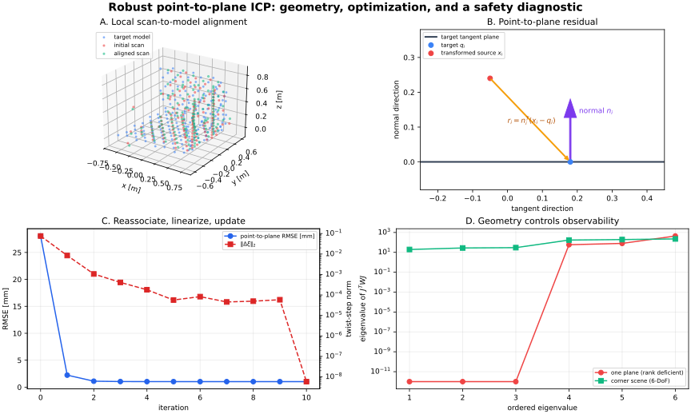

# Robust Point-to-Plane ICP: SE(3) Scan Matching with Outlier Rejection and Observability Checks

**Date:** 2026-10-26 (Asia/Shanghai)  
**Track:** Computer Vision → 3-D Reconstruction and Mapping  
**Level:** Advanced  
**Code:** [runnable NumPy reference](../../examples/robust-point-to-plane-icp/)  
**Validation:** [executed checks and ablations](../../examples/robust-point-to-plane-icp/VALIDATION.md)  
**Illustration:** [original SVG](../../assets/robust-point-to-plane-icp/robust-icp.svg)

Point-to-plane Iterative Closest Point (ICP) estimates the rigid transform that aligns
a source scan to a target surface. It is the missing tracking step between yesterday's
[projective TSDF fusion](2026-10-25-projective-tsdf-fusion.md) and a complete dense
mapping system: estimate the camera pose first, reject unsafe estimates, and only then
integrate the new depth frame.

This lesson does not present ICP as a magical global registration solver. It develops
the local algorithm, states the frame convention, derives the left-SE(3) Jacobian,
adds robust correspondence handling, and shows how the spectrum of the normal matrix
reveals geometry that cannot constrain all six pose degrees of freedom.

## Evidence labels used here

- **Paper says** — a claim stated or evaluated in a cited primary paper.
- **Implementation says** — a property directly visible in the supplied code.
- **Experiment says** — a result produced by commands recorded in
  [VALIDATION.md](../../examples/robust-point-to-plane-icp/VALIDATION.md).
- **Inference** — a consequence derived from equations, source material, or measured
  behavior, but not a quotation or direct experimental claim from a paper.
- **My interpretation** — an engineering recommendation or conceptual framing.
- **Unknown** — a claim that remains unevaluated here.

The labels matter. A classic paper's result, a mathematical consequence, and a
synthetic demonstration are different kinds of evidence.

## 1. Research problem

Given:

- source points $P=\{p_i\}_{i=1}^{N}$ in a **source sensor frame** $S$;
- optionally, source normals $m_i^S$;
- target points $Q=\{q_j\}_{j=1}^{M}$ and target normals $n_j^T$ in a **target/model
  frame** $T$;
- an initial pose estimate $T_{T\leftarrow S}^{(0)}\in SE(3)$;

estimate the target-from-source rigid transform

$$
T_{T\leftarrow S} =
\begin{bmatrix}
R & t\\
0^T & 1
\end{bmatrix},
\qquad
x_i^T = R p_i^S+t.
$$

**Symbols.** $R\in SO(3)$ is a $3\times3$ rotation; $t\in\mathbb{R}^3$ is a
translation in metres; $p_i^S\in\mathbb{R}^3$ is source point $i$; $x_i^T$ is that
point after transformation into target coordinates; $T_{T\leftarrow S}$ is a
$4\times4$ homogeneous transform. The arrow means “coordinates on the right become
coordinates on the left.”

Rigid registration is not the same as correspondence estimation. If correspondence
$c(i)$ were known, pose estimation would be easier. ICP alternates:

1. transform source points by the current pose;
2. assign target correspondences under that pose;
3. hold those correspondences fixed and compute a pose increment;
4. update the pose and repeat.

**Paper says.** Besl and McKay's original ICP formulation is a general-purpose local
registration method built around repeated closest-point queries and rigid pose
updates; its least-squares objective descends to a local minimum under the paper's
iteration assumptions [Besl & McKay, 1992](https://doi.org/10.1109/34.121791).

**Inference.** “Converges” does not mean “finds the intended alignment.” The objective
may have a wrong local minimum, and a symmetric object may have several equally good
alignments.

## 2. Motivation: why point-to-plane rather than only point-to-point?

Classical point-to-point ICP minimizes Euclidean displacement:

$$
E_{\mathrm{p2p}}(R,t)=\sum_i\left\|Rp_i+t-q_{c(i)}\right\|_2^2.
$$

**Symbols.** $E_{\mathrm{p2p}}\in\mathbb{R}_{\ge0}$ is total squared error;
$c(i)\in\{1,\ldots,M\}$ indexes the current target match; $\|\cdot\|_2$ is Euclidean
length. Each residual has three scalar components.

On a sampled plane, a transformed source point can be tangentially displaced from
its nearest target sample even when it already lies on the correct continuous
surface. Point-to-point fitting spends effort moving between samples. Point-to-plane
fitting instead minimizes displacement along the target normal:

$$
r_i=n_{c(i)}^T\left(Rp_i+t-q_{c(i)}\right),
\qquad
E_{\mathrm{plane}}=\sum_i r_i^2.
$$

**Symbols.** $n_{c(i)}\in\mathbb{R}^3$ is a unit target normal; $r_i\in\mathbb{R}$ is
a signed distance in metres to the matched tangent plane; the superscript $T$ means
transpose, not the target frame. Each match supplies one scalar constraint.

**Paper says.** Chen and Medioni minimize distances to local tangent planes while
registering multiple range images, avoiding a requirement for exact point-to-point
identity on a sampled surface [Chen & Medioni, 1992](https://graphics.stanford.edu/~smr/ICP/comparison/chen-medioni-align-rob91.pdf).
Rusinkiewicz and Levoy classify ICP choices—sampling, matching, weighting, rejection,
error metric, and minimization—and report fast convergence for well-chosen variants
with a sufficiently good initial estimate
[Rusinkiewicz & Levoy, 2001](https://www.cs.princeton.edu/~smr/papers/fasticp/fasticp_paper.pdf).

**My interpretation.** Point-to-plane ICP is best understood as **tangent-space
Newton-like alignment**. It removes surface-normal error aggressively, but a tangent
plane says nothing about motion within itself. Diverse normals must collectively
recover six-degree-of-freedom information.

## 3. Prior limitations and what this implementation changes

| Limitation | Consequence | Policy used here |
|---|---|---|
| ICP is local | Wrong initialization gives wrong correspondences or no overlap | Require an odometry/predictive initial pose; gate coverage |
| Nearest neighbor is not semantic identity | Repeated structures can align to the wrong instance | Geometric gates; semantic identity remains external |
| Ordinary least squares has unbounded outlier influence | Dynamic objects and partial overlap bias the pose | Distance gate + normal gate + trimming + Huber IRLS |
| Point-to-plane requires target normals | Bad normals create bad residual directions | Normalize normals; reject angular inconsistency |
| One plane is rank deficient | Some motions have zero first-order cost | Inspect $J^TWJ$ eigenvalues; reject weak poses |
| A small residual can come from a tiny subset | Residual-only acceptance can corrupt a map | Gate residual **and** coverage **and** conditioning |
| Brute-force matching is $O(NM)$ | Educational code is not real time | Use KD-tree, projective association, voxel hash, or GPU index in production |

**Paper says.** Generalized ICP places point-to-point and point-to-plane behavior in a
probabilistic framework using local surface covariances
[Segal, Hähnel & Thrun, 2009](https://www.roboticsproceedings.org/rss05/p21.html).
That is a valuable next step when anisotropic sensor and surface uncertainty matters.

## 4. Key insight

For a fixed correspondence, point-to-plane error is nonlinear in $R$ but becomes
linear in a *small* six-vector pose increment. Recompute correspondences after every
increment and solve a small robust weighted least-squares problem:



The alternation is essential: the linear system is valid only around the current
pose with correspondences held fixed.



## 5. Coordinate, tensor, modality, temporal, and precision flow

### 5.1 Interface contract

| Quantity | Shape | Frame | Units | Typical dtype | Role |
|---|---:|---|---|---|---|
| `source_points` | $[N,3]$ | source $S$ | m | FP32/FP64 | current depth/LiDAR scan |
| `source_normals` | $[N,3]$ | source $S$ | unitless | FP32/FP64 | optional angular gate |
| `target_points` | $[M,3]$ | target/model $T$ | m | FP32/FP64 | prior scan or rendered model |
| `target_normals` | $[M,3]$ | target/model $T$ | unitless | FP32/FP64 | tangent-plane direction |
| `T_target_from_source` | $[4,4]$ | $S\rightarrow T$ | mixed | FP32/FP64 | estimated rigid pose |
| nearest indices | $[N]$ | target index space | integer | int32/int64 | $c(i)$ |
| residual | $[K]$ | target tangent planes | m | FP32/FP64 | accepted scalar errors |
| Jacobian | $[K,6]$ | left tangent at current pose | mixed | FP32/FP64 | pose sensitivity |
| normal matrix | $[6,6]$ | twist coordinates | mixed | FP32/FP64 | solve + observability |

$K\le N$ after gates and trimming. Twist order is
$[\omega_x,\omega_y,\omega_z,v_x,v_y,v_z]$.

### 5.2 Temporal flow in dense mapping

At time $k$, a depth image $D_k$ is back-projected into source-frame points. A
motion model or visual/inertial odometry predicts $T_{W\leftarrow C_k}^{(0)}$.
A raycast of the TSDF produces target vertices and normals in world frame $W$.
ICP refines the live frame against that model. Only an accepted pose and depth map
advance the TSDF state from $V_{k-1}$ to $V_k$.

$$
(D_k,V_{k-1},T^{(0)}_{W\leftarrow C_k})
\xrightarrow{\mathrm{ICP}}
(\widehat T_{W\leftarrow C_k},s_k)
\xrightarrow{\mathrm{gate}}
V_k,
$$

**Symbols.** $D_k$ is the current depth image; $V_{k-1}$ is the previous TSDF;
$\widehat T$ is the refined pose; $s_k$ contains quality statistics; $V_k$ is the
updated volume. If the gate rejects, the safe transition is $V_k=V_{k-1}$.

**Paper says.** KinectFusion tracks a live depth frame against a global model with
coarse-to-fine ICP and then integrates depth into a dense surface representation
[Newcombe et al., 2011](https://www.microsoft.com/en-us/research/wp-content/uploads/2016/02/ismar2011.pdf).

### 5.3 Precision flow

The reference code uses FP64 so that finite-difference checks and eigenvalue
diagnostics are easy to inspect. A real GPU pipeline normally stores points/normals
in FP32. Even if matching uses FP16/BF16 inputs, accumulate $J^TWJ$ and $J^TWr$ in
FP32 or FP64 and solve the $6\times6$ system at higher precision. The rotation and
translation columns have different physical units; raw condition numbers also depend
on scene scale.

## 6. Method, step by step

### 6.1 Transform the source

At iteration $k$:

$$
x_i^{(k)}=R^{(k)}p_i+t^{(k)},
\qquad
\widetilde m_i^{(k)}=R^{(k)}m_i^S.
$$

**Symbols.** $x_i^{(k)}\in\mathbb{R}^3$ is the transformed source point;
$\widetilde m_i^{(k)}\in\mathbb{R}^3$ is its transformed normal. Normals are rotated
but never translated.

### 6.2 Associate and gate

The exact nearest neighbor in the target point set is

$$
c(i)=\arg\min_{j\in\{1,\ldots,M\}}
\left\|x_i^{(k)}-q_j\right\|_2.
$$

**Symbols.** $c(i)$ is a discrete target index; $M$ is target point count; the
$\arg\min$ returns the index, not the distance.

The implementation retains a match only if

$$
\left\|x_i-q_{c(i)}\right\|_2\le\tau_d,
\qquad
\left|\widetilde m_i^T n_{c(i)}\right|\ge\cos\tau_\theta.
$$

**Symbols.** $\tau_d$ is a distance threshold in metres; $\tau_\theta$ is a maximum
normal angle; the absolute dot product treats opposite normal orientations as the
same local plane. If oriented normals carry inside/outside meaning, remove the
absolute value and enforce consistent orientation.

After gating, the code retains the configured fraction with smallest absolute
point-to-plane residual. Trimming protects against partial overlap but changes the
objective discontinuously when membership changes.

### 6.3 Robust objective

For retained set $\mathcal I$, minimize Huber loss:

$$
E(T)=\sum_{i\in\mathcal I}\rho_\delta(r_i),
\qquad
\rho_\delta(r)=
\begin{cases}
\frac12r^2,& |r|\le\delta,\\
\delta\left(|r|-\frac12\delta\right),&|r|>\delta.
\end{cases}
$$

**Symbols.** $\mathcal I$ is the retained index set; $\rho_\delta$ is Huber loss;
$\delta>0$ is the quadratic-to-linear transition in metres; $r$ is a signed scalar
residual. The loss is quadratic near zero and linear for large errors.

Iteratively reweighted least squares (IRLS) uses

$$
w_i=\frac{\psi(r_i)}{r_i}=
\begin{cases}
1,&|r_i|\le\delta,\\
\frac{\delta}{|r_i|},&|r_i|>\delta,
\end{cases}
$$

**Symbols.** $\psi(r)=\partial\rho/\partial r$ is the influence function;
$w_i\in(0,1]$ is a scalar weight. Code guards division at $r=0$.

**Small numerical example.** With $\delta=1\text{ cm}$, residuals
$[2,8,30]\text{ mm}$ receive weights $[1,1,1/3]$. In the weighted least-squares
system their row multipliers are $\sqrt{w}=[1,1,0.577]$, because multiplying both
the Jacobian and residual by $\sqrt w$ produces $w r^2$.

Open3D's official documentation demonstrates robust kernels specifically for
point-to-plane ICP and explains the IRLS role
[Open3D robust-kernel tutorial](https://www.open3d.org/docs/release/tutorial/pipelines/robust_kernels.html).

### 6.4 Left perturbation on SE(3)

We do not add six numbers directly to a rotation matrix. Let

$$
\Delta\xi=
\begin{bmatrix}\Delta\omega\\\Delta v\end{bmatrix}
\in\mathbb{R}^6,
\qquad
T\leftarrow\operatorname{Exp}(\Delta\xi^\wedge)T.
$$

**Symbols.** $\Delta\omega\in\mathbb{R}^3$ is a small rotation vector in radians;
$\Delta v\in\mathbb{R}^3$ is a translational tangent component; ${}^\wedge$ maps a
six-vector to the $4\times4$ Lie-algebra matrix; $\operatorname{Exp}$ maps it onto
$SE(3)$. Left multiplication expresses the increment in the target frame.

The wedge matrix is

$$
\Delta\xi^\wedge=
\begin{bmatrix}
[\Delta\omega]_\times & \Delta v\\
0^T&0
\end{bmatrix},
\quad
[a]_\times=
\begin{bmatrix}
0&-a_z&a_y\\
a_z&0&-a_x\\
-a_y&a_x&0
\end{bmatrix}.
$$

**Symbols.** $[a]_\times b=a\times b$; $a_x,a_y,a_z$ are vector components.

For a small update,

$$
\operatorname{Exp}(\Delta\xi^\wedge)x
\approx x+\Delta\omega\times x+\Delta v.
$$

**Symbols.** $x\in\mathbb{R}^3$ is already in target coordinates. This first-order
approximation discards terms quadratic and higher in the increment.

Low derives a linear least-squares approximation for point-to-plane registration
when relative rotation is small
[Low, 2004](https://www.comp.nus.edu.sg/~lowkl/publications/lowk_point-to-plane_icp_techrep.pdf).
Our code uses the exact SE(3) exponential for each update but the same local
first-order logic to build the Jacobian.

### 6.5 Derive the point-to-plane Jacobian

Start with one residual under a left perturbation:

$$
r_i(\Delta\xi)
\approx n_i^T\left(x_i+\Delta\omega\times x_i+\Delta v-q_i\right).
$$

**Symbols.** $q_i,n_i$ abbreviate the currently matched target point and normal;
$x_i$ is the current transformed source point.

Using the scalar triple-product identity
$n^T(\omega\times x)=(x\times n)^T\omega$:

$$
r_i(\Delta\xi)\approx r_i(0)+
\underbrace{\begin{bmatrix}(x_i\times n_i)^T & n_i^T\end{bmatrix}}_{J_i\in\mathbb{R}^{1\times6}}
\Delta\xi.
$$

**Symbols.** $J_i$ is a one-row Jacobian; its first three columns measure rotation
sensitivity and last three measure translation sensitivity. Stacking $K$ matches
gives $J\in\mathbb{R}^{K\times6}$ and $r\in\mathbb{R}^K$.

Why $x\times n$, not $n\times x$? The update convention decides the sign and which
point appears. The supplied test compares this analytic Jacobian with finite
differences under the same **left** update. Copying a Jacobian from a right-update
derivation is a common silent bug.

### 6.6 Solve the weighted normal equations

The local IRLS subproblem is

$$
\Delta\xi^*=\arg\min_{\Delta\xi}
\left\|W^{1/2}(J\Delta\xi+r)\right\|_2^2,
\qquad
W=\operatorname{diag}(w_1,\ldots,w_K).
$$

**Symbols.** $W\in\mathbb{R}^{K\times K}$ is diagonal; $W^{1/2}$ contains
$\sqrt{w_i}$; $J\Delta\xi+r$ is the predicted residual after the local update.

Setting the gradient to zero gives

$$
(J^TWJ+\lambda s I_6)\Delta\xi=-J^TWr.
$$

**Symbols.** $H=J^TWJ\in\mathbb{R}^{6\times6}$ is the normal matrix;
$g=J^TWr\in\mathbb{R}^6$ is the gradient; $I_6$ is identity; $\lambda$ is a small
dimensionless damping setting; $s=\operatorname{tr}(H)/6$ scales damping to the
matrix magnitude. Damping improves numerical solvability but does not add real
observations.

**Small numerical example.** Suppose a translation-only 1-D toy problem has normals
$n_i=1$, current errors $r=[2,-1]\text{ mm}$, and unit weights. Then
$J=[1,1]^T$, so $H=2$ and $g=1\text{ mm}$. The update is
$\Delta t=-g/H=-0.5\text{ mm}$, making the linearized residuals
$[1.5,-1.5]\text{ mm}$.

### 6.7 Observability from the normal matrix

Let

$$
H=J^TWJ=U\operatorname{diag}(\lambda_1,\ldots,\lambda_6)U^T,
\qquad 0\le\lambda_1\le\cdots\le\lambda_6.
$$

**Symbols.** $U\in\mathbb{R}^{6\times6}$ contains orthonormal twist directions;
$\lambda_j$ are information-like curvature eigenvalues. A zero eigenvalue means a
first-order motion direction produces no point-to-plane cost.

For a horizontal plane, $n=[0,0,1]^T$ and $x=[x,y,0]^T$, so

$$
J_i=\begin{bmatrix}y&-x&0&0&0&1\end{bmatrix}.
$$

**Symbols.** Only rotation about $x$, rotation about $y$, and translation along $z$
appear. Translation along $x$ or $y$, and rotation about $z$, are unobservable. The
executed check finds exactly three zero eigenvalues.

A crude condition statistic is

$$
\kappa(H)=\frac{\lambda_{\max}}{\lambda_{\min}}.
$$

**Symbols.** $\kappa$ is infinite for a rank-deficient matrix. Because rotation
columns are dimensionless-length products while translation columns are unit normals,
this raw condition number depends on coordinate scaling. For cross-scene comparison,
normalize coordinates by a characteristic scene length or whiten twist units.

**My interpretation.** Report the spectrum, coverage, and residual together. No one
scalar is a sufficient tracking certificate.

## 7. Full algorithm

For pyramid level from coarse to fine, and iteration $k$ within that level:

1. Transform source points and normals with $T^{(k)}$.
2. Find target correspondences.
3. Gate by distance and normal compatibility.
4. Compute point-to-plane residuals; trim the largest absolute residuals.
5. Compute Huber weights.
6. Stack $J$ and $r$; accumulate $H=J^TWJ$ and $g=J^TWr$.
7. Solve $(H+\lambda sI)\Delta\xi=-g$.
8. Update $T^{(k+1)}=\operatorname{Exp}(\Delta\xi^\wedge)T^{(k)}$.
9. Stop on a small step or small relative cost change.
10. Recompute final matches, then gate the result using correspondence count,
    coverage, residual RMSE, and observability.

The reference implements one resolution. A production RGB-D tracker should build
depth/vertex/normal pyramids and scale thresholds with resolution.

## 8. Implementation anatomy

| File / module | Input → output | Purpose |
|---|---|---|
| [`robust_icp.py`](../../examples/robust-point-to-plane-icp/robust_icp.py) | points, normals, pose → `ICPResult` | SE(3), matching, robust linearization, solve, diagnostics |
| [`synthetic_scene.py`](../../examples/robust-point-to-plane-icp/synthetic_scene.py) | seed → known-pose scene | deterministic partial overlap, noise, and outliers |
| [`demo.py`](../../examples/robust-point-to-plane-icp/demo.py) | trial count → JSON | paired robust/plain/point-to-point ablation |
| [`application.py`](../../examples/robust-point-to-plane-icp/application.py) | predicted pose + scan + model → accept/reject | protects TSDF fusion from bad tracking |
| [`checks.py`](../../examples/robust-point-to-plane-icp/checks.py) | none → pass/fail | 21 algebraic, numerical, geometric, and application checks |
| [`make_figure.py`](../../examples/robust-point-to-plane-icp/make_figure.py) | deterministic case → SVG | regenerates the lesson illustration |

Key implementation excerpt:

```python
# x, q, n all have shape [K, 3], in the target frame.
r = np.einsum("ni,ni->n", n, x - q)       # [K]
J = np.concatenate([np.cross(x, n), n], 1) # [K, 6]
w = huber_weights(r, delta)                 # [K]
Jw = J * np.sqrt(w)[:, None]                # [K, 6]
rw = r * np.sqrt(w)                         # [K]
H = Jw.T @ Jw                               # [6, 6]
g = Jw.T @ rw                               # [6]
delta_xi = np.linalg.solve(H + damping, -g) # [6]
T = exp_se3(delta_xi) @ T                   # [4, 4], left update
```

`nearest_neighbors` deliberately uses chunked exact search. Its largest temporary is
`[chunk_size, M, 3]`, not `[N,M,3]`, but time remains $O(NM)$.

## 9. Reproduce the lesson

From the repository root:

```bash
cd CV/examples/robust-point-to-plane-icp
python -m pip install -r requirements.txt
python checks.py
python demo.py --trials 12
python application.py
python make_figure.py
```

Expected deterministic checks end with:

```text
21/21 checks passed
```

Read [VALIDATION.md](../../examples/robust-point-to-plane-icp/VALIDATION.md) for the
recorded environment and full result boundaries.

## 10. Experiments and evidence

### 10.1 Synthetic protocol

The target contains three mutually informative, gently curved surfaces. A partial
source view is generated through a known transform, corrupted with 1.5 mm Gaussian
point noise and 15% uniformly distributed source outliers. Each method starts from
the same imperfect initial transform. Twelve seeds change only the noise and outliers.

### 10.2 Paired ablation results

| Variant | Median rotation error | Median translation error | Median iterations |
|---|---:|---:|---:|
| Robust point-to-plane: Huber + 82% trim + normal gate | **0.03576°** | **0.29851 mm** | 9.0 |
| Plain point-to-plane: no trim, effectively L2, no normal gate | 0.39611° | 3.12955 mm | 5.0 |
| Trimmed point-to-point SVD | 1.88688° | 13.65561 mm | 15.5 |

**Experiment says.** Robust point-to-plane had the lowest median pose error in this
specific controlled experiment. Across seeds, its translation error ranged from
0.08500 to 0.61696 mm.

**Unknown.** These numbers do not establish performance on KITTI, TUM RGB-D,
ETH/Stanford scans, surgical anatomy, tactile images, or a particular LiDAR. No
public benchmark was run.

**Important confound.** The first and second rows change several robustness choices
together. The table evaluates a policy, not the isolated causal contribution of
Huber loss. The point-to-point baseline also lacks a Huber kernel and normal gate.

### 10.3 Residual-only gating failure

The integrated application accepts a good prediction with 73.1% coverage and about
0.97 mm retained-residual RMSE. A deliberately poor prediction retains only 8.1% of
source points, yet that tiny subset also has about 0.93 mm RMSE. It is rejected for
low coverage.

**Inference.** Selecting correspondences and then reporting only their residual
creates survivorship bias. A tracker must report how much data survived.

### 10.4 Deliberate planar degeneracy

For a single plane, the check records normal-matrix eigenvalues

```text
[0, 0, 0, 48.13333333, 65.51481481, 361]
```

Three zero modes match the analytic Jacobian. This failure is not numerical noise;
it is missing geometry.

## 11. Ablations worth running next

1. **Initialization sweep.** Increase rotation and translation error separately and
   plot success rate. This estimates the empirical basin of attraction.
2. **Trim fraction.** Sweep 0.5–1.0. Too little trimming discards information; too
   much admits non-overlap.
3. **Huber scale.** Sweep relative to sensor axial noise. A tiny $\delta$ downweights
   valid structure; a huge $\delta$ becomes ordinary least squares.
4. **Normal noise.** Perturb target normals and measure bias. Point-to-plane speed is
   bought with normal dependence.
5. **Correspondence engine.** Compare exact KD-tree, approximate search, voxel hash,
   and projective association while keeping the optimizer fixed.
6. **Pyramid.** Compare one scale with three depth pyramid levels under larger motion.
7. **Spectrum gate.** Correlate smallest normalized eigenvalue with downstream pose
   error; choose thresholds on held-out sequences, not the training sequence.
8. **Robust kernel.** Compare Huber, Cauchy, Tukey, and Welsch. Zhang, Yao, and Deng
   formulate a fast robust ICP using Welsch loss and acceleration
   [Fast and Robust ICP, 2020](https://arxiv.org/abs/2007.07627).

## 12. Failure modes

### 12.1 Outside the basin of attraction

Nearest neighbors become wrong before the optimizer sees them. Huber loss cannot
recover absent correspondences. Use global features/RANSAC, place recognition,
wheel/visual/inertial odometry, or a wider coarse level to initialize.

### 12.2 Symmetry and repeated structure

A cylinder does not strongly constrain rotation about its axis; identical shelves
can yield semantically wrong but geometrically convincing alignment. Add color,
features, semantics, temporal priors, or task-specific landmarks.

### 12.3 Planar or corridor degeneracy

One plane leaves three unobservable modes. A long corridor can weakly constrain
motion along its axis. Damping hides a singular solve but not pose uncertainty.

### 12.4 Partial overlap and dynamic objects

Loose thresholds pull toward unrelated surfaces; strict thresholds may leave too few
matches. Dynamic people, tools, and tissue violate the static-scene model. Use motion
masks, semantic exclusion, temporal consistency, or robust mixture models.

### 12.5 Bad normals

Noisy depth edges produce unstable normals. Estimate normals at a physical scale
larger than single-pixel noise, reject depth discontinuities, orient them consistently,
and avoid mixing frames.

### 12.6 Wrong units or frame direction

Millimetres versus metres silently changes every threshold. Applying
$T_{S\leftarrow T}$ when code expects $T_{T\leftarrow S}$ often looks like divergence.
Unit-test a known point and pose before tuning ICP.

### 12.7 Nonrigid anatomy or tactile deformation

Rigid ICP can align only one rigid transform. Soft tissue and tactile gels deform;
low residual does not prove physical correspondence. Use local/nonrigid models or
restrict the spatial/temporal window where rigidity is defensible.

## 13. Generalization and application patterns

### Robotics and TSDF mapping

Raycast model vertices/normals, align the live depth frame, gate quality, then call
TSDF integration. Keep rejected frames out of the map; one bad pose writes a coherent
but displaced surface that later frames may reinforce.

### VLA and manipulation

ICP can stabilize object/scene geometry beneath a VLA policy. It should not decide
object identity. Language grounding or a detector chooses the intended region; ICP
then refines metric alignment within that region.

### Visual–tactile sensing

A tactile sensor can produce a local height/normal field. ICP may align a contact
patch to an object model, but contact deformation and small patch size create weak
or biased constraints. Fuse kinematics and force/contact priors, and inspect the
information spectrum.

### Surgical imaging

Rigid point-to-plane registration can initialize a tracked surface against a
preoperative model when rigid anatomy is a reasonable approximation. Soft-tissue
deformation, occlusion, fluids, and specular reconstruction errors violate that
assumption. Treat the residual as an optimization statistic, not a safety guarantee;
clinical use requires validated sensing, uncertainty, and independent safeguards.

## 14. Computational cost

For $N$ source and $M$ target points:

- brute-force association: $O(NM)$ time and
  $O(BM)$ temporary memory for chunk size $B$;
- KD-tree build: commonly $O(M\log M)$, with data-dependent query cost;
- projective RGB-D association: approximately $O(N)$ when the pose maps a point to a
  target pixel and occlusion checks are handled;
- residual/Jacobian construction: $O(K)$;
- accumulation: $O(36K)$ for a six-variable problem;
- solving $6\times6$: constant and negligible relative to association.

**Inference.** Optimize association and memory traffic before micro-optimizing the
tiny linear solve.

## 15. ONNX, TensorRT, quantization, and Jetson deployment

### ONNX and TensorRT

This classical algorithm is a poor fit for plain ONNX/TensorRT export. Dynamic
nearest-neighbor search, correspondence filtering, reductions, a conditioned
$6\times6$ solve, and a data-dependent loop are not a conventional feed-forward
tensor graph. Keep ICP as a CUDA/C++/library component. Export only learned depth,
normal, feature, or correspondence networks, then feed their outputs to the geometry
module.

### Quantization

INT8 is inappropriate for the pose solve without careful scene-specific scaling.
Residuals can be millimetres while coordinates are metres; cancellation in
$J^TWr$ matters. FP16 storage may reduce bandwidth, but accumulate and solve in at
least FP32. Test pose error and acceptance decisions, not merely per-point tensor
differences.

### Jetson

Useful implementation choices are:

- compact valid depth points before matching;
- use projective association for organized RGB-D data;
- voxel-downsample LiDAR/model clouds;
- fuse transform, correspondence gate, residual, and normal-equation accumulation;
- reduce per-block $6\times6$ and six-vector partial sums in FP32;
- copy only the tiny reduced system to CPU if a GPU solver is unnecessary;
- preallocate buffers and use CUDA streams around depth preprocessing and raycasting.

NVIDIA has published a CUDA PCL/ICP project and Jetson-oriented discussion, but its
supported branches and software stack must be checked against the target JetPack
release [NVIDIA cuPCL repository](https://github.com/NVIDIA-AI-IOT/cuPCL) and
[NVIDIA technical article](https://developer.nvidia.com/blog/accelerating-lidar-for-robotics-with-cuda-based-pcl/).

**Unknown.** This lesson did not build or benchmark cuPCL, Open3D CUDA, TensorRT,
ONNX Runtime, or any Jetson target.

## 16. What each source establishes—and does not

### Paper says

- Besl–McKay: iterative closest-point registration and local monotonic convergence
  properties for the defined least-squares process.
- Chen–Medioni: range-image registration using distances to local tangent planes.
- Rusinkiewicz–Levoy: ICP is a family of choices, and variant design materially
  affects convergence speed.
- Low: small-angle point-to-plane optimization yields a linear least-squares system.
- Segal–Hähnel–Thrun: covariance models unify point-to-point and point-to-plane
  behavior probabilistically.
- Newcombe et al.: coarse-to-fine ICP can track live depth against a dense global
  model in a real-time reconstruction pipeline.

### Inference

- Damping cannot resolve a geometric nullspace.
- Residual plus low coverage is unsafe evidence for map integration.
- A VLA system should separate semantic target selection from local metric refinement.

### My interpretation

- Treat point-to-plane ICP as a locally valid, inspectable measurement update, not a
  global registration oracle.
- Carry pose convention, units, coverage, residuals, and spectrum through interfaces.
- Fail closed before persistent fusion when observability or overlap is poor.

### Unknown

- The best thresholds for a particular sensor, environment, or safety case.
- Real-world latency and accuracy on the reader's hardware.
- Whether a low residual corresponds to the intended semantic object.
- Whether a rigid model is adequate for a specific tactile or surgical setting.

## 17. Primary sources and official implementations

1. P. Besl and N. McKay, “A Method for Registration of 3-D Shapes,” IEEE TPAMI,
   1992. [DOI](https://doi.org/10.1109/34.121791)
2. Y. Chen and G. Medioni, “Object Modelling by Registration of Multiple Range
   Images,” Image and Vision Computing, 1992.
   [Author-hosted PDF](https://graphics.stanford.edu/~smr/ICP/comparison/chen-medioni-align-rob91.pdf)
3. S. Rusinkiewicz and M. Levoy, “Efficient Variants of the ICP Algorithm,” 3DIM,
   2001. [Author-hosted PDF](https://www.cs.princeton.edu/~smr/papers/fasticp/fasticp_paper.pdf)
4. K.-L. Low, “Linear Least-Squares Optimization for Point-to-Plane ICP Surface
   Registration,” UNC technical report, 2004.
   [Author-hosted PDF](https://www.comp.nus.edu.sg/~lowkl/publications/lowk_point-to-plane_icp_techrep.pdf)
5. A. Segal, D. Hähnel, and S. Thrun, “Generalized-ICP,” RSS, 2009.
   [Official proceedings](https://www.roboticsproceedings.org/rss05/p21.html)
6. R. Newcombe et al., “KinectFusion: Real-Time Dense Surface Mapping and Tracking,”
   ISMAR, 2011. [Microsoft Research PDF](https://www.microsoft.com/en-us/research/wp-content/uploads/2016/02/ismar2011.pdf)
7. J. Zhang, Y. Yao, and B. Deng, “Fast and Robust Iterative Closest Point,” IEEE
   TPAMI, 2022 / preprint 2020. [arXiv](https://arxiv.org/abs/2007.07627)
8. Open3D, “Robust kernels” and point-to-plane ICP.
   [Official documentation](https://www.open3d.org/docs/release/tutorial/pipelines/robust_kernels.html)
9. NVIDIA-AI-IOT, cuPCL.
   [Official repository](https://github.com/NVIDIA-AI-IOT/cuPCL)

## 18. Takeaway

The essential line is short:

$$
J_i=\begin{bmatrix}(x_i\times n_i)^T&n_i^T\end{bmatrix}.
$$

**Symbols.** $x_i$ is the transformed source point and $n_i$ the matched target
normal, both in the target frame. That row converts surface geometry into pose
information.

But dependable engineering lives around the line: initialize locally, reassociate,
reject incompatible matches, robustify, inspect coverage and eigenvalues, preserve
frame/precision contracts, and refuse to integrate an untrustworthy pose. That is
why robust point-to-plane ICP remains a foundational algorithm for CV, robotics, and
embodied multimodal systems.
