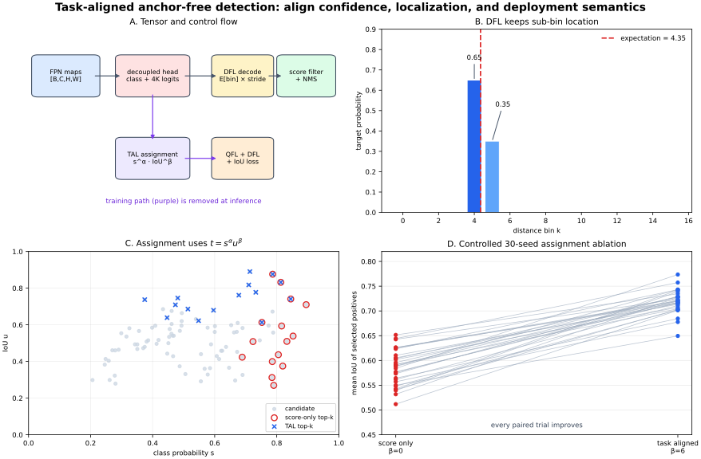
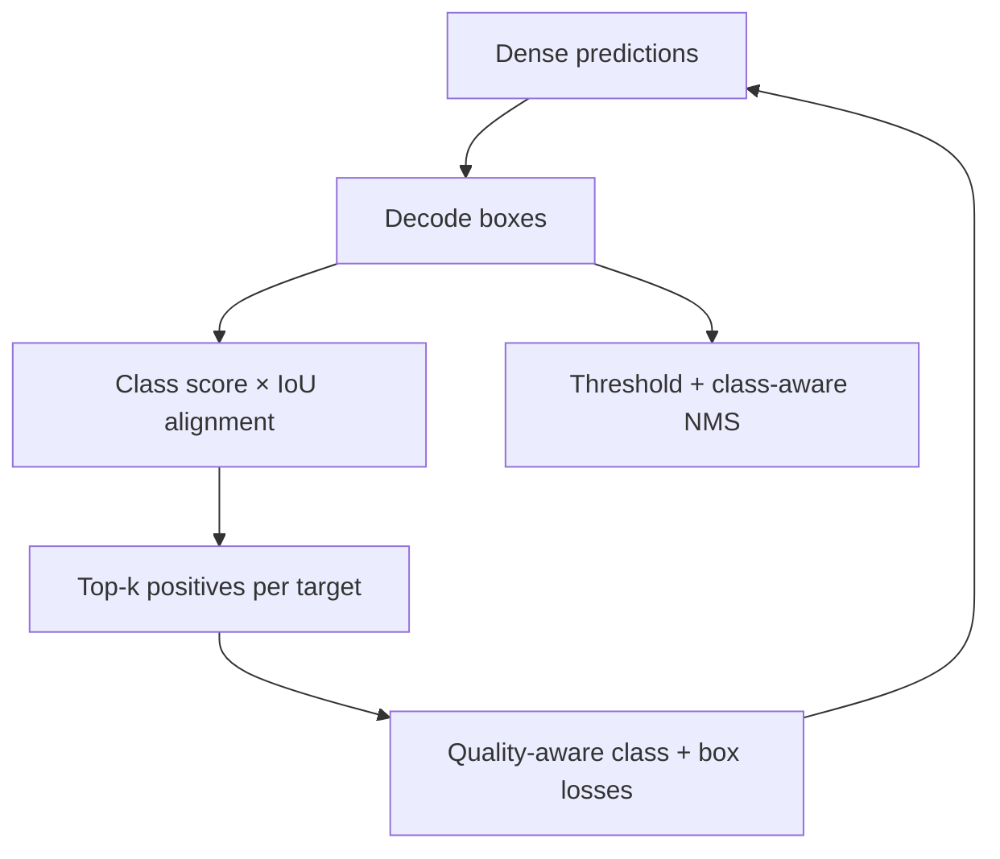

# Task-Aligned Anchor-Free Detection: DFL, Quality Scores, Dynamic Assignment, and NMS

**Date:** 2026-10-28  
**Track:** CV → Attention and Detection  
**Level:** advanced  
**Runnable reference:** [NumPy implementation, ablations, and tactile-marker gate](../../examples/task-aligned-anchor-free-detection/)  
**Illustration:** [training/inference flow, DFL target, and assignment ablation](../../assets/task-aligned-anchor-free-detection/tal-dfl-pipeline.svg)

> This lesson is a **sourced engineering synthesis**, not a claim that FCOS, GFL, TOOD, and a current YOLO implementation are one paper. FCOS supplies the anchor-free point-to-box geometry; GFL supplies Quality Focal Loss (QFL) and Distribution Focal Loss (DFL); TOOD supplies Task Alignment Learning (TAL); contemporary dense detectors often combine close variants of these ideas. Every section labels paper claims, implementation choices, interpretations, and unknowns.



## 0. What an engineer should retain

A modern one-stage detector is not merely “a CNN that outputs boxes.” It is a tightly coupled system with four semantics that must agree:

1. **Geometry:** each feature-grid point predicts distances to four box sides.
2. **Representation:** each distance can be a probability distribution over bins, decoded by expectation.
3. **Training assignment:** a grid point is positive when its current class score and localization quality agree, not merely because it is near an object center.
4. **Inference ranking:** the score used by thresholding and non-maximum suppression should mean “correct class *and* well localized.”

The crucial failure is **task misalignment**. A location may be highly confident but poorly localized, while a neighboring location predicts a much better box with a slightly lower class score. If training selects the first and NMS ranks by the same misleading score, the detector reinforces and then deploys the wrong candidate.

The compact design studied here is:

\[
\boxed{
\text{FPN features}
\rightarrow
\begin{cases}
\text{class/quality logits}\\
4K\text{ distance logits}
\end{cases}
\xrightarrow{\text{TAL during training}}
\xrightarrow{\text{DFL expectation at inference}}
\text{boxes + scores}
\xrightarrow{\text{NMS}}
\text{detections}
}
\]

## 1. Evidence vocabulary

This lesson uses four labels deliberately:

- **Paper says** — stated by an original paper or its authors' official code.
- **Implementation says** — observed in a cited current implementation; it may differ from the paper.
- **My interpretation** — an engineering explanation or consequence derived from the sources.
- **Unknown** — not established by the cited evidence, or dependent on an unreported deployment choice.

These labels matter because “modern YOLO head” is not a stable mathematical specification. Model families reuse names while changing assignment, loss normalization, head topology, export graphs, and post-processing.

## 2. Research problem

Given an image tensor

\[
I\in\mathbb{R}^{B\times 3\times H\times W},
\]

predict a variable-length set

\[
\mathcal D_b=\{(\hat b_i,\hat c_i,\hat q_i)\}_{i=1}^{N_b}
\]

for every batch element \(b\), where:

- \(\hat b_i=(x_1,y_1,x_2,y_2)\in\mathbb{R}^4\) is an image-coordinate box;
- \(\hat c_i\in\{0,\ldots,C-1\}\) is a class;
- \(\hat q_i\in[0,1]\) is the ranking confidence;
- \(N_b\) is not fixed.

The difficulty is not only learning \(\hat b\) and \(\hat c\). A dense detector emits thousands of candidates. Training must decide which candidates are positives, and inference must rank and suppress them. Those discrete decisions affect what the network learns.

### 2.1 The multi-task conflict

Classification prefers features invariant to exact object extent. Localization prefers features sensitive to borders and scale. A single spatial location can therefore have:

- high semantic confidence \(s\) but low box IoU \(u\);
- moderate \(s\) but high \(u\);
- high values for both;
- low values for both.

Detection needs the third case. Ranking by \(s\) alone cannot distinguish the first from the third.

### 2.2 The representation conflict

A scalar box distance says only “the answer is 4.35.” A categorical distribution can also express whether evidence is concentrated near 4–5 or ambiguous across several plausible edges. DFL does not guarantee calibrated uncertainty, but it gives the head capacity to represent more than a Dirac-like point estimate.

### 2.3 The deployment conflict

Training may use assignment, IoU matrices, and losses; inference does not. An exported engine usually needs only:

1. feature extraction and head logits;
2. sigmoid/softmax and DFL expectation;
3. point-distance box decoding;
4. score filtering and NMS.

Putting training-only assignment into ONNX is unnecessary. Omitting or changing coordinate and score semantics during export is dangerous.

## 3. Motivation and prior limitations

### 3.1 Hand-designed anchors

Anchor-based detectors attach several template boxes to each feature point. This introduces ratios, scales, matching thresholds, and many near-duplicate candidates.

**Paper says (FCOS):** FCOS formulates detection per pixel, analogous to semantic segmentation, and removes predefined anchors and their sensitive hyperparameters. It uses feature-pyramid levels to handle scale and predicts four distances from a location to a target box.

**My interpretation:** “anchor-free” does not mean “prior-free.” The detector still assumes a feature pyramid, strides, receptive fields, point placement, scale ranges, and a positive-assignment rule. It removes template rectangles, not design choices.

### 3.2 Binary class target plus a separate quality branch

A traditional detector may train a class probability \(p(c\mid x)\) and a separate centerness or IoU score, then multiply them at inference.

**Paper says (GFL):** separately trained classification and localization-quality signals can be used inconsistently between training and inference. GFL merges localization quality into the class vector so that the deployed class score is quality-aware.

**My interpretation:** the desired ranking score is closer to “probability that this class prediction is usable at this geometry” than pure semantic presence.

### 3.3 Scalar regression as a single-point target

Smooth L1 and IoU losses can regress a scalar distance directly. They do not require discretization, but they offer no explicit multi-bin representation.

**Paper says (GFL):** a Dirac-delta-style localization representation is inflexible in ambiguous scenes; GFL represents each coordinate with a distribution and introduces DFL to supervise continuous targets.

**Unknown:** a broad DFL output is not automatically a calibrated posterior. Calibration requires separate evidence and evaluation.

### 3.4 Static positive assignment

Center sampling or fixed IoU thresholds choose positives without considering whether the current classifier and regressor agree at that location.

**Paper says (TOOD):** parallel classification and localization branches can be spatially misaligned. TOOD proposes a task-alignment metric and task-aligned loss to pull the optimal anchors for both tasks together.

**My interpretation:** assignment is a latent curriculum. Early predictions determine which samples receive stronger supervision; the supervision then changes later predictions.

## 4. Key insight

Use a common quality concept throughout training and inference:

- the **assignment metric** rewards locations whose class confidence and IoU agree;
- the **classification target** contains localization quality;
- the **box head** represents each side as a distribution;
- the **inference score** ranks candidates by the learned joint signal;
- **NMS** resolves the remaining discrete duplicates.

This creates a more coherent loop:



The loop is active only during training; the bottom inference edge is active at deployment.

## 5. Method: module reconstruction

Assume an FPN with levels \(l\in\{3,4,5\}\), strides \(s_l\in\{8,16,32\}\), and shapes \((H_l,W_l)\). Let

\[
A=\sum_l H_lW_l
\]

be the total number of feature points. Let \(K\) be the number of distance bins and \(C\) the number of classes.

| Module | Input | Output | Purpose |
|---|---|---|---|
| backbone + FPN | \([B,3,H,W]\) | list of \([B,D,H_l,W_l]\) | multi-scale visual features |
| class tower | each FPN map | \([B,C,H_l,W_l]\) | quality-aware class logits |
| regression tower | each FPN map | \([B,4K,H_l,W_l]\) | four categorical distance distributions |
| flatten/concatenate | per-level logits | class \([B,A,C]\), box \([B,A,4,K]\) | one dense candidate axis |
| DFL decode | box logits | \([B,A,4]\) feature-unit distances | expectation over bins |
| geometric decode | points \([A,2]\), stride \([A]\), distances | boxes \([B,A,4]\) in image pixels | restore \(xyxy\) geometry |
| TAL assigner, training only | scores, decoded boxes, points, GT | targets and foreground mask | choose positives dynamically |
| losses, training only | logits, targets, mask | scalar objective | update model parameters |
| threshold + NMS | boxes and class scores | at most \(N_{max}\) detections | suppress duplicates |

### 5.1 Precision, modality, and coordinate flow

| Stage | Modality | Coordinates | Typical precision | Important invariant |
|---|---|---|---|---|
| input | RGB, RGB-D image channel subset, or tactile image | pixels after resize/letterbox | UINT8 → FP16/FP32 | preprocessing matches training |
| FPN | latent visual tensors | implicit grids | FP16/FP32 | stride attached to every level |
| point generation | numeric metadata | image pixels \((x,y)\) | FP32 | half-cell offset is consistent |
| DFL logits | categorical distances | feature units | FP16/FP32 | bin axis stays last/known |
| decoded boxes | geometry | image \(xyxy\) pixels | preferably FP32 for assignment | distances multiplied by correct stride |
| GT | labels + boxes | same resized image frame | integer + FP32 | no normalized/pixel mixing |
| NMS output | instances | resized frame, then inverse transform | FP16/FP32 | undo padding and scale once |

No temporal state is required. In video, tracking or filtering is a downstream consumer; the detector independently processes each frame unless a temporal backbone is added.

## 6. Mathematics

### 6.1 Feature points

For feature level \(l\), row \(i\), and column \(j\), place the point at the cell center:

\[
p_{lij}=\left((j+\delta)s_l,(i+\delta)s_l\right),\qquad \delta=\tfrac12.
\]

Symbol by symbol:

- \(i\in\{0,\ldots,H_l-1\}\): feature row;
- \(j\in\{0,\ldots,W_l-1\}\): feature column;
- \(s_l\): pixels per feature step;
- \(\delta\): within-cell offset;
- \(p_{lij}\in\mathbb R^2\): image-coordinate point.

For stride 8, the first point is \((4,4)\), not \((0,0)\). A half-cell mismatch shifts every decoded box.

### 6.2 Point-to-box distances

Given a target box \(b=(x_1,y_1,x_2,y_2)\) and point \(p=(p_x,p_y)\), the feature-unit targets are

\[
\begin{aligned}
l^*&=\frac{p_x-x_1}{s}, & t^*&=\frac{p_y-y_1}{s},\\
r^*&=\frac{x_2-p_x}{s}, & b^*&=\frac{y_2-p_y}{s}.
\end{aligned}
\]

All four are positive exactly when the point lies inside the box. Decoding reverses the transform:

\[
\hat b=\left(p_x-s\hat l,\ p_y-s\hat t,\ p_x+s\hat r,\ p_y+s\hat b\right).
\]

**Numerical example.** Let \(p=(40,24)\), \(s=8\), and target distances \((2.0,1.0,3.5,2.5)\). Pixel distances are \((16,8,28,20)\), so

\[
\hat b=(24,16,68,44).
\]

Encoding that box around the same point and stride returns the original distances.

### 6.3 Distribution Focal Loss

For one side, the head predicts logits

\[
z\in\mathbb R^K.
\]

Softmax produces

\[
q_k=\frac{e^{z_k}}{\sum_{m=0}^{K-1}e^{z_m}},\qquad k=0,\ldots,K-1,
\]

and the continuous decoded distance is the expectation

\[
\hat d=\sum_{k=0}^{K-1}kq_k.
\]

For a target \(d^*\in[i,i+1]\), define

\[
w_i=i+1-d^*,\qquad w_{i+1}=d^*-i.
\]

The weights are nonnegative and sum to one. DFL is

\[
\mathcal L_{DFL}(z,d^*)=-w_i\log q_i-w_{i+1}\log q_{i+1}.
\]

#### Why the two-bin target reconstructs the scalar

At the cross-entropy optimum, \(q_i=w_i\), \(q_{i+1}=w_{i+1}\), and other bins are zero. Therefore

\[
\begin{aligned}
\mathbb E[k]
&=i(i+1-d^*)+(i+1)(d^*-i)\\
&=i(i+1)-id^*+(i+1)d^*-i(i+1)\\
&=d^*.
\end{aligned}
\]

So the representation is discrete, but its expectation is continuous.

#### Numerical example

Let \(d^*=4.35\). Then \(i=4\),

\[
w_4=5-4.35=0.65,\qquad w_5=4.35-4=0.35.
\]

The ideal distribution has \(q_4=0.65\), \(q_5=0.35\), and

\[
\hat d=4(0.65)+5(0.35)=4.35.
\]

A hard nearest-bin target would decode to 4 and incur 0.35 feature cells of quantization error. At stride 16, that is 5.6 pixels.

**My interpretation:** the expectation is differentiable and sub-bin accurate; a wider learned distribution can signal ambiguity to diagnostics. It does not prove probabilistic calibration.

### 6.4 Quality Focal Loss

Let \(y\in[0,1]\) be the quality target for one class—commonly zero for background and IoU-like for a positive. Let \(p=\sigma(z)\). GFL's binary QFL form is

\[
\mathcal L_{QFL}(p,y)=|y-p|^\gamma\left[-y\log p-(1-y)\log(1-p)\right].
\]

Where:

- \(z\in\mathbb R\): class logit;
- \(p\in(0,1)\): sigmoid output;
- \(y\): continuous class-quality target;
- \(\gamma\ge0\): focusing exponent.

The bracket is binary cross-entropy with a soft target. The factor \(|y-p|^\gamma\) suppresses already matched examples. When \(p=y\), the factor is zero for \(\gamma>0\).

For a positive with IoU 0.81, the target for its class can be 0.81 rather than 1.0. A perfectly classified but badly localized candidate is therefore not trained toward the same deployed score as a well-localized one.

### 6.5 Task-alignment metric

TOOD defines

\[
t=s^\alpha u^\beta,
\]

where:

- \(s\in[0,1]\): predicted probability for the ground-truth class;
- \(u\in[0,1]\): IoU between decoded prediction and ground truth;
- \(\alpha\): semantic emphasis;
- \(\beta\): localization emphasis;
- \(t\): alignment score.

For each ground truth, the assigner:

1. computes \(t\) for candidate points;
2. rejects points outside the ground-truth box in the anchor-free case;
3. keeps the top \(k\) candidates;
4. resolves a point selected by multiple targets using the largest IoU.

The official TOOD reference uses \(\alpha=1\), \(\beta=6\) in its assigner defaults.

#### Numerical score/localization conflict

Consider three candidates for one target:

| candidate | class score \(s\) | IoU \(u\) | \(s\,u^6\) |
|---:|---:|---:|---:|
| 0 | 0.99 | 0.25 | 0.000242 |
| 1 | 0.72 | 0.81 | 0.2033 |
| 2 | 0.82 | 0.6807 | about 0.0818 |

Score-only top-1 selects candidate 0. Task alignment selects candidate 1. The sixth power is intentionally severe: a high semantic score cannot easily compensate for poor geometry.

**Failure implication:** early in training, \(u\) may be unreliable. Dynamic assignment must be monitored; some detector families use warm-up or different early assigners.

### 6.6 IoU and Complete IoU

For boxes \(A\) and \(B\),

\[
IoU(A,B)=\frac{|A\cap B|}{|A\cup B|}.
\]

IoU gives no gradient signal when boxes do not overlap. Complete IoU adds center-distance and aspect-ratio terms:

\[
CIoU=IoU-\frac{\rho^2(c_A,c_B)}{d^2}-\eta v,
\]

with

\[
v=\frac{4}{\pi^2}\left(\arctan\frac{w_B}{h_B}-\arctan\frac{w_A}{h_A}\right)^2,
\qquad
\eta=\frac{v}{1-IoU+v}.
\]

- \(c_A,c_B\): box centers;
- \(\rho^2\): squared Euclidean center distance;
- \(d^2\): squared diagonal of the smallest enclosing box;
- \(w,h\): widths and heights;
- \(v\): aspect-ratio disagreement.

A common box objective is a weighted combination

\[
\mathcal L_{box}=\lambda_{IoU}(1-CIoU)+\lambda_{DFL}\sum_{q\in\{l,t,r,b\}}\mathcal L_{DFL}^{(q)}.
\]

DFL supervises each side distribution; CIoU supervises the decoded box as a whole. They are complementary, not interchangeable.

### 6.7 Non-maximum suppression

For one class:

1. sort candidates by score descending;
2. retain the highest remaining candidate;
3. remove remaining boxes whose IoU with it exceeds threshold \(\tau\);
4. repeat.

Class-aware NMS runs this per class. Class-agnostic NMS can suppress two overlapping objects of different classes. Conversely, class-aware NMS can retain duplicate geometry when the classifier assigns different labels.

**Unknown:** no universal NMS threshold exists. It changes precision/recall, crowd behavior, latency, and the number of downstream instances.

## 7. End-to-end training flow

For a batch:

1. Resize or letterbox images and transform boxes to the same frame.
2. Run backbone and FPN.
3. Emit class logits \([B,A,C]\) and distance logits \([B,A,4,K]\).
4. Decode distance expectations and then \(xyxy\) boxes.
5. Under `no_grad`, compute pairwise candidate/GT IoU and task-alignment metrics.
6. Select top-k positives per target and resolve conflicts.
7. Create quality-aware class targets \([B,A,C]\), foreground mask \([B,A]\), box targets \([B,A,4]\), and DFL side targets \([B,A,4]\).
8. Compute classification loss over dense points and box losses over foreground points.
9. Normalize carefully—usually by a positive-quality sum or foreground count with an epsilon.
10. Backpropagate through the head, FPN, and backbone; do not backpropagate through the discrete assignment itself.

### 7.1 Minimal PyTorch shape skeleton

This skeleton shows tensor plumbing, not a full detector:

```python
# features[l]: [B, D, H_l, W_l]
cls_levels, reg_levels = [], []
for f in features:
    cls_levels.append(cls_head(f))       # [B, C, H_l, W_l]
    reg_levels.append(reg_head(f))       # [B, 4*K, H_l, W_l]

cls_logits = torch.cat([
    x.flatten(2).transpose(1, 2) for x in cls_levels
], dim=1)                                # [B, A, C]

reg_logits = torch.cat([
    x.view(B, 4, K, -1).permute(0, 3, 1, 2) for x in reg_levels
], dim=1)                                # [B, A, 4, K]

prob = reg_logits.softmax(dim=-1)
bins = torch.arange(K, device=prob.device, dtype=prob.dtype)
distance = (prob * bins).sum(dim=-1)     # [B, A, 4], feature units
boxes = dist2bbox(points, distance, stride)  # [B, A, 4], image pixels
```

Never infer the bin axis from convenience. A wrong `view` can silently mix sides, bins, points, or levels while preserving element count.

## 8. Runnable reference implementation

The companion code deliberately uses NumPy so every operation is inspectable:

| File | Role |
|---|---|
| [`detector_math.py`](../../examples/task-aligned-anchor-free-detection/detector_math.py) | grids, box encoding/decoding, DFL, QFL, IoU/CIoU, TAL, NMS |
| [`synthetic_scene.py`](../../examples/task-aligned-anchor-free-detection/synthetic_scene.py) | deterministic assignment and tactile-marker cases |
| [`demo.py`](../../examples/task-aligned-anchor-free-detection/demo.py) | DFL and 30-seed TAL ablations |
| [`application.py`](../../examples/task-aligned-anchor-free-detection/application.py) | detection → NMS → marker motion → safety gate |
| [`checks.py`](../../examples/task-aligned-anchor-free-detection/checks.py) | 28 numerical and behavioral checks |
| [`make_figure.py`](../../examples/task-aligned-anchor-free-detection/make_figure.py) | original SVG generation |
| [`VALIDATION.md`](../../examples/task-aligned-anchor-free-detection/VALIDATION.md) | commands and executed outputs |

Run:

```bash
cd CV/examples/task-aligned-anchor-free-detection
python checks.py
python demo.py
python application.py
MPLBACKEND=Agg python make_figure.py
```

The code is a mathematical reference, not an optimized COCO trainer and not a reimplementation of a named commercial YOLO release.

## 9. Experiments and evidence

### 9.1 What the papers report

| Source | Paper says | Boundary on interpretation |
|---|---|---|
| FCOS | 44.7 AP for its reported ResNeXt-64x4d-101 single-model, single-scale setting | not a claim about this NumPy reference |
| GFL | 45.0 AP with ResNet-101 under the paper's comparison setting; its best reported model reaches 48.2 AP and 10 FPS on one 2080 Ti | hardware, backbone, schedule, and implementation matter |
| TOOD | 51.1 AP single-model, single-scale; the abstract compares against ATSS 47.7, GFL 48.2, and PAA 49.0 with fewer parameters/FLOPs | these are the authors' reported settings, not a new reproduction |

Do not arrange these numbers as a simple chronological leaderboard: the configurations are not identical.

### 9.2 Executed DFL representation ablation

We sampled 5,000 continuous distances uniformly over \([0,15]\) and compared:

- hard nearest-bin decoding;
- the expectation of the ideal two-bin DFL target.

| Measure | Hard bin | Two-bin expectation |
|---|---:|---:|
| mean absolute error | 0.250938660098 | 0.000000000000 |
| maximum absolute error | 0.499755792910 | 0.000000000000 |

**What this establishes:** two-bin interpolation can represent an in-range continuous target exactly in expectation.

**What it does not establish:** a trained network will predict the ideal distribution, improve COCO AP, or produce calibrated uncertainty.

### 9.3 Executed task-alignment ablation

Thirty deterministic seeds generated three separated targets and 32 candidates per target. Classification confidence was only weakly correlated with localization. Both variants selected top-5 inside points:

| Assignment | Mean IoU of selected positives |
|---|---:|
| score-only, \(\beta=0\) | 0.585848 |
| task-aligned, \(\beta=6\) | 0.719097 |

- paired median gain: **0.125664 IoU**;
- task-aligned assignment won **30/30** trials.

This is a controlled mechanism test, not a detector benchmark. It verifies that the implementation selects geometrically stronger positives when the metric is given reliable IoU predictions.

### 9.4 Integrated visual-tactile marker application

A synthetic tactile sensor contains 12 marker identities. The detector produces three dense duplicates per marker plus a false proposal. The application:

1. applies class-aware NMS;
2. retains the highest score per marker identity;
3. computes center displacement from a reference frame;
4. estimates global motion by the coordinate-wise median;
5. gates deployment using support and the 90th percentile motion residual.

Healthy case:

- support: 12 markers;
- estimated motion: \((2.4502,-1.3682)\) px;
- error from planted motion: **0.0847 px**;
- residual p90: **0.3600 px**;
- gate: **accept**.

Corrupted case with four spatially inconsistent markers:

- support: 12 markers;
- residual p90: **5.9383 px**;
- gate: **reject**.

The important engineering point is that high support and confidence are insufficient. A downstream geometric-consistency gate catches a failure that NMS cannot.

## 10. Reproduction and validation plan

### 10.1 Mathematical unit tests

The provided 28 checks cover:

- stable sigmoid and softmax;
- DFL normalization, endpoints, interpolation, expectation, decoding, and loss;
- feature-point count and half-cell coordinates;
- box/distance round trips;
- IoU symmetry, disjointness, and CIoU center penalty;
- QFL matched and wrong-confidence behavior;
- TAL microcase and multi-GT conflict resolution;
- single-class and class-aware NMS;
- DFL and TAL controlled ablations;
- healthy/corrupted tactile gate behavior.

### 10.2 Full detector reproduction

For a publishable reproduction rather than a mechanism check:

1. Choose one exact codebase and commit; record license and dependency versions.
2. Use the paper's stated backbone, input scale, augmentation, schedule, optimizer, and EMA policy.
3. Confirm annotation conversion and crowd/ignore handling.
4. Unit-test point generation and inverse letterbox transforms on hand-computed boxes.
5. Log positive counts per level, mean positive IoU, DFL entropy, class/box loss scales, and empty-GT batches.
6. Evaluate with the official COCO evaluator, including AP, AP50, AP75, and small/medium/large breakdowns.
7. Run at least three seeds if comparing assignment or loss changes.
8. Benchmark preprocessing, engine, decode, NMS, and transfer separately on deployment hardware.
9. Save raw predictions so changes in thresholds and NMS can be re-evaluated without rerunning the network.

### 10.3 High-value ablations

| Ablation | Hold constant | Question |
|---|---|---|
| scalar distance vs DFL | backbone, assignment, IoU loss, schedule | does distributed regression help beyond capacity change? |
| \(K=8,16,32\) | maximum physical range and loss weight | accuracy/latency/memory tradeoff |
| \(\beta=0,2,4,6,8\) | \(\alpha\), top-k, seed | sensitivity to localization emphasis |
| top-k 5, 10, 13, 20 | all losses | positive density and recall |
| IoU vs CIoU in alignment | class scores and candidates | conflict resolution behavior |
| QFL vs binary BCE | assignment and regression | ranking/localization calibration |
| class-aware vs agnostic NMS | raw outputs | cross-class suppression errors |
| FP32 vs FP16 vs INT8 head | identical engine graph | numeric and latency impact |

## 11. Failure modes

### 11.1 Bootstrap instability

TAL uses current predictions to create targets. Early boxes are poor; high \(\beta\) can make a few accidental overlaps dominate.

Mitigations: assignment warm-up, minimum positive guarantees, gradient-free assignment, monitoring per-level positive counts, and conservative top-k.

### 11.2 Tiny objects below stride support

An object may contain no point at a coarse level, or only one unstable point at the finest level. DFL cannot restore spatial evidence removed by downsampling.

Mitigations: add a lower-stride feature level, increase input resolution, use crop/tiling, or formulate the target as keypoint/segmentation when that is a better fit.

### 11.3 Crowds and overlapping targets

A point selected by multiple targets receives only one assignment. Highest-IoU conflict resolution is locally sensible but can starve a nearby object.

Mitigations: inspect per-instance positive counts, increase candidate density, and consider set-based detectors or specialized crowd objectives.

### 11.4 Truncated distance range

With \(K\) bins, a side distance is bounded by roughly \((K-1)s\) unless another scaling parameter is used. Clipping creates biased boxes near the limit.

Mitigations: appropriate FPN scale routing, larger \(K\), learned scale factors, and assertions on target clipping rates.

### 11.5 Quality score is not calibrated probability

QFL changes ranking semantics, but a score of 0.8 need not mean an 80% chance of a correct detection.

Mitigations: reliability diagrams stratified by class and scale, temperature/isotonic calibration on held-out data, and downstream safety gates.

### 11.6 NMS is greedy

Greedy suppression can remove a true object in a crowd or retain duplicate boxes just below threshold.

Mitigations: tune by scenario, consider soft-NMS or learned/set-based alternatives, and evaluate instance-count errors—not AP alone.

### 11.7 Coordinate-frame mistakes

Common silent bugs include \(xywh\) versus \(xyxy\), normalized versus pixel units, wrong stride per level, wrong half-cell offset, and inverse letterbox applied twice.

Mitigation: round-trip tests with boxes whose answer is known analytically. The companion implementation includes this.

### 11.8 Domain shift

Specular surgery, transparent objects, event cameras, or tactile elastomer illumination may have statistics far from natural-image pretraining.

Mitigations: domain-specific augmentation, held-out device/patient/environment evaluation, uncertainty or consistency gates, and periodic recalibration.

## 12. Complexity and deployment

### 12.1 Head output size

For a 640×640 input with strides 8, 16, and 32:

\[
A=80^2+40^2+20^2=8400.
\]

With \(C=80\) and \(K=16\):

\[
8400(80+4\cdot16)=1{,}209{,}600
\]

raw scalar outputs per image.

- FP32: about 4.84 MB;
- FP16: about 2.42 MB;
- before temporary softmax, decode, or NMS buffers.

Increasing \(K\) linearly increases regression-head output bandwidth and parameters in the final convolution.

### 12.2 Assignment and NMS cost

For \(A\) points and \(G\) ground truths, dense IoU/alignment construction costs \(O(AG)\) time and memory during training. Assignment is absent at inference.

Naive NMS over \(M\) candidates is worst-case \(O(M^2)\). Score thresholding and pre-NMS top-k are therefore latency controls, not cosmetic options.

### 12.3 ONNX export

DFL decode maps cleanly to standard operators:

```text
reshape [B,A,4,K]
→ Softmax(axis=K)
→ multiply by constant [0,...,K-1]
→ ReduceSum(axis=K)
→ distance-to-box arithmetic
```

Export checklist:

- freeze \(K\), class count, point offset, and stride ordering;
- expose decoded boxes and scores if NMS is external;
- or export an end-to-end graph only when the runtime's NMS semantics are verified;
- test dynamic batch and image profiles explicitly;
- compare raw logits, decoded distances, boxes, and final detections—not only final count.

### 12.4 TensorRT and Jetson

NVIDIA's TensorRT repository includes an EfficientNMS plugin. Plugin version, coordinate convention, background-class handling, score activation, `topK`, and `keepTopK` must match the exported model.

Practical Jetson path:

1. keep backbone/FPN/head in TensorRT;
2. fuse DFL softmax and expectation when the exporter/runtime permits;
3. use FP16 first;
4. prefilter scores before NMS;
5. benchmark engine compute, decode, NMS, and CPU/GPU transfers separately;
6. lock clocks and record power mode for reproducible timing.

**Implementation says:** current Ultralytics source has a `TaskAlignedAssigner`, a DFL loss, CIoU box loss, and DFL expectation decode. This is evidence of contemporary integration, not proof that every model called YOLO uses the same equations or defaults.

### 12.5 Quantization

INT8 can be effective for the backbone and towers, but the regression head contains sensitive relative logits. Small per-bin logit perturbations can shift the expected distance.

Recommended evaluation:

- calibrate with hard examples spanning object scales and lighting;
- compare per-side distance error before box decoding;
- consider leaving final regression logits, softmax, expectation, and NMS in FP16;
- measure AP75 and small-object AP, which may expose localization damage earlier than overall AP;
- never infer safety from throughput alone.

**Unknown:** the best precision split is model-, calibrator-, runtime-, and device-specific.

## 13. Application patterns

### Robotics and VLA

Detections can become object tokens for a planner, but a language model should receive coordinate-frame metadata, camera calibration, timestamp, and quality—not only labels. Use geometric tracking and reachability gates before action.

### Visual-tactile sensing

Dense detectors can localize markers, contact regions, slip cues, or tool features. The companion example demonstrates a crucial pattern: detector confidence is followed by multi-marker motion consistency before a control signal is accepted.

### Surgical imaging

Small instruments, smoke, specularities, blood, and partial visibility stress assignment and NMS. Per-procedure calibration, temporal consistency, class-specific thresholds, and patient-level validation are necessary. A paper's COCO AP is not clinical evidence.

### Industrial inspection

DFL can help represent sub-cell edge locations, while TAL can prioritize predictions that are both semantically and geometrically credible. For repetitive arrays or identical parts, NMS and instance counting need task-specific validation.

## 14. Paper says / inference / interpretation / unknown summary

| Statement | Status |
|---|---|
| Per-pixel anchor-free distance regression removes predefined anchor boxes | **Paper says — FCOS** |
| Joint class-quality targets and distributed box coordinates address representation inconsistencies | **Paper says — GFL** |
| \(t=s^\alpha u^\beta\) and top-k assignment align classification and localization | **Paper says — TOOD** |
| A combined FCOS + QFL/DFL + TAL + CIoU pipeline is one canonical paper algorithm | **False; this lesson is a synthesis** |
| DFL expectation gives sub-bin coordinates | **Derivation; verified in code** |
| A wide DFL distribution is calibrated uncertainty | **Unknown** |
| TAL always improves real-dataset AP | **Unknown; requires controlled training** |
| FP16/INT8 improves Jetson latency without accuracy loss | **Unknown until measured on the exact engine** |
| Detection confidence alone is sufficient for tactile control | **Rejected by the integrated failure case** |

## 15. Primary sources and official implementations

1. Z. Tian, C. Shen, H. Chen, and T. He, **“FCOS: Fully Convolutional One-Stage Object Detection,”** ICCV 2019. [arXiv:1904.01355](https://arxiv.org/abs/1904.01355) · [authors' repository](https://github.com/tianzhi0549/FCOS)
2. X. Li et al., **“Generalized Focal Loss: Learning Qualified and Distributed Bounding Boxes for Dense Object Detection,”** NeurIPS 2020. [arXiv:2006.04388](https://arxiv.org/abs/2006.04388) · [NeurIPS proceedings](https://proceedings.neurips.cc/paper/2020/hash/f0bda020d2470f2e74990a07a607ebd9-Abstract.html)
3. C. Feng et al., **“TOOD: Task-aligned One-stage Object Detection,”** ICCV 2021. [arXiv:2108.07755](https://arxiv.org/abs/2108.07755) · [authors' repository](https://github.com/fcjian/TOOD) · [official assigner source](https://github.com/fcjian/TOOD/blob/master/mmdet/core/bbox/assigners/task_aligned_assigner.py)
4. Z. Zheng et al., **“Distance-IoU Loss: Faster and Better Learning for Bounding Box Regression,”** AAAI 2020. [arXiv:1911.08287](https://arxiv.org/abs/1911.08287)
5. Ultralytics, **current open-source task-aligned assignment and detection loss implementation.** [assignment source](https://github.com/ultralytics/ultralytics/blob/main/ultralytics/utils/tal.py) · [DFL/box loss source](https://github.com/ultralytics/ultralytics/blob/main/ultralytics/utils/loss.py)
6. NVIDIA, **TensorRT EfficientNMS plugin source and documentation.** [official repository path](https://github.com/NVIDIA/TensorRT/tree/main/plugin/efficientNMSPlugin)

**Source availability note:** the GFL paper points to `implus/GFocal`; the repository endpoint was not available when this lesson was prepared. The paper and NeurIPS proceedings remain the primary mathematical sources. That availability issue should not be silently replaced by an unofficial fork.

## 16. Final engineering checklist

- [ ] Points use the intended half-cell offset and per-level stride.
- [ ] Distances are feature units until exactly one stride multiplication.
- [ ] DFL tensor layout is explicitly \([B,A,4,K]\).
- [ ] Targets near \(K-1\) are clipped consistently with the loss.
- [ ] Assignment runs without gradient and handles empty GT batches.
- [ ] Positive count and mean positive IoU are logged per FPN level.
- [ ] Class score semantics match training and inference.
- [ ] NMS is deliberately class-aware or class-agnostic.
- [ ] Letterbox scaling/padding is inverted once.
- [ ] ONNX/TensorRT outputs match framework intermediates numerically.
- [ ] Quantization is evaluated on localization metrics, not only top-1 labels.
- [ ] Robotics, tactile, or surgical consumers add domain-specific consistency and safety gates.

The transferable lesson is simple: **a detector is reliable only when its representation, assignment, loss, ranking, geometry, and deployment graph agree.**
