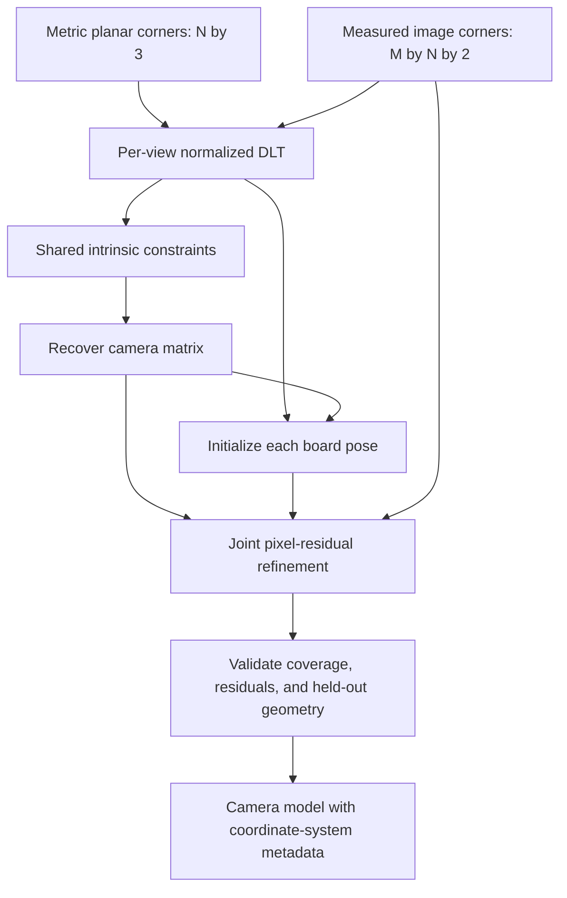
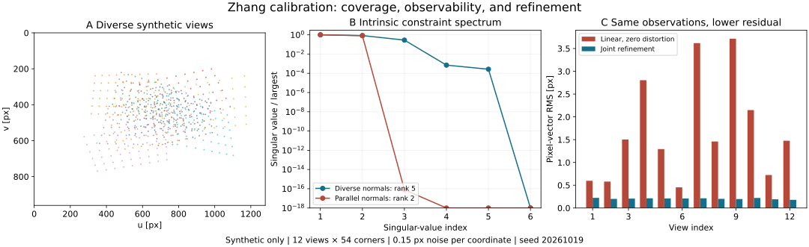

# Zhang Camera Calibration: From Planar Homographies to Metric Rays

Date: 2026-10-19 · Category: Geometry and Calibration · Level: advanced foundations

[Category index](README.md) · [CV index](../../README.md) · [Runnable implementation](../../examples/zhang-camera-calibration/) · [Executed validation](../../examples/zhang-camera-calibration/VALIDATION.md)

## Reading map and evidence labels

This lesson returns to geometry after [deformable attention](../attention-and-detection/2026-10-17-deformable-attention.md) and [RAFT](../video-and-motion/2026-10-18-raft-optical-flow.md). A learned correspondence or optical-flow field still lives in a particular pixel coordinate system. Converting it into a robot ray, a fixture location, or a metric motion estimate requires the camera model and preprocessing geometry to agree.

The central question is not “which function returns a camera matrix?” It is “which observations make that matrix identifiable, and what assumptions turn a small residual into a trustworthy measurement?”

Evidence labels used throughout:

- **Paper says:** a claim attributable to Zhang's original work, with a source location.
- **Inference:** a deduction from a stated mathematical model or the supplied experiments.
- **My interpretation:** an engineering recommendation or explanation, not a claim of experimental validation by the paper.
- **Unknown:** something not established by the sources or by this lesson's execution.

Primary reading: Zhengyou Zhang, [A Flexible New Technique for Camera Calibration, TPAMI 2000](https://www.microsoft.com/en-us/research/publication/a-flexible-new-technique-for-camera-calibration/), with the author's expanded [MSR-TR-98-71 report](https://www.microsoft.com/en-us/research/wp-content/uploads/2016/02/tr98-71.pdf). The report contains later corrections and appendices; it is not byte-for-byte the journal article. The reconstruction and numerical experiments below are independently written educational material, not official author code.

## 1. Research problem

Given several images of one rigid, flat target with known corner coordinates, estimate:

1. The shared camera intrinsics: focal lengths in pixels, principal point, and possibly skew.
2. Lens-distortion parameters under an explicitly chosen model.
3. A separate target-to-camera rotation and translation for each image.

The camera-to-target motions are unknown. The board supplies metric geometry; it does not supply its pose in any image. A single pixel observation supplies two image coordinates, not an independent depth.

**Paper says:** the method uses a planar target, an algebraic initialization, and nonlinear refinement; radial distortion is included. See report §§2–3.

**My interpretation:** calibration is a model-fitting and experiment-design task. It is neither a neural training procedure nor a guarantee that all future images satisfy the fitted model. Focus, zoom, image stabilization, a protective window, temperature, or image resizing can change the effective imaging system.

## 2. Motivation and prior limitations

A precisely manufactured 3D calibration rig is inconvenient. Unconstrained natural images avoid the rig but introduce uncertain geometry and correspondences. A planar metric target is a useful middle ground: inexpensive correspondences plus enough geometric structure to constrain a camera when viewed from informative orientations.

Why not fit a separate image warp for every board image and stop there? A homography can reproduce a planar image without giving physically consistent intrinsics. It absorbs the unknown pose and camera parameters together. A robot needs a common camera model that continues to work when the target moves.

Why not optimize every parameter from arbitrary numbers? Focal length, depth, distortion, and principal point can partially compensate for each other. Nonlinear optimization is local. A plausible algebraic initialization makes the optimization problem much easier, but cannot rescue missing information.

Why not collect many almost identical images? More measurements of the same geometric constraint improve its precision without necessarily adding a new independent constraint. This distinction between sample count and observability is the main lesson.

## 3. Key insight: Euclidean rotations constrain projective warps

A plane-to-image mapping has eight projective degrees of freedom. But its first two columns arise from two columns of a rotation matrix, transformed by the same camera intrinsics. Rotation columns are orthogonal and have equal unit length. Undoing the correct intrinsics must restore those relationships.

Thus each informative planar view contributes two constraints on one shared symmetric matrix encoding the intrinsics. Stack views, solve a small homogeneous linear system, then jointly refine the actual pixel prediction.

**Inference:** the target does not need to translate a known distance. However, its *orientation* must vary enough to reveal the camera metric. Translation alone cannot replace that variation in this initialization.

## 4. Method overview and data contracts



| Module | Input → output | Purpose and convention |
|---|---|---|
| Board generator | inner-corner counts, spacing → [N,3] | Metres; all board Z coordinates are zero; row-major corner order |
| Corner observation | images → [M,N,2] | Continuous pixel coordinates (u,v), u right, v down; consistent corner identities |
| Homography estimator | [N,2] board XY + [N,2] pixels → [3,3] | One projective mapping per view; no distortion in this algebraic stage |
| Intrinsic initializer | [M,3,3] → [3,3] | General five-parameter intrinsic matrix, including skew |
| Pose initializer | homography + intrinsics → rotation [3,3], translation [3] | Board-to-camera, not camera-to-board |
| Joint refiner | all corners, initial camera/poses → camera, distortion, M poses | Zero skew in this implementation; 0, 1, or 2 radial terms |
| Application | pixel + camera model + known plane pose → point [3] | Inverse distortion, ray construction, metric ray-plane intersection |

Here M is the number of images and N the number of corners in each image. This educational implementation uses the same visible corners in every view; real workflows may support varying subsets. There is no temporal model: view order does not matter, and board motion during an exposure violates the rigid-image assumption.

All numerical estimation is NumPy float64. The images would normally be uint8, but a corner location is subpixel floating point, not an integer array index. No modality conversion or learned embedding is involved.

## 5. Mathematics, with local symbol annotations

### 5.1 Projection, frames, and units

First ignore distortion:

$$
\mathbf X_c=R\mathbf X_b+\mathbf t,\qquad
x=X_c/Z_c,\quad y=Y_c/Z_c,\qquad
K=\begin{bmatrix}f_x&\gamma&c_x\\0&f_y&c_y\\0&0&1\end{bmatrix},
\qquad
\begin{bmatrix}u\\v\\1\end{bmatrix}
=K\begin{bmatrix}x\\y\\1\end{bmatrix}.
$$

Symbols immediately above:

- $\mathbf X_b\in\mathbb R^3$: board-frame point in metres; $\mathbf X_c=(X_c,Y_c,Z_c)^T\in\mathbb R^3$: camera-frame point in metres, with positive $Z_c$ in front of the camera.
- $R\in SO(3)$: board-to-camera rotation, dimensionless; $\mathbf t\in\mathbb R^3$: board-origin position in camera coordinates, metres.
- $x,y$: dimensionless normalized image coordinates. $K\in\mathbb R^{3\times3}$: intrinsic matrix. $f_x,f_y>0$: focal lengths in pixels; $\gamma$: skew in pixels; $c_x,c_y$: principal-point coordinates in pixels.
- $u,v$: predicted continuous pixel coordinates; superscript $T$ denotes transpose; $SO(3)$ is the group of orthogonal 3-by-3 matrices with determinant +1.

A focal length in pixels is not a focal length in millimetres. Sensor pitch or equivalent physical information is needed to convert between them.

Small example: with focal lengths 800 and 820 pixels, principal point (320,240), zero skew, and camera point (0.1,0.05,1) metres, normalized coordinates are (0.1,0.05), and the pixel is (400,281). The first validation test checks exactly this calculation.

### 5.2 A plane removes one rotation column

For board points on a plane:

$$
\mathbf q=(X,Y,1)^T,\qquad
\tilde{\mathbf p}=(u,v,1)^T,\qquad
s\tilde{\mathbf p}=H\mathbf q,\qquad
H=K[\,\mathbf r_1\ \mathbf r_2\ \mathbf t\,].
$$

Symbols immediately above:

- $X,Y$: metric board-plane coordinates; $\mathbf q\in\mathbb R^3$: their homogeneous representation, with board Z fixed to zero.
- $u,v$: undistorted pixel coordinates; $\tilde{\mathbf p}\in\mathbb R^3$: homogeneous image point.
- $H\in\mathbb R^{3\times3}$: plane-to-image homography, defined only up to nonzero scale; $s$: point-dependent homogeneous scale.
- $K\in\mathbb R^{3\times3}$: intrinsics; $\mathbf r_1,\mathbf r_2\in\mathbb R^3$: the first two columns of board-to-camera rotation; $\mathbf t\in\mathbb R^3$: translation in board-coordinate length units.

Derivation: the third board coordinate is zero, so its multiplication by the third rotation column contributes nothing. This does not mean the physical third axis is unknown forever: it can be reconstructed from the cross product of the first two rotation columns.

With distortion, one homography no longer maps the board exactly to measured corners. The initial homographies intentionally approximate that relationship.

### 5.3 Estimate each homography by normalized DLT

Cross-multiplying the two pixel ratios yields two linear equations per corner:

$$
\begin{bmatrix}
-X&-Y&-1&0&0&0&uX&uY&u\\
0&0&0&-X&-Y&-1&vX&vY&v
\end{bmatrix}\mathbf h=\mathbf0,\qquad
\hat{\mathbf h}=\underset{\|\mathbf h\|_2=1}{\arg\min}\|D\mathbf h\|_2^2.
$$

Symbols immediately above:

- $X,Y,u,v$: one pair of board and image coordinates, after separate point normalizations in the implemented DLT.
- $\mathbf h=(h_{11},h_{12},h_{13},h_{21},h_{22},h_{23},h_{31},h_{32},h_{33})^T\in\mathbb R^9$: row-wise entries of the normalized homography.
- $D\in\mathbb R^{2N\times9}$: matrix stacking the displayed two-row block for all N paired corners; $\mathbf0$: the two-component zero vector for one block.
- $\hat{\mathbf h}$: estimated unit-norm parameter vector; $\|\cdot\|_2$: Euclidean norm; $\arg\min$: parameter value minimizing the objective.

Implementation detail: center each point set and scale it so its mean Euclidean distance from the origin is the square root of two. This avoids mixing tiny metric coordinates with large pixel coordinates in an unnecessarily ill-scaled linear system. After SVD, undo both normalizations.

Four non-collinear point pairs are the minimum. With exactly four pairs, the design matrix has eight rows and nine columns. A reduced SVD would omit the ninth right-singular vector needed for its nullspace. The code requests the full right basis in that case; the four-point test guards this often-missed bug. For larger inputs it avoids building an unnecessary full left basis.

This algebraic objective is an initialization, not the final image-noise likelihood. Bad corners are not automatically rejected.

### 5.4 Remove pose using rotation orthogonality

$$
B=K^{-T}K^{-1},\qquad
\mathbf h_1^TB\mathbf h_2=0,\qquad
\mathbf h_1^TB\mathbf h_1-\mathbf h_2^TB\mathbf h_2=0.
$$

Symbols immediately above:

- $K\in\mathbb R^{3\times3}$: camera intrinsics; $K^{-1}$: its inverse; $K^{-T}$: transpose of its inverse.
- $B\in\mathbb R^{3\times3}$: symmetric positive-definite matrix representing the image's Euclidean metric, up to positive scale.
- $\mathbf h_1,\mathbf h_2\in\mathbb R^3$: first and second columns of the same homography H, using any consistent nonzero homography scale; $T$: transpose.

Derivation: applying the inverse camera matrix to the homography columns produces the first two rotation columns times one common scale. Their dot product is zero; subtracting their squared lengths eliminates the unknown common scale. Translation disappears.

This is the key elimination: unknown pose does not have to be known before estimating intrinsics.

To make those constraints linear, expand the six independent entries of the symmetric matrix:

$$
\mathbf b=(B_{11},B_{12},B_{22},B_{13},B_{23},B_{33})^T,\qquad
\mathbf v_{ij}=
\begin{bmatrix}
h_{1i}h_{1j}\\
h_{1i}h_{2j}+h_{2i}h_{1j}\\
h_{2i}h_{2j}\\
h_{3i}h_{1j}+h_{1i}h_{3j}\\
h_{3i}h_{2j}+h_{2i}h_{3j}\\
h_{3i}h_{3j}
\end{bmatrix},
\qquad
V\mathbf b=\mathbf0,\quad
V=\operatorname{stack}_{m=1}^{M}
\begin{bmatrix}
\mathbf v_{12}^{(m)T}\\
(\mathbf v_{11}^{(m)}-\mathbf v_{22}^{(m)})^T
\end{bmatrix}.
$$

Symbols immediately above:

- $B_{ab}$: row a, column b of the symmetric intrinsic metric B; $\mathbf b\in\mathbb R^6$: its independent entries in the exact order shown.
- $h_{ai}$: row a, column i of one homography; $i,j\in\{1,2\}$: column indices; $\mathbf v_{ij}\in\mathbb R^6$: coefficient vector satisfying $\mathbf h_i^TB\mathbf h_j=\mathbf v_{ij}^T\mathbf b$.
- $m$: view index; $M$: number of views; superscript $(m)$: quantity from that view. $\operatorname{stack}$: vertical concatenation; $V\in\mathbb R^{2M\times6}$: calibration constraint matrix; $\mathbf0\in\mathbb R^{2M}$: zero vector.

The code uses zero-based column indices, so its vij(H,0,1) is the mathematical vector with indices 1 and 2. Each row is normalized before solving; this is a chosen numerical weighting, not an uncertainty-optimal weighting.

The solution is the right singular vector associated with the smallest singular value. In exact nondegenerate data, V has rank five and one scale nullspace. With noise, it generally has rank six; seek a well-separated approximate null direction rather than demanding exact rank five.

**Paper says:** three views generically suffice for the general intrinsic case; two can be used with an additional zero-skew constraint. See report §3.1. The abstract's “at least two” is not an unconditional guarantee for five unconstrained intrinsic parameters. This implementation deliberately requires at least three views for its general linear initializer.

### 5.5 Recover a physical camera matrix

$$
B=LL^T=U^TU,\qquad U=L^T,\qquad
\tilde K=U^{-1},\qquad
K=\tilde K/\tilde K_{33}.
$$

Symbols immediately above:

- $B\in\mathbb R^{3\times3}$: symmetric matrix reconstructed from the nullspace vector, with its global sign chosen so its bottom-right entry is positive.
- $L\in\mathbb R^{3\times3}$: lower-triangular Cholesky factor with positive diagonal; $U\in\mathbb R^{3\times3}$: its upper-triangular transpose.
- $\tilde K$: unnormalized inverse factor; $\tilde K_{33}$: bottom-right scalar; $K$: normalized intrinsic matrix with bottom-right entry one; $T$ and $-1$: transpose and inverse.

**My interpretation / implementation choice:** this factorization reconstructs the same intrinsic metric without copying a long scalar extraction formula. The arbitrary positive scale of B cancels in the final normalization.

If Cholesky fails, the estimated metric is not positive definite. Do not silently clip its eigenvalues and advertise the resulting camera as measured. It may indicate weak geometry, distortion, bad corner identities, or simply a poor linear start. The example raises an informative error.

Positive definiteness is necessary, not sufficient for trustworthy calibration. A positive camera matrix can still be inaccurate.

### 5.6 Recover poses and project rotations back onto SO(3)

$$
A=K^{-1}H=[\,\mathbf a_1\ \mathbf a_2\ \mathbf a_3\,],\qquad
\lambda=\frac{2}{\|\mathbf a_1\|_2+\|\mathbf a_2\|_2},\qquad
\mathbf t=\lambda\mathbf a_3,
$$

Symbols immediately above:

- $K,H\in\mathbb R^{3\times3}$: intrinsics and one homography; $A\in\mathbb R^{3\times3}$: transformed homography with columns $\mathbf a_1,\mathbf a_2,\mathbf a_3\in\mathbb R^3$.
- $\lambda$: common scale, with its sign flipped if needed to place the board origin in front of the camera; $\|\cdot\|_2$: Euclidean norm; $\mathbf t$: recovered translation in board length units; $-1$: matrix inverse.

Next construct and correct an approximate rotation:

$$
G=[\,\lambda\mathbf a_1\ \lambda\mathbf a_2\
((\lambda\mathbf a_1)\times(\lambda\mathbf a_2))\,]
=U\Sigma W^T,\qquad
R=U\operatorname{diag}(1,1,\det(UW^T))W^T.
$$

Symbols immediately above:

- $\lambda$: signed homography scale above; $\mathbf a_1,\mathbf a_2\in\mathbb R^3$: first two columns of the intrinsic-normalized homography.
- $G\in\mathbb R^{3\times3}$: approximate rotation; $\times$: 3D cross product; $U,\Sigma,W$: its SVD factors, with $\Sigma$ diagonal and nonnegative.
- $R\in SO(3)$: corrected rotation; $\operatorname{diag}$: diagonal-matrix constructor; $\det$: determinant; $T$: transpose.

The SVD correction gives the closest proper rotation in Frobenius norm. Normalizing two columns separately is not enough to make them orthogonal. The determinant correction prevents a reflection.

The board-origin depth sign does not prove every corner has positive depth; project() checks all points. Distortion and image noise make this pose only an initialization.

### 5.7 Add radial distortion in normalized coordinates

$$
r^2=x^2+y^2,\qquad
g=1+k_1r^2+k_2r^4,\qquad
x_d=xg,\quad y_d=yg,\qquad
u=f_xx_d+c_x,\quad v=f_yy_d+c_y.
$$

Symbols immediately above:

- $x,y$: ideal dimensionless camera-normalized coordinates; $r$: normalized radius; $r^4=(r^2)^2$.
- $k_1,k_2$: dimensionless first and second radial-distortion coefficients; $g$: radial scale factor; $x_d,y_d$: distorted normalized coordinates.
- $u,v$: distorted pixel coordinates; $f_x,f_y$: pixel focal lengths; $c_x,c_y$: pixel principal point. Skew is fixed to zero in this displayed model and in joint refinement.

Small example: normalized point (0.5,0), coefficients (-0.2,0.04), gives squared radius 0.25, scale 0.9525, and distorted point (0.47625,0). The optical-axis point stays fixed. The radial test checks both.

Do not feed pixel-radius values into this formula. A radius of hundreds of pixels and a dimensionless radius below one are different quantities; the coefficients would have entirely different meaning.

Why are corner observations near the image center insufficient for distortion? At zero skew:

$$
\frac{\partial (u,v)^T}{\partial k_1}
=r^2\begin{bmatrix}f_xx\\f_yy\end{bmatrix},\qquad
\frac{\partial (u,v)^T}{\partial k_2}
=r^4\begin{bmatrix}f_xx\\f_yy\end{bmatrix}.
$$

Symbols immediately above:

- $u,v$: predicted pixel coordinates; $k_1,k_2$: radial coefficients; $\partial/\partial k_i$: derivative with respect to the indicated scalar coefficient.
- $x,y$: ideal normalized coordinates; $r^2=x^2+y^2$; $r^4$: its square; $f_x,f_y$: focal lengths in pixels.
- Each derivative is a 2-by-1 pixel sensitivity vector; superscript $T$ denotes transpose.

**Inference:** both sensitivities vanish at the center, and the second radial term becomes especially weak at small radius. Repeating many central views can leave edge behavior uncertain even if training residuals look excellent.

This is only a two-term radial model. Tangential/decentering distortion, fisheye geometry, refraction, and rolling shutter are not implemented. Increasing polynomial order without evidence can produce unstable extrapolation.

### 5.8 Joint nonlinear refinement and likelihood

$$
\mathbf e_{mn}(\theta)=\pi(K,\mathbf k,R_m,\mathbf t_m,\mathbf X_n)-\mathbf p_{mn},
\qquad
\theta^\star=\arg\min_\theta\sum_{m=1}^M\sum_{n=1}^N
\|\mathbf e_{mn}(\theta)\|_2^2,
$$

Symbols immediately above:

- $m,n$: view and corner indices; $M,N$: numbers of views and corners; $\mathbf X_n\in\mathbb R^3$: known board point.
- $K$: shared intrinsics; $\mathbf k=(k_1,k_2)^T$: shared radial coefficients; $R_m,\mathbf t_m$: board-to-camera pose for view m.
- $\pi$: the complete perspective-plus-distortion pixel projection; $\mathbf p_{mn}\in\mathbb R^2$: measured corner; $\mathbf e_{mn}\in\mathbb R^2$: pixel prediction error.
- $\theta$: all estimated camera and pose parameters; $\theta^\star$: minimizing estimate; $\arg\min$: minimizing parameter value; $\|\cdot\|_2$: Euclidean norm.

Under independent, equal-variance, zero-mean Gaussian coordinate noise:

$$
-\log p(\{\mathbf p_{mn}\}\mid\theta)
=C+\frac{1}{2\sigma^2}\sum_{m,n}\|\mathbf e_{mn}(\theta)\|_2^2.
$$

Symbols immediately above:

- $\mathbf p_{mn}\in\mathbb R^2$: measured corner n in view m; braces: the collection of all measured corners; $\theta$: all model and pose parameters.
- $\mathbf e_{mn}(\theta)\in\mathbb R^2$: predicted-minus-measured pixel residual; the sum runs over all view/corner pairs; $\|\cdot\|_2$: Euclidean norm.
- $p$: conditional probability density; $\sigma^2$: common per-coordinate pixel-noise variance under independent zero-mean Gaussian noise; $C$: additive term independent of the parameters; $\log$: natural logarithm.

The likelihood expression derives the least-squares objective from a Gaussian observation model. If corner uncertainty is anisotropic, appropriate covariance-weighted residuals are needed. If gross mismatches occur, this Gaussian model is inadequate; robust loss is an option, not a substitute for checking board identities.

Implementation parameters are log focal lengths, principal point, chosen radial terms, then six parameters per view. Exponentiating focal parameters enforces positivity. The default problem has 78 parameters and 1,296 scalar residuals: six shared parameters plus twelve six-parameter poses, with two residuals for each of 648 corners.

Rotations use three-component axis-angle vectors rather than nine unconstrained matrix entries:

$$
\Omega=[\boldsymbol\omega]_\times,\qquad
\alpha=\|\boldsymbol\omega\|_2,\qquad
R=I+\frac{\sin\alpha}{\alpha}\Omega+
\frac{1-\cos\alpha}{\alpha^2}\Omega^2.
$$

Symbols immediately above:

- $\boldsymbol\omega\in\mathbb R^3$: axis-angle rotation vector, direction equal to rotation axis and length equal to angle in radians; $\alpha$: that angle.
- $[\boldsymbol\omega]_\times=\Omega\in\mathbb R^{3\times3}$: skew-symmetric matrix whose multiplication by a vector is the cross product with the rotation vector; $\Omega^2$: matrix square.
- $I$: 3-by-3 identity; $R\in SO(3)$: rotation; $\sin,\cos$: trigonometric functions. The two scalar ratios use their continuous limits at zero.

SciPy's Rotation implements this mapping. The optimizer uses trust-region reflective least squares, linear loss, and finite-difference Jacobians. This is not the paper's exact optimizer implementation. The code constrains each board-origin depth to remain positive, but does not provide a globally safe parameterization of every possible board configuration.

## 6. Observability: the failure case to understand before collecting data

**Paper says:** parallel target-plane positions provide no additional intrinsic constraints; see report §4, Proposition 1.

**Inference:** translating the board, moving it closer, or rotating it within its own plane can change many pixel positions without changing the independent calibration constraints. With ideal fronto-parallel poses, our twelve-view constraint matrix has rank two, not five. The initializer rejects it instead of returning misleading focal lengths.

The singular spectrum depends on coordinate scaling and row weighting. It is a useful diagnostic here, not a universal uncertainty score or a camera-quality threshold. Near-degeneracy is continuous: noisy almost-parallel views can numerically have full rank while remaining uninformative.

**My interpretation:** collect variation around more than one tilt axis and across the usable image area. Keep corners sharp and detectable; severe foreshortening may undermine corner localization. Do not treat either “three images” or a fixed tilt angle as a capture-quality certificate.

Uniform board-size errors are another subtlety. Multiplying all board coordinates by one constant leaves the intrinsic estimate unchanged and scales the pose translations by that constant. The unit test verifies metres-to-millimetres consistency. Therefore, good reprojection does not validate the printed target's absolute scale. Unequal horizontal/vertical printer scaling or board bending is a different error and can bias intrinsics.

## 7. Implementation and how to run it

The example has no pretrained weights or data downloads.

```bash
cd CV/examples/zhang-camera-calibration
python -m venv .venv
source .venv/bin/activate
python -m pip install -r requirements.txt
OPENBLAS_NUM_THREADS=1 python checks.py
OPENBLAS_NUM_THREADS=1 python demo.py
OPENBLAS_NUM_THREADS=1 python ablations.py
OPENBLAS_NUM_THREADS=1 python application.py
OPENBLAS_NUM_THREADS=1 python make_figure.py ../../assets/zhang-camera-calibration/observability-and-refinement.svg
```

On Windows, activate the environment with its Scripts activation command and set the thread variable using the shell's syntax, or simply omit the optional thread setting. The numerical result may differ slightly across library/BLAS versions.

Core usage with already ordered corner arrays:

```python
from calibration import initialize, refine

# object_points: float64 [N,3], board metres, Z=0
# image_points:  float64 [M,N,2], measured distorted pixels (u,v)
K0, poses0, homographies = initialize(object_points, image_points)
K0[0, 1] = 0.0  # explicit zero-skew assumption of the joint refiner
result = refine(object_points, image_points, K0, poses0, radial_terms=2)
# result.K: [3,3]; result.distortion: [2]; result.poses: M*(R[3,3],t[3])
print(result.K, result.distortion, result.per_view_rms)
```

This snippet documents the interface; the full runnable demo supplies all arrays. The linear initializer allows skew so that its mathematical reconstruction can be tested; the final estimator intentionally constrains skew. This is a model change, not an unnoticed parameter loss.

Implementation boundaries:

- normalized DLT estimates each homography;
- the intrinsic solve checks rank and positive definiteness;
- pose extraction enforces a proper rotation;
- joint optimization compares actual distorted-pixel predictions with observations;
- no detector, RANSAC, image ingestion, or automatic model selection is hidden inside the implementation.

For real capture, use a production corner detector and a maintained calibration implementation such as [OpenCV calib3d](https://docs.opencv.org/4.13.0/d9/d0c/group__calib3d.html). **Documentation says:** its ordinary pinhole calibration uses zero skew and supports additional distortion terms; calibrateCameraExtended exposes per-view errors and parameter standard deviations. **My interpretation:** to approximate this example's two-radial-term model, set tangential terms to zero and fix the third radial term; do not enable the rational model.

OpenCV's [calibration tutorial](https://docs.opencv.org/4.13.0/dc/dbb/tutorial_py_calibration.html) explains detection and subpixel refinement. Pattern size means inner-corner columns then rows, not the number of squares. Image size is width then height, whereas a NumPy image's shape begins with height then width. Record these contracts explicitly.

**Unknown:** no real images or OpenCV execution were used in this lesson. OpenCV is not installed in the execution environment and is not a dependency of the runnable NumPy/SciPy example.

## 8. Experiments and evidence



The illustration is generated by make_figure.py from the same deterministic simulation. Panel A is actual synthetic point coverage, not a recommendation that its edges are sufficiently sampled for a real lens. Panel B uses clean homographies to isolate geometric rank. Panel C uses noisy distorted observations for optimization. Mixing those data regimes without labeling them would be misleading.

### 8.1 Executed synthetic setup

Python 3.12.14, NumPy 2.3.5, SciPy 1.17.0, Matplotlib 3.10.8; CPU float64. Seed 20261019. Twelve views, 54 corners per view, 25 mm grid spacing; simulated image bounds 1280 by 960. Independent Gaussian noise has standard deviation 0.15 pixels **per coordinate**. All sampled boards remain within a 20-pixel image margin. The generator and rejection rule are included in demo.py.

True camera: focal lengths (920,900) pixels; principal point (640,480); zero skew; radial coefficients (-0.12,0.03). Rotations and translations vary, with board-origin distances sampled between 0.38 and 0.62 metres.

The error metric is:

$$
E_{\mathrm{RMS}}=
\sqrt{\frac{1}{MN}\sum_{m=1}^{M}\sum_{n=1}^{N}
\left((\hat u_{mn}-u_{mn})^2+(\hat v_{mn}-v_{mn})^2\right)}.
$$

Symbols immediately above:

- $E_{\mathrm{RMS}}$: pixel-vector root-mean-square reprojection error, in pixels.
- $M,N$: numbers of views and corners; $m,n$: corresponding indices.
- $\hat u_{mn},\hat v_{mn}$: predicted distorted pixel coordinates; $u_{mn},v_{mn}$: measured coordinates. The factor averages over points, not over scalar coordinates.

For an unfitted correct model, independent 0.15-pixel noise in both coordinates has expected squared vector error 0.045 pixel-squared, giving a noise scale near 0.212 pixels. Parameter fitting can reduce the training residual below that scale; this is not automatically suspicious or evidence of extraordinary detector precision.

| Quantity | Executed result |
|---|---:|
| Linear initialization, forced zero skew and zero distortion, before joint fitting | 2.021747 px RMS |
| Full two-term radial joint refinement | 0.205512 px RMS |
| Refined focal lengths | 920.770792, 900.656264 px |
| Relative absolute focal errors | 0.083782%, 0.072918% |
| Refined principal point | (640.553645, 480.223926) px |
| Refined radial coefficients | (-0.120948, 0.034465) |
| Three additional clean synthetic views, **known true poses**, projection disagreement | 0.556774 px RMS |
| Clean diverse / fronto-parallel constraint rank | 5 / 2 |

The known-pose check deliberately isolates camera-model discrepancy. It is **not** a real held-out validation in which target poses must also be estimated, and it is not a robot accuracy measurement. This distinction matters: pose re-estimation can hide part of an intrinsic error.

### 8.2 Controlled radial-model ablation

ablations.py reuses exactly the same observations, camera/pose initialization, and optimizer. Only the number of fitted radial terms changes:

| Fitted radial terms | Training RMS (px) | Absolute focal error X / Y | Principal-point error (px) |
|---|---:|---:|---:|
| None: joint pinhole fit | 0.869284 | 4.208942% / 3.556398% | 28.904663 |
| One | 0.214173 | 0.264906% / 0.275611% | 0.844031 |
| Two | 0.205512 | 0.083782% / 0.072918% | 0.597214 |

**Inference:** on this particular synthetic lens, a pinhole-only fit partly absorbs radial distortion into intrinsics and pose. Adding the second radial term gives a small residual improvement but a more noticeable improvement in the known camera parameters. Neither observation proves that more terms are better on a real camera. Here the generator explicitly has two terms, so the final model is correctly specified by construction.

What this experiment does not test: correlated detector error, board non-planarity, outliers, image blur, imperfect focus, wide-angle behavior, or a radial model different from the generator. One seed is not a statistical study.

### 8.3 Evidence from the paper, not from this reproduction

**Paper says:** its orientation simulation reports 40% failed trials at a 5-degree tilt setting; those failures were excluded from the displayed error averages. It also notes that its simulation did not model the loss of corner precision from strong foreshortening. See report §5.1, Fig. 3.

**My interpretation:** report failed initializations as well as errors on successful cases. An attractive mean error can conceal a large failure rate. This lesson does not reproduce the paper's Monte Carlo study or its real-camera table.

### 8.4 What was actually checked

Ten numerical tests passed: hand projection, minimal four-point DLT, collinear-layout rejection, exact five-parameter intrinsic/pose recovery including skew, parallel-plane rejection, unit-scale consistency, resize/crop consistency, hand radial distortion, noisy joint refinement, and the integrated ray-plane application. Full commands and acceptance bounds are in [VALIDATION.md](../../examples/zhang-camera-calibration/VALIDATION.md).

## 9. Integrated application: locating a point on a robot fixture

Consider a camera observing a known planar robot fixture. A detector supplies a feature pixel. The task is to return its point on that fixture in metres.

The missing ingredient is an independently known fixture-to-camera pose. Intrinsic calibration alone does not tell you camera-to-robot extrinsics. In the supplied application, that pose is synthetic ground truth so that the effect of the fitted camera can be isolated.

### 9.1 Preserve pixel geometry through preprocessing

For an explicitly declared scaling-and-cropping coordinate transform:

$$
A_p=\begin{bmatrix}s_x&0&-o_x\\0&s_y&-o_y\\0&0&1\end{bmatrix},
\qquad
\tilde{\mathbf p}'=A_p\tilde{\mathbf p},\qquad
K'=A_pK.
$$

Symbols immediately above:

- $s_x,s_y>0$: dimensionless horizontal and vertical scaling factors; $o_x,o_y$: crop offsets in the scaled pixel coordinate system.
- $A_p\in\mathbb R^{3\times3}$: affine pixel-coordinate transform; $\tilde{\mathbf p},\tilde{\mathbf p}'\in\mathbb R^3$: original and transformed homogeneous pixel coordinates.
- $K,K'\in\mathbb R^{3\times3}$: original and transformed intrinsics.

Example: half-scale followed by crop offsets (20,10) changes a camera with focal lengths (800,820) and principal point (320,240) into focal lengths (400,410) and principal point (140,110). Pixel (400,281) becomes (180,130.5).

**Inference:** normalized lens coordinates and radial coefficients remain unchanged under this declared pixel-coordinate transformation. If the real resize operator uses half-pixel-center offsets, include those offsets in the affine transform. If an image is rectified, its output camera matrix and rectified distortion state must be tracked instead. Do not apply original distortion twice.

### 9.2 Invert distortion, then intersect a plane

application.py solves the two-dimensional inverse radial equation, constructs a camera direction, and intersects board Z=0:

$$
\mathbf d=(x,y,1)^T,\qquad
\ell=\frac{(R^T\mathbf t)_3}{(R^T\mathbf d)_3},\qquad
\mathbf X_b=R^T(\ell\mathbf d-\mathbf t).
$$

Symbols immediately above:

- $x,y$: ideal normalized coordinates obtained by undoing intrinsics and numerically inverting radial distortion; $\mathbf d\in\mathbb R^3$: camera ray direction with third component one, not unit norm.
- $R\in SO(3),\mathbf t\in\mathbb R^3$: independently known board-to-camera pose; $T$: transpose; subscript 3: third vector component.
- $\ell$: camera-axis depth of the intersection in board length units; $\mathbf X_b\in\mathbb R^3$: recovered metric board point, whose third component is zero.

Derivation: points along the camera ray are direction times depth. Transform that point to the board frame and set its third component to zero. Solve the resulting scalar equation for depth. A near-zero denominator means the ray is almost parallel to the board; negative depth means an intersection behind the camera.

Executed example: target board point (0.040,-0.025,0) metres produces raw pixel (706.852150,403.929148). After the declared resize/crop, the pixel is (333.426075,191.964574). Using the fitted camera returns approximately (0.039617,-0.025214,0) metres: **0.438793 mm synthetic intersection error**. With the true parameters, the round trip agrees within 1e-10 metres.

**Unknown:** real fixture accuracy. This calculation has exact fixture pose, exact feature localization, a correct lens family, and synthetic images. It cannot be used as a surgical, tactile, or robot safety accuracy claim.

Application limits: the inverse polynomial may have multiple roots outside a sensible lens domain; a successful numerical root does not establish global invertibility. The example is for the simulated moderate field of view, not a generic fisheye inverse.

## 10. Failure modes, uncertainty, and generalization

| Failure mechanism | Why a small residual may mislead | Practical validation |
|---|---|---|
| Nearly parallel board normals | Intrinsics and pose can compensate along weak directions | Add independently tilted views; inspect parameter stability across subsets |
| Central-only observations | Distortion is weakly constrained at large radius | Capture usable border regions; validate residuals versus radius |
| Bent or anisotropically printed board | Incorrect target geometry is fitted as camera distortion | Measure target, check flatness, use an independent reference |
| Motion blur / rolling shutter | One rigid pose no longer explains the whole exposure | Lock the setup for capture; inspect directional residual patterns |
| Focus, zoom, resolution, or stabilization changes | The deployed imaging model differs from the fitted one | Calibrate the operating configuration and record its metadata |
| Outliers or corner-order mistakes | Least squares can spread their effect across all parameters | Visualize reprojected identities, per-view errors, and residual vectors |
| Wrong lens family / refractive cover | A radial pinhole model may fit one region but fail elsewhere | Compare physically suitable models and held-out geometry |
| Wrong coordinate transforms | Pixels and camera parameters refer to different images | Unit-test every crop, resize, rectification, and orientation step |

A local covariance approximation can help reason about weak directions:

$$
C_\theta\approx\sigma^2(J^TJ)^{-1},\qquad
J=\left.\frac{\partial\mathbf e}{\partial\theta}\right|_{\theta^\star}.
$$

Symbols immediately above:

- $C_\theta$: approximate parameter covariance matrix; $\theta$: parameter vector; $\theta^\star$: fitted parameter vector.
- $\mathbf e\in\mathbb R^{2MN}$: stacked pixel residual vector; $J\in\mathbb R^{2MN\times P}$: its Jacobian at the fitted parameters; $P$: number of free parameters.
- $\sigma^2$: assumed common per-coordinate observation variance; $T$: transpose; $-1$: inverse, valid here only if the information matrix is nonsingular after removing gauge freedoms.

**Inference:** weak singular directions of the Jacobian imply large parameter uncertainty even when residuals are small. The formula assumes local linearity, correct noise and camera models, and fixed correct board geometry. It does not account for systematic target or detector errors.

**Unknown / not implemented:** this lesson does not compute or validate calibrated confidence intervals. The optimizer's success flag and iteration count are not substitutes for uncertainty. The returned finite-difference Jacobian could support further analysis, but pose parameters must be included or properly marginalized when interpreting intrinsic uncertainty.

Generalization here means new target orientations, image locations, depths, and operating conditions, not a held-out image classification dataset. Do not average away bad edge regions by reporting only one global number.

### Robotics, VLA, tactile, and surgical use

**My interpretation:**

- In robotics or VLA, perception outputs often refer to resized policy images. Carry the pixel affine transform into the camera matrix before producing rays. Intrinsics, camera-to-robot extrinsics, depth, and temporal synchronization are separate contracts.
- In optical-tactile sensing, an elastomer, transparent window, or refractive medium can make a bare-camera calibration insufficient. Calibrate the assembled optical path and test whether a pinhole-plus-radial model is appropriate. Intrinsics alone do not infer contact depth, surface deformation, or force.
- In surgical imaging, endoscope optics, changing focus, distortion, and refractive interfaces may require a different model and procedure. A checkerboard fit is not clinical validation; independent metric error characterization is necessary.

These are application deductions, not application experiments reported in Zhang's paper.

## 11. Computational cost and deployment

The homography solve has nine columns; the intrinsic solve has six. With a thin SVD for nonminimal views, their cost scales linearly with the number of corner observations at fixed column count. The educational minimal-case SVD retains the missing right-nullspace vector.

The expensive step is joint refinement. There are many more pose parameters as views increase, and this implementation uses a dense finite-difference Jacobian and dense solver. Production bundle-adjustment style methods exploit the fact that each corner depends on shared intrinsics and only one view's pose. The code is intended for inspection and modest data sizes, not large-scale calibration services.

No latency, GPU-memory, TensorRT speedup, or Jetson power benchmark was measured.

**My interpretation — deployment boundary:**

1. Estimate camera parameters offline in float64. Do not export the SciPy optimizer to ONNX.
2. Deploy the camera model and an explicit image-coordinate contract. For image rectification, precompute the source-coordinate map for the exact output camera and resolution.
3. Rectification is an inverse sampling operation: for each desired undistorted output pixel, determine the distorted input coordinate to sample. Simply moving input pixels forward can leave holes.
4. On Jetson or another edge platform, test the actual remap/interpolation path and camera pipeline. GPU remapping, CPU remapping, and custom TensorRT preprocessing can differ in border handling, pixel-center conventions, and precision.
5. Keep geometric parameters and map generation at least FP32 online unless measured error tolerances justify a lower precision. INT8 neural inference does not imply that geometric maps should also be INT8.

An ONNX/TensorRT VLM or detector may consume rectified frames, but the engine does not automatically know the resulting camera matrix. Keep that metadata with the preprocessing configuration, including scale, crop, padding, rectification, and image orientation. Validate pixel/ray agreement after every export or fusion step.

## 12. A meaningful real-data reproduction protocol

The following is a proposed protocol, **not executed**:

1. Lock camera resolution, focus/zoom and any stabilization state. Record lens, cover/window, target dimensions, square spacing, and units.
2. Measure target flatness and horizontal/vertical scale. Use a rigid mount; maintain consistent corner identities.
3. Collect sharp views spanning orientations and image regions. Split by capture pose/session, not by duplicating nearly identical frames.
4. Inspect corner overlays. Estimate both simple and justified richer models; do not choose solely by training RMS.
5. Report global and per-view pixel-vector RMS, residual vectors versus image position/radius, number of failed initializations, and parameter stability across capture subsets.
6. On held-out boards, estimate pose using a designated subset of corners and score withheld corners. Also use an independent metric target or instrument if downstream millimetre accuracy matters; same-board self-consistency is not independent ground truth.
7. Repeat after pipeline changes and across the relevant operating envelope. For dynamic systems, validate timing and rolling-shutter assumptions separately.
8. Run the exact deployment resize/crop/rectification path and test known pixel-to-ray correspondences against the desktop reference.

**My interpretation:** accept a calibration against the application's measurement tolerance and spatial operating envelope, not against a universal reprojection threshold.

## 13. Takeaways

The planar method is powerful because it separates projective fitting from Euclidean consistency. Its algebra is small; its assumptions are consequential.

Know how a homography is estimated, why two rotation constraints arise, why view diversity matters, why distortion belongs in normalized coordinates, and why refinement must optimize pixel reprojection rather than an arbitrary matrix error. Above all, preserve the coordinate system from measured pixels through deployment: a mathematically correct camera matrix attached to the wrong image is still wrong.

## Primary sources and attribution

1. Zhang, [TPAMI publication record, 2000](https://www.microsoft.com/en-us/research/publication/a-flexible-new-technique-for-camera-calibration/).
2. Zhang, [MSR-TR-98-71 expanded report](https://www.microsoft.com/en-us/research/wp-content/uploads/2016/02/tr98-71.pdf): §§2–3 for the method; §4 for degeneracy; §5.1 for orientation experiments; appendices for algebra.
3. OpenCV, [calib3d reference, 4.13.0](https://docs.opencv.org/4.13.0/d9/d0c/group__calib3d.html), and [Python calibration tutorial](https://docs.opencv.org/4.13.0/dc/dbb/tutorial_py_calibration.html).
4. SciPy, [least_squares API](https://docs.scipy.org/doc/scipy/reference/generated/scipy.optimize.least_squares.html). The online reference may describe a newer release; the executed example's dependency versions are pinned separately.

Source links checked 2026-10-19. All supplied code, synthetic experiments, diagrams, and application calculations are educational reconstructions; none is presented as an official implementation or a reproduction of the paper's published benchmarks.
