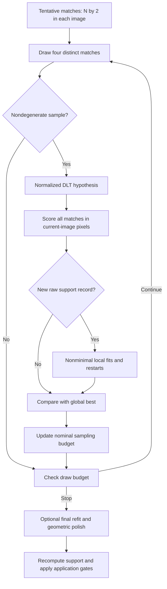
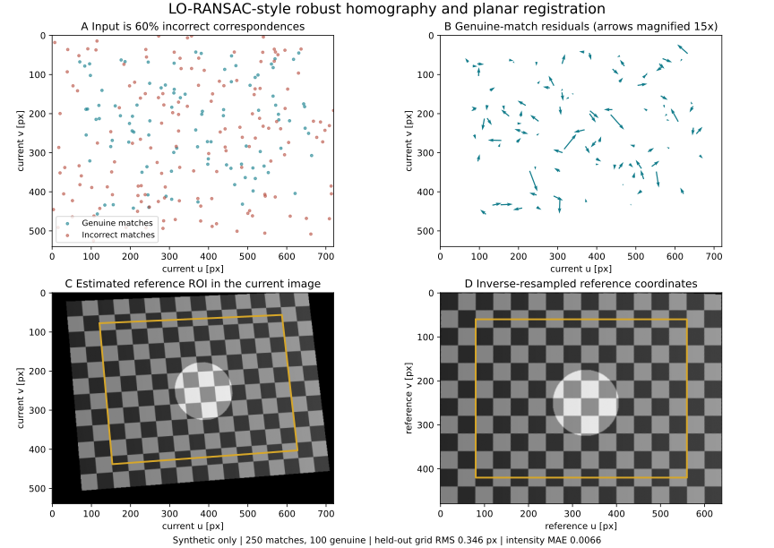

# LO-RANSAC: Robust Homographies, Local Optimization, and Honest Stopping Budgets

Date: 2026-10-20 · Category: Geometry and Calibration · Level: advanced foundations with a 2025 research connection

[Category index](README.md) · [CV index](../../README.md) · [Runnable Python](../../examples/lo-ransac-homography/) · [Executed validation](../../examples/lo-ransac-homography/VALIDATION.md)

## Intellectual map

[Yesterday's calibration lesson](2026-10-19-zhang-camera-calibration.md) explained how reliable planar observations constrain camera intrinsics. Today's question is what to do when many proposed correspondences are **not observations of the same physical point at all**.

A modern matcher can produce a confident but wrong match. A least-squares homography can fit a mixture badly. A RANSAC confidence parameter can describe sampling without certifying that the returned plane is the object the robot wanted.

The progression is:

**Research problem → Why least squares fails → Hypothesize and verify → Why minimal samples remain noisy → Local optimization → Correct sampling probabilities → Reproduction and failure analysis → Deployment.**

Evidence labels:

- **Paper says:** a claim from the cited primary work.
- **Inference:** a mathematical deduction or a conclusion limited to the supplied experiments.
- **My interpretation:** an engineering judgment or explanatory reconstruction.
- **Unknown:** something not established by these sources or this execution.

Main sources are [LO-RANSAC, Chum, Matas and Kittler, DAGM 2003](https://cmp.felk.cvut.cz/~matas/papers/chum-dagm03.pdf), [Fixing the Locally Optimized RANSAC, Lebeda, Matas and Chum, BMVC 2012](https://www.bmva-archive.org.uk/bmvc/2012/BMVC/paper095/paper095.pdf), and [Fixing the RANSAC Stopping Criterion, Schönberger, Larsson and Pollefeys, arXiv v1, 2025-03-10](https://arxiv.org/pdf/2503.07829v1).

**Scope:** the supplied code is an inspectable **LO-RANSAC-style reconstruction**, not the authors' code, a complete LO+-RANSAC reproduction, or OpenCV USAC. Its exact choices and omissions are listed below.

## 1. Research problem

Input: N tentative matches between a reference image and a current image. Each match contains two continuous pixel coordinates. Some pairs are genuine but noisy; others connect unrelated scene points.

Output: a reference-to-current homography, an error for every match, a model-consistent support mask, and diagnostics describing the search.

The homography model is appropriate for one rigid plane under perspective projection, or for ideal camera rotation about a common optical center. It is not a generic model of nonrigid tissue, deforming elastomer, or a translating camera observing arbitrary 3D depths.

For a robot, useful outputs might be a planar fixture outline in the current frame or a registered background patch. A homography by itself is not a metric 6D pose, depth map, contact force estimate, or semantic object identity.

## 2. Motivation and prior limitations

### Least squares treats wrong identities as noisy measurements

With correct correspondence identities and moderate noise, fitting many points is sensible. A wrong identity is a different error: moving its residual closer to zero can move the model away from the desired geometry.

In today's synthetic example, 150 of 250 matches are incorrect. Fitting all of them produces about 634 pixels of error on an independent clean grid. That is not an indictment of DLT; it is the consequence of asking a non-robust estimator to explain incompatible correspondences.

### Minimal sampling trades precision for the chance of avoiding outliers

Four generic pairs determine a homography. Drawing a small subset makes an uncontaminated hypothesis more likely. But a model that interpolates four noisy pairs may predict other genuine points poorly, especially when those four points have weak spatial coverage.

**Paper says:** LO-RANSAC addresses the mismatch between an uncontaminated minimal sample and a model that actually recovers the larger inlier set. See the 2003 paper, §§1–3.

### One final refit cannot change which hypotheses were explored

Refitting the winning consensus once at the end is valuable. It does not make promising models better *during* search, where refinement can reveal more support and alter subsequent selection and adaptive stopping.

**My interpretation:** distinguish three operations: discovering a basin, improving a model inside that basin, and deciding whether the basin is the intended scene structure. They solve different problems.

## 3. Key insight and novelty

Use minimal samples to discover candidate geometry, then use a larger, tentatively consistent set to stabilize promising hypotheses. Improve models when the search encounters a new record, rather than running expensive refinement after every random draw.

| Contribution type | What matters here |
|---|---|
| Conceptual | An all-inlier sample is not the same event as reliable model recovery |
| Algorithmic | Add nonminimal refinement and local resampling to promising hypotheses |
| Engineering | Bound local fitting work; separate random streams; return a mask recomputed from the final model |
| Experimental | Measure prediction error and failure counts, not only the size of a selected consensus |
| Recent connection | Revisit the finite-population probability used to decide how long sampling should continue |

**Paper says:** the 2012 work studies local-optimization cost and introduces bounded fitting subsets and truncated-quadratic scoring. Its experiments show that local optimization is not always computationally free. See §§1 and 3.

The 2025 stopping-criterion paper studies the practical consequences of replacing an approximate all-inlier probability with the exact finite-population probability. Do not describe the combinatorial identity as first invented in 2025: it also appears explicitly in Eq. 2 of the 2003 LO-RANSAC paper.

## 4. Pipeline and module contracts



| Module | Input → output | Purpose |
|---|---|---|
| Matcher, external to this code | two images → two [N,2] arrays | Propose identities; no detector or descriptor is simulated as a neural network |
| Minimal sampler | N indices → four distinct indices | Avoid repeated points within a hypothesis |
| Degeneracy check | four source and four target points → accept/reject | Reject almost-collinear triples in either image |
| DLT solver | paired [K,2] coordinates → H [3,3] | Estimate a source-to-target projective mapping |
| Verification | H + all pairs → squared errors [N], mask [N] | Judge a hypothesis on data outside its sample |
| Local optimizer | promising H + all pairs → improved H | Nonminimal fitting, local resampling, narrowing support thresholds |
| Budget update | estimated support count → nominal number of draws | Adapt work using exact finite-population sampling probability |
| Final polish | fixed consensus + H → candidate H | Minimize forward geometric residuals, then rescore on all points |
| Registration application | current image + H → reference-coordinate image | Inverse bilinear resampling with validity masks |

Here K in the DLT row means the number of points used in that particular fit, not a camera intrinsic matrix. The formulas below use n for that fit size to avoid ambiguity.

### Coordinate, time, modality, and precision flow

- Point order is (u,v) = (column,row), not NumPy's (row,column) indexing order.
- H maps **reference/source → current/destination**. Its inverse maps current coordinates back to reference coordinates.
- Threshold 3.0 means three **destination-image pixels** for a forward Euclidean transfer error.
- Matcher coordinates may instead be feature-grid locations or letterboxed pixels. Apply stride, offset, crop, and resize transforms before interpreting a sensor-pixel threshold.
- Both images must use declared, compatible distortion/rectification conventions. A homography generally does not absorb arbitrary lens distortion.
- This is a two-view estimator, not a temporal filter. Repeating it on video does not establish synchronization, frame-to-frame consistency, or drift-free tracking.
- Estimation is float64. The synthetic images and resampling output are float32 intensities in [0,1]. No language tokens, embeddings, weights, or multimodal fusion are involved.

## 5. Mathematics and small examples

Every displayed equation is followed immediately by definitions of its symbols.

### 5.1 A homography is a projective mapping, not a displacement vector

$$
\tilde{\mathbf x}=(u,v,1)^T,\qquad
\mathbf z=H\tilde{\mathbf x},\qquad
f_H(\mathbf x)=
\begin{bmatrix}z_1/z_3\\z_2/z_3\end{bmatrix},
\qquad H\sim aH,\quad a\ne0.
$$

Symbols immediately above:

- $\mathbf x=(u,v)^T\in\mathbb R^2$: source pixel; $\tilde{\mathbf x}\in\mathbb R^3$: its homogeneous representation.
- $H\in\mathbb R^{3\times3}$: source-to-destination homography; $\mathbf z=(z_1,z_2,z_3)^T$: transformed homogeneous point. When the bottom-right entry is normalized to one and both images use pixels, the top-left linear entries are dimensionless, top-right translations have pixel units, and the first two bottom-row entries have inverse-pixel units.
- $f_H:\mathbb R^2\rightarrow\mathbb R^2$: dehomogenized coordinate mapping, defined only when the denominator is nonzero.
- $a$: arbitrary nonzero scalar; $\sim$: projective equivalence; $T$: transpose.

There are eight independent parameters because multiplying all nine entries by one scalar changes no finite projected point.

For a pure translation by (10,-4) pixels, the upper-right entries are 10 and -4, the diagonal is one, and the other entries are zero. Point (100,80) maps to (110,76). This direction convention determines both ROI transfer and image resampling.

Near a projective horizon, division by a tiny denominator amplifies errors. The code marks such projections invalid instead of treating them as inliers.

### 5.2 Normalized DLT supplies minimal and nonminimal hypotheses

Cross-multiplication removes the coordinate denominator:

$$
D_i\mathbf h=\mathbf0,\qquad
D_i=
\begin{bmatrix}
-u_i&-v_i&-1&0&0&0&u'_iu_i&u'_iv_i&u'_i\\
0&0&0&-u_i&-v_i&-1&v'_iu_i&v'_iv_i&v'_i
\end{bmatrix},
\qquad
\hat{\mathbf h}=\arg\min_{\|\mathbf h\|_2=1}\|D\mathbf h\|_2^2.
$$

Symbols immediately above:

- $i$: correspondence index; $(u_i,v_i)$: source coordinates; $(u'_i,v'_i)$: matched destination coordinates. The implemented solver uses separately normalized coordinates in this block.
- $D_i\in\mathbb R^{2\times9}$: one correspondence's two linear constraints; $D\in\mathbb R^{2n\times9}$: vertical stack for n fitted pairs; $\mathbf0\in\mathbb R^2$: zero vector.
- $\mathbf h\in\mathbb R^9$: row-wise entries of the homography in the coordinates used by D; $\hat{\mathbf h}$: estimated unit-norm vector; $\|\cdot\|_2$: Euclidean norm; $\arg\min$: minimizing parameter value.

Derivation: multiply each predicted coordinate ratio by its denominator, collect the nine coefficients, and stack all pairs. The smallest right singular vector solves the constrained algebraic problem.

Centering each point set and scaling its mean distance to the square root of two improves conditioning. Recover the original-coordinate mapping by:

$$
H=T_y^{-1}\hat H T_x.
$$

Symbols immediately above:

- $T_x,T_y\in\mathbb R^{3\times3}$: source and destination point-normalization transforms.
- $\hat H\in\mathbb R^{3\times3}$: homography estimated between normalized coordinates; $H$: homography in original image coordinates; $-1$: matrix inverse.

Four correspondences yield an 8-by-9 design matrix. Its right nullspace is essential: a reduced SVD that omits the ninth right vector is wrong in this minimal case. The implementation requests the full right basis only when necessary.

Any three collinear points in a four-point sample are a degeneracy. The code checks a normalized triangle-area tolerance in both images. That tolerance is an engineering guard, not a universal conditioning certificate.

DLT minimizes an algebraic residual. It does not directly minimize pixel error, and fitting it to all tentative matches is not robust.

### 5.3 Choose the residual before choosing a threshold

$$
\mathbf e_i(H)=f_H(\mathbf x_i)-\mathbf y_i,\qquad
r_i^2(H)=\mathbf e_i(H)^T\mathbf e_i(H),\qquad
\mathcal I(H)=\{i:r_i^2(H)\le\tau^2\}.
$$

Symbols immediately above:

- $\mathbf x_i,\mathbf y_i\in\mathbb R^2$: source and measured destination pixels for match i.
- $H$: candidate homography; $f_H$: its finite-point projection; $\mathbf e_i\in\mathbb R^2$: predicted-minus-measured destination pixel error.
- $r_i^2$: squared forward transfer distance in pixel-squared; $T$: transpose.
- $\tau>0$: destination-pixel distance threshold; $\mathcal I(H)$: model-consistent support set.

A residual vector (3,4) has distance 5, not 7 and not squared distance 5. It fails a four-pixel threshold and passes a five-pixel threshold. The code compares squared distance with squared threshold; the test suite checks the boundary.

The word “inlier” here means *consistent with this model and threshold*. It does not establish ground-truth correspondence identity.

Symmetric transfer error also checks the inverse mapping. It is a different residual with a different scale; do not copy a forward threshold unchanged and assume the same false-rejection rate. The supplied estimator uses forward error only.

### 5.4 Consensus and truncated-quadratic scoring are different objectives

$$
C(H)=\sum_{i=1}^{N}\mathbf1[r_i^2(H)\le\tau^2],
\qquad
E_{\mathrm{MSAC}}(H)=\sum_{i=1}^{N}\min(r_i^2(H),\tau^2).
$$

Symbols immediately above:

- $N$: total matches; $i$: match index; $H$: candidate homography.
- $r_i^2(H)$: squared destination-pixel residual; $\tau$: pixel distance threshold.
- $\mathbf1[\cdot]$: indicator, one when its condition is true and zero otherwise; $C(H)$: support count, maximized.
- $\min$: smaller of its arguments; $E_{\mathrm{MSAC}}(H)$: truncated squared-error cost, minimized.

Default code selection first maximizes count, then breaks ties with truncated squared cost. The optional MSAC mode reverses that priority. The ablations below all use the default consensus-first objective.

Example with a three-pixel threshold: squared residuals [0,0,100] have support two and truncated cost nine. Squared residuals [8,8,8] have support three and cost 24. Consensus prefers the latter; MSAC prefers the former. This is a real change in the objective, not a cosmetic tie-break.

Truncation prevents a very distant wrong match from increasing the cost without bound. It does not prevent a large coherent wrong structure from winning.

### 5.5 Noise in both images changes the threshold interpretation

Linearizing the source-coordinate perturbation gives:

$$
\Sigma_{e,i}\approx
\Sigma_{y,i}+J_{x,i}\Sigma_{x,i}J_{x,i}^T,
\qquad
J_{x,i}=
\left.\frac{\partial f_H(\mathbf x)}{\partial\mathbf x}\right|_{\mathbf x_i}.
$$

Symbols immediately above:

- $\Sigma_{x,i},\Sigma_{y,i}\in\mathbb R^{2\times2}$: source and destination localization covariances in their respective pixel-squared units.
- $\Sigma_{e,i}\in\mathbb R^{2\times2}$: approximate covariance of the forward residual, assuming independent source and destination noise and a fixed H.
- $J_{x,i}\in\mathbb R^{2\times2}$: spatial Jacobian of the homography mapping at source point $\mathbf x_i$; $f_H$: coordinate mapping.
- $\partial/\partial\mathbf x$: derivative with respect to source coordinates; $T$: transpose.

**Inference:** using only the destination detector's noise variance understates residual uncertainty when source coordinates are also noisy. The mapping can amplify source errors nonuniformly.

Under an isotropic approximation:

$$
\Sigma_{e,i}\approx\sigma_{\mathrm{eff}}^2I_2,\qquad
\frac{r_i^2}{\sigma_{\mathrm{eff}}^2}\sim\chi_2^2,
\qquad
\tau=\sigma_{\mathrm{eff}}\sqrt{\chi_2^2(p)}.
$$

Symbols immediately above:

- $\Sigma_{e,i}$: residual covariance; $\sigma_{\mathrm{eff}}$: effective per-coordinate residual standard deviation in destination pixels; $I_2$: 2-by-2 identity.
- $r_i^2$: squared residual of a genuine correspondence under a fixed correct model.
- $\chi_2^2$: chi-square distribution with two degrees of freedom; $\sim$: modeled as distributed according to it.
- $p\in(0,1)$: desired acceptance probability for a genuine observation; $\chi_2^2(p)$: its quantile; $\tau$: resulting distance threshold.

For p=0.99, the squared normalized distance quantile is about 9.21, so the radius is about 3.03 effective standard deviations. This is a noise-model calculation, not a claim that an estimated model, uncertain parameters, or real feature errors obey it exactly.

**Unknown / not implemented:** per-feature covariance calibration and Mahalanobis scoring. The code uses one global pixel threshold.

### 5.6 Probability of drawing an all-inlier subset

When every point in a trial is distinct:

$$
q_{\mathrm{exact}}=
\frac{\binom{I}{m}}{\binom{N}{m}}
=\prod_{j=0}^{m-1}\frac{I-j}{N-j},
\qquad
q_{\mathrm{approx}}=\left(\frac{I}{N}\right)^m.
$$

Symbols immediately above:

- $N$: total correspondences; $I$: number of genuine inlier correspondences, assumed known for this probability calculation.
- $m$: sample size, four for homography; $j$: position within the sequential draw, starting at zero.
- $\binom{a}{b}$: number of b-element subsets of an a-element set.
- $q_{\mathrm{exact}}$: all-inlier probability under uniform sampling without replacement **within a trial**, zero if I is smaller than m.
- $q_{\mathrm{approx}}$: common with-replacement approximation; the product expression is dimensionless.

Derivation: the first selected point has inlier probability I/N. Conditional on it being an inlier, the next selection has one fewer inlier and one fewer available point. Continue for the sample size.

The outer loop can draw the same subset again in a later trial. Distinct points within a sample do not mean globally unique samples across the entire run.

**Inference:** for a nontrivial inlier fraction and sample size above one, the approximation is optimistic. It matters most when the population is small compared with the sample size and the number of genuine inliers.

### 5.7 Derive the stopping budget, then state what it does not guarantee

For independent repeated trials:

$$
P(\text{at least one all-inlier sample in }K\text{ trials})
=1-(1-q)^K,\qquad
K_{\mathrm{req}}=
\left\lceil\frac{\log(1-c)}{\log(1-q)}\right\rceil.
$$

Symbols immediately above:

- $P$: event probability; $K$: number of independent outer trials; $q$: per-trial all-inlier probability.
- $c\in(0,1)$: desired probability of drawing at least one all-inlier sample.
- $K_{\mathrm{req}}$: smallest integer budget reaching that probability; $\lceil\cdot\rceil$: ceiling; $\log$: natural logarithm.

The denominator is negative, so taking logarithms reverses the inequality when solving for the required number of trials. The implementation uses log1p for stability. Probability zero requires an unbounded budget; probability one requires one draw.

Small executed example: with 20 matches, six genuine matches, and a four-point sample, the exact probability is about 0.003096; the approximation is 0.0081. For a target sampling probability of 0.99, the budgets are **1,486 versus 567 draws**. Using 567 draws with the true probability achieves only **0.827635**, not 0.99.

This example is calculated directly from combinatorics. It is not an empirical 99%-successful homography benchmark.

**Paper says:** the 2025 study analyzes and evaluates undersampling caused by this approximation, especially in difficult finite-population settings. See §§3–5. The current code implements the exact product, but does not reproduce that paper's dataset experiments.

An all-inlier sample can still be degenerate or too noisy:

$$
q_{\mathrm{useful}}
=q_{\mathrm{exact}}\,
P(\text{nondegenerate and useful hypothesis}\mid\text{all-inlier sample}).
$$

Symbols immediately above:

- $q_{\mathrm{useful}}$: probability that one draw yields a usable hypothesis.
- $q_{\mathrm{exact}}$: exact probability that the drawn identities are all genuine.
- $P(A\mid B)$: conditional probability of event A given event B; the second factor includes geometric conditioning and noise.

**Inference:** exact sample counting fixes one approximation. It does not make the conditional factor one.

In real data I is unknown. The estimator substitutes a selected support count, which can include false matches or belong to the wrong plane. Rejected samples also consume the draw budget in this code. Minimum/maximum draw limits further change the procedure. Therefore, the confidence setting is **nominal sampling control, not a posterior probability that the returned homography is correct**.

### 5.8 What local optimization actually does here

The implemented inner procedure:

1. Refit using the current threshold-consistent points.
2. Try a fit using support within twice the threshold.
3. Form a local base set using the original threshold.
4. Draw ten subsets from that base; use up to twelve points per initial local fit.
5. For each restart, refit while narrowing distance thresholds through multipliers 2, 5/3, 4/3, and 1.
6. Evaluate **every candidate on all matches at the original threshold** and retain the best.

Each local fit is capped at 64 points. The subset size is clamped to at least four when the base is small. These are explicit reconstruction choices, not the exact settings or weighted solvers of a complete published LO+ implementation.

Why widen first? A noisy minimal model can exclude genuine points near the support boundary. Why narrow later? A widened set can introduce wrong matches. Why score at the original threshold? Otherwise the optimizer could appear to improve simply because it changed the definition of an inlier.

The local optimization cannot worsen the code's selected objective because the seed model remains a candidate. That does **not** guarantee lower true geometric error; a better support score can still describe the wrong structure.

The code tracks raw minimal-sample records separately from optimized support. Otherwise, a strongly refined best model could suppress later raw records that might lead to a better refinement basin.

### 5.9 Final geometric polish is a separate, conditional step

$$
\theta^\star=
\arg\min_{\theta}
\sum_{i\in\mathcal I_0}
\|f_{H(\theta)}(\mathbf x_i)-\mathbf y_i\|_2^2,
\qquad
\theta=(h_{11},h_{12},h_{13},h_{21},h_{22},h_{23},h_{31},h_{32})^T,
\quad h_{33}=1.
$$

Symbols immediately above:

- $\mathcal I_0$: fixed consensus chosen before polishing; $i$: match index.
- $\mathbf x_i,\mathbf y_i\in\mathbb R^2$: measured source and destination points; $f_H$: homography projection.
- $H(\theta)\in\mathbb R^{3\times3}$: homography parameterized by its first eight row-wise entries, with bottom-right entry fixed to one.
- $\theta\in\mathbb R^8$: free parameter vector; $\theta^\star$: minimizer; $\|\cdot\|_2$: Euclidean norm; $\arg\min$: minimizing parameter value; $T$: transpose.

This parameter chart excludes homographies whose bottom-right entry cannot safely be normalized to one; the code skips geometric polish near that case. It uses SciPy trust-region least squares and finite-difference Jacobians.

Because both images are noisy, forward residual minimization is not the complete errors-in-variables maximum-likelihood treatment. It is a useful geometric refinement with stated assumptions.

After polishing, rescore all matches and recompute the mask from the returned H. Do not return an old mask attached to a new matrix. Candidates that worsen the chosen global score are rejected.

## 6. Implementation and execution

The example uses NumPy, SciPy and Matplotlib. It requires no images, weights, GPU, or downloads beyond installing dependencies.

```bash
cd CV/examples/lo-ransac-homography
python -m venv .venv
source .venv/bin/activate
python -m pip install -r requirements.txt
OPENBLAS_NUM_THREADS=1 python checks.py
OPENBLAS_NUM_THREADS=1 python demo.py
OPENBLAS_NUM_THREADS=1 python demo.py --ablations
OPENBLAS_NUM_THREADS=1 python demo.py --failure-case
OPENBLAS_NUM_THREADS=1 python application.py
OPENBLAS_NUM_THREADS=1 python make_figure.py ../../assets/lo-ransac-homography/robust-planar-registration.svg
```

Windows users should use their shell's environment activation and variable-setting syntax; the thread setting is optional. Library and BLAS versions can change the last digits.

Core interface:

```python
from robust_homography import estimate, transfer

# source:      float64 [N,2], reference (u,v)
# destination: float64 [N,2], current (u,v), paired in the same order
result = estimate(source, destination, threshold=3.0, seed=20261020)
current_roi = transfer(result.H, reference_roi)  # reference_roi: [4,2]
# result.H: [3,3]; result.inliers: bool [N]; result.errors2: float64 [N]
print(result.inliers.sum(), result.draws, result.rejected_samples)
```

The fully runnable demo supplies all arrays; this snippet documents integration.

Important differences from published/production implementations:

- unweighted normalized DLT in local fitting;
- explicit 64-point fitting cap and chosen threshold schedule;
- consensus-first score by default, optional MSAC;
- uniform outer sampling, no PROSAC ranking, spatial sampler, SPRT, graph cut, or sigma consensus;
- homography only, not essential/fundamental/PnP solvers;
- no nonlinear joint correction of both measured image points;
- no real feature detector or matcher;
- no claim of global optimality or calibrated correctness probabilities.

Separate outer and local random generators are deliberate. Adding local sampling must not silently change the outer sample sequence in a paired ablation.

## 7. Experiments and evidence



Panel A labels matches by synthetic ground truth, not by the estimator's selected mask. Panel B includes all genuine matches, including any outside the selected support; residual arrows are enlarged 15 times for visibility. Panels C–D show a toy image, not real tactile or surgical imagery.

### 7.1 Executed setup

Python 3.12.14; NumPy 2.3.5; SciPy 1.17.0; Matplotlib 3.10.8. CPU, float64 estimation. Data seed 20261020.

There are 250 tentative pairs: 100 genuine and 150 uniformly random destination outliers. Source points span approximately a 640-by-480 reference image. Genuine coordinates in **both** images receive independent 0.7-pixel standard-deviation Gaussian noise per coordinate. The true transform has modest rotation/shear, translation, and projective terms; its full numeric matrix is in demo.py.

The evaluation grid has 165 clean source points that are not fitted. Its prediction error is:

$$
E_{\mathrm{grid}}=
\sqrt{\frac1G\sum_{j=1}^{G}
\|f_{\hat H}(\mathbf g_j)-f_{H_{\mathrm{true}}}(\mathbf g_j)\|_2^2}.
$$

Symbols immediately above:

- $G$: number of held-out clean grid points; $j$: grid index; $\mathbf g_j\in\mathbb R^2$: source grid coordinate.
- $\hat H$: estimated homography; $H_{\mathrm{true}}$: known generating homography; $f_H$: pixel projection.
- $E_{\mathrm{grid}}$: vector RMS prediction error in destination pixels; $\|\cdot\|_2$: Euclidean norm.

The grid is synthetic ground truth, not a held-out camera dataset.

### 7.2 Single adaptive run

Default threshold: three destination pixels. Nominal confidence: 0.999. Maximum draws: 3,000; minimum draws: 32. Exact finite-population budget enabled.

| Quantity | Executed result |
|---|---:|
| All-match DLT clean-grid error | 634.140672 px |
| Robust clean-grid error | 0.346217 px |
| Selected support | 97 / 250 |
| Genuine fraction of selected support | 1.000000 |
| Fraction of all genuine matches selected | 0.970000 |
| Outer draws / valid hypotheses / rejected samples | 314 / 313 / 1 |
| Local calls / local fitting attempts | 3 / 144 |
| Maximum draw cap reached | No |

**Inference:** this fixture separates genuine geometry from random wrong matches effectively. A precision of one on one synthetic fixture does not establish perfect real matching precision.

### 7.3 Paired local-optimization ablation

All variants receive identical observations and the same 20 outer RNG seeds, 20261020 through 20261039. Each receives **300 outer draws**, with adaptive stopping disabled. Local work is additional; this is an equal-outer-search comparison, not an equal-runtime comparison.

| Variant | Median grid RMS (px) | 90th percentile (px) | Worst (px) | Runs above 2 px / 20 | Mean support |
|---|---:|---:|---:|---:|---:|
| Minimal hypotheses only | 2.603519 | 5.804881 | 13.543359 | 14 | 69.75 |
| Final refit/polish only | 0.689795 | 1.495319 | 6.826464 | 2 | 91.30 |
| One simple local fit per record + final | 0.402054 | 0.736536 | 1.901610 | 0 | 96.55 |
| Inner local optimization + final | 0.346217 | 0.810131 | 1.031990 | 0 | 97.35 |

Two pixels is an explicit toy failure cutoff, not a universal application tolerance. Percentiles use NumPy's default interpolation.

**Inference:** final fitting already helps substantially; moving refinement inside the search helps further on this fixture. Inner optimization has a better median and worst case than the simple variant here, but a slightly worse 90th percentile. Do not summarize the table as uniform improvement on every metric.

Both local variants average 4.4 local calls. The simple variant averages 4.4 local fitting attempts; the inner variant averages 227.7. Hypothesis counts alone therefore hide substantial extra work.

**Unknown:** performance across independent scenes, illumination, feature architectures, real outlier distributions, or latency budgets. These 20 runs vary the search seed on one fixed observation set; they are not 20 independent datasets or a statistical significance study.

### 7.4 Structured failure: the wrong plane wins

The second fixture has 100 intended-plane matches and 150 matches from a coherent distractor plane, all with the same noise scale.

Executed result: support 148, **zero intended-plane matches in that support**, and 38.488518 pixels of held-out grid disagreement with the intended plane.

**Inference:** maximum consensus solved its geometric objective and still failed the semantic task. More RANSAC iterations do not fix the absence of target identity. Use object/region constraints, known fiducials, multiple-model reasoning, or other task evidence.

This is more revealing than testing only independent random outliers, which rarely form a convincing competing geometry.

### 7.5 Paper evidence versus our evidence

**Paper says, 2003:** local optimization is applied to promising record hypotheses, and several local procedures are evaluated. **Paper says, 2012:** bounded local fitting and scoring changes address accuracy/cost tradeoffs. **Paper says, 2025:** stopping-probability approximations can cause practical undersampling.

The tables above are produced by today's independent reconstruction, not transcribed paper results. No speedup factor, paper benchmark, or real-image accuracy claim has been reproduced.

Sixteen numerical checks passed; [VALIDATION.md](../../examples/lo-ransac-homography/VALIDATION.md) lists exact commands and acceptance conditions.

## 8. Integrated application: registering a planar sensor background

Imagine a visual-tactile camera whose rigid background or external fixture shifts between reference and current frames. A reliable background registration can put a known ROI into stable coordinates before a downstream model examines it.

The supplied runnable application uses a synthetic checker pattern and a bright disk. It does not detect image features: the correspondence generator supplies noisy matches with outliers. This isolates the estimator and resampling contracts.

Steps:

1. Generate the reference intensity image, [480,640].
2. Form a current image, [540,720], under the known transform.
3. Estimate reference-to-current H from contaminated matches.
4. Require at least 20 selected points and source convex-hull coverage above 25% of the reference area.
5. Transfer a reference ROI into the current frame.
6. Resample current intensities back into reference coordinates and propagate a validity mask.

The gate settings are engineering heuristics, not calibrated probabilities. The wrong-plane experiment explains why support and coverage alone cannot identify the intended object.

### Inverse resampling is not the same direction as point transfer

$$
I_{\mathrm{aligned}}(\mathbf x)=I_{\mathrm{current}}\!\left(f_H(\mathbf x)\right),
\qquad
H_{\mathrm{new}}=A_y H A_x^{-1}.
$$

Symbols immediately above:

- $I_{\mathrm{aligned}}$: current-image intensities expressed on the reference output grid; $\mathbf x\in\mathbb R^2$: one reference output coordinate.
- $I_{\mathrm{current}}$: current source image for resampling; $H$: reference-to-current homography; $f_H$: its coordinate mapping, sampled bilinearly here.
- $A_x,A_y\in\mathbb R^{3\times3}$: declared affine pixel-coordinate changes applied to reference and current images, respectively.
- $H_{\mathrm{new}}$: homography between the changed coordinate systems; $-1$: inverse.

Why does alignment sample using the forward reference-to-current mapping? Each output reference coordinate asks where its intensity lives in the current input. The generic warp_image helper accepts a source-to-output mapping and internally inverts it, so alignment passes the inverse of the estimated reference-to-current H.

The second relation follows by substituting the changed homogeneous coordinates on both sides of the correspondence equation. Cropping or resizing both images generally requires updating **both sides** of H, not just scaling its translation.

The unit tests verify identity resampling, a one-pixel translation, and this coordinate conjugation with different transforms in each image.

Executed application results: source hull coverage 0.723914; valid aligned output fraction 0.971042; mean absolute intensity difference 0.006639 on [0,1] intensities in the valid region. Two bilinear resamplings blur edges even with accurate geometry; the intensity metric is not the same as geometric accuracy.

**My interpretation — tactile caution:** estimate background motion using rigid reference regions, not deforming contact features. A global homography fitted to the contact patch can remove meaningful deformation or reinterpret it as camera motion. This example does not reconstruct occluded content, measure force, or validate a real elastomer optical path.

For surgical imaging, deforming tissue, specular highlights, tool motion, changing depth, and refraction can invalidate a single-plane model. A convincing consensus is not a clinical reliability claim.

## 9. Production bridge: OpenCV USAC and learned matchers

The [OpenCV 4.13.0 USAC tutorial](https://docs.opencv.org/4.13.0/de/d3e/tutorial_usac.html) describes modular sampling, scoring, verification, local optimization, and termination. The [tagged official source](https://github.com/opencv/opencv/blob/4.13.0/modules/calib3d/src/usac/ransac_solvers.cpp) was inspected for preset composition.

**Source says:** at that tag, USAC_DEFAULT combines uniform sampling, MSAC scoring, and inner/iterative local optimization; USAC_MAGSAC selects a MAGSAC score and sigma-consensus local optimization. Neither preset is equivalent to this lesson's default consensus-first reconstruction.

Optional real-data integration sketch, **not executed here**:

```python
import cv2 as cv
import numpy as np

# Matched coordinates must refer to the actual processed image coordinate systems.
src = np.asarray(reference_points, dtype=np.float32).reshape(-1, 2)
dst = np.asarray(current_points, dtype=np.float32).reshape(-1, 2)
H, mask = cv.findHomography(
    src, dst, cv.USAC_DEFAULT,
    ransacReprojThreshold=3.0, maxIters=5000, confidence=0.999
)
if H is None or mask is None:
    raise RuntimeError("Homography estimation failed")
# Recheck support, spatial coverage, residuals and target identity before acting.
```

See the [findHomography API](https://docs.opencv.org/4.13.0/d9/d0c/group__calib3d.html). OpenCV is not installed in the executed environment, so this snippet has not been runtime-validated and is not included in the pinned runnable dependencies.

A learned matcher changes how correspondences are proposed; it does not remove the need to choose the correct scene model. Match ranking can support PROSAC-like sampling, but quality calibration and sampling assumptions then change. The exact uniform-subset formula must not be blindly presented as a complete stopping rule for arbitrary guided samplers.

For VLM pipelines, a geometry-verified crop can reduce gross alignment errors before visual encoding. It cannot certify that the crop contains the requested object or that downstream text generation is grounded correctly.

## 10. Failure modes and generalization

| Failure | Mechanism | What to inspect |
|---|---|---|
| Narrow or nearly collinear support | Small coordinate noise causes large extrapolation error | Spatial hull, conditioning, withheld points beyond the sampled region |
| Repeated texture | Wrong identities can form coherent support | Target identity, descriptor ambiguity, known regions/fiducials |
| Multiple planes | Largest support may be a background plane | Competing models and task-relevant segmentation |
| Nonrigid deformation / parallax | One H cannot explain all true correspondences | Spatially structured residuals; alternative geometry |
| Radial distortion / refraction | Mapping between raw images is not a pure projectivity | Rectification and camera-model suitability |
| Blur / rolling shutter | A single sharp global transform is not the imaging process | Exposure conditions, row-dependent residuals, timing |
| Wrong scale or crop | Thresholds and H refer to different coordinate systems | Explicit affine transforms and pixel-center conventions |
| Adaptive premature stopping | Support overestimates genuine identities or useful-sample probability | Caps, rejected samples, seed stability, independent validation |
| Stale output mask | Matrix and support were computed at different refinement stages | Recompute residuals from the final returned H |

**My interpretation:** monitor geometric residual patterns and downstream error, not only one inlier ratio. A high ratio on a tiny patch can coexist with a poor full-image warp.

**Unknown:** robustness to real feature correlations, distribution shifts, optical-tactile mesh occlusion, and endoscopic imagery. No real data were used.

## 11. Computational cost and deployment

For a fixed four-point solver, each outer verification scans N matches. K outer draws therefore contribute work roughly proportional to K times N. Local fits add repeated SVDs and full-data verifications. Capping the number of fitted inliers bounds one part of the local cost, not the all-point verification cost.

The inner-local ablation uses much more local fitting work than the simple variant. No wall-clock estimator benchmark was measured, and there is no claim that the Python reconstruction is faster than plain RANSAC or a maintained C++ implementation.

**My interpretation — Jetson / ONNX / TensorRT boundary:**

- A learned detector or matcher may run in ONNX Runtime or TensorRT. Robust geometric estimation is a separate dynamic control-flow stage; it need not be forced into the neural engine.
- On a Jetson Orin Nano Super, test the actual correspondence-transfer and CPU-estimator path. Synchronizing small arrays from GPU to CPU can matter, but no latency or power result is asserted here.
- Keep a maximum draw cap for operational latency, and treat cap exhaustion as a diagnostic. A bounded estimator can still return a wrong matrix; the cap is not an accuracy guarantee.
- INT8 matching can change keypoint positions, confidence ranking, and outlier structure. Validate pixel localization and final geometry after quantization, not just descriptor similarity or network output error.
- Use float64 as a desktop/reference estimator. Evaluate FP32 geometric parity on the intended resolutions before choosing a lower-precision path; this lesson did not execute a precision ablation.
- For raster warping, validate direction, bilinear interpolation, border rules, validity masks, and pixel-center conventions after export or GPU fusion. A correct matrix with the wrong resampling convention is still wrong.

In a VLA system, rejected geometry should trigger a defined observation-handling policy—such as holding a previous verified ROI with a staleness limit—not silent acceptance of an arbitrary new warp. The appropriate control response requires application-specific validation.

## 12. Reproduction plan beyond this toy example

The following is proposed, not executed:

1. Build image-pair datasets with known planar targets, multiple competing planes, and explicit target identity. Include cases where the intended plane is not the majority.
2. Fix detector/matcher outputs when comparing estimators. Then separately evaluate how matcher changes and quantization change the input distribution.
3. Pair RNG seeds or recorded outer samples. Compare equal-runtime or equal-compute budgets in addition to equal outer-draw budgets.
4. Use independent manually verified or instrumented correspondences not included in fitting. Report spatial prediction error, target-selection failures, and invalid/no-model outputs.
5. Sweep threshold, outlier fraction, spatial spread, noise, and number of matches. Distinguish search-seed variability from variability across scenes.
6. Report failures explicitly, including no nondegenerate hypothesis, wrong-plane recovery, high held-out error, cap exhaustion, and unacceptable image warp.
7. Pin library versions and estimator settings. For hardware, report latency distributions, transfers/synchronization, memory, power mode, and end-to-end control impact.
8. Test preprocessing and deployment parity with golden coordinate samples and synthetic transforms before real imagery.

## 13. Takeaways

RANSAC is not simply “fit four points many times.” It is a set of contracts: sample distribution, solver conditioning, residual units, scoring objective, local optimization, stopping assumptions, and application identity.

LO-RANSAC-style refinement makes promising minimal hypotheses useful by bringing more evidence into their estimation. Exact finite-population counting makes one part of the draw budget more honest. Neither tells the robot which plane it was supposed to follow.

## Primary sources

1. Fischler and Bolles, [Random Sample Consensus, SRI publication record, 1981](https://www.sri.com/publication/artificial-intelligence-pubs/random-sample-consensus-a-paradigm-for-model-fitting-with-applications-to-image-analysis-and-automated-cartography-2/).
2. Chum, Matas and Kittler, [Locally Optimized RANSAC, 2003](https://cmp.felk.cvut.cz/~matas/papers/chum-dagm03.pdf), especially §§2–3.
3. Lebeda, Matas and Chum, [Fixing the Locally Optimized RANSAC, BMVC 2012](https://www.bmva-archive.org.uk/bmvc/2012/BMVC/paper095/paper095.pdf), especially Algorithms 1–3 and §3.
4. Schönberger, Larsson and Pollefeys, [Fixing the RANSAC Stopping Criterion, arXiv:2503.07829v1, 2025-03-10](https://arxiv.org/pdf/2503.07829v1), especially §§3–6.
5. OpenCV [USAC documentation, 4.13.0](https://docs.opencv.org/4.13.0/de/d3e/tutorial_usac.html), [calib3d API](https://docs.opencv.org/4.13.0/d9/d0c/group__calib3d.html), and [tagged preset implementation](https://github.com/opencv/opencv/blob/4.13.0/modules/calib3d/src/usac/ransac_solvers.cpp).

Sources checked 2026-10-20. The code, experiments, image pattern, and illustrations in this lesson are original educational reconstructions. Only the explicitly recorded numerical checks and synthetic experiments were executed.
