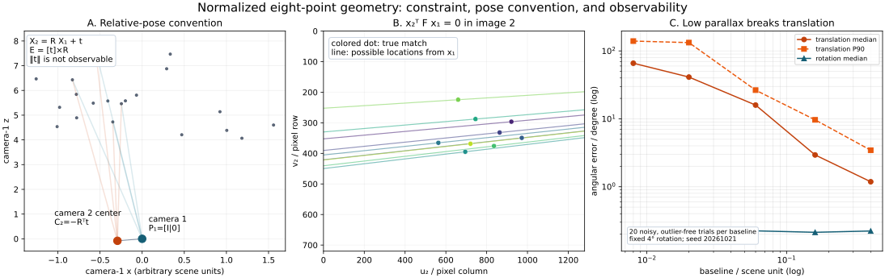
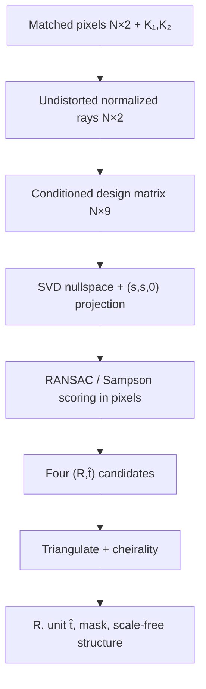

# Normalized Eight-Point Essential Matrix: From Calibrated Matches to Relative Pose

Date: 2026-10-21 · Category: Geometry and Calibration · Level: advanced foundations

[Category index](README.md) · [CV index](../../README.md) · [Runnable NumPy](../../examples/eight-point-essential-matrix/) · [Executed validation](../../examples/eight-point-essential-matrix/VALIDATION.md)



## Intellectual map and evidence labels

[Zhang calibration](2026-10-19-zhang-camera-calibration.md) gave us the pixel-to-ray map. [LO-RANSAC homography](2026-10-20-lo-ransac-homography.md) showed how to survive wrong correspondences when one plane explains the scene. This lesson removes the single-plane assumption and asks a harder question: **what 3-D camera motion can two calibrated perspective images reveal?**

The normalized eight-point algorithm is not the minimal production solver for calibrated relative pose. That is exactly why it is worth learning. Its linear algebra exposes the entire chain—calibrated rays, epipolar constraint, essential manifold, four pose hypotheses, triangulation, cheirality, scale ambiguity, and low-parallax failure—without hiding the geometry inside a polynomial solver.

Evidence labels used throughout:

- **Paper says:** attributable to a cited primary paper or official implementation.
- **Inference:** follows from the stated model or from this lesson's executed experiments.
- **My interpretation:** an engineering recommendation or conceptual explanation.
- **Unknown:** not established by the sources or the supplied execution.

Primary sources:

- H. Christopher Longuet-Higgins, [A Computer Algorithm for Reconstructing a Scene from Two Projections, Nature 1981](https://doi.org/10.1038/293133a0). This introduced the essential-matrix/eight-point route for calibrated views.
- Richard Hartley, [In Defence of the 8-Point Algorithm, TPAMI 1997](https://users.cecs.anu.edu.au/~hartley/Papers/fundamental/electronic-submission/fundamental.pdf). The author-hosted paper analyzes coordinate conditioning and normalization.
- David Nistér, [An Efficient Solution to the Five-Point Relative Pose Problem, TPAMI 2004](https://doi.org/10.1109/TPAMI.2004.17). This is the important minimal-solver comparison, not code reproduced here.
- [OpenCV 4.13 calib3d documentation](https://docs.opencv.org/4.13.0/d9/d0c/group__calib3d.html) and its tagged [five-point / recoverPose source](https://github.com/opencv/opencv/blob/4.13.0/modules/calib3d/src/five-point.cpp). These document and implement the production-facing API behavior discussed below.

**Scope:** the supplied code is an original educational NumPy reconstruction. It implements normalized eight-point fitting, essential-manifold projection, Sampson scoring, a compact RANSAC with inner non-minimal refits, linear triangulation, and cheirality. It is not the authors' code, Nistér's five-point solver, full LO-RANSAC, OpenCV USAC, or bundle adjustment.

## 1. Research problem

We observe the same static 3-D scene from two calibrated perspective cameras. A matcher proposes pairs of undistorted pixels. We want:

1. rotation from camera 1 coordinates to camera 2 coordinates;
2. translation **direction** between the cameras;
3. an inlier mask and diagnostics;
4. triangulated structure up to one unknown global scale.

We do **not** get metric translation magnitude from a single monocular pair. Nor do we automatically get object identity, scene rigidity, or a guarantee that the dominant matches belong to the robot's intended object.

The convention in this lesson is:

$$
\mathbf X_2=\mathbf R\mathbf X_1+\mathbf t.
$$

where:

- $\mathbf X_1\in\mathbb R^3$ is one 3-D point expressed in camera-1 coordinates, in an arbitrary scene-length unit;
- $\mathbf X_2\in\mathbb R^3$ is the same point expressed in camera-2 coordinates, in the same unit;
- $\mathbf R\in SO(3)$ is a dimensionless $3\times3$ rotation mapping camera 1 axes into camera 2 axes;
- $\mathbf t\in\mathbb R^3$ is the camera-1-origin location expressed in camera-2 coordinates, in scene-length units.

This convention is easy to misuse. The center of camera 2 expressed in camera-1 coordinates is $-\mathbf R^\top\mathbf t$, not $\mathbf t$. OpenCV's `recoverPose` documentation likewise describes the returned rotation and unit translation as a camera-1-to-camera-2 change of basis.

### Inputs, outputs, and domains

| Quantity | Shape | Domain / unit | Purpose |
|---|---:|---|---|
| pixels $\mathbf p_{1i},\mathbf p_{2i}$ | $N\times2$ | `(u,v)` pixels | measured correspondences |
| intrinsics $\mathbf K_1,\mathbf K_2$ | $3\times3$ each | pixels in focal/principal-point entries | pixel-to-ray conversion |
| normalized points $\mathbf x_{1i},\mathbf x_{2i}$ | $N\times3$ homogeneous | dimensionless | calibrated bearing coordinates |
| essential matrix $\mathbf E$ | $3\times3$ | scale-free | calibrated epipolar geometry |
| fundamental matrix $\mathbf F$ | $3\times3$ | scale-free pixel-coordinate relation | pixel-domain scoring |
| rotation $\mathbf R$ | $3\times3$ | dimensionless | orientation change |
| translation $\hat{\mathbf t}$ | $3$ | unit norm, direction only | baseline direction |
| triangulated $\hat{\mathbf X}_i$ | $N\times3$ | baseline-normalized units | cheirality and structure |

The code keeps geometry in `float64`. Image tensors are absent: feature extraction and matching happen before this module.

## 2. Motivation and prior limitations

### A homography is not general 3-D motion

A homography maps all image points correctly when their 3-D sources lie on one rigid plane, or under ideal pure camera rotation. A translating camera viewing points at different depths creates depth-dependent displacement. One $3\times3$ plane warp cannot explain that general scene.

**Inference:** the previous homography lesson remains useful. Competing homography and essential models can diagnose planar dominance, but choosing between them is a model-selection problem—not proof that the chosen model describes the intended object.

### Raw pixels do not satisfy the calibrated essential constraint

The essential matrix relates camera rays. Raw pixels include focal length, principal point, skew if present, preprocessing transforms, and lens distortion. Feeding cropped or resized pixels with stale intrinsics silently changes the geometry.

### A linear solution is not automatically a valid essential matrix

Nine matrix entries solved from noisy equations generally form a full-rank matrix with three unrelated singular values. A physical calibrated two-view matrix has rank two and two equal nonzero singular values. Constraint enforcement is part of the algorithm, not cosmetic cleanup.

### Algebraic fit is not geometric fit

The equation residual depends on arbitrary matrix scale and coordinate scaling. It is useful for the SVD solution but not a pixel error. RANSAC needs a scale-invariant geometric proxy such as Sampson error; final systems usually need nonlinear reprojection optimization.

### Rotation can remain plausible when translation is unobservable

Near pure rotation, points move substantially in pixels even though translation parallax is tiny. Total optical flow is therefore not a parallax certificate. The executed study later shows rotation error staying near 0.2° while translation-direction error explodes.

## 3. Key insight: motion turns each match into a plane constraint

Every normalized bearing in camera 1, its transformed bearing in camera 2, and the translation vector must be coplanar. The scalar triple product of three coplanar vectors is zero. That condition is linear in the entries of one matrix:

$$
\mathbf E=[\mathbf t]_\times\mathbf R,
\qquad
\mathbf x_2^\top\mathbf E\mathbf x_1=0.
$$

where:

- $\mathbf E\in\mathbb R^{3\times3}$ is the scale-free essential matrix;
- $[\mathbf t]_\times\in\mathbb R^{3\times3}$ is the skew-symmetric matrix satisfying $[\mathbf t]_\times\mathbf a=\mathbf t\times\mathbf a$ for any $\mathbf a\in\mathbb R^3$;
- $\mathbf R\in SO(3)$ and $\mathbf t\in\mathbb R^3$ use the convention above;
- $\mathbf x_1,\mathbf x_2\in\mathbb P^2$ are homogeneous normalized camera coordinates, usually scaled so their third entries are one;
- $(\cdot)^\top$ denotes transpose; the scalar result is dimensionless and zero for an exact rigid correspondence.

### Derivation from projection

For one scene point, normalized bearings are parallel to its camera-frame vectors. Introduce positive depths and substitute the pose equation:

$$
\lambda_2\mathbf x_2=\mathbf R(\lambda_1\mathbf x_1)+\mathbf t
\quad\Longrightarrow\quad
\mathbf x_2^\top[\mathbf t]_\times\mathbf R\mathbf x_1=0.
$$

where:

- $\lambda_1,\lambda_2\in\mathbb R_{>0}$ are the point depths in cameras 1 and 2, in scene-length units;
- $\mathbf x_1,\mathbf x_2\in\mathbb P^2$ are dimensionless rays;
- $\mathbf R$ and $\mathbf t$ map camera-1 coordinates to camera-2 coordinates;
- left multiplication by $\mathbf x_2^\top[\mathbf t]_\times$ takes a scalar triple product; a vector dotted with its own cross-product plane normal is zero.

The depths disappear. That is the gift of epipolar geometry: each match constrains camera motion without first reconstructing its metric depth.

### A small numerical example

Let $\mathbf R=\mathbf I$, $\mathbf t=(1,0,0)^\top$, and $\mathbf X_1=(0.4,0.2,4)^	op$. Then $\mathbf x_1=(0.1,0.05,1)^	op$, $\mathbf X_2=(1.4,0.2,4)^	op$, and $\mathbf x_2=(0.35,0.05,1)^	op$. The essential matrix and residual are:

$$
\mathbf E=
\begin{bmatrix}
0&0&0\\
0&0&-1\\
0&1&0
\end{bmatrix},
\quad
\mathbf E\mathbf x_1=
\begin{bmatrix}0\\-1\\0.05\end{bmatrix},
\quad
\mathbf x_2^\top\mathbf E\mathbf x_1=-0.05+0.05=0.
$$

where:

- $\mathbf I\in\mathbb R^{3\times3}$ is the identity rotation;
- $\mathbf t$ has one arbitrary scene unit of baseline along camera-2 $x$;
- $\mathbf X_1,\mathbf X_2$ are metric-up-to-scale 3-D coordinates;
- $\mathbf x_1,\mathbf x_2$ are dimensionless normalized rays;
- $\mathbf E=[\mathbf t]_\times\mathbf R$ is defined only up to a nonzero scalar.

The dot product says the observed second-view point lies on the epipolar line generated by the first-view point. It does not by itself identify where on that line the match lies.

## 4. Coordinate flow: pixels → rays → equations → pixel residuals

### 4.1 Undistort before applying the pinhole inverse

After removing lens distortion under the same model used during calibration, convert a pixel to a normalized ray:

$$
\tilde{\mathbf x}_i=\mathbf K_i^{-1}\tilde{\mathbf p}_i,
\qquad
\mathbf x_i=rac{1}{\tilde x_{i,3}}\tilde{\mathbf x}_i.
$$

where:

- $i\in\{1,2\}$ indexes the camera/view;
- $\tilde{\mathbf p}_i=(u_i,v_i,1)^\top\in\mathbb P^2$ is one undistorted homogeneous pixel;
- $\mathbf K_i\in\mathbb R^{3\times3}$ is that image's intrinsic matrix;
- $\tilde{\mathbf x}_i\in\mathbb P^2$ is a homogeneous calibrated ray;
- $\tilde x_{i,3}$ is its third coordinate;
- $\mathbf x_i=(x_i,y_i,1)^\top$ is the dimensionless normalized point.

The supplied synthetic data has no distortion. In real data, subtracting a principal point is not a substitute for applying the chosen inverse distortion model.

### 4.2 Resizing and cropping must transform the intrinsics

If preprocessing applies a homogeneous image transform $\mathbf A_i$ to pixels, apply the same transform to the intrinsics:

$$
\tilde{\mathbf p}'_i=\mathbf A_i\tilde{\mathbf p}_i,
\qquad
\mathbf K'_i=\mathbf A_i\mathbf K_i,
\qquad
(\mathbf K'_i)^{-1}\tilde{\mathbf p}'_i=\mathbf K_i^{-1}\tilde{\mathbf p}_i.
$$

where:

- $\mathbf A_i\in\mathbb R^{3\times3}$ is a known crop/resize affine transform in homogeneous pixel coordinates;
- primed quantities live in the processed image coordinate system;
- $\mathbf p_i$ and $\mathbf K_i$ live in the original calibrated image system;
- the final equality shows that consistent preprocessing preserves the normalized ray.

Check 10 verifies this identity using different transforms in the two views.

### 4.3 Essential for rays, fundamental for pixels

Pixel-domain epipolar geometry uses:

$$
\mathbf F=\mathbf K_2^{-\top}\mathbf E\mathbf K_1^{-1},
\qquad
\tilde{\mathbf p}_2^\top\mathbf F\tilde{\mathbf p}_1=0.
$$

where:

- $\mathbf F\in\mathbb R^{3\times3}$ is the scale-free fundamental matrix;
- $\mathbf K_2^{-\top}$ means $(\mathbf K_2^{-1})^\top$;
- $\mathbf E$ acts on normalized rays;
- $\tilde{\mathbf p}_1,\tilde{\mathbf p}_2$ are homogeneous pixels;
- the scalar constraint is zero for an exact correspondence.

**My interpretation:** estimate motion in normalized coordinates, but score robust hypotheses in the domain where the threshold is specified. The demo's `3 px` threshold is applied with $\mathbf F$ to pixel coordinates, so its unit is not quietly converted into an average-focal approximation.

## 5. The normalized eight-point method, step by step

### 5.1 One match gives one linear equation

For normalized points $\mathbf x_1=(x_1,y_1,1)^	op$ and $\mathbf x_2=(x_2,y_2,1)^	op$, row-major vectorization gives:

$$
\underbrace{[x_2x_1,\ x_2y_1,\ x_2,\ y_2x_1,\ y_2y_1,\ y_2,\ x_1,\ y_1,\ 1]}_{\mathbf a_i^\top\in\mathbb R^{1\times9}}
\underbrace{[e_{11},e_{12},e_{13},e_{21},e_{22},e_{23},e_{31},e_{32},e_{33}]^\top}_{\mathbf e\in\mathbb R^9}=0.
$$

where:

- $x_1,y_1,x_2,y_2$ are dimensionless normalized image coordinates for match $i$;
- $e_{jk}$ is row $j$, column $k$ of $\mathbf E$;
- $\mathbf a_i^\top$ is one design-matrix row;
- $\mathbf e=\operatorname{vec}_{\rm row}(\mathbf E)$ stacks the nine entries in row-major order.

Stack $N\ge8$ rows and solve the homogeneous least-squares problem:

$$
\mathbf e^*=\arg\min_{\|\mathbf e\|_2=1}\|\mathbf A\mathbf e\|_2^2.
$$

where:

- $\mathbf A\in\mathbb R^{N\times9}$ contains one row $\mathbf a_i^\top$ per match;
- $\mathbf e\in\mathbb R^9$ is constrained to unit Euclidean norm to exclude the trivial zero vector;
- $\mathbf e^*$ is the right singular vector of $\mathbf A$ associated with its smallest singular value;
- the minimized quantity is squared algebraic error, dimensionless after normalized-coordinate conditioning.

For exactly eight generic matches, $\mathbf A$ is $8\times9$. A full SVD must retain the ninth right-singular vector spanning its nullspace. `full_matrices=False` is a subtle bug in this minimal rectangular case because it returns only eight rows in `Vt`.

**Paper says:** Hartley's paper describes the same linear nullspace idea for eight or more matches and emphasizes numerical conditioning. It addresses fundamental-matrix estimation; this lesson applies the analogous conditioning step after calibration and then enforces the stronger essential constraint.

### 5.2 Hartley conditioning inside each view

Even normalized camera coordinates can have an offset and uneven scale. Independently translate each point cloud to zero centroid and isotropically scale it. This code uses root-mean-square radius $\sqrt2$:

$$
\bar{\mathbf q}=\frac1N\sum_{i=1}^{N}\mathbf q_i,
\quad
r_{\rm rms}=\sqrt{\frac1N\sum_{i=1}^{N}\|\mathbf q_i-\bar{\mathbf q}\|_2^2},
\quad
s=\frac{\sqrt2}{r_{\rm rms}}.
$$

where:

- $\mathbf q_i=(x_i,y_i)^	op\in\mathbb R^2$ is one inhomogeneous point in one view;
- $\bar{\mathbf q}\in\mathbb R^2$ is that view's centroid;
- $N$ is the number of selected correspondences;
- $r_{\rm rms}$ is the dimensionless RMS radius;
- $s$ is a dimensionless isotropic scale;
- the process is performed separately for views 1 and 2.

Let the resulting similarities be $\mathbf T_1$ and $\mathbf T_2$. Estimate $\bar{\mathbf E}$ from transformed points, then undo the coordinate change:

$$
\bar{\mathbf x}_1=\mathbf T_1\mathbf x_1,
\qquad
\bar{\mathbf x}_2=\mathbf T_2\mathbf x_2,
\qquad
\mathbf E=\mathbf T_2^\top\bar{\mathbf E}\mathbf T_1.
$$

where:

- $\mathbf T_1,\mathbf T_2\in\mathbb R^{3\times3}$ center and scale the two point clouds;
- barred points and $\bar{\mathbf E}$ live in those conditioned coordinate systems;
- $\mathbf E$ is returned to calibrated normalized-camera coordinates;
- equality is up to arbitrary nonzero scale.

In a constructed 80-match large-coordinate check, `cond(A)` fell from about $3.88\times10^8$ to $48.44$. That is this code's numerical check—not a number reported by Hartley and not a claim about every dataset.

In the 20 clean noisy trials, conditioned and unconditioned rotation medians were similar (0.283° versus 0.248°), but translation-direction medians were 1.592° versus 10.399°. Conditioning is not magic; it reduces one avoidable source of instability.

### 5.3 Project to the essential manifold

Let the raw matrix have SVD $\mathbf U\operatorname{diag}(\sigma_1,\sigma_2,\sigma_3)\mathbf V^\top$. Replace its singular values by two equal nonzero values and one zero:

$$
s=\frac{\sigma_1+\sigma_2}{2},
\qquad
\mathbf E_{\rm ess}=\mathbf U\operatorname{diag}(s,s,0)\mathbf V^\top.
$$

where:

- $\mathbf U,\mathbf V\in O(3)$ are orthogonal SVD factors;
- $\sigma_1\ge\sigma_2\ge\sigma_3\ge0$ are the raw singular values;
- $s$ is their averaged leading magnitude;
- $\mathbf E_{\rm ess}$ is the closest matrix with essential singular-value structure under the Frobenius-norm projection used here;
- the code finally normalizes $\|\mathbf E_{\rm ess}\|_F=1$ because global scale is irrelevant.

Rank two alone is the fundamental-matrix constraint. Equal leading singular values encode calibrated rigid motion. This difference is why blindly passing a fitted fundamental matrix to an essential decomposition is wrong.

### 5.4 Score with Sampson error, not raw algebraic error

For a pixel-coordinate $\mathbf F$, the symmetric first-order correction cost is:

$$
d_{S,i}^2=
\frac{(\tilde{\mathbf p}_{2i}^\top\mathbf F\tilde{\mathbf p}_{1i})^2}
{(\mathbf F\tilde{\mathbf p}_{1i})_1^2+(\mathbf F\tilde{\mathbf p}_{1i})_2^2+(\mathbf F^\top\tilde{\mathbf p}_{2i})_1^2+(\mathbf F^\top\tilde{\mathbf p}_{2i})_2^2}.
$$

where:

- $d_{S,i}^2$ is the Sampson squared error, approximately in squared pixels here;
- $\tilde{\mathbf p}_{1i},\tilde{\mathbf p}_{2i}\in\mathbb P^2$ are homogeneous pixels;
- $\mathbf F\tilde{\mathbf p}_{1i}$ is the epipolar line in image 2;
- $\mathbf F^\top\tilde{\mathbf p}_{2i}$ is the epipolar line in image 1;
- subscripts 1 and 2 select the line's first two coefficients;
- numerator and denominator scale together, so the ratio is invariant to nonzero scaling of $\mathbf F$.

Sampson error is still an approximation, not two-view bundle adjustment. It becomes questionable near singular configurations or when the linearization is poor.

### 5.5 Robust outer loop and why five points matter in production

The example samples eight matches, fits an essential matrix, scores every match with pixel-domain Sampson error, minimizes a capped MSAC-style loss, and tries 64 sixteen-point inner samples from the current support. It then attempts consensus refits. The final mask is recomputed from the returned model.

If independent matches have inlier probability $w$, the familiar approximate all-inlier sample probability and draw budget are:

$$
q_m\approx w^m,
\qquad
n\ge\frac{\log(1-c)}{\log(1-q_m)}.
$$

where:

- $m$ is the minimal sample size, 8 here and 5 for a five-point solver;
- $w\in[0,1]$ is the assumed independent inlier fraction;
- $q_m$ is the approximate probability that one sample is all-inlier;
- $c\in(0,1)$ is the desired probability of drawing at least one all-inlier sample under the approximation;
- $n$ is the required integer number of random draws after rounding upward.

At $w=2/3$ and $c=0.999$, this approximation gives $q_8\approx0.0390$ and 174 draws, versus $q_5\approx0.1317$ and 49 draws. Exact finite-population sampling, unknown inlier rates, correlated failures, degeneracy, model recovery, and local optimization complicate that calculation; see the previous lesson for the stopping-criterion details.

**Paper says:** Nistér provides an efficient five-point relative-pose solution. **Official implementation says:** OpenCV 4.13's traditional `findEssentialMat` path normalizes pixels by intrinsics, scales its threshold by average focal length, and invokes a five-point estimator inside RANSAC or LMedS. The USAC overload routes through its USAC framework. `recoverPose` evaluates four decompositions with triangulation and cheirality.

**My interpretation:** use eight-point hypotheses here because they are inspectable. Use a mature five-point USAC implementation in a production system unless you have a measured reason not to.

## 6. Recovering the four pose candidates

Project $\mathbf E$ to the essential manifold and decompose it:

$$
\mathbf E=\mathbf U\operatorname{diag}(s,s,0)\mathbf V^\top,
\quad
\mathbf W=
\begin{bmatrix}0&-1&0\\1&0&0\\0&0&1\end{bmatrix},
\quad
\mathbf R\in\{\mathbf U\mathbf W\mathbf V^\top,\ \mathbf U\mathbf W^\top\mathbf V^\top\},
\quad
\hat{\mathbf t}\in\{\mathbf u_3,-\mathbf u_3\}.
$$

where:

- $\mathbf U,\mathbf V$ are proper-orientation SVD factors after determinant sign correction;
- $s>0$ is the repeated essential singular value;
- $\mathbf W$ is a fixed 90° in-plane rotation used by this decomposition convention;
- $\mathbf u_3$ is the third column of $\mathbf U$;
- $\mathbf R$ has two candidate rotations, each corrected to determinant $+1$;
- $\hat{\mathbf t}$ has two candidate signs and unit norm;
- their Cartesian product yields four pose hypotheses.

Different references may transpose or sign-flip $\mathbf W$ and reorder the candidates. The physical set is the same if the pose convention is consistent.

### Linear triangulation

For each candidate, use normalized projection matrices $\mathbf P_1=[\mathbf I|\mathbf0]$ and $\mathbf P_2=[\mathbf R|\hat{\mathbf t}]$. One match gives four homogeneous linear equations:

$$
\mathbf A_i=
\begin{bmatrix}
x_{1i}\mathbf P_{1,3}^\top-\mathbf P_{1,1}^\top\\
y_{1i}\mathbf P_{1,3}^\top-\mathbf P_{1,2}^\top\\
x_{2i}\mathbf P_{2,3}^\top-\mathbf P_{2,1}^\top\\
y_{2i}\mathbf P_{2,3}^\top-\mathbf P_{2,2}^\top
\end{bmatrix},
\qquad
\mathbf A_i\tilde{\mathbf X}_i=\mathbf0.
$$

where:

- $\mathbf A_i\in\mathbb R^{4\times4}$ is the triangulation design matrix;
- $x_{ji},y_{ji}$ are normalized coordinates for view $j\in\{1,2\}$;
- $\mathbf P_{j,k}^\top\in\mathbb R^{1\times4}$ is row $k$ of projection matrix $\mathbf P_j$;
- $\tilde{\mathbf X}_i\in\mathbb P^3$ is the homogeneous 3-D point in camera-1 coordinates;
- its solution is the right singular vector associated with the smallest singular value.

### Cheirality selects a candidate

Count finite triangulated points with positive depth in both cameras:

$$
z_{1i}=(\mathbf X_i)_3>0,
\qquad
z_{2i}=(\mathbf R\mathbf X_i+\hat{\mathbf t})_3>0.
$$

where:

- $\mathbf X_i\in\mathbb R^3$ is the Euclidean triangulated point after homogeneous division;
- $(\cdot)_3$ selects the third coordinate, the optical-axis depth;
- $z_{1i},z_{2i}$ are depths in cameras 1 and 2 in units where $\|\hat{\mathbf t}\|_2=1$;
- the candidate with the largest valid positive-depth count is selected.

**Critical limitation:** distant points under low parallax can flip depth sign under tiny noise. A raw cheirality majority is not a calibrated confidence score. OpenCV exposes a distance threshold in one `recoverPose` overload to filter very far triangulations.

## 7. Scale ambiguity is structural, not an implementation omission

Scaling translation scales the essential matrix, which does not change the projective constraint:

$$
[\alpha\mathbf t]_\times\mathbf R=\alpha\mathbf E,
\qquad
\mathbf x_2^\top(\alpha\mathbf E)\mathbf x_1=0
\quad\text{for any }\alpha\ne0.
$$

where:

- $\alpha\in\mathbb R\setminus\{0\}$ is an arbitrary nonzero scale;
- $\mathbf t$ is translation in scene-length units;
- $\mathbf E$ and $\alpha\mathbf E$ encode the same epipolar geometry;
- image measurements therefore determine translation direction and scene structure only up to a common scale.

Sources of scale include stereo baseline, wheel/IMU integration, known object size, robot kinematics, depth sensing, or multi-view priors. A VLM-generated statement that an object is “about ten centimeters wide” is not a safe metrology source unless its uncertainty and task tolerance are explicitly handled.

## 8. Implementation anatomy and tensor flow

The main path is:



| Module | Input → output | Purpose | Precision |
|---|---|---|---|
| `pixels_to_normalized` | pixels `[N,2]`, `K [3,3]` → rays `[N,2]` | coordinate contract | float64 |
| `hartley_similarity` | rays `[N,2]` → conditioned rays, `T [3,3]` | numerical conditioning | float64 |
| `estimate_essential_eight_point` | paired rays → `E [3,3]` | nullspace and manifold projection | float64 SVD |
| `fundamental_from_essential` | `E,K1,K2` → `F [3,3]` | return to pixel coordinates | float64 |
| `sampson_squared` | `F`, pixels → residual `[N]` | robust scoring | squared pixels |
| `decompose_essential` | `E` → four `(R,t̂)` | resolve algebraic ambiguity set | float64 SVD |
| `triangulate_linear` | rays, candidate pose → points `[N,3]` | test physical depth | float64 per-point SVD |
| `select_pose_by_cheirality` | four candidates → one `PoseResult` | physical hypothesis selection | float64 |

Core use:

```python
from essential_geometry import (
    pixels_to_normalized,
    ransac_essential_eight_point,
    select_pose_by_cheirality,
)

fit = ransac_essential_eight_point(
    points1_px, points2_px, K1, K2,
    threshold_px=3.0,
    confidence=0.999,
    seed=20261021,
)
x1 = pixels_to_normalized(points1_px, K1)
x2 = pixels_to_normalized(points2_px, K2)
pose = select_pose_by_cheirality(
    fit.E, x1[fit.inliers], x2[fit.inliers]
)

R_camera2_from_camera1 = pose.R          # [3,3]
t_direction_camera2_from_camera1 = pose.t_direction  # [3], unit norm
```

The robust wrapper's random seed makes the example reproducible, not statistically certain. Adaptive stopping depends on estimated support and an independence approximation. The compact inner step is inspired by local optimization, but it does not reproduce the full schedules in the LO-RANSAC papers.

## 9. Experiments and evidence

All commands and full-precision outputs are in [VALIDATION.md](../../examples/eight-point-essential-matrix/VALIDATION.md). No table below is copied from a paper.

### 9.1 Main synthetic experiment

Seed `20261021` creates 240 matches: 160 genuine projections, 80 random outliers, 0.55 px Gaussian noise per coordinate in both views, depth 4–10 scene units, and baseline 0.28 units.

| Estimator | Rotation error | Translation-direction error | Support | Precision | Recall |
|---|---:|---:|---:|---:|---:|
| all-match eight-point | 91.2161° | 129.0887° | — | — | — |
| robust eight-point + inner refits | 0.6084° | 5.6111° | 160 | 0.99375 | 0.99375 |

The robust run used 1,675 outer draws. Median selected-support Sampson residual was 0.5397 px. These are deterministic synthetic results, not claims about a benchmark dataset.

### 9.2 Twenty-seed ablation

| Variant / metric | Median | P90 | Worst |
|---|---:|---:|---:|
| all-match rotation | 79.469° | 146.362° | 163.615° |
| all-match translation direction | 67.925° | 143.597° | 154.782° |
| robust rotation | 0.420° | 0.869° | 3.205° |
| robust translation direction | 3.607° | 9.691° | **129.301°** |
| clean conditioned translation direction | 1.592° | 4.593° | 9.192° |
| clean unconditioned translation direction | 10.399° | 18.175° | 27.856° |

The robust masks looked strong: median precision 0.99377 and median recall 1.0. Yet one of 20 runs had translation-direction error above 45°. That failure is the useful result.

**Inference:** support count and even a nearly correct inlier mask do not certify the translation direction of a noisy eight-point estimate. Rotation, translation, and triangulation need separate health checks.

**Unknown:** whether five-point USAC plus nonlinear refinement would remove this exact failure. It was not run here.

### 9.3 Controlled low-parallax study

Twenty outlier-free trials were run per baseline with fixed 4° rotation and 0.55 px coordinate noise.

| Baseline / scene unit | Rotation median | Translation median | Translation P90 |
|---:|---:|---:|---:|
| 0.400 | 0.223° | 1.183° | 3.450° |
| 0.160 | 0.213° | 2.937° | 9.662° |
| 0.060 | 0.224° | 15.949° | 26.476° |
| 0.020 | 0.194° | 41.216° | 132.758° |
| 0.008 | 0.158° | 65.935° | 139.741° |

Rotation-induced image motion remained large. Therefore “median flow magnitude is large” would have been a dangerously reassuring gate.

**My interpretation:** monitor translational parallax or triangulation angle after compensating for rotation, along with spatial coverage and residuals. Do not gate on flow magnitude alone.

## 10. Integrated application: robot camera motion with external scale

The included application uses a two-stage contract:

1. vision estimates $\mathbf R$ and unit $\hat{\mathbf t}$;
2. an external source provides baseline magnitude $b$;
3. the system forms metric translation and, if needed, the second camera center.

$$
\mathbf t_{\rm metric}=b\hat{\mathbf t},
\qquad
\mathbf C_2^{(1)}=-\mathbf R^\top\mathbf t_{\rm metric}.
$$

where:

- $b>0$ is the externally measured baseline magnitude in meters;
- $\hat{\mathbf t}$ is the unit camera-1-to-camera-2 translation direction expressed in camera-2 axes;
- $\mathbf t_{\rm metric}$ is the scaled translation in meters;
- $\mathbf C_2^{(1)}$ is the camera-2 optical center expressed in camera-1 coordinates, in meters;
- $\mathbf R$ maps camera-1 coordinates into camera-2 coordinates.

The deterministic synthetic application supplied $b=0.28$ m. It obtained 181 support matches, 1.043° rotation error, and 3.580° translation-direction error. These are synthetic truth comparisons, not robot measurements.

Possible integrations:

- **Mobile manipulation:** combine visual direction with wheel odometry or arm kinematics; reject updates when parallax is weak.
- **VLA systems:** provide an explicit motion token or geometric state to a policy, but preserve the estimator's validity flags rather than presenting pose as unquestioned truth.
- **Endoscopy:** relative rotation may remain informative, but deforming tissue, specularities, rolling shutter, and moving instruments violate static-scene assumptions. Use robust spatial masks and domain validation.
- **Optical visual-tactile sensors:** a rigid background or housing can support registration, while the deforming contact patch should often be excluded. Fitting the deformation as camera motion can erase the signal of interest.

## 11. Failure modes and diagnostics

### Pure rotation or almost zero baseline

At exactly zero translation, $\mathbf E=[\mathbf0]_\times\mathbf R=\mathbf0$, so translation direction is undefined. The code rejects `essential_from_pose(R, zeros(3))`. Near zero, noise chooses an arbitrary direction even when rotation is recoverable.

### Planar or nearly planar scene

All matches may be explained strongly by a homography. Essential fitting can still return a model, but scene structure and motion can be ambiguous or poorly conditioned. Compare models and inspect parallax; do not infer nonplanarity merely because an essential matrix exists.

### Dominant moving object

RANSAC returns a supported rigid motion, not necessarily camera ego-motion. A large moving instrument, gripper, vehicle, or deforming tissue region may dominate. Semantic masks can help, but semantic labels can themselves be wrong.

### Rolling shutter and unsynchronized cameras

One global $\mathbf R,\mathbf t$ assumes a single exposure pose per image. Row-dependent exposure, asynchronous stereo, or rapid motion produces a different geometry. Lower residuals from a flexible wrong model do not restore the global-shutter interpretation.

### Calibration or preprocessing mismatch

Incorrect focal length, stale principal point after crop, omitted distortion, digital stabilization, focus breathing, or different image rotations bias normalized rays. This is why calibration metadata must travel with the tensor.

### Poor spatial distribution

Many matches in one small patch can create a high support count but weak motion constraints. Track convex-hull/grid coverage and directional diversity, not just count.

### Repeated texture and structured outliers

Random-outlier simulations are easier than repeated windows, endoscopic highlights, or tactile dot lattices. Structured wrong matches can form coherent alternative models. The 0.999 RANSAC parameter is not a 99.9% probability that the returned physical interpretation is correct.

### Cheirality ties and distant points

When triangulated points lie near infinity, tiny noise flips depth sign. Report the four counts and triangulation-angle statistics. A narrow winning margin should be a warning.

## 12. Generalization and what remains unknown

**Paper says:** Hartley reported that coordinate normalization substantially improves the eight-point method and compared it with iterative techniques on real images. Those historical experiments are not re-run here.

**Inference from this execution:** normalization improved translation-direction stability on this clean synthetic distribution, robust sampling handled random outliers in most runs, and small baseline damaged translation direction far more than rotation.

**My interpretation:** the eight-point algorithm is an excellent audit tool and non-minimal refitter. A deployed relative-pose stack should add a minimal solver, mature robust estimation, degeneracy tests, nonlinear refinement, temporal consistency, and calibrated failure gates.

**Unknown:** real-domain accuracy, confidence calibration, behavior under rolling shutter, nonrigidity, matcher correlations, severe distortion, mixed cameras, and embedded latency. No confidence interval or universal baseline threshold was established.

## 13. Computational cost and deployment

For one $N$-match non-minimal fit, building $\mathbf A$ is $O(N)$; the SVD is of an $N\times9$ matrix and is linear in $N$ up to the small fixed nine-column factor. Each hypothesis scores $N$ matches. RANSAC cost is therefore roughly proportional to draws times matches, plus local refits and per-point triangulation for the winning model.

### ONNX and TensorRT

This solver is a poor monolithic ONNX/TensorRT target:

- random sampling, adaptive loops, dynamic masks, branchy degeneracy checks, and small SVDs do not match dense accelerator workloads well;
- ONNX SVD availability and TensorRT support vary by operator set and version;
- quantizing coordinates or matrix decompositions to INT8 can destroy the small differences that determine a nullspace.

**My interpretation:** deploy the learned detector/descriptor or matcher in TensorRT, transfer compact `float32`/`float64` keypoints and confidences, and run the robust geometry in tested CPU C++—often OpenCV USAC. Keep normalized geometry at least FP32; use FP64 where platform cost is acceptable and validate tolerances on device.

### Jetson implications

On an Orin-class device, GPU memory is better spent on the feature network and VLM/VLA components than on a tiny matrix solver. Batch correspondence transfer, avoid synchronizing per match, and keep the geometry module observable: return support, spatial coverage, residual quantiles, cheirality counts, parallax metrics, draw counts, and model-selection diagnostics.

No Jetson, FP32, FP16, INT8, ONNX, or TensorRT experiment was run. There is no latency or power claim.

## 14. Reproduction

From `CV/examples/eight-point-essential-matrix/`:

```bash
python -m pip install -r requirements.txt
OPENBLAS_NUM_THREADS=1 python checks.py
OPENBLAS_NUM_THREADS=1 python demo.py
OPENBLAS_NUM_THREADS=1 python demo.py --ablations
OPENBLAS_NUM_THREADS=1 python demo.py --parallax
OPENBLAS_NUM_THREADS=1 python application.py
OPENBLAS_NUM_THREADS=1 python make_figure.py ../../assets/eight-point-essential-matrix/relative-pose-and-parallax.svg
```

Expected high-level results:

- 16 checks pass;
- the main robust run is near 0.61° rotation and 5.61° translation-direction error;
- the 20-seed study retains one catastrophic translation-direction failure;
- the low-parallax sweep worsens translation direction while rotation remains stable;
- the application explicitly injects scale rather than claiming monocular metric recovery.

Floating-point reductions and linear-algebra libraries can change last digits. Treat the stated values as the executed reference environment, not exact cross-platform assertions.

## 15. Practical checklist

Before trusting relative pose:

- undistort points under the matching camera model;
- update intrinsics after every crop, resize, rotation, or stabilization transform;
- keep `(u,v)=(column,row)` explicit;
- use a mature five-point robust solver for production hypotheses;
- enforce the essential singular-value structure;
- score in a coordinate system whose threshold unit you understand;
- separate rotation error, translation-direction health, and scale;
- inspect support coverage, residuals, four cheirality counts, and parallax;
- compare against a homography for planar/pure-rotation degeneracy;
- refine in a nonlinear multi-view objective when the application requires precision;
- reject low-observability updates instead of returning confident-looking motion;
- record which claims are paper results, experiment-limited inferences, engineering interpretations, or unknowns.

The essential matrix is small, but the contract around it is the real algorithm.

