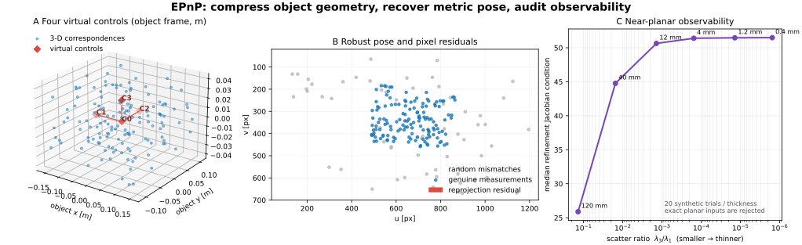
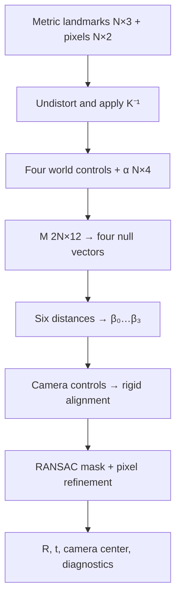

# EPnP: Efficient Metric Pose from 3-D–2-D Correspondences

Date: 2026-10-22 · Category: Geometry and Calibration · Level: advanced foundations

[Category index](README.md) · [CV index](../../README.md) · [Runnable NumPy/SciPy](../../examples/epnp-pose/) · [Executed validation](../../examples/epnp-pose/VALIDATION.md)



## Intellectual map and evidence labels

[Camera calibration](2026-10-19-zhang-camera-calibration.md) supplied the pixel-to-ray map. [Robust homography estimation](2026-10-20-lo-ransac-homography.md) handled wrong matches on a plane. [The essential matrix](2026-10-21-eight-point-essential-matrix.md) recovered relative camera motion without metric translation scale. EPnP now solves the complementary localization problem: **given known metric 3-D landmarks and their 2-D image measurements, where is the calibrated camera—or equivalently, where is the known object—in metric coordinates?**

Evidence labels used throughout:

- **Paper says:** directly attributable to a primary paper or official implementation.
- **Inference:** follows from the stated model or this lesson's executed experiments.
- **My interpretation:** an engineering recommendation or conceptual explanation.
- **Unknown:** not established by the sources or the supplied execution.

Primary sources:

- Vincent Lepetit, Francesc Moreno-Noguer, and Pascal Fua, [EPnP: An Accurate O(n) Solution to the PnP Problem, IJCV 2009](https://doi.org/10.1007/s11263-008-0152-6); [author-hosted paper PDF](https://www.tugraz.at/fileadmin/user_upload/Institute/ICG/Images/team_lepetit/publications/lepetit_ijcv08.pdf).
- EPFL CVLab's [official EPnP software page](https://www.epfl.ch/labs/cvlab/software/multi-view-stereo/epnp/) and [public reference repository](https://github.com/cvlab-epfl/EPnP).
- [OpenCV 4.13 solvePnP documentation](https://docs.opencv.org/4.13.0/d5/d1f/calib3d_solvePnP.html) and tagged [EPnP implementation](https://github.com/opencv/opencv/blob/4.13.0/modules/calib3d/src/epnp.cpp).
- Georgios Terzakis and Manolis Lourakis, [A Consistently Fast and Globally Optimal Solution to the Perspective-n-Point Problem, ECCV 2020](https://www.ecva.net/papers/eccv_2020/papers_ECCV/papers/123460460.pdf), the SQPnP comparison discussed later.

**Scope:** the supplied code is an original educational reconstruction, not the authors' code or a wrapper around OpenCV. It implements the non-planar four-control-point formulation, three beta initializations, five Gauss–Newton beta updates, absolute orientation, pixel reprojection refinement, and a compact robust wrapper. It deliberately requires at least six correspondences and rejects planar/near-planar point sets. The paper supports the theoretical case from four correspondences and includes planar handling; this teaching implementation does not reproduce every minimal or planar branch. Use a mature production solver when those cases matter.

## 1. Research problem

For each landmark $i$, we know a 3-D point in an object/world frame and measure its pixel in one calibrated image. We seek the rigid transform from that metric frame to the camera frame:

$$
\mathbf X_i^c=\mathbf R\mathbf X_i^w+\mathbf t,
\qquad
s_i\tilde{\mathbf p}_i=\mathbf K\mathbf X_i^c.
$$

where:

- $i\in\{1,\ldots,N\}$ indexes a correspondence;
- $\mathbf X_i^w\in\mathbb R^3$ is a known metric 3-D landmark in the world/object frame;
- $\mathbf X_i^c\in\mathbb R^3$ is that landmark in camera coordinates;
- $\mathbf R\in SO(3)$ is the $3\times3$ world-to-camera rotation;
- $\mathbf t\in\mathbb R^3$ is the world origin expressed in camera coordinates, in the same length unit as the landmarks;
- $\tilde{\mathbf p}_i=(u_i,v_i,1)^\top\in\mathbb P^2$ is a homogeneous undistorted pixel;
- $\mathbf K\in\mathbb R^{3\times3}$ is the intrinsic matrix in pixel units;
- $s_i=(\mathbf X_i^c)_z$ is camera-frame depth.

The returned translation is **not the camera center in world coordinates**. The camera center is the world point that maps to the camera origin:

$$
\mathbf C_w=-\mathbf R^\top\mathbf t.
$$

where:

- $\mathbf C_w\in\mathbb R^3$ is the camera optical center expressed in the world/object frame;
- $\mathbf R^\top=\mathbf R^{-1}$ because $\mathbf R$ is orthonormal;
- $\mathbf t$ follows the world-to-camera convention above.

This distinction matters in robotics: $\mathbf t$ locates the object's origin in the camera frame, while $\mathbf C_w$ locates the camera in the object's frame.

### Inputs, outputs, and coordinate contract

| Quantity | Shape | Unit / frame | Role |
|---|---:|---|---|
| landmarks `points_world` | `[N,3]` | meters (or another consistent unit), object/world frame | known geometry |
| observations `points_px` | `[N,2]` | `(u,v)` pixels | measured 2-D locations |
| intrinsics `K` | `[3,3]` | pixel focal/principal-point entries | calibrated projection |
| normalized observations | `[N,2]` | dimensionless camera rays | linear EPnP equations |
| virtual controls $\mathbf C_j^w$ | `[4,3]` | world units | compact affine basis |
| barycentric weights $\alpha_{ij}$ | `[N,4]` | dimensionless | preserve object geometry |
| projection matrix $\mathbf M$ | `[2N,12]` | mixed homogeneous scale | solve camera control points |
| pose $\mathbf R,\mathbf t$ | `[3,3]`, `[3]` | world-to-camera, metric translation | final state |
| robust inlier mask | `[N]` bool | pixel-threshold decision | correspondence support |

Image tensors and descriptors are upstream. EPnP receives sparse correspondences, so modality changes from RGB/features to geometric points before this solver. The implementation converts inputs immediately to `float64`; it never quantizes geometry.

## 2. Motivation and prior limitations

### DLT grows with all point coordinates

A direct camera-matrix DLT estimates 12 projective parameters and then recovers a calibrated pose. It is simple, but it does not exploit the rigid metric structure as tightly as a PnP solver, and naive formulations can be poorly conditioned.

### P3P is minimal but ambiguous

Three 3-D–2-D correspondences can generate several physical pose candidates. A fourth point disambiguates, and robust pipelines commonly use P3P/AP3P hypotheses. The price is polynomial case logic and multiple solutions. Minimal solvers are excellent inside RANSAC but less transparent as a first derivation.

### Iterative pose optimization needs an initialization

Minimizing pixel reprojection error is the right final objective for many applications, but rotation makes the problem nonlinear. A local optimizer can converge to an undesirable basin, especially with poor initialization, weak depth spread, or outliers.

### EPnP's key trade

**Paper says:** EPnP has $O(N)$ complexity because it expresses every 3-D point using four virtual control points and solves a constant-size recovery problem after accumulating linear constraints. The paper reports accuracy competitive with iterative methods in its evaluated settings.

**My interpretation:** EPnP is valuable because it separates the part that scales with $N$ from the small nonlinear part. All landmarks contribute linearly to one $2N\times12$ matrix, but the metric constraints depend only on four coefficients. That structure is both efficient and inspectable.

## 3. Key insight: replace $N$ unknown camera points by four controls

Choose four non-coplanar virtual control points $\mathbf C_0^w,\ldots,\mathbf C_3^w$. Because they form an affine basis in 3-D, every landmark has barycentric coordinates:

$$
\mathbf X_i^w=\sum_{j=0}^{3}\alpha_{ij}\mathbf C_j^w,
\qquad
\sum_{j=0}^{3}\alpha_{ij}=1.
$$

where:

- $\mathbf C_j^w\in\mathbb R^3$ is virtual control point $j$ in world coordinates;
- $\alpha_{ij}\in\mathbb R$ is landmark $i$'s affine weight for control $j$;
- the weights sum to one, so translations preserve the representation;
- $N$ may be large, but there are always four controls on this non-planar path.

A rigid transform preserves affine combinations:

$$
\mathbf X_i^c
=\mathbf R\mathbf X_i^w+\mathbf t
=\sum_{j=0}^{3}\alpha_{ij}(\mathbf R\mathbf C_j^w+\mathbf t)
=\sum_{j=0}^{3}\alpha_{ij}\mathbf C_j^c.
$$

where:

- $\mathbf C_j^c=\mathbf R\mathbf C_j^w+\mathbf t\in\mathbb R^3$ is control $j$ in camera coordinates;
- the equality uses $\sum_j\alpha_{ij}=1$;
- only the 12 scalar coordinates of four $\mathbf C_j^c$ are initially unknown.

This is the conceptual compression: the algorithm does not independently estimate (N) camera-frame points. It estimates four camera-frame controls, reconstructs all (N) camera points by the known weights, and then aligns the two point clouds rigidly.

## 4. Choosing stable virtual control points

The code uses the centroid and principal axes of the landmark scatter matrix, matching the public/OpenCV construction:

$$
\bar{\mathbf X}=\frac1N\sum_{i=1}^{N}\mathbf X_i^w,
\qquad
\mathbf S=\sum_{i=1}^{N}(\mathbf X_i^w-\bar{\mathbf X})(\mathbf X_i^w-\bar{\mathbf X})^\top.
$$

where:

- $\bar{\mathbf X}\in\mathbb R^3$ is the landmark centroid;
- $\mathbf S\in\mathbb R^{3\times3}$ is an unnormalized scatter matrix with squared-length units;
- its eigenpairs are $\lambda_k,\mathbf v_k$, ordered $\lambda_1\ge\lambda_2\ge\lambda_3\ge0$.

Set the controls to:

$$
\mathbf C_0^w=\bar{\mathbf X},
\qquad
\mathbf C_k^w=\bar{\mathbf X}+\sqrt{\lambda_k/N}\,\mathbf v_k,
\quad k\in\{1,2,3\}.
$$

where:

- $\sqrt{\lambda_k/N}$ is the root-mean-square spread along principal axis $k$, in world length units;
- $\mathbf v_k\in\mathbb R^3$ is a unit eigenvector;
- the four controls need not be physical landmarks or lie inside the object.

The implementation reports $\lambda_3/\lambda_1$ as a scale-invariant thickness diagnostic and rejects ratios below $10^{-8}$. That cutoff is an implementation contract, not a universal safe threshold.

### Small barycentric example

Let the controls be the origin and the three unit-axis points. Then the landmark $\mathbf X=(0.2,0.3,0.1)^\top$ has weights:

$$
(\alpha_0,\alpha_1,\alpha_2,\alpha_3)=(0.4,0.2,0.3,0.1),
$$

where:

- $\alpha_1,\alpha_2,\alpha_3$ multiply the unit $x,y,z$ controls;
- $\alpha_0=1-0.2-0.3-0.1=0.4$ multiplies the origin;
- the weights sum to one and reconstruct $\mathbf X$.

Weights may be negative for points outside the control tetrahedron; barycentric here means affine, not a probability simplex.

## 5. Projection constraints: a $2N\times12$ nullspace

Convert an undistorted pixel to a normalized point:

$$
\tilde{\mathbf x}_i=\mathbf K^{-1}\tilde{\mathbf p}_i,
\qquad
\mathbf x_i=(x_i,y_i,1)^\top
=\frac{\tilde{\mathbf x}_i}{(\tilde{\mathbf x}_i)_3}.
$$

where:

- $\tilde{\mathbf p}_i=(u_i,v_i,1)^\top$ is a homogeneous undistorted pixel;
- $\mathbf K^{-1}$ removes intrinsic calibration;
- (x_i,y_i) are dimensionless normalized image coordinates;
- the division makes the third coordinate one.

Let $\mathbf C_j^c=(c_{jx},c_{jy},c_{jz})^\top$. Perspective projection gives $X_i^c=x_iZ_i^c$ and $Y_i^c=y_iZ_i^c$. Substitute the control-point expansion:

$$
\sum_{j=0}^{3}\alpha_{ij}(c_{jx}-x_i c_{jz})=0,
\qquad
\sum_{j=0}^{3}\alpha_{ij}(c_{jy}-y_i c_{jz})=0.
$$

where:

- each correspondence contributes two homogeneous linear equations;
- (c_{jx},c_{jy},c_{jz}) are camera-frame control coordinates;
- $\alpha_{ij}$ are already known from object geometry;
- (x_i,y_i) are already known from the calibrated pixel.

Stack the unknown controls into a 12-vector:

$$
\mathbf c=
[\mathbf C_0^{c\top},\mathbf C_1^{c\top},
\mathbf C_2^{c\top},\mathbf C_3^{c\top}]^\top,
\qquad
\mathbf M\mathbf c=\mathbf0,
\quad \mathbf M\in\mathbb R^{2N\times12}.
$$

where:

- $\mathbf c\in\mathbb R^{12}$ concatenates four 3-D camera controls;
- $\mathbf M$ contains the coefficients from the two equations above;
- the homogeneous system alone determines $\mathbf c$ only up to a family of nullspace combinations.

For example, the $x$-equation contributes block $\alpha_{ij}[1,0,-x_i]$ for control $j$, and the $y$-equation contributes $\alpha_{ij}[0,1,-y_i]$.

Compute the four right singular vectors of $\mathbf M$ with smallest singular values and write:

$$
\mathbf c=\sum_{k=0}^{3}\beta_k\mathbf v_k.
$$

where:

- $\mathbf v_k\in\mathbb R^{12}$ is a small-singular-value right singular vector reshaped as four 3-D control points;
- $\beta_k\in\mathbb R$ is an unknown coefficient;
- four basis directions are retained because the image equations do not yet impose all metric rigidity constraints.

**Paper says:** this nullspace parameterization is the bridge from a problem whose data size grows with $N$ to a constant-size recovery in four $\beta$ values.

## 6. Restore metric structure with six control distances

The world-to-camera map is rigid, so all six pairwise distances among four controls are preserved:

$$
\left\|\mathbf C_a^c-\mathbf C_b^c\right\|_2^2
=\left\|\mathbf C_a^w-\mathbf C_b^w\right\|_2^2
=\rho_{ab},
\quad 0\le a<b\le3.
$$

where:

- $(a,b)$ ranges over the six unordered control pairs;
- $\rho_{ab}$ is a known squared distance in world length squared;
- camera control points are functions of $\beta_0,\ldots,\beta_3$.

For pair $(a,b)$, define the basis difference $\mathbf d_k^{ab}=\mathbf v_{k,a}-\mathbf v_{k,b}\in\mathbb R^3$. Expanding the squared norm produces quadratic beta products:

$$
\left\|\sum_{k=0}^{3}\beta_k\mathbf d_k^{ab}\right\|_2^2
=\sum_{k=0}^{3}\sum_{\ell=0}^{3}
\beta_k\beta_\ell\,{\mathbf d_k^{ab}}^\top\mathbf d_\ell^{ab}
=\rho_{ab}.
$$

where:

- $\mathbf v_{k,a}\in\mathbb R^3$ is control $a$'s part of nullspace vector $k$;
- each inner product is a known scalar;
- beta products are the only unknowns.

Collect the ten distinct symmetric products:

$$
\mathbf b=
[\beta_0^2,\beta_0\beta_1,\beta_1^2,
\beta_0\beta_2,\beta_1\beta_2,\beta_2^2,
\beta_0\beta_3,\beta_1\beta_3,\beta_2\beta_3,\beta_3^2]^\top,
\qquad
\mathbf L\mathbf b=\boldsymbol\rho.
$$

where:

- $\mathbf b\in\mathbb R^{10}$ contains unique degree-two monomials;
- $\mathbf L\in\mathbb R^{6\times10}$ is built from basis-difference inner products, with factors of two on cross terms;
- $\boldsymbol\rho\in\mathbb R^6$ contains the six known squared world distances.

The system is underdetermined if its ten entries are treated independently because valid entries must factor through only four beta values. EPnP therefore builds several reduced approximations, converts them into beta initializations, refines each, reconstructs a pose, and keeps the candidate with positive depth and lowest reprojection error.

### Three initializations and Gauss–Newton

The public/OpenCV structure used here forms three approximations from selected columns of $\mathbf L$: a four-term approximation involving $\beta_0$, then two approximations involving the leading two or three beta components. Each yields one $\boldsymbol\beta^{(0)}\in\mathbb R^4$.

For nonlinear refinement define:

$$
\mathbf r(\boldsymbol\beta)=
\boldsymbol\rho-\mathbf L\mathbf b(\boldsymbol\beta),
\qquad
\mathbf J=\frac{\partial(\mathbf L\mathbf b)}{\partial\boldsymbol\beta}
\in\mathbb R^{6\times4}.
$$

where:

- $\boldsymbol\beta=(\beta_0,\beta_1,\beta_2,\beta_3)^\top$;
- $\mathbf r\in\mathbb R^6$ is the distance-constraint residual;
- $\mathbf J$ is its sign-adjusted prediction Jacobian used in the update.

One Gauss–Newton step solves:

$$
\Delta\boldsymbol\beta
=\arg\min_{\Delta\in\mathbb R^4}
\left\|\mathbf J\Delta-\mathbf r\right\|_2^2,
\qquad
\boldsymbol\beta\leftarrow\boldsymbol\beta+\Delta\boldsymbol\beta.
$$

where:

- $\Delta\boldsymbol\beta\in\mathbb R^4$ is a least-squares increment;
- the code runs at most five iterations for each of three initializations;
- all matrices here have constant size independent of (N).

This inner update is not a full pixel reprojection optimizer. It only restores distances among virtual controls.

## 7. Recover all camera points, then the rigid pose

Once beta is selected, reconstruct camera controls and all camera-frame landmarks:

$$
\mathbf C_j^c=\sum_{k=0}^{3}\beta_k\mathbf v_{k,j},
\qquad
\widehat{\mathbf X}_i^c=\sum_{j=0}^{3}\alpha_{ij}\mathbf C_j^c.
$$

where:

- $\mathbf v_{k,j}\in\mathbb R^3$ is the $j$-th control block of basis vector $k$;
- $\widehat{\mathbf X}_i^c\in\mathbb R^3$ is the reconstructed camera point;
- a global sign is flipped when the median reconstructed depth is negative.

Now solve the absolute-orientation problem:

$$
(\mathbf R^*,\mathbf t^*)=
\arg\min_{\mathbf R\in SO(3),\,\mathbf t\in\mathbb R^3}
\sum_{i=1}^{N}
\left\|\widehat{\mathbf X}_i^c-(\mathbf R\mathbf X_i^w+\mathbf t)\right\|_2^2.
$$

where:

- $\mathbf R^*,\mathbf t^*$ are the closed-form EPnP pose;
- the objective is in 3-D reconstructed coordinates, not pixels;
- SVD enforces a proper rotation with determinant (+1).

With centered point matrices, form the cross-covariance and take its SVD:

$$
\mathbf H=\sum_i
(\widehat{\mathbf X}_i^c-\bar{\mathbf X}^c)
(\mathbf X_i^w-\bar{\mathbf X}^w)^\top
=\mathbf U\boldsymbol\Sigma\mathbf V^\top,
\qquad
\mathbf R=\mathbf U\mathbf D\mathbf V^\top.
$$

where:

- $\mathbf H\in\mathbb R^{3\times3}$ is the cross-covariance;
- $\mathbf U,\mathbf V\in O(3)$ come from its SVD;
- $\mathbf D=\operatorname{diag}(1,1,\det(\mathbf U\mathbf V^\top))$ removes a reflection;
- $\mathbf t=\bar{\mathbf X}^c-\mathbf R\bar{\mathbf X}^w$.

Finally, select the beta initialization by positive-depth fraction and pixel reprojection RMSE.

## 8. Pixel reprojection refinement

The closed-form pose is an initializer. The code optionally minimizes pixel residuals using a rotation vector and SciPy's trust-region least-squares solver:

$$
\min_{\boldsymbol\omega,\mathbf t}
\sum_{i\in\mathcal I}
\rho\!\left(
\left\|
\pi\!\left(\mathbf K,
\exp([\boldsymbol\omega]_\times)\mathbf X_i^w+\mathbf t
\right)-\mathbf p_i
\right\|_2^2
\right).
$$

where:

- $\boldsymbol\omega\in\mathbb R^3$ is an axis-angle rotation vector;
- $\exp([\boldsymbol\omega]_\times)\in SO(3)$ is its matrix exponential;
- $\pi$ performs perspective division and returns an inhomogeneous pixel;
- $\mathcal I$ is the fit set, ideally robust inliers;
- $\rho$ is linear loss for oracle/clean refinement or Huber loss in the robust wrapper.

**Inference from execution:** over 20 synthetic clean-inlier trials, pixel refinement improved the median rotation error from $0.1307^\circ$ to $0.1084^\circ$ and median translation error from $0.4277$ mm to $0.3226$ mm. This is distribution-specific, not a benchmark.

**My interpretation:** use EPnP to enter a good basin, then refine the actual sensor objective. For multi-view systems, joint bundle adjustment is usually more informative than independently refining each frame.

## 9. Outliers: robust estimation around a non-minimal solver

EPnP assumes correspondences are correct. Learned matchers, fiducial detectors, and VLM-proposed associations can be wrong. The included wrapper samples six correspondences, estimates a pose, evaluates all matches in pixels, and uses a capped MSAC-style cost:

$$
S(\mathbf R,\mathbf t)
=\sum_{i=1}^{N}
\min\left(e_i^2,\tau^2\right),
\qquad
e_i=\left\|\pi(\mathbf K,\mathbf R\mathbf X_i^w+\mathbf t)-\mathbf p_i\right\|_2.
$$

where:

- $e_i$ is Euclidean reprojection error in pixels;
- $\tau=3$ px in the main experiment;
- smaller $S$ is better;
- the final mask is $e_i\le\tau$.

The approximate adaptive draw budget is:

$$
T=\left\lceil
\frac{\log(1-p)}{\log(1-w^s)}
\right\rceil.
$$

where:

- $p\in(0,1)$ is the requested probability of drawing at least one all-inlier sample under the model assumptions;
- $w\in[0,1]$ is the estimated inlier fraction;
- $s=6$ is this implementation's non-minimal sample size;
- the formula assumes independent sampling and a single valid dominant model.

Six points are an engineering choice for this reconstruction, not a claim that EPnP's theoretical minimum is six. Production systems often use P3P/AP3P or SQPnP in a mature RANSAC/USAC framework.

After a winning mask is found, the wrapper refits on all selected points, performs Huber reprojection refinement, and re-evaluates the mask up to three times. It is educational local refinement, not a reproduction of a specific LO-RANSAC schedule.

## 10. Implementation anatomy and data flow



| Module | Input → output | Purpose | Precision |
|---|---|---|---|
| `pixels_to_normalized` | pixels `[N,2]`, `K [3,3]` → rays `[N,2]` | calibrated coordinate contract | float64 |
| `choose_control_points` | landmarks `[N,3]` → controls `[4,3]` | PCA affine basis and thickness diagnostic | float64 eigendecomposition |
| `barycentric_coordinates` | landmarks + controls → `alpha [N,4]` | preserve object geometry | float64 linear solve |
| `build_projection_matrix` | `alpha`, rays → `M [2N,12]` | image constraints | float64 |
| `distance_constraint_system` | four null vectors → `L [6,10]`, `rho [6]` | metric rigidity | float64 |
| `solve_epnp` | correspondences → closed-form pose | three beta paths and pose selection | float64 SVD/least squares |
| `refine_pose` | pose + fit set → refined pose | pixel objective and Jacobian condition | float64 SciPy |
| `ransac_epnp` | noisy matches → pose + mask | reject mismatches | float64 geometry |

Minimal use:

```python
from epnp_pose import camera_center_world, ransac_epnp

fit = ransac_epnp(
    points_world,          # [N,3], meters, object frame
    points_px,             # [N,2], undistorted (u,v) pixels
    K,                     # [3,3], matched to this image transform
    threshold_px=3.0,
    seed=20261022,
)

R_camera_from_object = fit.pose.R          # [3,3]
t_object_origin_in_camera_m = fit.pose.t   # [3]
C_camera_in_object_m = camera_center_world(
    fit.pose.R, fit.pose.t
)
inliers = fit.inliers                      # [N] bool
```

### Crop and resize rule

If an image preprocessing transform $\mathbf A$ maps original homogeneous pixels to processed pixels, transform the intrinsics too:

$$
\tilde{\mathbf p}'=\mathbf A\tilde{\mathbf p},
\qquad
\mathbf K'=\mathbf A\mathbf K,
\qquad
{\mathbf K'}^{-1}\tilde{\mathbf p}'=\mathbf K^{-1}\tilde{\mathbf p}.
$$

where:

- $\mathbf A\in\mathbb R^{3\times3}$ is a known crop/resize affine transform in homogeneous pixels;
- primed quantities live in the processed image coordinates;
- consistent transformation preserves the calibrated ray.

Check 8 verifies this identity numerically. Stale intrinsics after a crop can look like a plausible pose bias rather than an obvious crash.

## 11. Experiments and evidence

All commands, versions, and full-precision JSON are recorded in [VALIDATION.md](../../examples/epnp-pose/VALIDATION.md). No number below is copied from a paper.

### 11.1 Main synthetic experiment

Seed `20261022` creates 200 matches: 140 genuine projections and 60 independent random mismatches. Genuine pixel coordinates receive Gaussian noise with $0.65$ px standard deviation per axis. The 3-D object spans $0.32\times0.22\times0.08$ m and sits about $0.78$ m from the camera.

| Estimator | Rotation error | Translation error | Reprojection RMSE on fit set | Support |
|---|---:|---:|---:|---:|
| all-match closed-form EPnP | 177.1110° | 160.1633 mm | 272.6648 px | all 200 |
| robust EPnP + Huber refinement | 0.1600° | 0.3013 mm | 0.8827 px | 140 |

The robust mask had precision 1.0 and recall 1.0, using 96 draws. Median selected reprojection error was 0.7462 px.

**Inference:** this particular independent-random-outlier distribution is easy for geometric consensus and catastrophic for ordinary least squares.

**Unknown:** the same mask quality under repeated texture, correlated learned-matcher errors, motion blur, distortion, or real object symmetries. Perfect synthetic mask recovery is not a general reliability claim.

### 11.2 Twenty-seed ablation

| Variant / metric | Median | P90 | Worst |
|---|---:|---:|---:|
| all-match rotation | 76.5547° | 114.4260° | 177.1110° |
| all-match translation | 289.8771 mm | 452.7493 mm | 578.4654 mm |
| oracle-inlier closed-form rotation | 0.1307° | 0.2368° | 0.2680° |
| oracle-inlier closed-form translation | 0.4277 mm | 1.1493 mm | 1.2566 mm |
| oracle-inlier refined rotation | 0.1084° | 0.1555° | 0.2132° |
| oracle-inlier refined translation | 0.3226 mm | 0.5447 mm | 0.7802 mm |
| robust refined rotation | 0.1084° | 0.1555° | 0.2132° |
| robust refined translation | 0.3226 mm | 0.5447 mm | 0.7802 mm |

All 20 robust masks exactly matched the random-outlier ground truth, so robust and oracle-refined statistics coincide. Across the clean closed-form fits, beta initializers 1, 2, and 3 won 6, 5, and 9 times. Testing only one initialization would therefore be unjustified on this distribution.

### 11.3 Thickness and observability study

Twenty outlier-free trials were executed per object thickness. Noise remained (0.65) px per coordinate.

| Object thickness | Median $\lambda_3/\lambda_1$ | Median rotation | Median translation | Median refinement Jacobian condition |
|---:|---:|---:|---:|---:|
| 120 mm | 0.137604 | 0.0887° | 0.3091 mm | 25.88 |
| 40 mm | 0.015416 | 0.1300° | 0.2993 mm | 44.77 |
| 12 mm | 0.001389 | 0.1516° | 0.3169 mm | 50.64 |
| 4 mm | 0.000154 | 0.1497° | 0.3316 mm | 51.40 |
| 1.2 mm | 0.0000139 | 0.1464° | 0.3343 mm | 51.47 |
| 0.4 mm | 0.00000154 | 0.1451° | 0.3334 mm | 51.49 |

**Inference:** the refinement Jacobian became less well conditioned as the object became thin, then plateaued in this favorable view. Pose accuracy did not collapse in these trials. “Nearly planar” does not mean “must fail”; it means observability and solver-branch assumptions require explicit inspection.

Exact planar input is rejected because this code omits the planar branch. OpenCV documents IPPE/IPPE-SQUARE for planar configurations. A production system should use the solver matched to the geometry rather than nudging a zero coordinate to bypass a guard.

### 11.4 Coherent wrong-pose failure

A second synthetic scene contains 100 correspondences from the intended object pose and 150 correspondences consistent with a different pose. RANSAC selected all 150 distractor matches and none of the intended matches. The selected pose was only $0.1367^\circ$ and $0.1347$ mm from the distractor, but $38.1445^\circ$ and $169.0641$ mm from the intended pose.

**Inference:** robust estimation answers “which pose has the strongest geometric support?” It does not answer “which physical object did the task mean?”

**My interpretation:** an embodied system must bind correspondences to object identity before or jointly with pose estimation. VLM semantics can propose that binding, but geometry should verify it, and neither subsystem should silently override the other's uncertainty.

## 12. Integrated application: robot fixture grasp transform

The included application estimates a metric fixture-to-camera pose and transforms a planned grasp point and approach axis:

$$
\mathbf g_c=\mathbf R\mathbf g_o+\mathbf t,
\qquad
\mathbf a_c=\mathbf R\mathbf a_o.
$$

where:

- $\mathbf g_o\in\mathbb R^3$ is a grasp point in the object/fixture frame, in meters;
- $\mathbf g_c\in\mathbb R^3$ is the same point in the camera frame;
- $\mathbf a_o,\mathbf a_c\in\mathbb R^3$ are unit direction vectors, so translation does not apply to them;
- $\mathbf R,\mathbf t$ are the estimated object-to-camera pose.

For the deterministic synthetic example, the solver selected 160 correspondences. Pose errors were $0.1146^\circ$ rotation and $0.6936$ mm translation; the transformed grasp-point error was $0.6453$ mm. These are synthetic truth comparisons, not robot accuracy measurements.

Practical integrations:

- **Robotic manipulation:** localize a rigid fixture, bin, or tagged tool, then compose camera-to-robot extrinsics. Collision checking still needs calibrated uncertainty and timestamp alignment.
- **VLA:** convert language-selected object identity into a correspondence subset; attach pose health metrics to the policy state rather than a bare transform.
- **Visual–tactile sensing:** estimate rigid sensor housing motion from stable markers while excluding the deforming contact patch whose motion is the signal of interest.
- **Surgical imaging:** track a rigid calibrated instrument from known 3-D landmarks, but account for specularities, occlusion, rolling shutter, and tissue deformation. A strong consensus on tissue is not instrument pose.

## 13. Failure modes and diagnostics

### Wrong distortion or preprocessing contract

EPnP's pinhole equations assume undistorted observations under the supplied $\mathbf K$. Fisheye points, stale crop offsets, digital stabilization, focus breathing, or inconsistent `(row,column)` versus `(u,v)` ordering bias the pose.

### Planar and nearly planar geometry

Four non-coplanar controls become singular as $\lambda_3\to0$. Use a planar formulation such as IPPE when the target is a marker or board. Monitor the scatter ratio and the final Jacobian, but calibrate thresholds on task-relevant data.

### Collinear or spatially concentrated landmarks

Many points are not automatically informative. Points along one line or in a tiny image patch constrain some pose directions weakly. Track 3-D spread, image coverage, depth range, and Jacobian singular values—not count alone.

### Points behind the camera

Algebra can produce sign-related or otherwise nonphysical candidates. The code prefers positive depth, but a high positive-depth fraction is not a calibrated confidence score.

### Object symmetry and repeated texture

Different physical poses may generate indistinguishable or coherently wrong associations. RANSAC can confidently select the wrong symmetric instance. Add marker IDs, semantic instance binding, temporal continuity, or task-specific constraints.

### Mixed rigid bodies

Camera motion, robot links, instruments, and background may each support a valid pose. The largest consensus is a model-selection outcome, not an identity guarantee, as the executed distractor experiment demonstrates.

### Rolling shutter, motion blur, and latency

One global pose assumes a single exposure time. Fast motion and row-dependent capture create a time-varying transform; unsynchronized landmark positions and images create the same kind of bias. A lower residual from a flexible fit does not restore the rigid single-pose interpretation.

### Unit mismatch

PnP is metric only relative to the 3-D model. If CAD points are millimeters and downstream code interprets $\mathbf t$ as meters, rotation remains plausible while translation is wrong by $1000\times$. Check 9 confirms that scaling all world coordinates scales translation but leaves pixels and rotation unchanged.

### Local refinement on outliers

Least squares will faithfully optimize the wrong objective if the mask is contaminated. Use robust loss and iterate mask/refit cautiously. Do not claim uncertainty from a Jacobian condition number alone; it omits correspondence uncertainty, calibration error, and model mismatch.

## 14. EPnP, SQPnP, planar solvers, and production choices

| Situation | Appropriate starting point | Why |
|---|---|---|
| many non-planar correspondences, need fast initializer | EPnP | linear in point count, transparent closed form |
| minimal robust hypotheses | P3P / AP3P | small samples improve RANSAC probability |
| planar marker/board | IPPE / IPPE-SQUARE | explicitly models planar geometry and pose ambiguities |
| want a globally optimal modern PnP solver | SQPnP | paper provides a consistently fast globally optimal formulation |
| highest final accuracy across frames | robust initializer + bundle adjustment | optimizes the actual multi-view reprojection objective |

**Paper says:** SQPnP presents a globally optimal PnP solution and reports consistently fast performance in its experiments. OpenCV 4.13 exposes `SOLVEPNP_SQPNP`, `SOLVEPNP_EPNP`, `SOLVEPNP_IPPE`, and refinement functions.

**Unknown:** which solver is best for the user's camera, target geometry, outlier process, latency target, and OpenCV build. This lesson did not execute OpenCV, SQPnP, P3P, IPPE, or a real benchmark. The correct comparison is paired on the deployment distribution.

## 15. Computational cost and deployment

Building barycentric weights and $\mathbf M$ is $O(N)$. The SVD is on a $2N\times12$ matrix, so its asymptotic dependence is linear in $N$ with a small fixed column dimension. Beta recovery uses fixed $6\times10$ and $6\times4$ systems. Pixel scoring is $O(N)$ per robust hypothesis. Nonlinear refinement evaluates $2N$ residual components per iteration.

Memory is $O(N)$ for correspondences, weights, residuals, and $\mathbf M$. In an optimized implementation, normal equations or incremental accumulation can reduce temporary storage, but numerical behavior must be validated.

### ONNX and TensorRT

The dense learned front end—detector, keypoint network, descriptor, matcher, or VLM vision encoder—is a good accelerator target. The robust geometric tail contains random sampling, adaptive loops, dynamic masks, small SVD/eigendecompositions, and branching. Those operations are usually easier to test and observe in CPU C++ than in a monolithic TensorRT graph.

INT8 quantization is inappropriate for the small geometric differences that define nullspaces and rotations. FP16 may also be fragile for poorly scaled coordinates. Keep the geometry at least FP32; use FP64 when available and justified by validation. Quantize the learned front end separately and verify that its changed localization noise does not alter the RANSAC threshold calibration.

### Jetson implications

On Jetson-class systems, run the neural matcher on GPU and transfer only compact keypoints, landmark IDs, confidences, and timestamps. Batch transfers, avoid device synchronization per match, and run a mature CPU PnP/USAC path. Return diagnostics: support, residual quantiles, image coverage, 3-D scatter eigenvalues, positive-depth fraction, beta path, refinement iterations, and Jacobian singular values.

No ONNX, TensorRT, Jetson, FP32, FP16, INT8, latency, power, or memory benchmark was run here. There is no embedded performance claim.

## 16. Reproduction and validation

From `CV/examples/epnp-pose/`:

```bash
python -m pip install -r requirements.txt
OPENBLAS_NUM_THREADS=1 python checks.py
OPENBLAS_NUM_THREADS=1 python demo.py
OPENBLAS_NUM_THREADS=1 python demo.py --ablations
OPENBLAS_NUM_THREADS=1 python demo.py --thickness
OPENBLAS_NUM_THREADS=1 python demo.py --failure-case
OPENBLAS_NUM_THREADS=1 python application.py
OPENBLAS_NUM_THREADS=1 python make_figure.py ../../assets/epnp-pose/control-points-and-observability.svg
```

Expected high-level results:

- all 16 numerical checks pass;
- exact noise-free non-minimal recovery is near machine precision;
- all-match EPnP fails under 30% random mismatches, while the robust wrapper recovers 140/140 true support for the main seed;
- all three beta initializers win at least once over 20 clean trials;
- thin-object Jacobian conditioning worsens in the controlled study without a pose-accuracy collapse;
- the coherent distractor wins despite being the semantically wrong object;
- the robot fixture example transforms a metric grasp point without confusing $\mathbf t$ and camera center.

Floating-point libraries can change last digits. The exact records are evidence for one environment, not universal tolerances.

## 17. Practical checklist

Before trusting a PnP pose:

- verify the world-to-camera convention and explicitly derive the camera center;
- preserve 3-D model units end to end;
- undistort observations under the correct camera model;
- transform $\mathbf K$ with every crop, resize, or image rotation;
- inspect 3-D rank/thickness and 2-D spatial coverage;
- choose planar, minimal, EPnP, or globally optimal solvers according to geometry and robust-estimation needs;
- score hypotheses in pixels with a threshold calibrated to detector noise;
- refine on a verified support set using the actual projection model;
- separate geometric consensus from object identity;
- record residual quantiles, support, depth, conditioning, and temporal consistency;
- reject uncertain updates instead of always returning a transform;
- validate on real devices and failure distributions before controlling a robot or supporting a clinical workflow.

EPnP's four virtual points are the elegant core. The trustworthy system is the larger contract around coordinates, identity, degeneracy, robustness, and deployment evidence.
