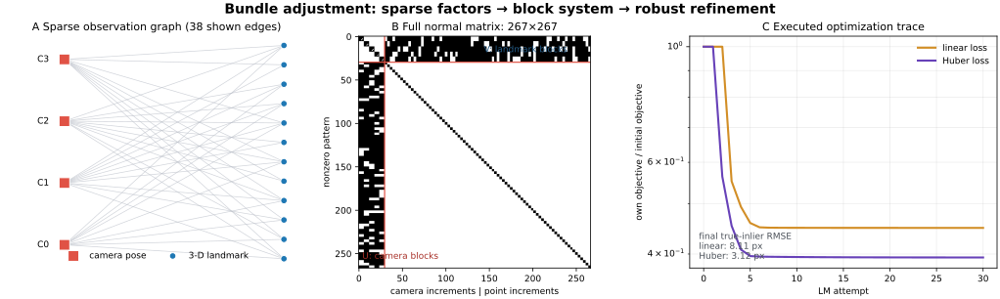
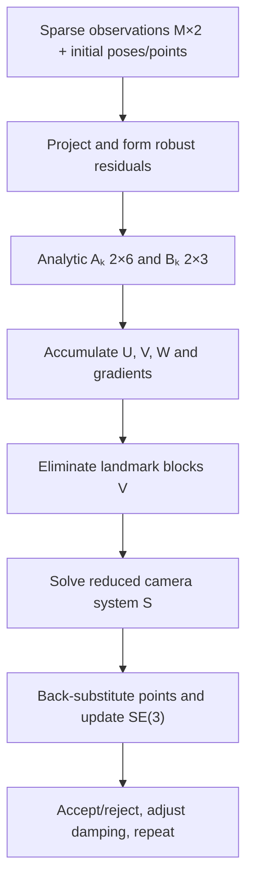

# Schur-Complement Bundle Adjustment: Joint Camera and Structure Refinement

Date: 2026-10-23 · Category: Geometry and Calibration · Level: advanced foundations

[Category index](README.md) · [CV index](../../README.md) · [Runnable NumPy](../../examples/schur-bundle-adjustment/) · [Executed validation](../../examples/schur-bundle-adjustment/VALIDATION.md)



## Intellectual map and evidence labels

The preceding lessons estimated pieces of a reconstruction: [calibration](2026-10-19-zhang-camera-calibration.md), [robust planar geometry](2026-10-20-lo-ransac-homography.md), [two-view relative pose](2026-10-21-eight-point-essential-matrix.md), and [metric 3-D–2-D pose](2026-10-22-epnp-pose.md). Bundle adjustment $BA$ is where those provisional camera poses and triangulated landmarks become one coupled estimate. Every observation links one camera to one landmark; optimizing all links together distributes information across the entire visibility graph.

Evidence labels used throughout:

- **Paper says:** attributable to a cited primary paper or official implementation.
- **Inference:** follows from the model or this lesson's executed experiments.
- **My interpretation:** an engineering recommendation or conceptual explanation.
- **Unknown:** not established by the sources or the supplied execution.

Primary sources and implementations:

- Bill Triggs, Philip McLauchlan, Richard Hartley, and Andrew Fitzgibbon, [Bundle Adjustment — A Modern Synthesis](https://inria.hal.science/inria-00590128), 2000; [paper PDF](https://www.cs.jhu.edu/~misha/ReadingSeminar/Papers/Triggs00.pdf). This is the foundational modern survey used for the problem structure, gauge discussion, and sparse second-order viewpoint.
- Sameer Agarwal et al., [Bundle Adjustment in the Large](https://homes.cs.washington.edu/~sagarwal/bal.pdf), ECCV 2010, and the [BAL datasets](https://grail.cs.washington.edu/projects/bal/). This is the primary large-scale comparison referenced for iterative reduced-camera solvers.
- The official [Ceres Solver bundle-adjustment tutorial]$https://ceres-solver.org/nnls_tutorial.html#bundle-adjustment$, [nonlinear least-squares solver documentation]$https://ceres-solver.org/nnls_solving.html$, and [bundle-adjuster example]$https://github.com/ceres-solver/ceres-solver/blob/master/examples/bundle_adjuster.cc$.
- Nikolaus Demmel et al., [Square Root Bundle Adjustment for Large-Scale Reconstruction]$https://openaccess.thecvf.com/content/CVPR2021/html/Demmel_Square_Root_Bundle_Adjustment_for_Large-Scale_Reconstruction_CVPR_2021_paper.html$, CVPR 2021, with the authors' [RootBA repository](https://github.com/nikolausdemmel/rootba).
- Rainer Kümmerle et al., [g2o: A General Framework for Graph Optimization](https://ais.informatik.uni-freiburg.de/publications/papers/kuemmerle11icra.pdf), ICRA 2011, and the [official repository](https://github.com/RainerKuemmerle/g2o).

**Scope:** the supplied implementation is an original educational reconstruction. It uses calibrated fixed intrinsics, world-to-camera poses, analytic Jacobians, left-multiplicative local pose updates, isotropic Huber IRLS, Levenberg–Marquardt-style damping, explicit camera and scale anchors, and landmark Schur elimination. It stores the reduced camera matrix densely for inspectability. It is not Ceres, g2o, COLMAP, GTSAM, RootBA, a sparse Cholesky package, a sliding-window marginalizer, or a benchmark implementation.

## 1. Research problem

We have $C$ cameras, $P$ world landmarks, and $M$ observed image measurements. Observation $k$ says that camera $i_k$ sees landmark $j_k$ at pixel $\mathbf z_k$. Bundle adjustment jointly refines camera and landmark parameters by minimizing reprojection error:

$$
\min_{\{\mathbf R_i,\mathbf t_i\},\{\mathbf X_j\}}
\sum_{k=1}^{M}
\rho\!\left(
\left\|
\pi\!\left(\mathbf K,\mathbf R_{i_k}\mathbf X_{j_k}+\mathbf t_{i_k}\right)
-\mathbf z_k
\right\|_2
\right).
$$

where:

- $C$ is the number of cameras and $P$ is the number of 3-D landmarks;
- $M$ is the number of visible camera–landmark observations, usually much smaller than $CP$;
- $i_k\in\{0,\ldots,C-1\}$ and $j_k\in\{0,\ldots,P-1\}$ are the camera and point indices for observation $k$;
- $\mathbf T_i=(\mathbf R_i,\mathbf t_i)\in SE(3)$ maps world coordinates to camera $i$;
- $\mathbf X_j\in\mathbb R^3$ is landmark $j$ in world coordinates;
- $\mathbf K\in\mathbb R^{3\times3}$ is the fixed intrinsic matrix;
- $\pi$ performs calibrated perspective projection into pixels;
- $\mathbf z_k\in\mathbb R^2$ is an undistorted measured pixel in `(u,v)` order;
- $\rho$ is a robust loss of a nonnegative residual norm; $\rho(e)=\tfrac12e^2$ gives ordinary least squares under this lesson's cost convention.

The pose convention is:

$$
\mathbf X_{ij}^c=\mathbf R_i\mathbf X_j+\mathbf t_i,
\qquad
\mathbf C_i^w=-\mathbf R_i^\top\mathbf t_i.
$$

where:

- $\mathbf X_{ij}^c\in\mathbb R^3$ is landmark $j$ expressed in camera $i$'s frame;
- $\mathbf R_i\in SO(3)$ is a dimensionless world-to-camera rotation;
- $\mathbf t_i\in\mathbb R^3$ is the world origin expressed in camera $i$, in world length units;
- $\mathbf C_i^w\in\mathbb R^3$ is camera $i$'s optical center expressed in the world frame.

### Inputs, outputs, and domains

| Quantity | Shape | Domain / unit | Role |
|---|---:|---|---|
| rotations | `[C,3,3]` | $SO(3)$, world → camera | initial and refined orientations |
| translations | `[C,3]` | meters or consistent world unit | initial and refined positions under the stated convention |
| landmarks | `[P,3]` | world frame, same length unit | initial and refined structure |
| observation camera IDs | `[M]` integer | $[0,C)$ | sparse visibility graph |
| observation point IDs | `[M]` integer | $[0,P)$ | sparse visibility graph |
| measured pixels | `[M,2]` | undistorted `(u,v)` pixels | residual targets |
| pose increment | `[6]` per variable camera | radians + length | local $SE(3)$ update |
| point increment | `[3]` per variable landmark | length | Euclidean update |
| residual | `[2]` per observation | pixels | optimized error |

Images, descriptors, semantic identities, and temporal association are upstream. BA receives a sparse geometric factor graph. It can refine a wrong association very precisely; it cannot decide what object the task intended.

## 2. Motivation: why independent estimates are not enough

### Sequential triangulation wastes feedback

Suppose two cameras triangulate a point, then a third camera is localized by PnP against that frozen point. Error in the first pair contaminates the point; the contaminated point then biases the third pose. If the third observation is informative, a one-way pipeline cannot send that information backward to improve the first cameras and the point.

BA makes information bidirectional: changing a camera affects every landmark it observes, and changing a landmark affects every camera that observes it.

### Pairwise motion accumulates drift

Two-view essential matrices recover relative motion only up to scale. Chaining relative poses compounds rotation, scale, and correspondence errors. Loop observations create constraints between distant parts of the trajectory, but only a joint optimization can distribute the correction coherently.

### Reprojection is the sensor-domain objective

DLT, epipolar algebraic error, PnP control distances, and linear triangulation are valuable initializers. They do not directly minimize the final discrepancy between predicted and measured pixels. BA returns to the image formation model used by the sensor.

**Paper says:** Triggs et al. define bundle adjustment as refining a visual reconstruction to obtain jointly optimal structure and viewing parameters. They emphasize parameterization, gauge freedom, robustification, and the sparse structure of the resulting systems.

**My interpretation:** BA is not a replacement for robust initialization. It is the final coupled refinement after calibration, matching, outlier rejection, relative pose, PnP, and triangulation have entered a useful basin.

## 3. Projection and residual construction

For camera-frame point $\mathbf q=(x,y,z)^\top$ with positive depth, the fixed-intrinsic pinhole model is:

$$
\pi(\mathbf K,\mathbf q)=
\begin{bmatrix}
f_x x/z+c_x\\
f_y y/z+c_y
\end{bmatrix}.
$$

where:

- $f_x,f_y$ are focal lengths in pixels;
- $c_x,c_y$ are principal-point coordinates in pixels;
- $x,y,z$ are camera-frame coordinates in a shared metric unit;
- the output is an inhomogeneous pixel in `(u,v)` order.

One observation residual is predicted minus measured:

$$
\mathbf r_k=
\pi\!\left(\mathbf K,\mathbf R_{i_k}\mathbf X_{j_k}+\mathbf t_{i_k}\right)
-\mathbf z_k
\in\mathbb R^2.
$$

where:

- $\mathbf r_k=(r_{u,k},r_{v,k})^\top$ has pixel units;
- the sign convention does not change a squared cost but does change the Jacobian/gradient sign;
- the implementation consistently uses predicted minus measured.

Lens distortion is absent from the synthetic implementation. Real systems must either undistort measurements first or include the calibrated distortion model and, if desired, its parameters in the residual.

## 4. Local pose parameterization on $SE(3)$

Directly optimizing nine rotation-matrix entries violates orthonormality. The code keeps a valid matrix and applies a six-dimensional local increment $\delta\boldsymbol\xi=(\delta\boldsymbol\omega,\delta\mathbf v)$:

$$
\mathbf R_i' = \exp([\delta\boldsymbol\omega_i]_\times)\mathbf R_i,
\qquad
\mathbf t_i' = \exp([\delta\boldsymbol\omega_i]_\times)\mathbf t_i+\delta\mathbf v_i.
$$

where:

- $\delta\boldsymbol\omega_i\in\mathbb R^3$ is a small left rotation in radians;
- $[\cdot]_\times$ maps a vector to its $3\times3$ skew-symmetric cross-product matrix;
- $\exp: \mathfrak{so}(3)\rightarrow SO(3)$ is Rodrigues' exponential map;
- $\delta\mathbf v_i\in\mathbb R^3$ is a camera-frame translation increment in world length units;
- the update is left-multiplicative, so its Jacobian must use the same convention.

For a small perturbation, $\exp([\delta\boldsymbol\omega]_\times)\approx\mathbf I+[\delta\boldsymbol\omega]_\times$. Therefore the perturbed camera point is:

$$
\mathbf q'
\approx \mathbf q
-[\mathbf q]_\times\delta\boldsymbol\omega
+\delta\mathbf v.
$$

where:

- $\mathbf q=\mathbf R\mathbf X+\mathbf t\in\mathbb R^3$ is the current camera point;
- the identity $\delta\boldsymbol\omega\times\mathbf q=-[\mathbf q]_\times\delta\boldsymbol\omega$ produces the minus sign;
- higher-order increment terms are discarded during linearization.

This gives the camera-point derivative:

$$
\frac{\partial\mathbf q}{\partial\delta\boldsymbol\xi}
=
\begin{bmatrix}
-[\mathbf q]_\times & \mathbf I_3
\end{bmatrix}
\in\mathbb R^{3\times6}.
$$

where:

- the first three columns correspond to rotation increments;
- the last three columns correspond to translation increments;
- $\mathbf I_3$ is the $3\times3$ identity.

## 5. Analytic projection Jacobians

Differentiate the pixel projection with respect to camera coordinates:

$$
\mathbf J_\pi=
\frac{\partial\pi}{\partial\mathbf q}
=
\begin{bmatrix}
f_x/z & 0 & -f_xx/z^2\\
0 & f_y/z & -f_yy/z^2
\end{bmatrix}
\in\mathbb R^{2\times3}.
$$

where:

- $x,y,z$ are components of $\mathbf q$;
- the first row differentiates horizontal pixel $u$;
- the second row differentiates vertical pixel $v$;
- small depth magnifies the derivative, one reason near-camera or behind-camera states are dangerous.

Chain rules produce one $2\times6$ pose block and one $2\times3$ landmark block:

$$
\mathbf A_k
=\frac{\partial\mathbf r_k}{\partial\delta\boldsymbol\xi_{i_k}}
=\mathbf J_\pi
\begin{bmatrix}-[\mathbf q_k]_\times&\mathbf I_3\end{bmatrix},
\qquad
\mathbf B_k
=\frac{\partial\mathbf r_k}{\partial\delta\mathbf X_{j_k}}
=\mathbf J_\pi\mathbf R_{i_k}.
$$

where:

- $\mathbf A_k\in\mathbb R^{2\times6}$ connects residual $k$ to its camera increment;
- $\mathbf B_k\in\mathbb R^{2\times3}$ connects residual $k$ to its point increment;
- every residual depends on exactly one camera and one point in this standard observation model.

Checks 3 and 4 compare both analytic Jacobians with finite differences. Their maximum differences are required to stay below $2\times10^{-4}$ in the supplied environment.

### Small numerical scale intuition

With $f_x=800$ px and $z=4$ m, horizontal sensitivity to one meter of camera-frame $x$ motion is $f_x/z=200$ px/m. A $1$ mm lateral error therefore produces about $0.2$ px displacement near the optical axis. At $z=8$ m, the same error produces about $0.1$ px. Pixel residuals do not translate into a single universal metric error; depth, baseline, viewing angle, and graph connectivity matter.

## 6. Robustification as iteratively reweighted least squares

For residual norm $e_k=\|\mathbf r_k\|_2$, the code uses an isotropic Huber cost:

$$
\rho(e_k)=
\begin{cases}
\tfrac12e_k^2,& e_k\le\delta,\\
\delta(e_k-\tfrac12\delta),& e_k>\delta.
\end{cases}
$$

where:

- $e_k$ is a two-dimensional reprojection norm in pixels;
- $\delta>0$ is the Huber transition threshold, $2.5$ px in the main experiment;
- the cost is quadratic near zero and linear for large residuals.

The corresponding IRLS weight used to form a weighted least-squares step is:

$$
w_k=
\begin{cases}
1,&e_k\le\delta,\\
\delta/e_k,&e_k>\delta,
\end{cases}
\qquad
\tilde{\mathbf r}_k=\sqrt{w_k}\mathbf r_k.
$$

where:

- $w_k\in(0,1]$ downweights a whole 2-D observation isotropically;
- the same factor $\sqrt{w_k}$ multiplies $\mathbf A_k$ and $\mathbf B_k$;
- weights are recomputed after each accepted state update.

Huber loss does not make arbitrary contamination harmless. A coherent wrong track can still pull several cameras and points together. Mature pipelines reject gross mismatches before BA and robustify remaining tail errors during BA.

## 7. Linearization and the block normal equations

Stack all variable camera increments into $\Delta\mathbf c\in\mathbb R^{6C_v}$ and all variable point increments into $\Delta\mathbf p\in\mathbb R^{3P_v}$. Linearization gives:

$$
\tilde{\mathbf r}(\Delta)
\approx
\tilde{\mathbf r}_0
+\mathbf J_c\Delta\mathbf c
+\mathbf J_p\Delta\mathbf p.
$$

where:

- $C_v$ and $P_v$ exclude fixed gauge anchors;
- $\mathbf J_c\in\mathbb R^{2M\times6C_v}$ contains pose blocks;
- $\mathbf J_p\in\mathbb R^{2M\times3P_v}$ contains landmark blocks;
- each two-row observation touches at most one block column in each Jacobian.

The damped normal equations have the canonical BA structure:

$$
\begin{bmatrix}
\mathbf U & \mathbf W\\
\mathbf W^\top & \mathbf V
\end{bmatrix}
\begin{bmatrix}
\Delta\mathbf c\\
\Delta\mathbf p
\end{bmatrix}
=-
\begin{bmatrix}
\mathbf g_c\\
\mathbf g_p
\end{bmatrix}.
$$

where:

- $\mathbf U=\mathbf J_c^\top\mathbf J_c+\lambda\mathbf D_c$ is block diagonal before landmark elimination, with $6\times6$ camera blocks;
- $\mathbf V=\mathbf J_p^\top\mathbf J_p+\lambda\mathbf D_p$ is block diagonal, with $3\times3$ landmark blocks;
- $\mathbf W=\mathbf J_c^\top\mathbf J_p$ contains a $6\times3$ block only when that camera observes that point;
- $\mathbf g_c=\mathbf J_c^\top\tilde{\mathbf r}_0$ and $\mathbf g_p=\mathbf J_p^\top\tilde{\mathbf r}_0$ are gradient blocks;
- $\lambda>0$ is damping and $\mathbf D_c,\mathbf D_p$ use block Hessian diagonals in this implementation.

The full system dimension is $6C_v+3P_v$. In typical mapping problems $P\gg C$, so solving it as an unstructured dense matrix wastes the most important property of BA.

## 8. The Schur complement: eliminate landmarks first

The point row gives:

$$
\Delta\mathbf p
=-\mathbf V^{-1}
\left(\mathbf g_p+\mathbf W^\top\Delta\mathbf c\right).
$$

where:

- $\mathbf V^{-1}$ means independent inversions/solves of small $3\times3$ landmark blocks;
- no dense inverse is formed in a production implementation;
- each point can be eliminated using only cameras that observe it.

Substitute into the camera row:

$$
\underbrace{\left(\mathbf U-\mathbf W\mathbf V^{-1}\mathbf W^\top\right)}_{\mathbf S}
\Delta\mathbf c
=
-\mathbf g_c+\mathbf W\mathbf V^{-1}\mathbf g_p.
$$

where:

- $\mathbf S\in\mathbb R^{6C_v\times6C_v}$ is the reduced camera matrix or Schur complement;
- a landmark observed by cameras $a$ and $b$ creates coupling between their camera blocks in $\mathbf S$;
- solve $\mathbf S\Delta\mathbf c=\mathbf b$, then recover each point update by back-substitution.

For one landmark $j$, its contribution between connected cameras $a,b$ is:

$$
\mathbf S_{ab}\mathrel{-}=\mathbf W_{aj}\mathbf V_j^{-1}\mathbf W_{bj}^\top,
\qquad
\mathbf b_a\mathrel{+}=\mathbf W_{aj}\mathbf V_j^{-1}\mathbf g_{p,j}.
$$

where:

- $\mathbf W_{aj}\in\mathbb R^{6\times3}$ is the camera–point cross block;
- $\mathbf V_j\in\mathbb R^{3\times3}$ is point $j$'s damped normal block;
- $\mathbf S_{ab}\in\mathbb R^{6\times6}$ is nonzero when cameras share landmark $j$.

Check 7 constructs the full damped system and the reduced system from the same executed linearization. Camera and point increments agree within $2\times10^{-9}$. The Schur method is algebraically the same step, not a different objective.

**Paper says:** Ceres documents specialized Schur linear solvers for BA, with dense or sparse reduced-camera strategies depending on problem size. Agarwal et al. study large BA using inexact Newton and preconditioned conjugate gradients to reduce time and memory.

## 9. Gauge freedom: a low residual can hide an undefined world

Monocular projection is unchanged by a global similarity transformation. With first camera center $\mathbf O$, scale all camera centers and points about $\mathbf O$:

$$
\mathbf C_i'=\mathbf O+s(\mathbf C_i-\mathbf O),
\qquad
\mathbf X_j'=\mathbf O+s(\mathbf X_j-\mathbf O),
\quad s>0.
$$

where:

- $s$ is an arbitrary positive scale factor;
- $\mathbf C_i,\mathbf X_j,\mathbf O\in\mathbb R^3$ share a world frame;
- rotations are unchanged;
- every camera-frame vector scales by $s$, so perspective division cancels it.

More generally, global translation, rotation, and scale form a seven-degree-of-freedom similarity gauge for calibrated monocular BA. A Hessian can be rank-deficient even when every residual equation looks valid.

The teaching solver fixes camera 0 to define the world frame and fixes landmark 0 to define metric scale. This is easy to inspect but not the only choice. Production systems can hold selected states constant, add priors, use stereo/depth/IMU/robot-kinematic scale, or solve gauge-aware systems.

The executed gauge demonstration multiplies the reconstruction scale by $2.75$; the largest pixel difference is $2.27\times10^{-13}$ px. The solver rejects joint monocular BA when the explicit scale anchor is missing.

**My interpretation:** never infer metric certainty from reprojection RMSE alone. Record how the world frame and scale were established, and propagate the uncertainty of that anchor.

## 10. Levenberg–Marquardt behavior

Pure Gauss–Newton can take an unsafe step when the linear approximation is poor. Damping modifies each block:

$$
\mathbf H_\lambda
=\mathbf H+\lambda\operatorname{diag}(\mathbf H).
$$

where:

- $\mathbf H=\mathbf J^\top\mathbf J$ is the approximate Hessian;
- $\lambda>0$ controls the transition toward a scaled gradient step;
- the code applies the diagonal rule independently to camera and point blocks before Schur elimination.

If a candidate reduces the exact current robust objective, the code accepts it and divides $\lambda$ by three. Otherwise it rejects the candidate and multiplies $\lambda$ by ten. This is a compact trust mechanism, not a full reproduction of Ceres' trust-region policy or acceptance ratio.

## 11. Implementation anatomy and flow



| Module | Input → output | Purpose | Precision |
|---|---|---|---|
| `project_observations` | states + sparse IDs → pixels `[M,2]`, depths `[M]` | sensor prediction | float64 |
| `observation_jacobians` | one camera + point → pixel, `[2,6]`, `[2,3]` | analytic local derivatives | float64 |
| `linearize` | graph + state → block normal system | exploit factor sparsity | float64 |
| `schur_step` | $U,V,W,g$ → pose/point increments | eliminate points | float64 dense reduced solve |
| `apply_increment` | state + local increments → valid rotations/points | manifold-consistent update | float64 |
| `solve_bundle_adjustment` | initialized problem → refined map | damped robust iteration | float64 |

Minimal use:

```python
from bundle_adjustment import BAProblem, solve_bundle_adjustment

problem = BAProblem(
    K=K,                              # [3,3]
    rotations=R_world_to_camera,      # [C,3,3]
    translations=t_world_to_camera,   # [C,3]
    points=points_world,               # [P,3]
    camera_indices=camera_ids,         # [M]
    point_indices=point_ids,           # [M]
    pixels=undistorted_pixels_uv,      # [M,2]
)

result = solve_bundle_adjustment(
    problem,
    fixed_camera=0,
    fixed_point=0,
    loss="huber",
    huber_delta_px=2.5,
)
```

The fixed landmark must represent a justified metric-scale contract. Blindly fixing an uncertain triangulated point makes its error part of the coordinate system.

## 12. Experiments and evidence

Every result below comes from the supplied code. Exact commands, versions, and fuller output are in [VALIDATION.md](../../examples/schur-bundle-adjustment/VALIDATION.md). No number is copied from a paper.

### 12.1 Main synthetic reconstruction

Seed `20261023` creates seven cameras, 140 landmarks, and 789 sparse observations. Pixels receive $0.8$ px Gaussian noise per coordinate; 79 observations (10%) receive an additional 35–110 px displacement. Camera 0 and landmark 0 are exact anchors. Other initial poses and points are perturbed.

| Metric | Joint linear loss | Joint Huber loss |
|---|---:|---:|
| initial all-observation RMSE | 25.2656 px | 25.2656 px |
| final all-observation RMSE | 19.6467 px | 22.5728 px |
| final true-inlier RMSE | 10.1933 px | 4.1055 px |
| median camera rotation error | 2.2887° | 0.0429° |
| median camera-center error | 194.8546 mm | 9.2455 mm |
| median landmark error | 168.7805 mm | 16.6355 mm |

The robust solution has a *higher all-observation RMSE* because it refuses to chase the displaced measurements. This is expected: ordinary RMSE gives gross outliers full leverage, while the optimized Huber objective deliberately changes their influence.

**Inference:** on this fixed synthetic distribution, robustification substantially protects pose and structure. It does not perfectly restore all points; the 90th-percentile landmark error remains $96.70$ mm because some tracks contain damaging outliers or weak depth geometry.

### 12.2 Ten paired ablation trials

For runtime, the paired study uses six cameras and 90 points per trial while keeping the same noise/outlier process.

| Variant | Median true-inlier RMSE | Median camera rotation error | Median camera-center error | Median landmark error |
|---|---:|---:|---:|---:|
| pose-only Huber | 6.3905 px | 0.3680° | 29.9644 mm | 37.9985 mm |
| structure-only Huber | 6.3284 px | 0.4653° | 18.1511 mm | 60.8012 mm |
| joint linear | 11.1270 px | 4.4226° | 352.2583 mm | 609.4068 mm |
| joint Huber | **2.1372 px** | **0.2720°** | 24.0706 mm | 44.9999 mm |

No variant raised an execution exception in ten trials. Joint Huber's camera-center median is not best in the table: structure-only cannot move its initially perturbed cameras, so its reported center error is simply the initial camera error rather than proof of a better joint reconstruction. Its structure error and residual remain worse.

**Inference:** allowing both variable families matters, but joint freedom also gives outliers more ways to deform the solution. Robust loss and good initialization are integral to the method, not optional decorations.

**Unknown:** confidence intervals, real-domain ranking, runtime scaling, behavior under correlated matcher failures, and whether a different Huber threshold or stronger redescending loss would improve these cases. Ten synthetic trials are evidence for code behavior, not a deployment guarantee.

## 13. Integrated application: wrist-camera fixture map

The application refines eight wrist-camera poses and 160 metric landmarks, then chooses four intended-fixture tracks using only track length and post-fit residual—not synthetic truth. A task point is the centroid of their refined landmarks:

$$
\mathbf g_w=\frac14\sum_{j\in\mathcal S}\mathbf X_j,
\qquad
\mathbf g_c=\mathbf R_f\mathbf g_w+\mathbf t_f.
$$

where:

- $\mathcal S$ contains four upstream identity-bound, geometrically stable landmark IDs;
- $\mathbf g_w\in\mathbb R^3$ is a metric task/inspection point in the world frame;
- $f$ indexes the final wrist-camera frame;
- $\mathbf g_c\in\mathbb R^3$ is the task point expressed in the final camera.

The executed application uses 992 observations and reaches $0.7936$ px true-inlier RMSE. Its median camera-center error is $11.04$ mm, final camera-center error $22.49$ mm, and transformed target error $27.21$ mm.

That gap is instructive: subpixel reprojection does not imply submillimeter task-space accuracy. The application prints a safety gate instead of claiming the pose is collision-safe.

Possible integrations:

- **Robot manipulation:** refine a wrist-camera map, then compose it with hand–eye and robot-base transforms. Add calibrated priors or stereo/depth to anchor scale.
- **VLA:** let the semantic model select object/landmark identity, but provide BA residual, coverage, track length, and observability flags alongside the pose.
- **Visual–tactile sensing:** BA can estimate rigid camera/housing motion from stable reference markers. Do not force deforming contact markers into one static 3-D map; deformation is the signal.
- **Surgical imaging:** sliding-window BA can refine endoscope motion and sparse anatomy under rigid/static assumptions. Tissue deformation, instruments, specularity, smoke, rolling shutter, and scale ambiguity violate those assumptions.

## 14. Failure modes and diagnostics

### Poor initialization and local minima

BA is nonlinear. Wrong cheirality, a mirrored structure, large rotation error, or bad scale can enter a poor basin. Use robust two-view geometry, PnP, triangulation, and incremental checks before global refinement.

### Gauge not removed

An unfixed similarity gauge produces rank deficiency or arbitrary coordinate drift. A numerical solver may still return a vector due to damping, which does not make the underlying coordinates observable.

### Weak baseline and far points

Small triangulation angles permit large depth changes with tiny pixel effects. Monitor parallax, point covariance or inverse-depth conditioning, and track geometry. Reprojection RMSE alone is insufficient.

### Wrong associations and repeated texture

One bad observation affects its camera and point; a coherent set affects the broader graph. Robust loss limits leverage but does not infer identity. Perform geometric gating and track-level consistency checks before BA.

### Dynamic and deformable scenes

Standard BA assumes each landmark has one static world coordinate. Moving robot links, surgical tools, deforming tissue, and tactile elastomers need segmentation, multiple motion models, deformation parameters, or exclusion.

### Calibration and preprocessing mismatch

Wrong distortion, rolling shutter, stale intrinsics after crop/resize, focus breathing, or timestamp offset create structured residuals that BA may absorb as false pose/structure changes. Check 13 verifies the crop/resize intrinsic transform; it does not validate a real camera model.

### Anchor bias

The teaching solver fixes one landmark completely to define scale. If that point is wrong, every metric output inherits the error. A calibrated baseline, robot kinematics, depth, or probabilistic prior is usually preferable.

### Robust threshold mismatch

A $2.5$ px Huber threshold has meaning only relative to detector localization, image resolution, distortion model, and preprocessing. Scaling an image without scaling the threshold changes the statistical model.

### Normal equations square the condition number

Forming $\mathbf J^\top\mathbf J$ can lose numerical precision. **Paper says:** Square Root BA eliminates landmarks by QR/nullspace projection and reports improved single-precision numerical behavior in its evaluated large-scale problems while remaining algebraically connected to Schur elimination.

## 15. Generalization and modern variants

**Paper says:** Bundle Adjustment in the Large studies iterative Schur strategies and preconditioners for large reconstructions. Ceres exposes dense, sparse, and iterative Schur solvers, ordering choices, robust losses, manifolds, and trust-region methods. RootBA supplies code for square-root BA and later power BA variants.

**My interpretation:** learn classical Schur BA before differentiable BA. The same factor graph, gauge, conditioning, and visibility structure remain when residuals or features come from a neural network.

Modern directions include:

- square-root and QR formulations that avoid explicitly squaring the Jacobian;
- sliding-window BA with marginalization priors for visual–inertial odometry;
- photometric BA using image intensities/features rather than only keypoint coordinates;
- differentiable BA layers that backpropagate through optimization;
- distributed and power-series solvers for very large maps;
- neural weighting or uncertainty prediction combined with geometric residuals.

**Unknown:** whether a learned uncertainty model is calibrated under a new camera, tactile surface, surgical domain, or quantized deployment. Differentiability does not remove the need for gauge handling or valid geometry.

## 16. Computational cost and deployment

Linearizing $M$ observations is $O(M)$. Each landmark block $\mathbf V_j$ is only $3\times3$, but eliminating it couples all cameras that see that landmark. The reduced system size depends on cameras, while its sparsity depends on camera co-visibility.

The teaching implementation deliberately stores $\mathbf S$ densely, costing $O(C_v^2)$ memory and up to $O(C_v^3)$ dense solve time. Production solvers use sparse block ordering, sparse Cholesky, iterative Schur/PCG, or square-root methods.

### ONNX and TensorRT

BA is usually a poor monolithic TensorRT graph: it contains sparse dynamic graphs, variable iteration counts, accept/reject branches, small factorizations, and gauge logic. The learned feature detector/matcher or VLM encoder is the natural ONNX/TensorRT component. Transfer compact tracks and uncertainties to a tested geometry backend.

Quantizing BA state/Jacobians to INT8 is not meaningful. FP16 normal equations can be fragile because conditioning is squared. FP32 may work for well-scaled square-root formulations; FP64 remains a conservative choice for Hessian-based geometry when platform cost allows.

### Jetson implications

On Jetson Orin, use the GPU for dense learned perception and keep a bounded local BA window on CPU unless profiling justifies a GPU sparse backend. Limit keyframes and landmarks, marginalize carefully, batch GPU-to-CPU track transfer, and avoid synchronization per feature. For global BA, offload to a workstation/server or run asynchronously so control is not blocked.

No Jetson, Ceres, sparse Cholesky, FP32, FP16, INT8, ONNX, TensorRT, latency, power, or memory benchmark was executed here. There is no deployment-speed claim.

## 17. Reproduction

From `CV/examples/schur-bundle-adjustment/`:

```bash
python -m pip install -r requirements.txt
OPENBLAS_NUM_THREADS=1 python checks.py
OPENBLAS_NUM_THREADS=1 python demo.py
OPENBLAS_NUM_THREADS=1 python demo.py --ablations
OPENBLAS_NUM_THREADS=1 python demo.py --gauge
OPENBLAS_NUM_THREADS=1 python application.py
OPENBLAS_NUM_THREADS=1 python make_figure.py ../../assets/schur-bundle-adjustment/schur-factorization.svg
```

Expected high-level outcomes:

- 18 numerical checks pass;
- analytic Jacobians agree with finite differences;
- Schur and full-system damped increments agree within $2\times10^{-9}$;
- Huber BA protects the main synthetic reconstruction from 10% displaced observations;
- paired ablations show why joint optimization and robustification both matter;
- a $2.75\times$ global scale change leaves pixels unchanged to numerical precision;
- the application retains a task-space error much larger than its subpixel residual, preventing a false accuracy claim.

Floating-point libraries may change last digits and iteration counts.

## 18. Practical checklist

Before trusting bundle adjustment:

- state the world-to-camera convention and local pose-update convention;
- undistort pixels or include the correct distortion model;
- update intrinsics and pixel thresholds after crop/resize;
- initialize with robust epipolar geometry, PnP, and triangulation;
- define the global frame and metric scale explicitly;
- keep only justified variable parameter blocks; do not refine weak intrinsics by habit;
- validate analytic/automatic Jacobians with finite differences;
- use robust prefiltering and a calibrated robust loss;
- inspect residual distributions per camera, track, region, and time—not only global RMSE;
- monitor parallax, graph connectivity, anchor uncertainty, and reduced-system conditioning;
- choose dense, sparse, iterative Schur, or square-root solvers according to graph scale;
- separate semantic identity from geometric consistency;
- propagate uncertainty to task-space decisions and reject unsafe states;
- benchmark the production solver, precision, hardware, and real failure distribution directly.

Bundle adjustment is not merely “run least squares again.” Its defining ideas are the sparse camera–landmark graph, manifold-consistent linearization, gauge-aware estimation, robust residual modeling, and elimination of the abundant landmark variables before solving for cameras.
