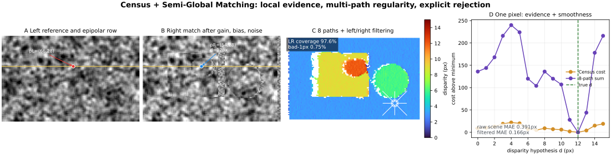

# Census + Semi-Global Matching: Dense Stereo without Hiding the Geometry

Date: 2026-10-24 · Category: Geometry and Calibration · Level: advanced foundations

[Category index](README.md) · [CV index](../../README.md) · [Runnable NumPy](../../examples/semi-global-matching/) · [Executed validation](../../examples/semi-global-matching/VALIDATION.md)

## Intellectual map and evidence labels

The preceding sequence built sparse geometry: calibration, robust homographies, essential-matrix pose, PnP, and bundle adjustment. Those methods estimate camera parameters and selected landmarks. Semi-Global Matching, or SGM, asks the dense question: after a stereo pair is calibrated and rectified, which disparity should every usable pixel receive?

Evidence labels:

- **Paper says:** attributable to a cited paper or official implementation.
- **Inference:** follows from the mathematics or this lesson's executed experiments.
- **My interpretation:** an engineering recommendation.
- **Unknown:** not established by the sources or supplied execution.

Primary sources and official implementations:

- Heiko Hirschmüller, [Stereo Processing by Semi-Global Matching and Mutual Information](https://elib.dlr.de/55367/1/Stereo_Processing-Hirschm%C3%BCller.pdf), IEEE TPAMI 2008; [IEEE record](https://ieeexplore.ieee.org/document/4359315/). This is the primary source for the energy, path recurrence, path summation, subpixel interpolation, consistency checking, and complexity discussion.
- Ramin Zabih and John Woodfill, [Non-parametric Local Transforms for Computing Visual Correspondence](https://www.woodfill.com/Papers/Census94.pdf), ECCV 1994. This is the primary source for the Census transform and Hamming comparison used by the supplied implementation.
- The official OpenCV [StereoSGBM documentation](https://docs.opencv.org/5.0/main_modules/classcv_1_1StereoSGBM.html) and [implementation source](https://github.com/opencv/opencv/blob/4.x/modules/calib3d/src/stereosgbm.cpp).
- NVIDIA's official [VPI 4.0.5 Stereo Disparity documentation](https://docs.nvidia.com/vpi/4.0.5/algo_stereo_disparity.html), accessed 2026-10-24, for Jetson-oriented backend and memory considerations.
- Lahav Lipson, Zachary Teed, and Jia Deng, [RAFT-Stereo](https://arxiv.org/abs/2109.07547), 3DV 2021, with the authors' [official repository](https://github.com/princeton-vl/RAFT-Stereo), for the connection to learned recurrent stereo.
- Daniel Scharstein and Richard Szeliski, [A Taxonomy and Evaluation of Dense Two-Frame Stereo Correspondence Algorithms](https://vision.middlebury.edu/stereo/taxonomy-IJCV.pdf), IJCV 2002, and the official [Middlebury Stereo Evaluation](https://vision.middlebury.edu/stereo/).

**Scope:** the supplied code is an original educational reconstruction. It uses rectified grayscale images, a 5×5 Census transform, a dense float32 cost volume, 0/1/2/4/8 selectable paths, constant smoothness penalties, winner-take-all selection, quadratic subpixel fitting, and an independently computed right disparity for consistency rejection. It is not Hirschmüller's mutual-information implementation, OpenCV StereoSGBM, NVIDIA VPI, a CUDA kernel, a learned stereo network, an occlusion-filling system, or a benchmark implementation.

## 1. Research problem

Given rectified left and right images, estimate a dense horizontal disparity map. The convention in this lesson is:

$$
d(y,x_L)=x_L-x_R.
$$

where:

- $d(y,x_L)$ is left-referenced disparity in pixels;
- $y$ is the shared rectified image row;
- $x_L$ is the horizontal left-image coordinate;
- $x_R$ is the coordinate of the same visible scene point in the right image;
- positive disparity means the right-image correspondence lies to the left.

Rectification is the contract that reduces a two-dimensional correspondence search to one horizontal line. The input is not merely “two images.” It is:

| Quantity | Shape | Domain / unit | Meaning |
|---|---:|---|---|
| left image | [H,W] | uint8 intensity | reference view |
| right image | [H,W] | uint8 intensity | match view |
| disparity hypotheses | [D] | integer pixels | $0,\ldots,D-1$ |
| matching cost volume | [H,W,D] | nonnegative cost | local evidence |
| aggregated volume | [H,W,D] | path-summed cost | evidence plus regularity |
| disparity | [H,W] | float32 pixels | dense horizontal correspondence |
| validity | [H,W] | Boolean | explicit rejection state |
| depth | [H,W] | metric length | only after calibrated conversion |

The output carries geometry, not semantic meaning. A VLM may define “the graspable handle” or “the surgical target,” but stereo decides only which image measurements are geometrically compatible.

## 2. Why dense stereo remains difficult

### Local winner-take-all is underconstrained

At one left pixel, several right pixels can have similar appearance. Repeated texture, a blank wall, highlights, sensor noise, and a narrow disparity range can produce multiple plausible minima. Selecting the smallest local cost independently creates speckle and streaks.

### Large windows destroy boundaries

Window matching gains evidence by assuming a constant disparity inside a patch. That assumption fails when the patch crosses a foreground boundary, thin cable, instrument edge, or tactile marker. A wide support region reduces noise but mixes different surfaces.

### Fully global optimization is expensive

A useful disparity field should agree with image evidence and be mostly piecewise smooth while preserving depth discontinuities. Exact two-dimensional optimization of a discontinuity-preserving energy is generally difficult. Optimizing each scanline independently is cheaper but produces directional streaks because rows do not communicate.

### Occlusions have no correct match

Some points visible in the left view are hidden in the right view. Forcing every pixel to choose a disparity creates a confident-looking fiction. A production depth system must represent invalidity.

**Paper says:** Hirschmüller motivates SGM as an approximation to a global two-dimensional smoothness constraint by combining dynamic-programming paths from many directions.

## 3. Geometry: from disparity to depth

For parallel rectified pinhole cameras with baseline $B$, equal horizontal focal length $f_x$, and a common principal point:

$$
x_L=f_x\frac{X}{Z}+c_x,\qquad
x_R=f_x\frac{X-B}{Z}+c_x,
\qquad
Z=\frac{f_xB}{d}.
$$

where:

- $(X,Z)$ are a scene point's horizontal and forward coordinates in the left camera frame;
- $x_L,x_R$ are its rectified pixel coordinates;
- $f_x$ is horizontal focal length in pixels;
- $c_x$ is the horizontal principal point in pixels;
- $B$ is the physical camera-center separation in meters or another length unit;
- $d=x_L-x_R$ is disparity in pixels;
- $Z$ is depth in the same length unit as $B$.

Subtracting the first two projection equations cancels $X$ and $c_x$, leaving $d=f_xB/Z$. This is why larger disparity means nearer depth.

Small numerical example: with $f_x=320$ px, $B=0.075$ m, and $d=12$ px, depth is $2.0$ m. At $d=3$ px, it is $8.0$ m. Equal disparity error therefore does not imply equal depth error.

## 4. The key insight: many cheap one-dimensional optimizations

SGM begins with a target energy:

$$
E(D)=
\sum_{\mathbf p}\left(
C(\mathbf p,D_{\mathbf p})
+
\sum_{\mathbf q\in\mathcal N_{\mathbf p}}
P_1\,\mathbf 1\!\left[|D_{\mathbf p}-D_{\mathbf q}|=1\right]
+
\sum_{\mathbf q\in\mathcal N_{\mathbf p}}
P_2\,\mathbf 1\!\left[|D_{\mathbf p}-D_{\mathbf q}|>1\right]
\right).
$$

where:

- $D$ is the complete disparity field;
- $\mathbf p=(y,x)$ is a reference-image pixel;
- $D_{\mathbf p}$ is the disparity assigned to $\mathbf p$;
- $C(\mathbf p,d)$ is the local matching cost for hypothesis $d$;
- $\mathcal N_{\mathbf p}$ is a pixel neighborhood;
- $\mathbf q$ is a neighbor of $\mathbf p$;
- $\mathbf 1[\cdot]$ is one when its condition is true and zero otherwise;
- $P_1$ penalizes a one-pixel disparity change;
- $P_2>P_1$ penalizes a larger change by a constant amount.

The smaller $P_1$ allows gently slanted or curved surfaces. The constant—not disparity-proportional—$P_2$ permits real discontinuities rather than making every large step impossibly expensive.

**Paper says:** the original method can adapt $P_2$ using the image gradient because real discontinuities often coincide with intensity changes. The supplied implementation keeps $P_2$ constant so the recurrence is easy to inspect. This simplification makes edge leakage more likely.

SGM does not solve this two-dimensional energy exactly. It solves related one-dimensional problems along several directions and sums their costs.

## 5. Local evidence: Census instead of raw intensity

The original TPAMI method emphasizes mutual-information cost and also discusses Birchfield–Tomasi cost. This lesson deliberately uses Census because it exposes the matching representation compactly and is invariant to strictly monotonic intensity transforms.

For a neighborhood $\mathcal N$ around pixel $\mathbf p$:

$$
\operatorname{Census}(\mathbf p)
=
\bigotimes_{\boldsymbol\delta\in\mathcal N}
\mathbf 1\!\left[I(\mathbf p+\boldsymbol\delta)<I(\mathbf p)\right],
\qquad
C(\mathbf p,d)
=
\operatorname{Hamming}\!\left(
\operatorname{Census}_L(\mathbf p),
\operatorname{Census}_R(y,x-d)
\right).
$$

where:

- $I$ is a grayscale image;
- $\boldsymbol\delta=(\delta_y,\delta_x)$ is a neighbor offset;
- $\bigotimes$ concatenates comparison bits in a fixed order;
- $\operatorname{Census}_L$ and $\operatorname{Census}_R$ are left and right bit strings;
- $\operatorname{Hamming}$ counts unequal bits;
- $C(\mathbf p,d)$ is the local cost at left pixel $\mathbf p$ and disparity $d$.

For a 5×5 window, the center is excluded, producing 24 bits. Suppose a three-neighbor toy descriptor is 101 in the left image and 111 in the right image. One bit differs, so the Hamming cost is one.

Because comparisons depend on ordering rather than absolute brightness, a strictly increasing transform preserves every bit. Clipping, saturation, specular reflection, local shadow, auto-exposure, and non-monotonic response can still break the assumption.

**Paper says:** Zabih and Woodfill define Census as a bit string of local intensity comparisons and compare transformed pixels with Hamming distance.

## 6. Cost-volume construction and coordinate flow

For every left pixel and disparity hypothesis, the code compares the left descriptor at $(y,x)$ with the right descriptor at $(y,x-d)$. Invalid hypotheses such as $x-d<0$ receive a large cost and an explicit false validity bit.

The data flow is:

~~~mermaid
flowchart TD
    A["Rectified uint8 pair H×W"] --> B["Census descriptors H×W"]
    B --> C["Cost volume C: H×W×D"]
    C --> D["Path recurrence in 2, 4, or 8 directions"]
    D --> E["Summed costs S: H×W×D"]
    E --> F["Winner-take-all + subpixel fit"]
    F --> G["Independent right disparity + consistency"]
    G --> H["Valid disparity → metric depth / task gate"]
~~~

No temporal state is used. Each stereo pair is processed independently. The coordinate chain is rectified left pixel → horizontal right match → disparity → left-camera depth. The supplied code uses uint8 images, uint64 Census descriptors, Boolean hypothesis masks, float32 costs, float32 disparity, and float64 depth conversion.

## 7. The SGM path recurrence

For path direction $\mathbf r$, the normalized path cost is:

$$
L_{\mathbf r}(\mathbf p,d)
=C(\mathbf p,d)
+
\min\!\begin{cases}
L_{\mathbf r}(\mathbf p-\mathbf r,d),\\
L_{\mathbf r}(\mathbf p-\mathbf r,d-1)+P_1,\\
L_{\mathbf r}(\mathbf p-\mathbf r,d+1)+P_1,\\
\min_i L_{\mathbf r}(\mathbf p-\mathbf r,i)+P_2
\end{cases}
-
\min_k L_{\mathbf r}(\mathbf p-\mathbf r,k).
$$

where:

- $L_{\mathbf r}(\mathbf p,d)$ is accumulated cost ending at pixel $\mathbf p$ with disparity $d$ along direction $\mathbf r$;
- $\mathbf p-\mathbf r$ is the preceding pixel on the path;
- $C(\mathbf p,d)$ is the local matching cost;
- the first candidate keeps disparity unchanged;
- the second and third candidates change disparity by one and pay $P_1$;
- the fourth candidate jumps from any previous disparity $i$ and pays $P_2$;
- $k$ indexes all previous disparities;
- subtracting the previous minimum normalizes all hypotheses by the same constant.

The subtraction does not change the minimum disparity because it is identical for all $d$ at the current pixel. It prevents costs from increasing without bound along a long path.

### Hand-derived numerical step

Let the previous path vector be $[0,2,4]$, current local costs be $[5,1,3]$, $P_1=1$, and $P_2=4$.

- For $d=0$, the candidates are $0$, invalid, $2+1$, and $0+4$. The minimum is $0$, giving $5$.
- For $d=1$, they are $2$, $0+1$, $4+1$, and $0+4$. The minimum is $1$, giving $2$.
- For $d=2$, they are $4$, $2+1$, invalid, and $0+4$. The minimum is $3$, giving $6$.

The new vector is $[5,2,6]$. Check 4 verifies this exact recurrence.

## 8. Path summation, selection, and subpixel fitting

The aggregated cost is:

$$
S(\mathbf p,d)=\sum_{\mathbf r\in\mathcal R}L_{\mathbf r}(\mathbf p,d),
\qquad
\hat d(\mathbf p)=\arg\min_d S(\mathbf p,d).
$$

where:

- $\mathcal R$ is the selected set of path directions;
- $S(\mathbf p,d)$ is the summed cost for one pixel and disparity;
- $\hat d(\mathbf p)$ is the integer winner-take-all estimate.

The code supports zero paths for raw local matching, two horizontal paths, four axial paths, and eight axial-plus-diagonal paths.

**Paper says:** Hirschmüller's formulation recommends at least eight directions and discusses sixteen for fuller two-dimensional coverage. **Implementation fact:** this lesson stops at eight, and the penalties are not retuned when path count changes.

For a minimum at integer index $d_0$, quadratic interpolation uses adjacent costs:

$$
\Delta d
=
\frac{S(d_0-1)-S(d_0+1)}
{2\left[S(d_0-1)-2S(d_0)+S(d_0+1)\right]},
\qquad
\hat d_{\mathrm{sub}}=d_0+\Delta d.
$$

where:

- $d_0$ is the integer minimum;
- $S(d_0-1),S(d_0),S(d_0+1)$ are neighboring aggregated costs for the same pixel;
- $\Delta d$ is the fitted offset, clipped to $[-1,1]$ in the code;
- $\hat d_{\mathrm{sub}}$ is the subpixel disparity.

This is an approximation. Census/Hamming costs are discrete and not intrinsically quadratic. The fit is useful computationally, but its decimals must not be confused with calibrated uncertainty.

## 9. Left/right consistency is rejection, not repair

The code independently estimates a right-referenced disparity whose stored magnitude remains $x_L-x_R$. A left estimate passes when:

$$
\left|
d_L(y,x)
-
d_R\!\left(y,\operatorname{round}(x-d_L(y,x))\right)
\right|
\le \tau.
$$

where:

- $d_L$ is the left-referenced estimate;
- $d_R$ is the independently computed right-view estimate;
- $x-d_L(y,x)$ is the predicted right-image coordinate;
- $\tau$ is a consistency tolerance in pixels, set to one in the experiments.

An inconsistent pixel becomes invalid. It is not filled. This makes coverage an essential metric: a method can reduce error by refusing hard pixels.

## 10. Depth sensitivity and uncertainty

Differentiate $Z=f_xB/d$:

$$
\frac{\partial Z}{\partial d}
=-\frac{f_xB}{d^2},
\qquad
\sigma_Z\approx\frac{f_xB}{d^2}\sigma_d.
$$

where:

- $\partial Z/\partial d$ is depth sensitivity to disparity;
- $\sigma_d$ is a small disparity standard deviation in pixels;
- $\sigma_Z$ is the corresponding first-order depth uncertainty;
- $f_x$, $B$, and $d$ retain their previous meanings.

With $f_x=320$ px, $B=0.075$ m, $d=12$ px, and $\sigma_d=0.25$ px, the first-order depth uncertainty is about $0.0417$ m. At $d=3$ px, the same disparity uncertainty becomes about $0.667$ m. Far-range metric depth becomes fragile even if pixel disparity error stays constant.

## 11. Implementation anatomy

| Module | Input → output | Purpose | Precision |
|---|---|---|---|
| census_transform | image [H,W] → descriptor [H,W], mask | robust local ordering code | uint8 → uint64 |
| build_cost_volume | descriptors + D → [H,W,D] | enumerate correspondence hypotheses | float32 + Boolean |
| aggregate_direction | cost + one direction → [H,W,D] | dynamic-programming recurrence | float32 |
| aggregate_costs | path volumes → summed volume | approximate 2-D regularity | float32 |
| select_disparity | volume → disparity/confidence/validity | WTA and quadratic fit | float32 |
| compute_left_right | two independent solves → consistency | reject occlusions/mismatches | Boolean |
| disparity_to_depth | disparity + calibration → depth | metric conversion | float64 |

Minimal use:

~~~python
from sgm_stereo import compute_left_right, disparity_to_depth

left_result, right_result, consistent = compute_left_right(
    left_gray_uint8,                 # [H,W]
    right_gray_uint8,                # [H,W]
    max_disparity=128,               # hypotheses 0...127
    method="census",
    census_window=(5, 5),
    p1=1.5,
    p2=8.0,
    path_count=8,
    consistency_tolerance_px=1.0,
)

depth_m = disparity_to_depth(
    left_result.disparity,
    focal_length_px=fx_rectified,
    baseline_m=baseline,
    valid=consistent,
)
~~~

Real calibration must use the rectified projection matrices. If an image is resized horizontally by $s_x$, both $f_x$ and disparity scale by $s_x$, so depth remains invariant only when calibration is updated consistently.

## 12. Experiments and evidence

Every value below was executed from the supplied code. Full commands, versions, and limits are recorded in [VALIDATION.md](../../examples/semi-global-matching/VALIDATION.md). No number is copied from a paper.

### 12.1 Fixed synthetic scene

Seed 20261024 renders an 80×128 rectified pair with disparities 3, 6, 9, and 12 px. A z-buffer determines which left pixels remain visible in the right image. The right image receives gain 1.10, bias 9 intensity units, and Gaussian noise with standard deviation 2.0. Evaluation uses 8,635 visible interior pixels.

| Variant | MAE | Bad-1px | Coverage |
|---|---:|---:|---:|
| raw Census winner-take-all | 0.3911 px | 4.9102% | 100% |
| Census SGM, 2 paths | 0.2163 px | 2.3046% | 100% |
| Census SGM, 4 paths | 0.2157 px | 2.3046% | 100% |
| Census SGM, 8 paths | 0.2191 px | 2.3162% | 100% |
| absolute intensity, 8 paths | 2.4382 px | 60.9265% | 100% |
| Census, 8 paths + left/right check | **0.1656 px** | **0.7474%** | 97.6144% |

**Inference:** multi-path regularity improves the fixed local matcher, Census protects against this particular gain/bias shift, and consistency rejection trades 2.39% coverage for a much lower bad-pixel rate.

The unfiltered four-path result is slightly better than eight paths here. More directions sum more assumptions; they do not guarantee improvement when $P_1$, $P_2$, scene size, and path count are fixed.

### 12.2 Eight paired synthetic seeds

| Variant | Median MAE | Median bad-1px | Median coverage |
|---|---:|---:|---:|
| raw Census winner-take-all | 0.3899 px | 4.9102% | 100% |
| Census SGM, 2 paths | 0.2128 px | 2.2814% | 100% |
| Census SGM, 4 paths | **0.2024 px** | **2.0382%** | 100% |
| Census SGM, 8 paths | 0.2088 px | 2.1309% | 100% |
| absolute intensity, 8 paths | 2.3803 px | 59.4673% | 100% |
| Census, 8 paths + left/right check | **0.1591 px** | **0.6288%** | 97.6433% |

All variants complete all eight trials without an exception.

**Inference:** on this narrow synthetic distribution, four-path unfiltered SGM ranks slightly above eight-path unfiltered SGM. The experiment rejects the simplistic claim that more paths are always better.

**Unknown:** confidence intervals, real-camera ranking, calibrated parameter transfer, runtime scaling, response to repetitive textures or non-monotonic illumination, and whether adaptive $P_2$ would reverse the path-count ranking. Eight synthetic seeds are implementation evidence, not a deployment guarantee.

## 13. Integrated application: conservative robot clearance

The application uses $f_x=320$ px and $B=0.075$ m. An upstream navigation or VLM module supplies an image-space corridor. SGM provides geometry inside that region; it does not decide what region matters.

Executed output:

- corridor pixels: 784;
- consistent, confident accepted pixels: 711;
- coverage: 90.69%;
- median disparity: 9.2188 px;
- median depth: 2.6034 m;
- tenth-percentile depth: 1.9862 m;
- synthetic truth-side accepted-pixel depth MAE: 0.3793 m;
- decision: STOP because the near-depth percentile violates a 2.30 m clearance threshold.

The mean depth error is much larger than the disparity MAE might suggest because inverse disparity magnifies error, particularly for farther pixels. The demo chooses a conservative lower depth percentile and refuses to treat a median as guaranteed clearance.

Useful integrations:

- **Robotics:** combine a calibrated stereo confidence/validity mask with tracking, braking distance, and independent emergency sensing.
- **VLA:** the language-action model selects a task region; stereo returns metric evidence plus invalidity and uncertainty signals.
- **Visual–tactile sensing:** stereo can reconstruct rigid marker or surface geometry when two views and stable rectification exist. Deforming elastomer, internal reflection, and moving illumination violate ordinary rigid-scene assumptions.
- **Surgical imaging:** binocular endoscopes can provide metric cues, but specularity, tissue deformation, smoke, narrow baseline, calibration drift, and synchronization make consistency checks and temporal validation essential.

## 14. Failure modes and diagnostics

### Rectification error

If corresponding points have vertical residual, the one-dimensional search excludes the truth. Inspect vertical epipolar error on held-out calibration targets and natural matches, not only calibration RMS.

### Wrong disparity range

If the true disparity is outside $[0,D)$, SGM must choose a false boundary hypothesis. Range should follow expected depth, focal length, and baseline, with margin for calibration error.

### Textureless and repeated regions

Blank areas produce flat costs; repeated patterns produce multiple minima. Smoothness then dominates. Report confidence margins and avoid interpreting a smooth output as observed detail.

### Occlusions and disocclusions

No valid correspondence exists. Left/right checking rejects many such pixels but is not a perfect visibility model. Filling holes may be useful for visualization yet dangerous for control unless provenance remains explicit.

### Thin structures and depth boundaries

Path regularization can erase wires, tool edges, and marker boundaries. Large $P_2$ oversmooths; small $P_2$ permits speckle. Gradient-adaptive penalties can help but also fail at texture edges unrelated to depth.

### Radiometric violations

Census survives monotonic gain/bias changes in theory. Saturation, strong specularities, shadows, projector pattern changes, local tone mapping, and rolling exposure can reorder neighbors.

### Temporal mismatch and rolling shutter

Stereo assumes the pair observes compatible geometry at the same time. Robot motion, deforming tissue, and rolling shutters produce row-dependent disagreement even with perfect static calibration.

### Subpixel overconfidence

A quadratic fit returns decimals even for a discrete, non-quadratic Census cost. Validate subpixel error against ground truth; never assign uncertainty merely from numeric precision.

### Calibration and baseline uncertainty

Depth inherits errors in $f_x$, baseline, rectification, and disparity. A mechanically flexible stereo rig can drift after calibration.

## 15. Generalization and learned stereo

The classical pipeline decomposes stereo into matching cost, aggregation, disparity selection, and refinement. Learned stereo changes one or more blocks:

- a CNN or transformer can learn the matching representation or cost volume;
- 3-D convolutions can regularize a cost volume;
- recurrent methods can update disparity iteratively;
- a classical consistency or uncertainty gate can remain after a learned predictor.

**Paper says:** RAFT-Stereo adapts recurrent all-pairs field transforms to rectified stereo and introduces multi-level convolutional GRUs. Its official implementation provides different correlation implementations with memory/speed tradeoffs.

**My interpretation:** SGM is still worth mastering before RAFT-Stereo. Cost-volume coordinates, ambiguity, disparity-to-depth sensitivity, occlusion, calibration, and evaluation coverage survive the transition from handcrafted to learned features.

**Unknown:** whether a learned stereo model's confidence remains calibrated on a new endoscope, tactile elastomer, exposure pipeline, or quantized Jetson deployment. Benchmark rank does not answer domain safety.

## 16. Computational cost and deployment

For image size $H\times W$, $D$ disparities, and fixed path count, cost construction and SGM aggregation are $O(HWD)$. A dense float32 volume uses $4HWD$ bytes.

At 640×480 with 128 disparities, one float32 volume is 157,286,400 bytes, about 150 MiB. Storing matching and aggregated volumes doubles that before descriptors, validity, right-view processing, or workspace. Production implementations stream path state, use narrower integers, tile carefully, or exploit specialized hardware.

**Paper says:** Hirschmüller bounds normalized path cost and discusses integer storage, SIMD-friendly operations, and tiling for large images. **Implementation fact:** this NumPy lesson deliberately uses float32 dense arrays and Python loops, so it is not a speed reference.

### OpenCV

OpenCV documents its algorithm as a modified SGBM: five directions by default, block matching rather than strictly pixelwise matching, Birchfield–Tomasi rather than mutual information, and additional pre/post-processing. Full HH mode uses more memory. Parameters called $P_1$ and $P_2$ are not portable without accounting for channels, block size, cost scale, and mode.

### NVIDIA VPI and Jetson

As documented in VPI 4.0.5 on 2026-10-24, the CUDA stereo backend uses SGM, while the OFA-oriented path uses an advanced variant intended to optimize memory bandwidth and performance. The same documentation warns that CUDA has a higher memory footprint and exposes backend-dependent controls.

For Jetson:

- rectify and convert images with a pipeline that avoids unnecessary host/device copies;
- bound $D$ from the actual working range;
- profile CUDA/OFA/VPI and CPU alternatives on the exact JetPack and camera resolution;
- keep confidence and invalid masks through the task layer;
- test synchronization, thermal throttling, memory pressure, and worst-case texture;
- do not copy this Python implementation into a control loop.

No Jetson, VPI, OpenCV, CUDA, OFA, TensorRT, latency, power, or memory benchmark was executed here.

### ONNX, TensorRT, and quantization

Classical SGM is a dynamic-programming kernel, not naturally an ONNX neural graph. Export the learned feature/cost network when present, and keep geometry/aggregation in a tested native backend unless a validated custom TensorRT plugin exists.

INT8 can be appropriate for a learned encoder after calibration or QAT, but disparity aggregation penalties and cost ranges need their own overflow analysis. FP16 dense volumes reduce memory but can alter close cost comparisons. Integer SGM can be robust when deliberately scaled; arbitrary post-training quantization of this float implementation is not an engineering plan.

## 17. Reproduction

From CV/examples/semi-global-matching:

~~~bash
python -m pip install -r requirements.txt
OPENBLAS_NUM_THREADS=1 python checks.py
OPENBLAS_NUM_THREADS=1 python demo.py
OPENBLAS_NUM_THREADS=1 python demo.py --ablations --trials 8
OPENBLAS_NUM_THREADS=1 python application.py
OPENBLAS_NUM_THREADS=1 python make_figure.py ../../assets/semi-global-matching/census-sgm-stereo.svg
~~~

Expected outcomes:

- 15 deterministic numerical checks pass;
- Census descriptors remain invariant under a non-clipping monotonic affine intensity transform;
- the hand-derived path recurrence produces $[5,2,6]$;
- four-path SGM improves raw matching on the fixed contaminated scene;
- Census strongly outperforms absolute intensity under the constructed gain/bias shift;
- left/right rejection reduces bad pixels while lowering coverage;
- the robot application issues a conservative STOP decision.

Floating-point libraries can change last digits. The images are synthetic and generated in memory; no paper benchmark was downloaded or evaluated.

## 18. Practical checklist

Before trusting dense stereo:

- state the disparity sign and reference-view convention;
- verify rectification with vertical correspondence error;
- derive disparity range from calibrated depth limits;
- transform intrinsics after crop or resize;
- preserve cost-volume and disparity tensor dimensions explicitly;
- tune $P_1$ and $P_2$ for the chosen cost scale and path count;
- compare raw, aggregated, and consistency-filtered results;
- report coverage with error, not error alone;
- retain invalid pixels rather than silently filling everything;
- inspect textureless areas, repeated patterns, thin structures, and occlusion boundaries;
- propagate disparity and calibration uncertainty into depth;
- verify gain, exposure, saturation, synchronization, and rolling shutter;
- separate semantic region selection from geometric matching;
- benchmark the exact production backend and hardware;
- add an independent safety mechanism for physical control.

SGM matters because it exposes a durable engineering compromise: local evidence alone is noisy, exact global inference is costly, and multiple directional dynamic programs provide strong regularity at predictable $O(HWD)$ cost—provided that ambiguity and invalidity remain visible.
