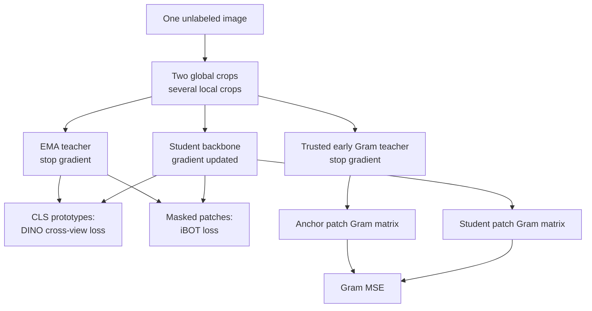
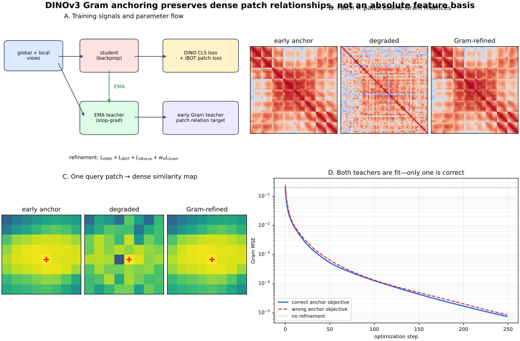

# DINOv3 Gram Anchoring: Preserving Dense Features During Self-Supervised Vision Training

**Date:** 2026-10-27 (Asia/Shanghai)  
**Track:** Computer Vision → Representation Learning  
**Level:** Advanced  
**Code:** [runnable NumPy loss reference and experiments](../../examples/dinov3-gram-anchoring/)  
**Validation:** [executed checks and controlled ablations](../../examples/dinov3-gram-anchoring/VALIDATION.md)  
**Illustration:** [original SVG](../../assets/dinov3-gram-anchoring/gram-anchoring.svg)

DINOv3 is not merely “a bigger DINO.” Its most instructive algorithmic addition is
**Gram anchoring**: preserve the relational geometry of good early patch features
while long self-supervised training continues to improve global representations.

That matters to a CV/VLM engineer because many downstream systems do not need only
one image vector. Tracking, depth, correspondence, segmentation, visual–tactile
matching, robotic manipulation, and surgical video require a *spatial field* of
reliable patch features. A backbone can improve image-level metrics while those
dense features quietly become less locally coherent.

This lesson reconstructs the DINO teacher–student foundation, locates DINOv3's Gram
objective within the larger DINO/iBOT/KoLeo recipe, derives its invariances and
gradient, and turns it into an unlabeled checkpoint gate for a visual–tactile encoder.

## Evidence labels

- **Paper says** — stated or measured in a cited primary paper.
- **Official code says** — directly visible in the authors' repository.
- **Experiment says** — produced by commands recorded in
  [VALIDATION.md](../../examples/dinov3-gram-anchoring/VALIDATION.md).
- **Inference** — follows from the mathematics or evidence but is not a paper quote.
- **My interpretation** — an engineering recommendation.
- **Unknown** — not established by the paper or this lesson's experiment.

The distinction is particularly important here: the supplied CPU experiment tests
the **loss geometry**, not billion-parameter pretraining.

## 1. Research problem

Let a vision backbone map an image into a global token and a grid of patch tokens:

$$
f_\theta(I)=\left[z_{\mathrm{cls}},X\right],
\qquad
z_{\mathrm{cls}}\in\mathbb{R}^{D},
\quad
X\in\mathbb{R}^{P\times D}.
$$

**Symbols.** $I\in\mathbb{R}^{C\times H\times W}$ is an image; $f_\theta$ is a
backbone with parameters $\theta$; $z_{\mathrm{cls}}$ is a $D$-dimensional global
representation; $X$ contains $P$ spatial patch features, each of dimension $D$;
for patch size $s$, a rectangular ViT normally has
$P=(H/s)(W/s)$ when dimensions divide evenly.

Self-supervised pretraining wants both:

1. a discriminative, view-invariant global token for image-level tasks; and
2. locally consistent patch features for dense tasks.

These goals are related but not identical. DINOv3 asks:

> How can very long, very large self-supervised training continue improving global
> representations without degrading the spatial relation structure of patch tokens?

**Paper says.** DINOv3 reports that global and dense quality can evolve relatively
independently, and that patch-level consistency degrades during extended training.
The paper introduces Gram anchoring to counter this failure
[DINOv3, Section 4](https://arxiv.org/abs/2508.10104).

## 2. Motivation

Suppose a marker patch in a tactile image should be similar to its deformed
neighborhood and dissimilar to the background. A dense feature map is useful when
the similarity row

$$
s_i=\left[\langle x_i,x_1\rangle,\ldots,\langle x_i,x_P\rangle\right]
\in\mathbb{R}^{P}
$$

is spatially meaningful.

**Symbols.** $x_i,x_j\in\mathbb{R}^{D}$ are unit-normalized patch features;
$\langle x_i,x_j\rangle=x_i^Tx_j$ is cosine similarity; $s_i$ is the query-to-all
similarity map flattened into a length-$P$ vector.

Image classification can remain good even if $s_i$ becomes speckled or dominated by
outlier tokens. A `[CLS]` objective sees global semantics; it does not fully specify
the geometry among every pair of patch embeddings.

**Paper says.** The original DINO paper showed that self-supervised ViT features
exhibit emergent segmentation-like structure and highlighted the importance of a
momentum teacher, multi-crop training, and small patches
[Caron et al., 2021](https://openaccess.thecvf.com/content/ICCV2021/html/Caron_Emerging_Properties_in_Self-Supervised_Vision_Transformers_ICCV_2021_paper.html).
DINOv2 scaled the recipe into general-purpose visual features
[Oquab et al., 2023](https://arxiv.org/abs/2304.07193). DINOv3 then isolates dense
feature degradation as a scaling problem and adds an explicit relational anchor.

## 3. Prior limitations

### 3.1 Contrastive negatives are not the only route

Classical instance contrastive learning pulls two views together and pushes other
images apart, which can require many negatives or a memory mechanism. BYOL and DINO
showed that an online/student network can learn from a momentum target/teacher
without explicit negative pairs
[BYOL](https://arxiv.org/abs/2006.07733) and
[DINO](https://arxiv.org/abs/2104.14294).

That solves one problem—label-free global representation learning—but not every
dense-feature failure.

### 3.2 Patch reconstruction is not a permanent spatial guarantee

DINOv2/DINOv3 combine global DINO self-distillation with iBOT-style masked patch
prediction. In iBOT, the teacher acts as an online tokenizer for masked patch targets
[Zhou et al., 2021](https://arxiv.org/abs/2111.07832).

**Paper says.** DINOv3 observes that the balance between global DINO and local iBOT
objectives becomes unstable over long training, with global representation learning
dominating. A local objective's presence alone therefore does not guarantee that
dense similarity maps remain clean.

### 3.3 Matching feature vectors too strictly is undesirable

One could freeze an early model $g$ and penalize
$\|X_S-X_G\|_F^2$. That would lock each feature coordinate to the old basis and
directly resist later representational improvement.

**Key need:** preserve *which patches relate to which* without forcing every feature
dimension to stay fixed.

### 3.4 Registers address a different artifact

High-norm background tokens are another dense-ViT failure. Register tokens give the
network dedicated workspace rather than repurposing spatial tokens
[Darcet et al., 2023](https://arxiv.org/abs/2309.16588). DINOv3 uses architectural
and training improvements, but Gram anchoring specifically targets pairwise patch
consistency over training. Registers and Gram anchoring are complementary ideas, not
synonyms.

## 4. Key insight

Preserve the $P\times P$ matrix of pairwise patch similarities from a trusted early
teacher:

$$
G(X)=XX^T,
\qquad
\mathcal L_{\mathrm{Gram}}
=\left\|G(X_S)-G(X_G)\right\|_F^2.
$$

**Symbols.** $X_S\in\mathbb{R}^{P\times D}$ contains row-normalized student patch
features; $X_G\in\mathbb{R}^{P\times D}$ contains row-normalized features from the
Gram teacher; $G(X)\in\mathbb{R}^{P\times P}$ is a cosine-similarity Gram matrix;
$\|A\|_F^2=\sum_{i,j}A_{ij}^2$ is squared Frobenius norm.

Each $G_{ij}$ says whether patch $i$ and patch $j$ are related. The student is free
to change its coordinate basis as long as this relational structure survives.





## 5. Tensor, modality, spatial, temporal, and precision flow

### 5.1 Module contract

| Quantity | Shape | Modality / coordinate meaning | Precision | Purpose |
|---|---:|---|---|---|
| global crops | $[G,B,C,H_g,W_g]$ | augmented image pixels | FP32/BF16 | teacher + student global views |
| local crops | $[L,B,C,H_l,W_l]$ | smaller augmented regions | FP32/BF16 | student-only multi-crop views |
| patch mask | $[G,B,P]$ | Boolean patch-grid positions | bool | hides student patches for iBOT |
| student CLS logits | $[G+L,B,K]$ | prototype scores | BF16/FP32 | DINO prediction |
| teacher CLS targets | $[G,B,K]$ | balanced/sharpened prototypes | FP32 | stop-gradient DINO target |
| patch tokens | $[G,B,P,D]$ | spatial feature grid | BF16/FP32 | iBOT and Gram input |
| Gram matrix | $[G B,P,P]$ | within-image patch relations | FP32 | dense consistency target |
| EMA parameters | model-shaped | training-time state | FP32 preferred | slowly moving teacher |

**Symbols.** $G$ is global-crop count; $L$ is local-crop count; $B$ is batch size;
$C$ is channel count; $H_g,W_g,H_l,W_l$ are crop dimensions; $P$ is patch count;
$D$ is backbone width; $K$ is prototype-head output dimension.

### 5.2 Spatial coordinates

Patch index $p$ corresponds to a 2-D location, but the Gram matrix itself stores
relations by index. Any resize between Gram-teacher and student feature grids must
preserve spatial ordering. DINOv3's high-resolution anchor runs the Gram teacher at
higher image resolution and downsamples the resulting feature map before comparing
same-sized patch Grams.

### 5.3 Training time has three model states

1. **Student at step $t$:** updated by backpropagation.
2. **EMA teacher at step $t$:** updated from the student; supplies current DINO/iBOT
   targets.
3. **Gram teacher:** an early or periodically refreshed snapshot chosen for better
   dense consistency.

These roles must not be collapsed into one vague “teacher.” Their update rules and
purposes differ.

### 5.4 Precision boundary

DINOv3 reports large-scale training with BF16 and some FP8 matrix multiplication,
but the official Gram implementation casts patch features to FP32 before similarity
matrices. That is sensible: $P^2$ correlations and small differences are accumulated.
The supplied NumPy reference uses FP64 to make derivative checks unambiguous.

## 6. Foundation: DINO self-distillation

### 6.1 Student and teacher distributions

For teacher logits $u_t\in\mathbb{R}^{K}$, original DINO centers and sharpens:

$$
p_t^{(k)}=
\frac{\exp\left((u_t^{(k)}-c^{(k)})/\tau_t\right)}
{\sum_{r=1}^{K}\exp\left((u_t^{(r)}-c^{(r)})/\tau_t\right)}.
$$

**Symbols.** $k,r\in\{1,\ldots,K\}$ index prototypes; $u_t^{(k)}$ is teacher logit
$k$; $c\in\mathbb{R}^{K}$ is the running center; $\tau_t>0$ is teacher temperature;
$p_t^{(k)}$ is a probability. A small $\tau_t$ sharpens the target.

The student distribution is

$$
q_s^{(k)}=
\frac{\exp(u_s^{(k)}/\tau_s)}
{\sum_{r=1}^{K}\exp(u_s^{(r)}/\tau_s)}.
$$

**Symbols.** $u_s\in\mathbb{R}^{K}$ is a student logit vector; $\tau_s>0$ is student
temperature; $q_s$ is the predicted prototype distribution.

DINOv2 and DINOv3 replace the original centering operation with Sinkhorn–Knopp
balancing in DINO and iBOT objectives. The NumPy reference includes original DINO
centering because it makes collapse-control mechanics transparent; it does not claim
to reconstruct distributed DINOv3 Sinkhorn training.

### 6.2 Cross-view cross entropy

For teacher global view $v$ and a different student view $w$:

$$
H(p_t^{(v)},q_s^{(w)})
=-\sum_{k=1}^{K}p_{t,k}^{(v)}\log q_{s,k}^{(w)}.
$$

**Symbols.** $H$ is cross entropy; $p_t^{(v)}$ is the stop-gradient teacher target
for global crop $v$; $q_s^{(w)}$ is the student prediction for another global or
local crop $w$.

With $G$ teacher global views and $V=G+L$ student views, excluding $G$ same-view
pairs gives

$$
N_{\mathrm{pairs}}=G V-G=G(V-1).
$$

**Symbols.** $N_{\mathrm{pairs}}$ is the number of ordered teacher–student view
pairs. With $G=2$ and $V=4$, the code verifies $N_{\mathrm{pairs}}=6$.

### 6.3 EMA teacher

The teacher is not updated by gradients:

$$
\theta_t\leftarrow m\theta_t+(1-m)\theta_s.
$$

**Symbols.** $\theta_t$ and $\theta_s$ are teacher and student parameter tensors of
matching shape; $m\in[0,1)$ is momentum. Large $m$ makes a slow target.

The original center also uses an EMA:

$$
c\leftarrow m_c c+(1-m_c)\frac{1}{N}\sum_{n=1}^{N}u_{t,n}.
$$

**Symbols.** $m_c$ is center momentum; $N$ counts teacher samples/views in the
update; $u_{t,n}\in\mathbb{R}^{K}$ is a teacher logit vector.

**Intuition.** Sharpening prevents a uniformly vague target; centering/balancing
prevents one prototype from dominating. The momentum teacher makes the target move
slowly enough for the student to chase it.

## 7. DINOv3 pretraining objective around the Gram term

DINOv3 writes its initial training objective as

$$
\mathcal L_{\mathrm{Pre}}
=\mathcal L_{\mathrm{DINO}}
+\mathcal L_{\mathrm{iBOT}}
+0.1\,\mathcal L_{\mathrm{DKoLeo}}.
$$

**Symbols.** $\mathcal L_{\mathrm{DINO}}$ is global cross-view self-distillation;
$\mathcal L_{\mathrm{iBOT}}$ predicts teacher targets for masked student patches;
$\mathcal L_{\mathrm{DKoLeo}}$ spreads global embeddings across the representation
space using a distributed KoLeo regularizer; $0.1$ is the paper's stated weight.

For iBOT, conceptually:

$$
\mathcal L_{\mathrm{iBOT}}
=\frac{1}{|\mathcal M|}
\sum_{p\in\mathcal M}H(p_{t,p},q_{s,p}).
$$

**Symbols.** $\mathcal M$ is the set of masked student patch indices; $p_{t,p}$ is
the teacher prototype target for visible patch $p$; $q_{s,p}$ is the student
prediction when that patch is masked; $|\mathcal M|$ is mask count.

**Paper says.** DINOv3 applies DINO to CLS tokens across crops, iBOT to randomly
masked global-crop patches, and distributed KoLeo to small groups of CLS features.
The full production system also depends on data curation, model scale, optimization,
architecture choices, post-training, and distillation—not only Gram anchoring.

## 8. Gram anchoring mathematics

### 8.1 Normalize each patch

For raw patch feature $z_i\in\mathbb{R}^{D}$:

$$
x_i=\frac{z_i}{\|z_i\|_2+\epsilon}.
$$

**Symbols.** $x_i$ is approximately unit length; $\epsilon>0$ prevents division by
zero. With nonzero $z_i$ and negligible $\epsilon$, $x_i^Tx_i=1$.

Stacking rows gives $X\in\mathbb{R}^{P\times D}$ and

$$
G_{ij}=x_i^Tx_j,\qquad G=XX^T\in[-1,1]^{P\times P}.
$$

**Symbols.** $i,j$ index patches; $G_{ij}$ is cosine similarity; $G$ is symmetric;
$G_{ii}=1$ for unit rows.

### 8.2 Paper loss and implementation reduction

The paper writes

$$
\mathcal L_{\mathrm{Gram}}^{\mathrm{sum}}
=\sum_{i=1}^{P}\sum_{j=1}^{P}
\left(G_{S,ij}-G_{G,ij}\right)^2.
$$

**Symbols.** $G_S$ is the student Gram; $G_G$ is the trusted Gram-teacher matrix.

The official code uses PyTorch MSE, which averages the entries. Our executable uses

$$
\mathcal L_{\mathrm{Gram}}^{\mathrm{mean}}
=\frac{1}{BP^2}\sum_{b=1}^{B}
\left\|G_{S,b}-G_{G,b}\right\|_F^2.
$$

**Symbols.** $B$ is image/crop batch count; the mean and sum have the same optimum,
but their gradient magnitudes differ by $BP^2$ and therefore require different loss
weights or learning rates.

**Official code says.** The released `GramLoss` normalizes features, forms the matrix
products, casts to FP32, and offers policies that remove negative similarities before
MSE [official `gram_loss.py`](https://github.com/facebookresearch/dinov3/blob/main/dinov3/loss/gram_loss.py).
The lesson's differentiable reference uses all correlations to match the paper's
displayed equation; `gram_anchor_loss(..., remove_negative=True)` also exposes the
positive-only forward variant.

### 8.3 Why feature-basis rotation is allowed

Let $Q\in\mathbb{R}^{D\times D}$ be orthogonal, so $QQ^T=I_D$. If the student uses
$X_S=X_GQ$, then

$$
G(X_S)=(X_GQ)(X_GQ)^T
=X_GQQ^TX_G^T
=X_GX_G^T
=G(X_G).
$$

**Symbols.** $I_D$ is the $D\times D$ identity. The student features can rotate or
reflect globally in feature space without changing patch relationships.

**Inference.** Gram anchoring does **not** preserve an absolute semantic direction.
A linear head trained on the old basis may not remain valid under an arbitrary
orthogonal change, even though dense similarity maps are identical.

### 8.4 Positive per-token scale is removed

For $\alpha_i>0$:

$$
\frac{\alpha_i z_i}{\|\alpha_i z_i\|_2}
=\frac{z_i}{\|z_i\|_2}.
$$

**Symbols.** $\alpha_i$ is a positive scalar. Therefore the normalized Gram objective
does not constrain raw patch-feature magnitudes. Other losses and normalization
layers control them.

### 8.5 Derive the gradient

For one image, define

$$
E=XX^T-A,
\qquad
A=X_GX_G^T,
\qquad
L=\frac{1}{P^2}\|E\|_F^2.
$$

**Symbols.** $X$ is the normalized student matrix; $A$ is the constant anchor Gram;
$E\in\mathbb{R}^{P\times P}$ is symmetric Gram error.

Using matrix differentials,

$$
dL=\frac{2}{P^2}\operatorname{tr}\left(E^T(dX\,X^T+X\,dX^T)\right)
=\operatorname{tr}\left(\left(\frac{4}{P^2}EX\right)^TdX\right).
$$

**Symbols.** $dX$ is an infinitesimal feature change; $\operatorname{tr}$ is trace.
Symmetry $E=E^T$ combines the two terms.

Thus

$$
\frac{\partial L}{\partial X}=\frac{4}{P^2}EX.
$$

**Symbols.** The gradient has shape $[P,D]$. For a batch mean, divide by $B$.

The normalization Jacobian for one raw row is

$$
\frac{\partial x}{\partial z}
=\frac{1}{\|z\|_2}\left(I_D-xx^T\right),
$$

**Symbols.** $I_D-xx^T$ projects the gradient onto the tangent plane of the unit
sphere. The code implements this projection and verifies it against finite
differences to maximum absolute error $6.636\times10^{-11}$.

### 8.6 Small numerical example

Consider three one-hot anchor patches:

$$
X_G=
\begin{bmatrix}
1&0\\
1&0\\
0&1
\end{bmatrix},
\qquad
G_G=
\begin{bmatrix}
1&1&0\\
1&1&0\\
0&0&1
\end{bmatrix}.
$$

**Symbols.** Patches 1 and 2 are identical; patch 3 is orthogonal. Here $P=3$ and
$D=2$.

If a degraded student makes all three patches identical, then

$$
G_S=\mathbf 1_{3\times3},
\qquad
\mathcal L_{\mathrm{mean}}=\frac{4}{9}.
$$

**Symbols.** $\mathbf 1_{3\times3}$ is an all-ones matrix. Four off-diagonal entries
that should be zero are wrong by one; diagonal entries remain correct.

The loss explicitly penalizes the false relation between patch 3 and patches 1–2.

## 9. Refinement stage and teacher choice

DINOv3 refines with

$$
\mathcal L_{\mathrm{Ref}}
=w_D\mathcal L_{\mathrm{DINO}}
+\mathcal L_{\mathrm{iBOT}}
+w_{DK}\mathcal L_{\mathrm{DKoLeo}}
+w_G\mathcal L_{\mathrm{Gram}}.
$$

**Symbols.** $w_D,w_{DK},w_G$ are scalar weights; the Gram teacher is stop-gradient.

**Paper says.** The authors select an early teacher because its patch consistency is
better, begin the Gram phase late for efficiency, and periodically refresh the Gram
teacher from the main EMA teacher. Their reported setup uses $w_G=2$ and up to three
teacher updates separated by 10k steps. The paper also finds that much later degraded
teachers are worse anchors.

**My interpretation.** Teacher selection is a model-selection problem. A Gram loss
can faithfully preserve a bad relation matrix. Save dense diagnostics throughout
training instead of automatically assuming the newest checkpoint is the best anchor.

## 10. Higher-resolution Gram teacher

DINOv3 also runs the Gram teacher at higher resolution, reshapes patch tokens back to
a 2-D grid, downsamples that feature map, and compares it with the student's grid.
Conceptually:

$$
X_G^{\downarrow}
=\operatorname{Flatten}\left(
\operatorname{Interp}\left(
\operatorname{Grid}(f_G(I_{2H,2W}))
\right)_{H/s,W/s}
\right).
$$

**Symbols.** $I_{2H,2W}$ is a higher-resolution crop; $f_G$ is the Gram teacher;
$\operatorname{Grid}$ restores patch tokens to $[D,H'/s,W'/s]$;
$\operatorname{Interp}$ downsamples spatially; $X_G^{\downarrow}$ matches the
student's patch count before its Gram is computed.

**Paper says.** In the reported ablation, a 200k teacher at doubled resolution
improves dense results beyond same-resolution anchoring, while ImageNet linear
evaluation remains nearly unchanged. This supports the claim that global and dense
quality are partly independent; see the paper's Figure 9 and table
[DINOv3](https://arxiv.org/abs/2508.10104).

## 11. Implementation anatomy

| File | Input → output | Purpose |
|---|---|---|
| [`dino_gram.py`](../../examples/dinov3-gram-anchoring/dino_gram.py) | logits/features → losses, gradients, refined features | DINO distributions, EMA, Gram math |
| [`synthetic_dense.py`](../../examples/dinov3-gram-anchoring/synthetic_dense.py) | seed → structured patch tensors | deterministic tactile-like relations and outliers |
| [`demo.py`](../../examples/dinov3-gram-anchoring/demo.py) | trials/steps → JSON | correct/no/wrong-anchor paired study |
| [`application.py`](../../examples/dinov3-gram-anchoring/application.py) | candidate + trusted features → deploy/reject | unlabeled checkpoint gate |
| [`checks.py`](../../examples/dinov3-gram-anchoring/checks.py) | none → pass/fail | 22 mathematical and behavioral checks |
| [`make_figure.py`](../../examples/dinov3-gram-anchoring/make_figure.py) | deterministic trial → SVG | regenerates the original illustration |

Core loss:

```python
# features: [B, P, D]
student = l2_normalize(student_features)
anchor = l2_normalize(anchor_features)

G_student = student @ student.swapaxes(-1, -2)  # [B, P, P]
G_anchor = anchor @ anchor.swapaxes(-1, -2)     # [B, P, P]
loss = np.mean((G_student - G_anchor) ** 2)      # scalar
```

This is intentionally smaller than the official stack. It isolates the objective so
that every dimension, invariance, and failure can be inspected on CPU.

## 12. Reproduce

From the repository root:

```bash
cd CV/examples/dinov3-gram-anchoring
python -m pip install -r requirements.txt
python checks.py
python demo.py --trials 12 --steps 250
python application.py
python make_figure.py
```

Expected deterministic check ending:

```text
22/22 checks passed
```

The executable uses only NumPy; Matplotlib is needed solely for the SVG. For actual
DINOv3 models and preprocessing, use the authors' official repository and model
cards [facebookresearch/dinov3](https://github.com/facebookresearch/dinov3).

## 13. Experiments and evidence

### 13.1 Controlled question

Can the Gram objective reconstruct a trusted patch-relation matrix from degraded
features, and what happens if the teacher relation matrix is wrong?

Each trial creates six synthetic `8×8` feature grids with 12-dimensional patch
vectors, smooth spatial/marker structure, a common degrading direction, Gaussian
perturbation, and 12% patch outliers. The experiment optimizes the feature tensor
directly for 250 Adam steps.

### 13.2 Results over 12 seeds

| Variant | Median Gram MSE to correct anchor | Median query-map correlation | Median top-8 IoU |
|---|---:|---:|---:|
| Degraded, no refinement | 0.179011 | 0.389123 | 0.186414 |
| Correct Gram anchor | **0.00000619** | **0.999909** | **0.962963** |
| Shuffled wrong anchor | 0.254710 | 0.019680 | 0.098413 |

**Experiment says.** Correct anchoring reconstructs the synthetic relation matrices
and query similarity maps. It does not establish end-to-end encoder learning.

**Experiment says.** Wrong-anchor runs fit their own objectives to median-scale
$10^{-5}$ while becoming worse relative to the correct anchor. Optimization success
is not teacher-quality evidence.

**Unknown.** No public dataset, DINOv3 checkpoint, ViT, ConvNeXt, GPU, or real tactile
frame was tested.

### 13.3 Ablation interpretation

- **No anchor:** measures unrepaired relational drift.
- **Correct anchor:** isolates the mathematical capacity of Gram matching.
- **Shuffled anchor:** tests teacher corruption. It is the crucial negative control.

The experiment does not compare DINO, iBOT, KoLeo, or end-to-end training because
those require a full encoder and data pipeline. It also does not justify the paper's
loss weight or schedules on another domain.

## 14. Practical integrated application: visual–tactile checkpoint gate

Imagine a tactile encoder trained on many unlabeled videos. At selected training
steps:

1. run a fixed calibration set through a trusted early checkpoint and the candidate;
2. extract same-grid patch tokens $[B,P,D]$;
3. measure Gram MSE;
4. choose several physical marker/contact queries and compare similarity-map
   correlation/top-$k$ overlap;
5. reject candidate checkpoints whose global task improves but dense relations drift.

The example gate requires all three synthetic conditions:

$$
\operatorname{MSE}(G_S,G_G)\le 0.010,
\quad
\rho(s_S,s_G)\ge0.93,
\quad
\operatorname{IoU}_{\mathrm{top8}}\ge0.70.
$$

**Symbols.** $\rho$ is per-image Pearson correlation averaged over the calibration
batch; $\operatorname{IoU}_{\mathrm{top8}}$ compares sets of the eight most similar
patches; the numerical thresholds are tutorial choices, not paper recommendations.

**Experiment says.** On seeded case 21, the correctly anchored candidate passes;
the degraded and wrong-teacher candidates fail. See
[`application.py`](../../examples/dinov3-gram-anchoring/application.py).

**My interpretation.** For the user's low-recognizability tactile markers, this gate
is more relevant than image-level k-NN alone. It tests whether a query marker retains
a coherent neighborhood under brightness, elastomer deformation, and background
variation—after those variations are represented in a real calibration set.

## 15. Failure modes and limitations

### 15.1 Wrong teacher, faithfully preserved

The largest conceptual failure is a bad anchor. Gram loss has no semantic oracle. A
checkpoint with smooth but incorrect correspondences can be preserved perfectly.

### 15.2 Quadratic patch cost

Full Gram construction costs

$$
T_{\mathrm{Gram}}=O(BP^2D),
\qquad
M_{\mathrm{Gram}}=O(BP^2).
$$

**Symbols.** $T$ is multiply–accumulate order; $M$ is stored scalar order. Doubling
both image dimensions quadruples $P$ and increases the Gram matrix by roughly $16×$.

At training resolutions used for anchoring this may be manageable; a full Gram for a
4096-pixel image with patch size 16 would be enormous. DINOv3's impressive 4096
inference feature maps do not imply computing a full Gram loss at that resolution.

Possible approximations include sampled query rows, local windows, blockwise
accumulation, low-rank sketches, or hierarchical features. Each changes the
objective and needs ablation.

### 15.3 Absolute feature orientation is unconstrained

Any orthogonal basis change preserves $G$. Gram equality alone cannot preserve a
legacy linear probe, prototype index, or cross-model cosine comparison.

### 15.4 Patch permutation is not invariant when indices are fixed

Permuting student patch rows changes which spatial locations are compared. This is
desirable only if the teacher and student crops/grids are aligned. Wrong crop
geometry or interpolation silently teaches wrong relations.

### 15.5 Negative-correlation policy matters

Clipping negative similarities discards “opposition” magnitude. It can improve a
particular recipe but creates zero-gradient regions. The paper equation and official
default implementation policy should not be conflated.

### 15.6 Domain-specific invariance can erase signal

In tactile sensing, aggressive crop, color, or blur augmentation may remove
force-relevant photometric cues. Self-supervised invariance must match the downstream
physics. “No labels” does not mean “no domain knowledge.”

### 15.7 Nonstationary teacher and optimizer interactions

Refreshing the Gram teacher changes the target. Loss spikes, learning-rate schedule,
EMA lag, and mixed precision can interact. Log each component and dense validation
metric, not only total loss.

## 16. Generalization and application patterns

### Robotics and VLA

Use dense DINOv3 features for correspondence, affordance maps, and spatial tokens
feeding a VLA policy. Gram anchoring belongs in backbone pretraining; it is not a
runtime planner and supplies no language alignment by itself. DINOv3's separate
post-hoc text alignment is another stage.

### Visual–tactile sensing

Candidate uses include marker re-identification, contact-region propagation, patch
tracking, and dense conditioning for force/depth decoders. Train with augmentations
that reflect illumination and elastomer variation while retaining deformation cues.
Evaluate per-marker displacement and force error—not only Gram loss.

### Surgical imaging

Dense self-supervised features may help correspondence under limited labels, but
specularities, smoke, blood, occlusion, and deforming tissue violate ordinary image
augmentations. A trusted teacher trained on natural imagery may encode the wrong
similarities. Domain-specific validation and temporal/geometric constraints remain
necessary.

### Retrieval and VLM connectors

The CLS token serves global retrieval; patch tokens serve localized evidence. A VLM
connector may pool, resample, or project these tokens. If the connector consumes
dense tokens, feature-map quality is a first-class interface contract rather than a
visualization luxury.

## 17. ONNX, TensorRT, quantization, and Jetson

### Inference graph

Gram anchoring is training-only. It adds no inference operator or parameter to the
student backbone. Export the chosen ViT/ConvNeXt backbone and the required output
tokens; omit EMA teacher, Gram teacher, projection heads, masks, and Gram loss.

### ONNX

Use an explicit output contract:

- global embedding: `[B,D]`;
- dense tokens: `[B,P,D]`, or feature map `[B,D,H/s,W/s]`;
- input normalization and permitted dynamic sizes.

Axial RoPE and dynamic rectangular resolutions may require exporter/runtime support
checks. Validate multiple resolutions against the source framework.

### TensorRT

Build optimization profiles for actual camera sizes. Transformer attention still
scales quadratically with token count, so high-resolution inference is expensive even
though Gram loss is absent. FP16/BF16 are natural first choices; profile attention,
layout transposes, and memory rather than assuming the projection head dominates.

### Quantization

For INT8, validate the structure actually used downstream:

$$
\Delta_G
=\frac{1}{BP^2}\sum_b
\left\|G(X_{\mathrm{INT8},b})-G(X_{\mathrm{FP},b})\right\|_F^2.
$$

**Symbols.** $X_{\mathrm{INT8}}$ and $X_{\mathrm{FP}}$ are dequantized dense outputs
from quantized and floating models on the same images; $\Delta_G$ measures relational
drift. Also report downstream marker displacement, segmentation, depth, or action
metrics. Low global cosine error does not guarantee patch consistency.

### Jetson

Prefer a released small/distilled backbone that fits the latency and memory budget,
then benchmark the real crop size. Useful steps are TensorRT FP16, fixed or few
resolution profiles, preallocated buffers, CUDA preprocessing, and avoiding CPU–GPU
copies of the full token grid. Preserve FP32 for offline Gram validation even if
runtime features are FP16/INT8.

The official repository lists ViT and ConvNeXt variants and their preprocessing
[DINOv3 README](https://github.com/facebookresearch/dinov3/blob/main/README.md).

**Unknown.** This lesson did not export an official checkpoint, build TensorRT, or
measure Jetson Orin latency. Do not infer deployment speed from the CPU NumPy loss.

## 18. Meaningful next ablations

1. **Teacher time:** early, peak-dense, late, and periodically refreshed anchors.
2. **Anchor resolution:** same resolution versus 2× teacher with spatial downsample.
3. **Loss weight:** plot global and dense validation Pareto fronts over $w_G$.
4. **Correlation policy:** full signed, clip both negatives, or clip teacher-only.
5. **Token subset:** all, masked, unmasked, local-window, and sampled-query Gram.
6. **Augmentation physics:** photometric-only, geometric-only, and deformation-aware
   tactile augmentations.
7. **Architecture:** ViT patch tokens versus ConvNeXt feature maps at matched compute.
8. **Quantization:** FP32, FP16, INT8 per-tensor, and INT8 per-channel with
   $\Delta_G$ plus downstream error.
9. **Temporal consistency:** add same-marker correspondences across adjacent frames;
   within-image Gram alone does not guarantee temporal identity.
10. **Teacher corruption:** blur, wrong crop alignment, shuffled patches, and a
    deliberately late degraded checkpoint.

## 19. What the sources establish—and what they do not

### Paper says

- Original DINO learns label-free representations with a momentum teacher,
  multi-crop views, centering/sharpening, and cross-view distillation.
- DINOv2 scales curated self-supervised features with DINO/iBOT-style objectives.
- DINOv3 reports dense feature degradation in extended large-scale training and
  introduces Gram anchoring to preserve patch consistency.
- DINOv3 reports stronger dense-task results from correct and higher-resolution Gram
  teachers, with relatively small change in some global metrics.

### Official code says

- Gram inputs are patch tensors shaped `[B,N,D]` at image level.
- Features are cast to FP32 and optionally normalized.
- Similarity matrices are multiplied explicitly and compared by MSE.
- Negative similarities can be removed under configurable policies.

### Inference

- Gram anchoring preserves relational geometry but cannot preserve an absolute
  feature basis.
- A low Gram loss is meaningful only relative to a trusted, spatially aligned teacher.
- Dense checkpoint and quantization evaluation should include relation-map metrics.

### My interpretation

- For visual–tactile marker learning, dense similarity stability should be monitored
  beside force/depth losses and global embeddings.
- Save early checkpoints and calibration features; the best final anchor may live in
  the middle of training.
- Treat global and dense quality as separate axes in experiment tracking.

### Unknown

- Whether DINOv3 Gram anchoring improves the user's real tactile, VLA, or surgical
  dataset.
- The correct teacher step, loss weight, crop policy, and thresholds for that domain.
- Whether full Gram is worth its memory relative to sampled/local alternatives.
- Jetson latency and quantized dense-feature stability for a chosen released model.

## 20. Primary sources and official resources

1. O. Siméoni et al., “DINOv3,” 2025.
   [Paper](https://arxiv.org/abs/2508.10104) ·
   [official repository](https://github.com/facebookresearch/dinov3) ·
   [Meta research page](https://ai.meta.com/research/dinov3/)
2. M. Caron et al., “Emerging Properties in Self-Supervised Vision Transformers,”
   ICCV 2021. [CVF paper](https://openaccess.thecvf.com/content/ICCV2021/html/Caron_Emerging_Properties_in_Self-Supervised_Vision_Transformers_ICCV_2021_paper.html) ·
   [official DINO repository](https://github.com/facebookresearch/dino)
3. M. Oquab et al., “DINOv2: Learning Robust Visual Features without Supervision,”
   2023. [Paper](https://arxiv.org/abs/2304.07193) ·
   [official repository](https://github.com/facebookresearch/dinov2)
4. J. Zhou et al., “iBOT: Image BERT Pre-Training with an Online Tokenizer,” 2021.
   [Paper](https://arxiv.org/abs/2111.07832)
5. J.-B. Grill et al., “Bootstrap Your Own Latent,” NeurIPS 2020.
   [Paper](https://arxiv.org/abs/2006.07733)
6. T. Darcet et al., “Vision Transformers Need Registers,” 2023/ICLR 2024.
   [Paper](https://arxiv.org/abs/2309.16588)
7. Meta AI, DINOv3 Gram loss implementation.
   [Official source](https://github.com/facebookresearch/dinov3/blob/main/dinov3/loss/gram_loss.py)

## 21. Takeaway

The crucial distinction is:

$$
\text{match features: }X_S\approx X_G
\qquad\neq\qquad
\text{match relations: }X_SX_S^T\approx X_GX_G^T.
$$

**Symbols.** $X_S$ is the evolving student's patch matrix; $X_G$ is a trusted
teacher's patch matrix. The left constraint freezes a coordinate representation; the
right preserves pairwise spatial semantics while allowing a global orthogonal basis
change.

For a CV/VLM engineer, Gram anchoring is a reusable pattern: when a long training
objective improves global behavior but damages local structure, anchor the relation
geometry you care about—then validate that the anchor itself is correct.
