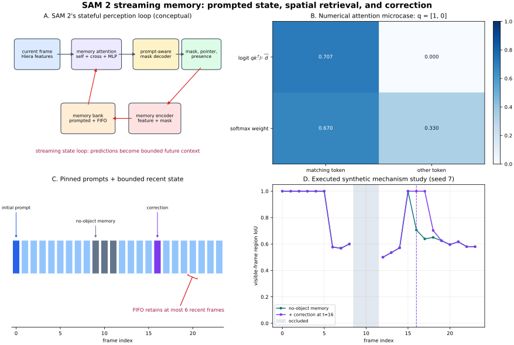

# SAM 2 Streaming Memory for Promptable Video Segmentation

**Date:** 2026-10-29  
**Track:** CV → Segmentation  
**Level:** advanced  
**Runnable reference:** [NumPy streaming-memory mechanism study and tactile application](../../examples/sam2-streaming-memory/)  
**Illustration:** [architecture, memory timeline, attention microcase, and executed trace](../../assets/sam2-streaming-memory/streaming-memory.svg)

> This lesson is a **sourced reconstruction of SAM 2's core algorithm plus an original mechanism study**. The NumPy code is not SAM 2, does not contain Meta weights, and is not a benchmark reproduction. It deliberately isolates spatial cross-attention, object pointers, a bounded FIFO bank, no-object memory, occlusion gating, and corrective prompts so that every state transition can be inspected.



## 0. What an engineer should retain

SAM 2 turns segmentation from a stateless per-image prediction into a **prompt-conditioned state machine**:

1. encode the current image once;
2. retrieve spatial evidence and compact object identity from earlier frames;
3. decode a mask using the current prompt, if any;
4. encode that prediction back into bounded memory;
5. accept a later correction as new high-priority evidence.

The important abstraction is not “video SAM.” It is this loop:

\[
\boxed{
(I_t,\;P_t,\;\mathcal M_{<t})
\xrightarrow{\text{current-image encoder + memory attention + mask decoder}}
(\hat Y_t,\;o_t,\;p_t)
\xrightarrow{\text{memory encoder}}
\mathcal M_{\leq t}
}
\]

where (I_t) is frame (t), (P_t) is an optional point/box/mask prompt, \(\mathcal M_{<t}\) is stored state, \(\hat Y_t\) is the mask, \(o_t\) is an object-presence score, and \(p_t\) is an object pointer. The loop is causal and bounded, so it can process a stream without attending to every raw historical frame.

This is a pattern a VLM/CV engineer should recognize elsewhere: memory tokens in video-language models, region tokens in a VLA policy, a corrected surgical tool track, or the persistent contact patch in a visual-tactile sensor.

## 1. Evidence vocabulary

The following labels prevent architecture archaeology from becoming folklore:

- **Paper says** — stated by the original SAM 2 paper.
- **Implementation says** — visible in Meta's official repository or configuration at the linked source revision; it may differ across SAM 2 and SAM 2.1 configurations.
- **My interpretation** — an engineering consequence derived from those sources.
- **Unknown** — not established by the cited evidence or dependent on a deployment decision.

Version warning: the 2024 paper describes the original SAM 2 models. The living repository also contains SAM 2.1 and configuration-specific changes. “SAM 2” is therefore not one immutable tensor graph. Pin a Git commit and YAML file for reproduction.

## 2. Research problem

### 2.1 Promptable visual segmentation

Let a video be

\[
\mathcal V=\{I_t\}_{t=0}^{T-1},
\qquad I_t\in\mathbb R^{3\times H_0\times W_0}.
\]

Here (T) is the number of frames, (H_0,W_0) are original image height and width, and the leading dimension contains RGB channels. For one object, the user may provide prompts on any subset of frames:

\[
P_t\in\{\varnothing,\;\text{positive/negative points},\;\text{box},\;\text{mask}\}.
\]

The model must return a **masklet**

\[
\hat{\mathcal Y}=\{\hat Y_t\}_{t=0}^{T-1},
\qquad \hat Y_t\in\{0,1\}^{H_0\times W_0},
\]

and must update that masklet after a corrective prompt.

**Paper says:** Promptable Visual Segmentation generalizes image prompting to video. Points, boxes, or masks can arrive on any frame; the output is the spatiotemporal mask of the target object. This differs from category-driven semantic segmentation: the prompt specifies the instance.

### 2.2 The state-estimation view

A useful engineering formulation is

\[
z_t=f_\theta(I_t,P_t,\mathcal M_{<t}),
\qquad
(\hat Y_t,o_t,p_t)=g_\theta(z_t,P_t),
\qquad
\mathcal M_{\leq t}=U(\mathcal M_{<t},I_t,\hat Y_t,p_t,o_t).
\]

- (z_t\in\mathbb R^{N_q\times D}\) is the memory-conditioned current-frame representation.
- (f_\theta\) contains the image encoder and memory attention.
- (g_\theta\) is the prompt-conditioned mask decoder and its heads.
- (U\) is the memory-selection and memory-encoding update.
- (o_t\) estimates whether the target is present.
- (p_t\in\mathbb R^{D_p}\) compactly represents the object.

**My interpretation:** (o_t) is part of the state transition, not merely an output score. A false positive can be written into memory and reinforce itself; a false absence can prevent useful state from being written. Video segmentation is consequently a closed-loop estimation problem.

## 3. Motivation and prior limitations

### 3.1 Per-frame image segmentation is temporally incoherent

Running an image segmenter independently on every frame discards identity and motion history. Repeating the same point is impossible when the object is occluded, deformed, or outside the current view. Similar distractors can win because the model has no instance-specific state.

### 3.2 Full space-time attention is expensive

If every current token attends to every token in all (T) frames, the logit count scales as

\[
O((TN)^2)
\]

for (N) spatial tokens per frame. Even a causal current-to-history design scales as (O(TN^2)) per late frame unless history is compressed or truncated.

### 3.3 Propagation-only systems drift

Optical-flow warping and recurrent propagation assume that a good previous mask remains available. Occlusion, re-entry, blur, fast motion, appearance drift, and a single bad prediction violate that assumption. A purely recurrent vector can also lose fine spatial structure.

### 3.4 Offline trackers resist interaction

An offline video model may use future frames and global optimization, but an interactive annotator expects a correction at frame (t_c) to update nearby and later frames quickly. A robotics stream cannot wait for the final frame.

**Paper says:** SAM 2 uses a simple transformer with streaming memory to unify image and video segmentation. It was trained with simulated corrective interactions and a data engine that collected the SA-V video dataset.

**My interpretation:** the design trades unlimited history for an operational invariant: “keep a few high-value prompted memories and a few recent observations.” That makes latency and state size predictable.

## 4. Key insight: separate spatial memory from object identity

SAM 2 stores two complementary forms of evidence:

1. **Spatial memories** preserve where object-like evidence occurred across a feature grid.
2. **Object pointers** are compact vectors derived from decoder output tokens and preserve target identity without carrying an entire map.

The current frame contributes **queries**. Stored maps and pointers contribute **keys/values**. Cross-attention retrieves the parts of history relevant to every current location. A prompt is not repeatedly warped; it becomes persistent state.

The bank also separates:

- **conditioning frames**, on which a user provided a prompt and which should not be casually evicted; and
- **recent unprompted frames**, maintained as a FIFO-like window to follow appearance change.

The original paper uses six recent unprompted memories by default and retains prompted frames. The official base implementation documents `num_maskmem=7` as one input memory plus six previous memories; exact selection behavior is predictor/configuration dependent.

## 5. Method, module by module

### 5.1 Tensor contract for a 1024 × 1024 example

The table reconstructs the main single-object flow. (B) is batch size, (P) point count, (M\leq 3) candidate masks, and (S=64\times64=4096) stride-16 tokens. Dimensions reflect the paper and common official 1024-pixel configurations; verify the chosen YAML.

| Module | Input | Output | Purpose |
|---|---|---|---|
| Resize/normalize | RGB frames `[B,3,H0,W0]` | model image `[B,3,1024,1024]` | establish model coordinate system |
| Hiera + FPN neck | image `[B,3,1024,1024]` | multi-scale maps; main map `[B,256,64,64]`, high-resolution stride-4/8 skips | compute image evidence once per frame |
| Prompt encoder | point coordinates `[B,P,2]` in `(x,y)`, labels `[B,P]`; optional box/mask | sparse prompt tokens and dense mask embedding | encode user intent |
| Memory selector | conditioning and unprompted state | selected memory maps plus pointer tokens | bound history while retaining prompts |
| Memory attention | current tokens `[4096,B,256]`; spatial memory tokens with 64-D values projected to 256-D; pointers | conditioned current tokens `[4096,B,256]` | retrieve spatial and identity evidence |
| Mask decoder | conditioned image tokens + prompt tokens + high-res skips | low-resolution logits `[B,M,256,256]`, IoU estimates, output tokens, presence score | turn state and prompt into candidate masks |
| Upsampling | low-res logits | video-size/model-size masks, then original-size masks | restore pixel geometry |
| Pointer projection | selected output token `[B,256]` | object pointer `[B,256]` | compact instance identity |
| Memory encoder | unconditioned image map `[B,256,64,64]` + predicted mask | memory map `[B,64,64,64]` and position encoding | write spatial state for future frames |

**Implementation says:** the current official `sam2_base.py` treats point coordinates as `[B,P,2]` in absolute `(x,y)` form at the model boundary and uses a 256-D SAM prompt embedding. The video predictor performs coordinate normalization/scaling when requested. Do not pass `(row,column)` or already-rescaled coordinates to an API that rescales them again.

### 5.2 Image encoder

**Paper says:** the image encoder is Hiera, a hierarchical vision transformer pretrained with masked autoencoding. A feature pyramid supplies the main stride-16 map and higher-resolution features to the mask decoder.

Let

\[
X_t=E_\theta(I_t)\in\mathbb R^{B\times D\times H\times W},
\]

where (D=256), (H=W=64) for the representative 1024-pixel case. Flattening gives

\[
X_t^{\flat}\in\mathbb R^{N_q\times B\times D},\qquad N_q=HW=4096.
\]

“Unconditioned” matters: the memory encoder later combines the predicted mask with image features that have not already absorbed memory, reducing a direct feedback shortcut.

### 5.3 Memory attention layer

The paper describes four memory-attention layers for the original reported architecture. Each performs current-token self-attention, cross-attention to memory, then an MLP, with residual connections and normalization. Current configuration files can use a different layer count.

For one head, scaled dot-product cross-attention is

\[
A=\operatorname{softmax}\!\left(\frac{QK^\top}{\sqrt{d_h}}+B_{\text{pos}}\right),
\qquad
O=AV.
\]

Every symbol has a concrete shape:

- (Q\in\mathbb R^{N_q\times d_h}\): queries from (N_q) current-frame locations;
- (K\in\mathbb R^{N_m\times d_h}\): keys from (N_m) selected memory tokens;
- (V\in\mathbb R^{N_m\times d_v}\): their values;
- (QK^\top\in\mathbb R^{N_q\times N_m}\): all current-to-memory similarity logits;
- (d_h\): per-head query/key dimension; division by \(\sqrt{d_h}\) controls logit variance;
- (B_{\text{pos}}\in\mathbb R^{N_q\times N_m}\): spatial/temporal positional contribution, conceptually;
- (A\in[0,1]^{N_q\times N_m}\): row-normalized retrieval weights;
- (O\in\mathbb R^{N_q\times d_v}\): retrieved context.

One pre-normalized layer can be written

\[
\begin{aligned}
U^{(\ell)} &= Z^{(\ell)} +
\operatorname{SelfAttn}(\operatorname{LN}(Z^{(\ell)})),\\
R^{(\ell)} &= U^{(\ell)} +
\operatorname{CrossAttn}(\operatorname{LN}(U^{(\ell)}),K,V),\\
Z^{(\ell+1)} &= R^{(\ell)} +
W_2\,\phi(W_1\operatorname{LN}(R^{(\ell)})).
\end{aligned}
\]

- (Z^{(\ell)}\in\mathbb R^{N_q\times B\times D}\) is the layer input.
- (U^{(\ell)},R^{(\ell)}) are residual intermediate tensors of the same shape.
- (W_1\in\mathbb R^{D_{ff}\times D}), (W_2\in\mathbb R^{D\times D_{ff}}) form the MLP.
- \(\phi\) is the configured nonlinearity.
- \(\operatorname{LN}\) is LayerNorm over the channel dimension.

**Implementation says:** Meta's official `memory_attention.py` applies normalization before self-attention, cross-attention, and the MLP. Its current code supports 2-D rotary position embedding (RoPE) and explicitly excludes object-pointer keys from spatial RoPE because a pointer is not a pixel location.

#### Numerical micro-example

Take one query and two keys:

\[
q=[1,0],\quad k_1=[1,0],\quad k_2=[0,1],\quad v_1=1,\quad v_2=0.
\]

Here (d_h=2). The logits are

\[
\left[\frac{q^\top k_1}{\sqrt2},\frac{q^\top k_2}{\sqrt2}\right]
=[0.7071,0].
\]

Softmax gives approximately `[0.6698, 0.3302]`, so

\[
O=0.6698(1)+0.3302(0)=0.6698.
\]

The retrieved mask evidence is soft because attention compares alternatives. In a trained model, learned projections, multiple heads, residual mixing, and the decoder make this far richer than direct nearest-neighbor copying.

### 5.4 Prompt and mask decoding

**Paper says:** SAM 2 reuses the SAM prompt-encoder idea and a lightweight mask decoder with two-way interaction between prompt tokens and image tokens. On ambiguous initial prompts it can produce multiple masks; the candidate with the highest predicted IoU is propagated in video. High-resolution encoder features improve boundary detail. A separate prediction indicates whether the object is present.

For candidate (m), the decoder emits low-resolution logits

\[
L_{t,m}\in\mathbb R^{256\times256}.
\]

Pixel probabilities are

\[
\pi_{t,m}(x,y)=\sigma(L_{t,m}(x,y))
=\frac{1}{1+e^{-L_{t,m}(x,y)}}.
\]

The binary mask at threshold \(\tau\) is

\[
\hat Y_{t,m}(x,y)=\mathbf 1[\pi_{t,m}(x,y)\geq\tau].
\]

The predicted IoU is a ranking estimate, not the true IoU available at inference. The presence score likewise is learned and can fail.

### 5.5 Object pointers

Let decoder output token (r_t\in\mathbb R^{256}). A learned projection creates

\[
p_t=W_p r_t\in\mathbb R^{256}.
\]

The original paper describes splitting a 256-D pointer into four 64-D tokens so it can join the 64-D memory-token stream:

\[
p_t\mapsto [p_t^{(1)},p_t^{(2)},p_t^{(3)},p_t^{(4)}],
\qquad p_t^{(j)}\in\mathbb R^{64}.
\]

**Paper says:** pointers provide high-level target semantics and are especially useful for resolving ambiguity after occlusion. The paper's Table 11 reports that adding pointers changes MOSE/SA-V/LVOS/9-zero-shot/SA23 results from `73.1/64.5/67.0/70.9/59.9` without a pointer to `73.0/68.3/71.6/70.7/59.7` with pointers. This helps SA-V and LVOS in that ablation, is essentially neutral or slightly negative on some other columns, and is not universal proof of improvement.

**My interpretation:** a pointer answers “which object?” while a spatial memory answers “what did its evidence look like at each location?” Both are needed when two objects look alike or a target disappears.

### 5.6 Memory encoder

Let (X_t\in\mathbb R^{B\times256\times64\times64}) be the unconditioned image feature and (L_t) the selected mask logits. A compact reconstruction is

\[
M_t=P_{out}\!\left(
F\!\left(P_x(X_t)+D(\sigma(L_t))\right)
\right)
\in\mathbb R^{B\times64\times64\times64}.
\]

- \(\sigma(L_t)\) converts logits to a soft mask.
- (D\) is a learned progressive convolutional downsampler aligning the mask with the stride-16 grid.
- (P_x\) projects image channels so addition is defined.
- (F\) is a small convolutional fuser; the official code uses ConvNeXt-style blocks.
- (P_{out}\) compresses the result to the memory dimension (D_m=64).
- (M_t\) is the spatial memory written for frame (t).

**Implementation says:** `memory_encoder.py` adds downsampled mask evidence to projected pixel features, fuses them, then applies an output projection. This is learned feature-mask fusion, not storing the binary mask verbatim.

For an absent object, the architecture also learns no-object/occlusion representations. The toy stores an explicit zero mask with the absent frame's features instead. That is an intentionally transparent analogy, not source equivalence.

### 5.7 Bank selection and temporal identity

Represent the state as

\[
\mathcal M_t=\mathcal C_t\cup\mathcal R_t,
\]

where \(\mathcal C_t\) contains user-conditioned memories and \(\mathcal R_t\) contains at most (N=6) recent unprompted memories in the paper's default policy.

A simple update is

\[
\mathcal R_t=
\operatorname{TakeRecent}_N(\mathcal R_{t-1}\cup\{M_t\}),
\]

while a prompted memory is inserted into \(\mathcal C_t\). Real selection also handles propagation direction, conditioning-frame limits, temporal stride, and object pointers.

Temporal position is not redundant with image content: the same visual evidence at ages 1 and 50 should not necessarily have the same reliability. The paper adds learned temporal embeddings to recent memory maps; spatial RoPE supplies coordinate structure. The toy uses a sine/cosine age vector and an explicit recency bias only to make the mechanism observable without training.

### 5.8 Training the interaction loop

**Paper says:** video training samples eight frames, chooses up to two as prompted frames, and simulates iterative corrective clicks from prediction errors. Additional longer-sequence fine-tuning uses 16-frame sequences. The system is trained on image and video data, including data collected through the SA-V model-in-the-loop engine.

The essential curriculum is:

1. choose a target and initial prompt;
2. predict a masklet;
3. locate an error region;
4. sample a corrective click from the error;
5. rerun the affected state transition;
6. optimize masks, quality estimates, and presence behavior.

**My interpretation:** interactive robustness cannot be added only at UI time. The network must see correction-induced state transitions during training, otherwise a correction token is out-of-distribution evidence.

**Unknown:** a universally optimal click simulator. Click policies change measured interaction count, so papers and reproductions must use the same protocol.

## 6. Coordinate, modality, time, and precision flow

| Concern | Flow | Failure if confused |
|---|---|---|
| Modality | `uint8 RGB → normalized float image → Hiera features → memory-conditioned features → mask logits` | treating memory tokens as RGB or prompt tokens as pixel maps |
| Coordinates | original `(x,y)` prompts → predictor transform → resized/padded model coordinates → stride-16/stride-4 grids → upsample/crop to original frame | `(row,column)` swap, double scaling, padding offset, wrong mask size |
| Time | frame index → conditioning/recent selection → relative temporal encoding → causal propagation direction | future leakage, stale memory dominance, evicting the only prompt |
| Identity | decoder output token → 256-D pointer → pointer memory tokens | attaching another object's pointer to the current mask |
| Presence | learned object score → no-object behavior and output suppression → state write | self-reinforcing false positives or premature track death |
| Precision | normalized input often autocast → encoder/attention → logits and state → thresholded boolean mask | FP16 softmax overflow, low-margin threshold flips, INT8 similarity distortion |

The official examples use PyTorch autocast with `bfloat16` on supported CUDA hardware. That is an example, not a requirement that every operator, GPU, TensorRT version, or Jetson supports BF16 efficiently.

## 7. Runnable implementation

The reference uses only NumPy and Matplotlib:

| File | Purpose |
|---|---|
| [`streaming_memory.py`](../../examples/sam2-streaming-memory/streaming_memory.py) | stable softmax, chunked attention, temporal encoding, pointers, bank state, IoU and boundary F |
| [`synthetic_video.py`](../../examples/sam2-streaming-memory/synthetic_video.py) | deterministic 24-frame feature video with appearance drift, distractor, and frames 9–11 occluded |
| [`demo.py`](../../examples/sam2-streaming-memory/demo.py) | four controlled variants and a 12-seed paired study |
| [`application.py`](../../examples/sam2-streaming-memory/application.py) | visual-tactile contact-region propagation with a deployment gate |
| [`checks.py`](../../examples/sam2-streaming-memory/checks.py) | numerical, shape, state, ablation, and application assertions |
| [`make_figure.py`](../../examples/sam2-streaming-memory/make_figure.py) | regenerates the original SVG |

Run from the repository root:

```bash
python -m pip install -r CV/examples/sam2-streaming-memory/requirements.txt
python CV/examples/sam2-streaming-memory/checks.py
python CV/examples/sam2-streaming-memory/demo.py
python CV/examples/sam2-streaming-memory/application.py
MPLBACKEND=Agg python CV/examples/sam2-streaming-memory/make_figure.py
```

### 7.1 Reference-code data flow

The synthetic input has shape `[T,H,W,D] = [24,24,32,8]`. It represents normalized per-pixel features, not RGB. At time (t):

1. flatten current features to queries `[768,8]`;
2. flatten every selected memory map to keys `[Nm,8]` and mask values `[Nm]`;
3. compute attention in query chunks so a full logit tensor is not retained;
4. mix spatially retrieved mask probability with a pooled object-pointer score;
5. suppress the mask if the simulated learned presence head says absent;
6. write a prompted memory, positive recent memory, or explicit no-object memory;
7. retain no more than six recent memories.

`object_scores` are simulated imperfect outputs, not ground-truth masks copied into inference. Ground truth is used only to create the initial/corrective prompts and evaluate results.

### 7.2 Why the toy has a hand-written recency bias

An untrained dot-product retriever has no learned notion of time. The code therefore adds a small age-dependent bias to attention logits and a sine/cosine age feature to recent keys. SAM 2 learns temporal embeddings inside an end-to-end model. The toy's scalar bias must not be copied into SAM 2 and described as official behavior.

## 8. Experiments and evidence

### 8.1 What the paper establishes

**Paper says:** under its reported evaluation protocols, SAM 2 achieves better video segmentation accuracy with three times fewer user interactions than prior interactive approaches, and its image mode is six times faster than SAM while being more accurate. Those are paper-level comparisons under specific models, hardware, datasets, and protocols—not universal deployment guarantees.

The pointer ablation quoted in §5.5 is especially instructive: component effects differ by dataset. Good engineering asks where a mechanism helps, not merely whether its mean column is larger.

### 8.2 What was executed here

The included code was executed in the recorded environment; [`VALIDATION.md`](../../examples/sam2-streaming-memory/VALIDATION.md) contains commands and versions. On seed 7, visible-frame metrics were:

| Controlled variant | Region J | Boundary F | J&F |
|---|---:|---:|---:|
| pinned initial prompt only | 0.706369 | 0.839603 | 0.772986 |
| recent FIFO, skip absent frames | 0.706369 | 0.839603 | 0.772986 |
| recent FIFO + explicit no-object memory | 0.730664 | 0.851347 | 0.791006 |
| no-object memory + correction at frame 16 | 0.764376 | 0.867237 | 0.815806 |

Across 12 deterministic random seeds:

- median gain of recent-memory-only over the pinned prompt: `0.000000` J&F; it won 2/12 trials;
- median gain from adding no-object memory: `0.018529` J&F; it won 12/12;
- median gain from a correction at frame 16: `0.023202` J&F; it won 12/12.

This deliberately exposes a negative result: **memory is not automatically beneficial**. If recent predictions repeat the same distractor error, storing them adds no information. Explicit absent-frame evidence and a trustworthy correction are useful in this constructed sequence.

The tactile application uses a conservative gate: mean visible IoU at least 0.75, minimum at least 0.45, and no false-positive pixels in known occluded frames. Without correction it is rejected (`mean IoU 0.736507`); with correction it is accepted (`0.763839`). This is a synthetic contract test, not a clinical or robotic safety validation.

## 9. Meaningful reproduction plan

### 9.1 Mechanism reference

Run the five commands in §7 and require:

- every assertion in `checks.py` passes;
- the SVG regenerates;
- no-object and correction gains are positive for the checked seed;
- the uncorrected tactile track is gated and the corrected one passes;
- occluded frames contain zero predicted pixels in the controlled fixture.

Because the fixture and seeds are fixed, this is a regression test, not a confidence interval for real videos.

### 9.2 Official SAM 2 reproduction

For a defensible full-model experiment:

1. record the official repository commit, model YAML, checkpoint hash, PyTorch/CUDA versions, GPU, and preprocessing;
2. download a benchmark through its official terms rather than copying headline numbers;
3. define the prompt protocol exactly: first-frame mask, positive click, box, number and placement of correction clicks;
4. run the official video predictor without modifying memory size;
5. evaluate region similarity (\mathcal J\) and boundary accuracy (\mathcal F) per object and sequence;
6. ablate one factor at a time—pointer use, recent-memory count, correction frame, presence handling;
7. report peak allocated memory, warm-up, per-frame latency distribution, and state-transfer cost separately from image encoding.

For binary masks (Y,\hat Y\), region IoU is

\[
\mathcal J(Y,\hat Y)=\frac{|Y\cap\hat Y|}{|Y\cup\hat Y|}.
\]

- (|Y\cap\hat Y|) is the count of pixels true in both masks.
- (|Y\cup\hat Y|) is the count true in either.
- A declared convention is needed when both are empty.

Boundary F combines boundary precision (P_b) and recall (R_b) within a spatial tolerance:

\[
\mathcal F=\frac{2P_bR_b}{P_b+R_b}.
\]

The common summary \((\mathcal J+\mathcal F)/2\) values both region coverage and contour quality. Match the benchmark's official boundary tolerance and empty-mask rules; the toy's one-pixel square dilation is only a compact local implementation.

### 9.3 Interactive evaluation

Do not compare “number of clicks” unless click selection is identical. A reproducible simulator should state:

- whether the next click is positive or negative;
- whether it uses the largest error component, its center, or random sampling;
- whether correction propagates forward, backward, or both;
- when evaluation stops;
- whether an absent object receives a prompt.

## 10. Ablations an engineer should run

| Ablation | Question | Expected diagnostic, not a promised outcome |
|---|---|---|
| 0, 1, 3, 6 recent memories | How much history is actually useful? | accuracy may saturate while attention cost rises linearly |
| remove pointers | Is spatial evidence sufficient? | identity switches may rise after occlusion or among similar objects |
| remove temporal position | Does the model distinguish fresh and stale state? | old appearances may dominate after drift |
| do not write absent frames | Is negative state useful? | fewer contaminated writes, but less explicit background evidence |
| presence threshold sweep | Is track survival calibrated? | false-presence/false-absence trade-off |
| correction at early/middle/late frames | How recoverable is accumulated drift? | prompt timing changes future state quality |
| evict the first prompt | How important is the immutable identity anchor? | later state can become self-referential |
| remove high-resolution skips | Are boundaries decoder- or backbone-limited? | region IoU may stay similar while boundary F falls |
| FP32 vs BF16/FP16 vs mixed INT8 | Where is precision fragile? | attention ranking and threshold margins may change |

Always inspect per-sequence results. A mean can hide catastrophic identity swaps on precisely the occlusion sequences for which memory was introduced.

## 11. Failure modes and limitations

1. **Self-reinforcing drift.** A wrong mask becomes a memory, which makes the next wrong mask more likely.
2. **Identity swap.** Similar adjacent objects can exchange pointers or spatial support after an overlap.
3. **Long occlusion.** A bounded FIFO forgets useful appearances; a stale prompt may not match a transformed object.
4. **Presence-head error.** False absence suppresses a valid mask; false presence writes hallucinated state.
5. **Prompt ambiguity.** One click may legitimately refer to several possible extents; highest predicted IoU can still select the wrong candidate.
6. **Thin structures and fast boundaries.** Stride-16 memory is spatially compressed. High-resolution skips help, but topology can still break.
7. **Camera cuts and discontinuities.** “Recent” does not mean relevant after an edit or robot-camera reset.
8. **Multi-object scaling.** Official predictor logic can track multiple objects, but state, decoding work, and bookkeeping grow with object count; interactions between separately processed objects are not automatically globally consistent.
9. **Domain shift.** Tactile gel markers, endoscopy, thermal imagery, and microscopy differ from web/video pretraining.
10. **Causality constraint.** Streaming inference cannot use future evidence unless an offline backward pass is explicitly run.

**Unknown:** whether a particular checkpoint is safe for an autonomous control loop, surgical measurement, or tactile force estimate. Segmentation quality alone does not establish calibration, physical units, failure detection, or safety.

## 12. Computational cost

For (1024\times1024) input with stride 16, one spatial memory has

\[
64\times64\times64=262{,}144
\]

scalar values. Stored in FP16, that is

\[
262{,}144\times2=524{,}288\text{ bytes}=0.5\text{ MiB}.
\]

Seven maps are about 3.5 MiB per object before position encodings, pointers, allocator overhead, cached image features, decoder tensors, and activations. This is a state-size lower bound, not process memory.

Naively materializing one current-to-memory logit matrix with 4096 current tokens and (7\times4096=28{,}672) spatial keys yields

\[
4096\times28{,}672=117{,}440{,}512
\]

logits: roughly 224 MiB in FP16 for **one head and one layer**. Fused/chunked attention can avoid retaining that full matrix, but arithmetic remains substantial. Pointer tokens are few and do not dominate this count.

The bounded bank makes state memory (O(NHW D_m)) rather than (O(THW D_m)), where (N) is retained-frame count and (T) is total video length.

## 13. ONNX, TensorRT, quantization, and Jetson

### 13.1 Split a stateful graph deliberately

A practical export boundary is:

1. **image encoder engine:** RGB tensor → multi-scale image features;
2. **stateful memory/decoder engine:** current features + prompts + packed memories/pointers → logits, presence, pointer, new memory;
3. **host controller:** coordinate transforms, memory selection/eviction, object IDs, correction scheduling, output resizing.

ONNX can represent tensors; it does not define your semantic policy for which memory to evict. Make the bank an explicit input/output with fixed maxima and validity masks. Dynamic Python dictionaries and per-object lists should stay in the host controller.

The official repository documents `torch.compile` options for video inference in supported configurations. That is not evidence of an official, behavior-identical ONNX/TensorRT export.

### 13.2 TensorRT details

- use optimization profiles for supported image sizes, point counts, object counts, and memory lengths;
- keep `(x,y)` transformations and padding metadata outside the engine or test them as separate kernels;
- confirm the exported RoPE, LayerNorm, interpolation, and dynamic gather operations are supported;
- compare raw logits, presence scores, pointer cosine similarities, and final masks—not only FPS;
- warm up before measuring and separate host-to-device state copies from kernel time.

### 13.3 Quantization

INT8 error can reorder similar attention logits. A conservative mixed-precision starting point is:

- quantize stable convolution/linear portions of the image encoder after calibration;
- keep LayerNorm, softmax, attention accumulation, mask thresholds near zero, and memory/pointer similarity in FP16 or FP32 first;
- use per-channel weight scales where supported;
- calibrate with long videos, occlusions, corrections, absent objects, and domain-specific frames—not independent random images;
- validate state drift over hundreds of frames because small per-frame errors compound.

### 13.4 Jetson implications

For an 8 GB Jetson-class target, begin with a small Hiera checkpoint, a single object, a fixed bank, and the minimum acceptable input resolution. Reuse encoded frame features during interaction, preallocate state buffers, and profile the memory-attention workspace. FP16 is often the pragmatic starting point; BF16 and fused-kernel support depend on the exact JetPack, TensorRT, PyTorch, and device combination.

**Unknown:** real-time throughput on the user's Jetson. It depends on checkpoint, resolution, object count, prompt frequency, bank size, compiler, power mode, thermals, and whether state is copied through the CPU. Measure on the exact device.

## 14. Integrated applications

### 14.1 Robotics and VLA

A human points to “this connector” once. SAM 2 supplies a persistent region; a VLA policy consumes a region-pooled token rather than the entire image. The pointer helps identity, while the mask supports geometry such as grasp points. The action policy should still receive presence/uncertainty and stop when the region fails a gate.

### 14.2 Visual-tactile sensing

Treat a deforming contact patch or marker cluster as the prompted object. Streaming state bridges brief glare or occlusion; a known no-contact interval supplies negative evidence; an automatic high-confidence detector or user correction re-anchors drift. Segmentation does **not** directly yield force—physical calibration and uncertainty propagation remain separate.

The included application demonstrates exactly this software contract: only publish the contact region when mean/minimum consistency and occlusion false-positive checks pass.

### 14.3 Surgical imaging

A surgeon or annotator can identify an instrument, lesion, or tissue region and correct it later. Streaming memory is useful under deformation and temporary occlusion. However, smoke, specular highlights, blood, rapid tool entry, and severe domain shift are expected failure modes. A research mask must not be interpreted as a clinical measurement without task-specific prospective validation and human oversight.

## 15. Paper says / inference / interpretation / unknown

| Status | Claim |
|---|---|
| **Paper says** | SAM 2 uses streaming memory, a memory encoder, memory attention, and a SAM-like prompt/mask decoder for images and video. |
| **Paper says** | Original training simulates corrective prompting; the default reported bank keeps six recent unprompted memories in addition to prompted evidence. |
| **Implementation says** | Official source uses learned temporal memory embeddings, no-object representations, pointer tokens, and configuration-dependent memory-attention depth. |
| **Inference from architecture** | Bounded state makes arbitrarily long causal streams operationally possible, but it does not prevent semantic drift. |
| **My interpretation** | The presence head is part of memory hygiene; its mistakes alter future evidence, not just the current display. |
| **My interpretation** | Prompted frames are measurements with unusually high trust and should be treated differently from self-generated memories. |
| **Unknown** | Which bank size, threshold, precision, and checkpoint are optimal for a new robotics, tactile, or surgical domain without experiments. |
| **Unknown** | Whether ONNX/TensorRT conversion is numerically equivalent until raw outputs and long-horizon state are tested. |

## 16. Primary sources

1. Ravi et al., **SAM 2: Segment Anything in Images and Videos**, 2024: [paper (arXiv:2408.00714)](https://arxiv.org/abs/2408.00714), [HTML](https://arxiv.org/html/2408.00714).
2. Meta, **official SAM 2 repository**: [facebookresearch/sam2](https://github.com/facebookresearch/sam2).
3. Official architecture source: [`sam2_base.py`](https://github.com/facebookresearch/sam2/blob/main/sam2/modeling/sam2_base.py), [`memory_attention.py`](https://github.com/facebookresearch/sam2/blob/main/sam2/modeling/memory_attention.py), and [`memory_encoder.py`](https://github.com/facebookresearch/sam2/blob/main/sam2/modeling/memory_encoder.py).
4. Official current small-model configuration: [`sam2.1_hiera_t.yaml`](https://github.com/facebookresearch/sam2/blob/main/sam2/configs/sam2.1/sam2.1_hiera_t.yaml).
5. Ryali et al., **Hiera: A Hierarchical Vision Transformer without the Bells-and-Whistles**, ICML 2023: [PMLR paper](https://proceedings.mlr.press/v202/ryali23a.html), [official repository](https://github.com/facebookresearch/hiera).
6. Kirillov et al., **Segment Anything**, ICCV 2023: [paper](https://arxiv.org/abs/2304.02643), [official repository](https://github.com/facebookresearch/segment-anything).
7. Meta, **SA-V dataset page**: [Segment Anything Video dataset](https://ai.meta.com/datasets/segment-anything-video/).

When precision matters, cite a commit rather than `main`: official code and configuration evolve.

## 17. Final engineering checklist

- [ ] Pin official commit, YAML, checkpoint hash, preprocessing, and prompt protocol.
- [ ] Keep original, resized, padded, feature-grid, and output coordinates explicit.
- [ ] Distinguish conditioning memories, recent memories, pointers, and absent-object state.
- [ ] Test identity switches, occlusion, re-entry, camera cuts, and corrections.
- [ ] Report region J and boundary F per sequence, not only an aggregate mean.
- [ ] Verify long-horizon numerical drift after compilation or quantization.
- [ ] Bound bank length and preallocate deployment state.
- [ ] Treat object presence as a state-transition decision.
- [ ] Gate downstream robotics, VLA, tactile, or surgical use on task-specific checks.
- [ ] Never describe the included NumPy mechanism study as a SAM 2 reimplementation or benchmark result.
