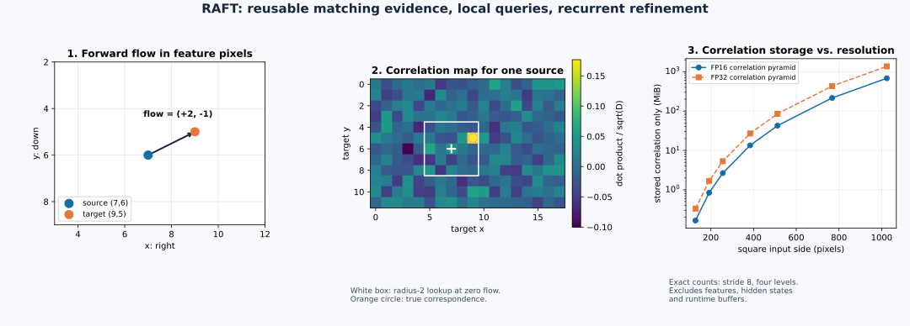
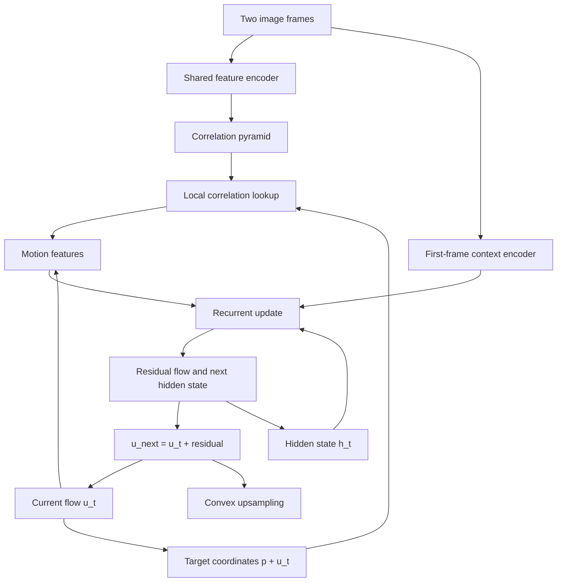

# RAFT optical flow: reusable correlation memory and recurrent refinement

**Date:** 2026-10-18  
**Category:** Video and motion  
**Prerequisites:** Feature maps, dot products, interpolation, backpropagation, basic recurrent networks  
**Primary work:** [Teed and Deng, RAFT, ECCV 2020](https://arxiv.org/abs/2003.12039)  
**Executable reference:** [Correlation, on-demand lookup, convex upsampling, checks and demo](../../examples/raft-optical-flow/)

Yesterday's [deformable-attention lesson](../attention-and-detection/2026-10-17-deformable-attention.md)
asked how a query can learn where to retrieve spatial information. Today we ask
a complementary question: **how can a motion estimator reuse visual matching
evidence while repeatedly improving a geometric hypothesis?**

The important distinction is between the evidence and the current answer.
Evidence can be computed once. The answer can change many times.

## 1. Problem, motivation and intellectual map

Optical flow is a dense correspondence field between two frames. Define forward
flow from frame 1 to frame 2. For source pixel $p=(x,y)$,

$$
q=p+u(p),\qquad u(p)=(u_x(p),u_y(p)).
$$

Here $q$ is the estimated location of the same visible scene point in frame 2.
Coordinates are image positions, not 3D points; flow is displacement, not depth.
We use x-right and y-down throughout.

**Paper says:** RAFT extracts features, forms all-pairs correlation evidence,
pools its target-coordinate axes, and repeatedly refines one flow field using
a recurrent update unit. Its experiments include supervised optical-flow
benchmarks and architecture ablations. [S1]

**My interpretation:** Treat this as a learned geometric inference loop with a
read-only evidence store. The state contains a current correspondence proposal
and a hidden representation of previous reasoning; each iteration reads local
evidence around that proposal and predicts a correction.

| Part of the reasoning problem | Representation | Why it matters |
| --- | --- | --- |
| What could match what? | Correlation between source and target features | Keep alternative hypotheses available |
| Where is the match currently believed to be? | Coordinate field $p+u_t(p)$ | Give every lookup an explicit geometric center |
| What was learned in earlier updates? | Recurrent hidden state $h_t$ | Retain information beyond the current flow vector |
| How should the estimate change? | Predicted residual $\Delta u_t$ | Refine instead of predicting the entire field anew |
| How should coarse-grid estimates reach image resolution? | Learned convex interpolation | Handle displacement units and local boundaries explicitly |

For a robot, correspondence can provide motion evidence to a tracker or a
policy. For an optical tactile sensor, it can describe apparent surface motion.
Neither interpretation automatically supplies metric force or physically valid
3D motion.

## 2. Prior limitations and the key idea

A basic brightness-matching objective compares $I_1(p)$ with $I_2(p+u(p))$.
An optimizer also needs a spatial prior, because a single observation often
admits many motions. Constant-intensity regions, repeated textures, occlusion,
specular highlights and blur all weaken that data term.

A conventional coarse-to-fine procedure estimates a large motion at low
resolution, then refines it. This is computationally attractive, but an early
wrong match can become difficult to escape, especially when a small object is
lost during downsampling.

**My interpretation of RAFT's useful design decision:** Downsample the search
evidence without repeatedly downsampling the set of source points being
estimated. Each source location retains its own target-response map. Coarse
target maps can offer a wide view, while the source lattice remains fixed.

This does not make the source representation full image resolution. The basic
model operates on a stride-8 feature lattice and later upsamples. “Fixed
resolution” refers to the update lattice, not to a claim that each recurrent
update directly processes every original image pixel.



The first two panels come from this lesson's ideal-descriptor experiment. The
curve is an exact storage calculation, not a hardware benchmark.



The loop represents repeated use of shared weights. It is not an unbounded
real-time control loop; an implementation chooses an update budget.

## 3. Mathematical objects and coordinate contracts

Let an input image have shape $[B,3,H_0,W_0]$. After suitable padding, let the
stride-8 feature size be $h=H_0/8,w=W_0/8$, with $N=hw$. We first assume the
two feature maps have the same size, as in the standard two-frame setup.

| Symbol | Shape | Interpretation |
| --- | --- | --- |
| $I_1,I_2$ | $[B,3,H_0,W_0]$ | Ordered image pair |
| $F_1,F_2$ | $[B,D,h,w]$ | Matching descriptors from a shared encoder |
| $C$ | $[B,h,w,h,w]$ | Source location, target location and their similarity |
| $C^{(l)}$ | $[B,h,w,h_l,w_l]$ | Evidence with only target axes pooled |
| $u_t$ | $[B,2,h,w]$ | Current flow in feature-pixel units |
| $q_t$ | $[B,2,h,w]$ | Absolute target coordinates in the same units |
| $g_t$ | $[B,L(2r+1)^2,h,w]$ | Retrieved correlation features |
| $h_t$ | $[B,D_h,h,w]$ | Recurrent hidden state |
| $c$ | $[B,D_c,h,w]$ | Fixed first-frame context features |
| $U_t$ | $[B,2,H_0,W_0]$ | Upsampled flow in image-pixel units |

The batch dimension is not one of the “four dimensions” in 4D correlation.
Those four indices are source y, source x, target y and target x.

## 4. Derive all-pairs correlation as matrix multiplication

Flatten source and target spatial coordinates, keeping channels separate:

$$
A\in\mathbb R^{B\times N\times D},\qquad
B_f\in\mathbb R^{B\times D\times N}.
$$

Then a batch matrix multiplication gives

$$
C_{b,p,q}=\frac{1}{\sqrt D}\sum_{d=1}^{D}F_{1,b,d,p}F_{2,b,d,q}.
$$

The result has shape $[B,N,N]$ and can be viewed as $[B,h,w,h,w]$ without
changing its meaning. The source and target spatial indices must use the same
flattening convention as the corresponding coordinate grids.

The $1/\sqrt D$ scale is used in the official correlation code. [S2] If descriptor
components were independent with zero mean and unit variance, the unscaled dot
product would have variance $D$. Scaling controls this dependence on feature
width. This is a useful variance argument, not a proof that learned descriptors
actually satisfy those assumptions.

### A small numerical example

Let a source descriptor be $(1,2)$ and two target descriptors be $(2,1)$ and
$(-1,0)$. Their scaled correlations are $4/\sqrt2$ and $-1/\sqrt2$. The first
candidate has a larger score. That tells you which of these descriptors aligns
better under this metric; it does not give a calibrated probability of a match.

RAFT's raw correlation is **not** a softmax distribution. There is no requirement
that its scores be positive or sum to one. Applying a softmax would change the
evidence representation consumed by a trained update network.

Compare this with deformable attention: that operator predicts sample weights
and aggregates feature values. Here the lookup retrieves similarity scores; a
separate recurrent network uses them to update geometry.

## 5. Target-only pooling and an exact memory-saving identity

At level $l$, use non-overlapping average pooling on the last two dimensions:

$$
C^{(l)}(p,j,i)=\frac{1}{4^l}
\sum_{a=0}^{2^l-1}\sum_{b=0}^{2^l-1}
C^{(0)}(p,2^lj+a,2^li+b).
$$

The source index $p$ does not change. Each source point still has its own
coarser target-response map. For odd dimensions, the executable reference
floors the pooled shape and drops incomplete bottom/right windows.

Because a dot product is linear, define $P_l(F_2)$ as target-feature average
pooling and move it inside the dot product:

$$
\begin{aligned}
C^{(l)}(p,q_l)
&=\frac1{\sqrt D}\,F_1(p)^\top P_l(F_2)(q_l).
\end{aligned}
$$

Now consider a fractional lookup location. Bilinear sampling is also a weighted
linear combination of nearby target values, so

$$
\operatorname{sample}(C^{(l)}(p,\cdot),q_l)
=\frac1{\sqrt D}F_1(p)^\top
\operatorname{sample}(P_l(F_2),q_l).
$$

This identity gives two equivalent routes:

| Route | Retain | At each query |
| --- | --- | --- |
| Materialized correlation | Every source-target score, plus pooled scores | Interpolate scalar scores |
| On-demand correlation | Source descriptors and pooled target descriptors | Interpolate descriptor vectors and take dot products |

**Inference:** The second route can avoid the quadratic retained evidence array
at the cost of repeated channel-wise calculations. It is only equivalent when
pooling, sampling, padding, scaling and channel ordering agree. In lower
precision the two arithmetic orders need not be bit-identical.

Do not insert a nonlinear operation into this derivation. Pooling softmaxed
correlations, normalizing each pooled descriptor to unit norm, or taking a
maximum before the dot product generally breaks the identity.

## 6. Lookup geometry: a displacement is not an absolute coordinate

For source feature position $p=(x,y)$, define

$$
q_t(p)=p+u_t(p).
$$

At level $l$, evaluate offsets $\delta=(\delta_x,\delta_y)$ around
$q_t(p)/2^l$:

$$
g_t(p)=\operatorname{concat}_{l,\delta}
\left[
\operatorname{sample}\left(C^{(l)}(p,\cdot),
\frac{q_t(p)}{2^l}+\delta\right)
\right].
$$

The official implementation enumerates a square $(2r+1)\times(2r+1)$ grid.
For the basic model $L=4,r=4$, this gives $4\cdot81=324$ response channels. [S2]
Use the implementation's actual enumeration when matching a pretrained
checkpoint: a permutation of lookup channels matters to subsequent convolutions.
Our independent reference explicitly uses level-major, dy-major, dx-minor order.

### Work through one coordinate

Let $p=(7,6)$ and $u=(2,-1)$. The target is $(9,5)$ in feature pixels.
At level 0, lookup is centered at $(9,5)$; at level 1 it is centered at
$(4.5,2.5)$. A level-1 offset $(1,0)$ reaches $(5.5,2.5)$ on that map and
corresponds to two additional feature pixels horizontally at level 0.

Dividing only $u$ by $2^l$ while leaving $p$ unchanged would center the search
at the wrong place. Both components of the absolute target coordinate must
be mapped into the coarser target grid.

### Pixel centers, normalized grids and interpolation

The NumPy sampler works directly in target-pixel-center coordinates. For a
non-degenerate target map of width $w_l$ and height $h_l$, the equivalent
`align_corners=True` normalized coordinates are

$$
g_x=\frac{2x}{w_l-1}-1,\qquad
g_y=\frac{2y}{h_l-1}-1.
$$

That convention follows the official RAFT sampler. [S4] It differs from the
`align_corners=False` half-pixel convention in yesterday's deformable-attention
example. Copying the old normalization formula and merely changing the flag
would move sampling locations.

For a cell with values $v_{00},v_{10},v_{01},v_{11}$ and fractions
$d_x,d_y\in[0,1]$:

$$
\widetilde v=(1-d_x)(1-d_y)v_{00}+d_x(1-d_y)v_{10}
+(1-d_x)d_yv_{01}+d_xd_yv_{11}.
$$

Using rows $[1,3]$ and $[5,7]$, a sample at pixel-center coordinate
$(0.25,0.75)$ returns 4.5. Its local derivatives are

$$
\frac{\partial\widetilde v}{\partial x}
=(1-d_y)(v_{10}-v_{00})+d_y(v_{11}-v_{01})=2,
$$

$$
\frac{\partial\widetilde v}{\partial y}
=(1-d_x)(v_{01}-v_{00})+d_x(v_{11}-v_{10})=4.
$$

The reference checks these derivatives by finite differences. It does not
implement automatic differentiation or claim to train the complete RAFT network.

## 7. Recurrent updates: what the learned optimizer actually receives

Let $E_m$ encode retrieved correlation and current flow into motion features:

$$
x_t=\operatorname{concat}\left(c,E_m(g_t,u_t)\right).
$$

A convolutional GRU computes gates and a candidate hidden state:

$$
z_t=\sigma(W_z*[h_t,x_t]+b_z),\qquad
r_t=\sigma(W_r*[h_t,x_t]+b_r),
$$

$$
\widetilde h_t=\tanh\left(W_h*[r_t\odot h_t,x_t]+b_h\right),
$$

$$
h_{t+1}=(1-z_t)\odot h_t+z_t\odot\widetilde h_t.
$$

The symbol $*$ denotes spatial convolution, square brackets concatenate
channels, $\odot$ is element-wise multiplication, $\sigma$ is sigmoid, and
$z_t,r_t$ have the hidden state's shape. A flow head predicts

$$
\Delta u_t=E_f(h_{t+1}),\qquad u_{t+1}=u_t+\Delta u_t.
$$

The basic implementation applies horizontal and vertical gated updates using
1×5 and 5×1 convolutions. Its context features and initial hidden state are
computed from frame 1, while matching features come from both frames. [S3]

**My interpretation:** A small vector $u_t(p)$ cannot retain all previous local
evidence. The hidden state can retain useful intermediate information and
share information spatially through convolutions. Weight tying makes repeated
refinement a learned process rather than a stack of unrelated estimators.

This is an analogy to optimization, not a guarantee that a particular scalar
energy decreases at every step. A recurrent network with bounded gates does
not automatically have a convergence proof or a calibrated stopping condition.

### Training and supervision

For full-resolution predictions $U_1,\ldots,U_T$, ground-truth flow $U^*$,
and a valid-pixel set $\Omega$, a masked sequence objective can be written as

$$
\mathcal L=\sum_{t=1}^{T}\gamma^{T-t}
\frac{1}{|\Omega|}\sum_{p\in\Omega}
\|U_t(p)-U^*(p)\|_1.
$$

Here $T$ is the number of supervised updates, $\gamma\in(0,1)$ discounts
earlier predictions, and $\|\cdot\|_1$ sums the two component errors. The paper
uses $\gamma=0.8$. [S1] An implementation may average over components as well;
that changes the loss scale and should be stated when reproducing optimization.

**Official-code detail:** The coordinates used to start each update are detached
from their earlier coordinate history. The hidden state is carried forward,
and feature/correlation computations still participate in training. [S3]
“Coordinates are detached” does not mean “the entire recurrent network is
detached.” Match the gradient policy when reproducing the implementation.

## 8. Convex upsampling: interpolation and physical units

Suppose $u(p)$ is measured in stride-8 feature pixels. A displacement of one
feature pixel corresponds to eight input-image pixels, so interpolation must
include a magnitude conversion.

For output subpixel $(a,b)$ inside coarse cell $p$, use nine neighboring coarse
flows with nonnegative weights summing to one:

$$
U(8p+(a,b))=8\sum_{n\in\mathcal N_3(p)}\beta_{p,a,b,n}u(n),
\quad \sum_n\beta_{p,a,b,n}=1.
$$

The upsampling network predicts $8\cdot8\cdot9=576$ mask logits per coarse
location. Softmax is applied over the **nine-neighbor axis**, separately for
each output subpixel. [S3] This is not a softmax over all 576 entries.

If every relevant coarse flow is $(0.25,-0.125)$, the interior output is
$(2,-1)$ image pixels. Omitting the factor 8 gives a field with the right
direction and wrong physical scale. Resizing a two-channel array does not
automatically convert displacement units.

Boundary handling also matters. With zero-padded neighborhoods and uniform
weights, a corner of a constant field includes only four in-bounds neighbors.
Its average is reduced. Our checks verify that behavior rather than assuming
that constant flow is preserved at a zero-padded boundary.

## 9. Executable reference: what is provided and what was run

From the repository root:

```bash
cd CV/examples/raft-optical-flow
python -m pip install -r requirements.txt
python checks.py
python demo.py
python make_figure.py
```

The implementation uses NumPy so the mathematical components run without
PyTorch, GPU access, pretrained weights or a dataset download.

| File | Purpose |
| --- | --- |
| [correlation.py](../../examples/raft-optical-flow/correlation.py) | Correlation, target pooling, two equivalent lookup routes, integer baseline and convex upsampling |
| [demo.py](../../examples/raft-optical-flow/demo.py) | Known-translation experiment with an explicit visibility mask |
| [checks.py](../../examples/raft-optical-flow/checks.py) | Scalar oracles, coordinate checks, finite differences and upsampling checks |
| [make_figure.py](../../examples/raft-optical-flow/make_figure.py) | Reproduce the original plot and storage calculations |
| [VALIDATION.md](../../examples/raft-optical-flow/VALIDATION.md) | Executed commands, environment, measured results and limits |

The synthetic experiment creates distinct unit-norm feature descriptors and
copies each visible source descriptor to a target location displaced by
$(+2,-1)$. New target-border content receives unrelated descriptors. Evaluation
excludes source points that moved outside the frame.

An unregularized integer argmax baseline then recovers all 176 visible
correspondences exactly. A radius-2 local lookup at a selected interior point
also identifies offset $(+2,-1)$. The two lookup implementations differ by at
most $8.326672684688674\times10^{-17}$ in float64 on the fixture.

**Interpretation of this result:** The code's sign convention, source/target
axes and pooling/lookup identity are behaving as intended on a controlled case.
The descriptors already contain the answer. This is not evidence that random
features estimate real optical flow, nor is the integer argmax baseline RAFT's
learned recurrent update.

### A PyTorch bridge to the actual model

The official project and TorchVision provide complete implementations. [S5, S6]
For a learned estimator, replace the synthetic descriptor generator with its
trained feature encoder and retain the model's context encoder, recurrent
update, output head, and preprocessing. Do not attach a new arbitrary GRU to a
pretrained correlation encoder and expect compatible flow predictions.

Conceptually, the full loop is:

```python
# Architecture pseudocode, not the executable NumPy demo.
features1, features2 = feature_encoder(frame1, frame2)
correlation = build_correlation_reader(features1, features2)
hidden, context = context_encoder(frame1)
coords0 = feature_coordinate_grid()
coords1 = coords0.clone()
predictions = []
for _ in range(num_updates):
    coords1 = coords1.detach()  # match the chosen implementation's policy
    response = correlation(coords1)
    flow = coords1 - coords0
    hidden, mask, residual = update_block(hidden, context, response, flow)
    coords1 = coords1 + residual
    predictions.append(convex_upsample(coords1 - coords0, mask))
```

The runnable reference is useful for validating a custom correlation or
upsampling operator independently from the rest of a neural network. It is
not a drop-in checkpoint-compatible replacement: tensor layout, lookup-channel
order and numerical dtype must be aligned explicitly.

## 10. Experiments and evidence: ask what each comparison isolates

**Paper says:** After training on FlyingChairs and FlyingThings, its two-view
model reports Sintel training-split EPE of 1.43 on Clean and 2.71 on Final.
These are cross-dataset evaluation results in Table 1, not this lesson's
measurements. [S1]

Table 2 also distinguishes inference update budgets and architecture variants:

| Published comparison | Sintel train Final EPE | What it can help assess |
| --- | --- | --- |
| 1 inference update | 5.45 | Quality at a very small refinement budget |
| 32 inference updates | 2.71 | Quality after more refinement with the reported model |
| Tied-weight reference update | 2.83 | A different reference configuration for architecture ablation |
| Untied-weight update | 3.20 | Effect of removing weight sharing in that ablation |

Do not combine the tied-weight ablation's reference configuration with the
final model and call the differences a single controlled experiment.

**My interpretation:** More iterations can improve this model's estimates, but
their usefulness must be judged against target latency and the actual data.
The evidence does not establish that every new frame or domain benefits
monotonically, or that 32 is an optimal budget for an embedded sensor.

For a deployment reproduction, hold checkpoint, precision, image geometry,
preprocessing and frame pairs fixed while changing update count. Record EPE
and outlier rate by motion size and visibility, alongside latency and memory.
For a training ablation, also hold data, augmentation, training steps and random
seed policy fixed; several runs help distinguish systematic changes from noise.

| Hypothesis for your own experiment | Change | Measure |
| --- | --- | --- |
| Coarse evidence helps larger motion | Remove pooled correlation levels and retrain | EPE stratified by displacement magnitude |
| Context helps ambiguous areas | Remove context with a controlled model change | EPE by texture and object boundary |
| The recurrent budget can be reduced | Evaluate 4, 8, 12 and 24 updates | Accuracy versus measured P50/P99 latency |
| On-demand correlation fits memory constraints | Change only the evidence implementation | Numerical parity, peak memory and wall time |
| A sensor needs domain adaptation | Compare fixed pretrained and adapted checkpoints | Held-out object, illumination and contact sequences |

## 11. Compute and memory: the useful Jetson question

For $N=hw$ source and target descriptors of width $D$:

- Building dense correlation costs approximately $O(BN^2D)$ arithmetic.
- Its retained pyramid costs $B N\sum_l h_lw_l$ elements.
- Each materialized lookup costs approximately $O(BNLK)$ scalar interpolation,
  where $K=(2r+1)^2$; repeat for $T$ updates.
- On-demand lookup costs approximately $O(BTNLKD)$ channel work and retains
  feature pyramids rather than an $N^2$ evidence array.

These formulas exclude encoder cost, motion convolutions, recurrent state,
upsampling, allocation overhead and training activations. The NumPy on-demand
reference materializes sampled-feature intermediates; it is not a fused
low-memory implementation of every part of the computation.

For a four-level target pyramid with stride 8, the exact correlation storage is:

| Padded input shape | Correlation elements | FP16 storage | FP32 storage |
| --- | ---: | ---: | ---: |
| 256×256 | 1,392,640 | 2.656 MiB | 5.312 MiB |
| 480×640 | 30,576,000 | 58.319 MiB | 116.638 MiB |
| 720×1280 | 275,040,000 | 524.597 MiB | 1,049.194 MiB |
| 1088×1920 | 1,414,944,000 | 2,698.792 MiB | 5,397.583 MiB |

These are calculated arrays, not measured runtime peaks. Odd pooled dimensions
are floored. Increasing both image dimensions by two roughly quadruples $N$
and multiplies its dominant $N^2$ term by sixteen.

**Official-code detail:** The examined feature tensors are cast to float32
before the standard correlation block, even when other network sections use
mixed precision. [S3] Enabling a general FP16 inference option does not prove
that this correlation memory becomes FP16.

### A useful deployment sequence

1. Fix image size and update budget, and establish an FP32 checkpoint baseline.
   Preserve both final flow and intermediate correlation/coordinate outputs for
   small golden inputs.
2. Compare stored and on-demand correlation mathematically, then profile the
   actual compiled implementations. Less storage can trade off against repeated
   arithmetic and memory-access behavior.
3. Export using the installed ONNX/TensorRT toolchain. Inspect the concrete
   support for sampling, pooling, tensor rearrangements and any custom
   correlation operator. This lesson does not claim a particular version's
   export support or performance.
4. Decide whether to unroll a fixed update count or use supported loop
   execution. A fixed graph can simplify deployment but changing the update
   count then requires an explicit graph/configuration decision.
5. Compare FP16 and any INT8 candidate on held-out motion data. Audit coordinate
   and correlation errors separately; geometry paths may merit higher precision
   if measured task error justifies it.
6. Measure batch-1 latency, sustained throughput, peak device memory, power mode
   and thermal state on the actual Jetson. Include frame acquisition,
   preprocessing, transfer and postprocessing in end-to-end timing.

For unit-normalized feature vectors, Cauchy–Schwarz bounds the dot product.
Learned RAFT descriptors are not automatically unit-normalized, so do not use
that synthetic bound as a deployment quantization range. Calibrate with the
actual descriptor distribution and representative sensor motion.

## 12. Integrated example: tactile motion and slip evidence

**Proposed application / my interpretation:** Estimate apparent deformation in
an optical tactile sensor, then combine motion features with calibrated sensor
observations to detect slip or predict a supervised force target.

| Module | Input → output | Important contract |
| --- | --- | --- |
| Capture | Two elastomer images → ordered RGB pair | Exposure, timestamps and crop must be known |
| Preprocess | RGB pair → model inputs | Match the selected checkpoint's normalization and padding |
| Flow estimator | Pair → `[B,2,H,W]` image-pixel displacement | Forward direction, scale and unpadding are explicit |
| Visibility/quality logic | Flow pair, masks, images → retained observations | Use masks and validated heuristics, not an assumed probability |
| Motion summarizer | Retained field → local translation, strain or temporal features | Distinguish displacement from displacement per second |
| Task head | Motion and other sensor features → slip/force estimate | Labels and calibration are task-specific |
| Robot policy | Timestamped observations → control decision | Account for inference delay and measurement age |

Suppose an upsampled patch flow is $(2,-1)$ image pixels over a measured
$\Delta t=0.02$ seconds. Apparent image velocity is $(100,-50)$ pixels/second.
With a locally validated isotropic scale of 0.04 mm/pixel, the corresponding
local planar velocity would be $(4,-2)$ mm/second. A general sensor may require
a position-dependent Jacobian instead:

$$
v_{\mathrm{surface}}(p)\approx
J_{\mathrm{pixel}\rightarrow\mathrm{surface}}(p)
\frac{U(p)}{\Delta t}.
$$

Here $J$ has units mm/pixel and depends on the calibration model. This small
local example is not a general conversion from optical flow to 3D velocity.
Force prediction additionally needs physical supervision or a validated
mechanical model. Surface displacement alone does not uniquely determine force.

### Forward–backward consistency as a diagnostic

Estimate forward flow $U_{12}$ and backward flow $U_{21}$. A consistency residual is

$$
e_{\mathrm{fb}}(p)=\left\|U_{12}(p)+
U_{21}\bigl(p+U_{12}(p)\bigr)\right\|_2.
$$

Sample the backward field at the displaced coordinate and mask out-of-image
locations. A large residual can indicate an unreliable correspondence; a small
residual is not proof of correctness, because two mutually wrong matches can
agree. A threshold is a heuristic until validated on the sensor dataset.

For mesh-covered imagery, a fixed foreground mesh can dominate correspondence
and appear stationary while the object behind it moves. Flow does not recover
unseen texture or hidden depth. Any reconstruction preprocessing can introduce
its own temporally inconsistent details; evaluate flow and downstream depth or
force accuracy on the actual pipeline, not only the reconstructed image's
visual appearance.

For surgical imagery, moving specularities, deformation, occlusion and changes
in illumination violate simple brightness matching. Pretrained performance on
driving or rendered scenes is not evidence of clinical reliability. The same
engineering lesson applies: define the task, collect suitable ground truth,
and separate acquisition sessions and objects between training and evaluation.

## 13. Failure modes and questions that expose misunderstandings

| Failure | Likely issue | Concrete check |
| --- | --- | --- |
| Motion points the wrong way | Frames or flow convention reversed | Use the known $(+2,-1)$ translation fixture |
| Flow is eight times too small | Feature-grid values treated as image units | Check convex upsampling's magnitude factor |
| Fractional lookups disagree across runtimes | Grid normalization, padding or axis order differs | Compare a known 2×2 interpolation sample and non-square maps |
| Memory exceeds the plan | FP32 correlation or temporary arrays were omitted | Inspect dtypes and measure real runtime peaks |
| Large motion fails after reducing resolution | Descriptors lose small objects or the motion distribution shifts | Stratify by object size and displacement |
| More updates do not fix errors | Evidence is ambiguous or outside the training distribution | Plot response maps, quality masks and residual updates |
| The model predicts motion on a stationary sensor pattern | Illumination or reconstruction changes | Evaluate unchanged-scene sequences with controlled exposure |

The correlation peak is not a universal uncertainty measure. Repeated texture
can produce several plausible peaks; a learned update can use context to select
among them, but that choice still needs evidence.

Try answering these before integrating the method:

1. Which two axes are pooled, and why would pooling all four alter the source
   estimation lattice?
2. Why does pooling target descriptors before a dot product reproduce pooled
   correlation, while normalizing the pooled descriptors may not?
3. Why is $p+u$ divided by the pyramid scale rather than $u$ alone?
4. What specifically changes when the number of recurrent updates is reduced?
5. Why does a perfect synthetic matching score fail to establish a force-sensing
   result or a real-image optical-flow result?

## Sources, evidence labels and unknowns

- **[S1]** Teed and Deng, [RAFT paper, arXiv v3](https://arxiv.org/pdf/2003.12039),
  ECCV 2020. Sections 3.1–3.4, Tables 1–2 and upsampling appendix.
- **[S2]** Official [correlation implementation](https://github.com/princeton-vl/RAFT/blob/2888e15a51fa41140771d3f498ed8023cff098d1/core/corr.py).
- **[S3]** Official [network and upsampling](https://github.com/princeton-vl/RAFT/blob/2888e15a51fa41140771d3f498ed8023cff098d1/core/raft.py)
  and [recurrent update blocks](https://github.com/princeton-vl/RAFT/blob/2888e15a51fa41140771d3f498ed8023cff098d1/core/update.py).
- **[S4]** Official [coordinate sampler and flow utilities](https://github.com/princeton-vl/RAFT/blob/2888e15a51fa41140771d3f498ed8023cff098d1/core/utils/utils.py).
- **[S5]** Official [RAFT repository and reproduction instructions](https://github.com/princeton-vl/RAFT).
- **[S6]** [TorchVision RAFT documentation](https://docs.pytorch.org/vision/stable/models/raft.html).

**Paper says** labels identify reported research; **Official-code detail** labels
identify examined implementation behavior; **Inference** and **My interpretation**
mark derivations or proposed engineering uses. Code-source links are pinned to
commit `2888e15a51fa41140771d3f498ed8023cff098d1`, inspected on 2026-10-18.

**Unknown / unmeasured here:** Real-image accuracy of a deployed checkpoint,
sensor-specific slip/force benefit, GPU kernel parity and timing, ONNX/TensorRT
execution, quantized accuracy, and the best Jetson resolution/update budget.
The executed NumPy results establish the small reference's tested mathematical
behavior, not those unmeasured outcomes.
