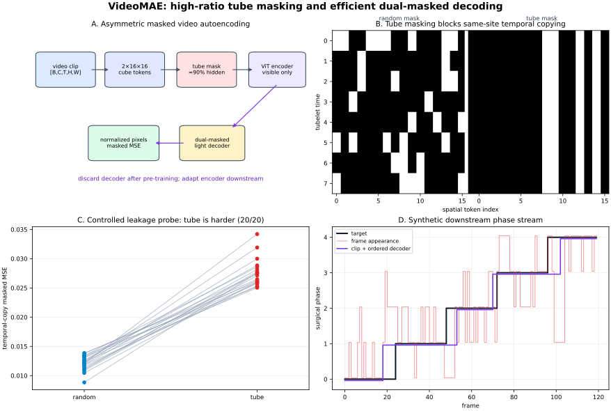

# VideoMAE and VideoMAE V2: Tube Masking, Dual Masking, and Video Representation Learning

**Date:** 2026-10-30  
**Track:** CV → Video and Motion  
**Level:** advanced  
**Runnable reference:** [NumPy masking, leakage, cost, and surgical-phase mechanism study](../../examples/videomae-dual-masking/)  
**Illustration:** [tube masking, dual-masked reconstruction, and downstream temporal decoding](../../assets/videomae-dual-masking/tube-and-dual-masking.svg)

> This lesson reconstructs the original **VideoMAE** algorithm and the **VideoMAE V2** dual-masking extension from their papers and official code. The companion code is an auditable mechanism study, not the official transformer, contains no pretrained weights, and does not reproduce a published benchmark. It tests masking semantics, temporal leakage, loss coverage, attention-pair scaling, and a downstream surgical-phase integration contract.



## 0. What an engineer should retain

VideoMAE learns a video encoder without manual labels by hiding almost the entire video token grid and asking a lightweight decoder to reconstruct the missing pixel cubes. Its three decisive ideas are:

1. **Space-time cubes, not independent frames.** A (2\times16\times16) tubelet becomes one token in the standard configuration.
2. **Tube masking at an unusually high ratio.** The same spatial locations are hidden through time, normally around 90%, so the task cannot be solved by copying an adjacent frame's corresponding patch.
3. **An asymmetric autoencoder.** The expensive encoder processes only visible tokens. The reconstruction decoder is discarded after pretraining.

VideoMAE V2 adds a fourth idea:

4. **Dual masking.** The decoder also receives only a subset of reconstruction positions, selected to cover the video efficiently. This reduces decoder memory and compute while retaining supervision over encoder-hidden tokens.

The transferable pattern is broader than action recognition:

\[
\boxed{
\text{unlabelled video}
\xrightarrow{\text{high-ratio structured corruption}}
\text{contextual video encoder}
\xrightarrow{\text{task adaptation}}
\text{clip or frame-level predictions}
}
\]

For your surgical phase project, VideoMAE is best understood as a **clip backbone**, not the complete long-video classifier. A practical stack is:

\[
\text{frames}
\rightarrow \text{VideoMAE clip encoder}
\rightarrow \text{cached temporal features}
\rightarrow \text{MS-TCN / ASFormer / TUNeS-like temporal head}
\rightarrow \text{per-frame phases}.
\]

## 1. Evidence vocabulary

- **Paper says** — stated by the original VideoMAE or VideoMAE V2 paper.
- **Implementation says** — observed in the authors' official repositories; command-line defaults are not necessarily the paper's reported setting.
- **Inference** — a consequence derived from the sourced equations or tensor shapes.
- **My interpretation** — engineering guidance, especially for surgical video, robotics, VLA, and deployment.
- **Unknown** — not established by the sources or dependent on an untested system.

This distinction matters because “VideoMAE” may refer to a pretraining objective, a released checkpoint, a Hugging Face port, a specific ViT size, or a downstream fine-tuning recipe. Those are not interchangeable.

## 2. Research problem

### 2.1 Self-supervised video pretraining

Given an unlabeled clip

\[
X\in\mathbb R^{B\times C\times T\times H\times W},
\]

where:

- (B) is batch size;
- (C=3) is the RGB channel count;
- (T) is sampled frame count;
- (H,W) are crop height and width;

learn encoder parameters \(\theta\) such that

\[
Z=E_\theta(X)
\]

transfers to action recognition, temporal detection, spatial action detection, surgical phase recognition, or another video task.

No action labels are available during masked-autoencoder pretraining. The supervision is generated from the video itself: hide some tokens, predict their pixels.

### 2.2 Why video is not merely a stack of images

Two properties conflict:

- **Temporal redundancy:** adjacent frames often contain nearly the same appearance.
- **Temporal correlation:** corresponding spatial regions persist or move predictably.

Redundancy means most tokens can be removed without destroying the scene. Correlation also creates a shortcut: under independent random masking, a hidden patch at time (t) may remain visible at (t-1) or (t+1). A model can reconstruct by local copying rather than learn higher-level motion and semantics.

**Paper says:** VideoMAE identifies temporal redundancy and temporal correlation as central design constraints. The authors use temporal downsampling, tube masking, and masking ratios around 90–95% to make reconstruction sufficiently difficult.

## 3. Motivation and prior limitations

### 3.1 Supervised video transformers are label-hungry

Video annotations are expensive, especially frame-level labels, temporal boundaries, surgical phases, or rare adverse events. Earlier video transformers often inherited supervised image pretraining and then fine-tuned on video.

**Paper says:** the original VideoMAE asks whether a plain ViT can be pretrained directly on video data without extra image labels. It reports strong transfer even on datasets with roughly 3–4K videos, while emphasizing that pretraining/target domain quality matters.

### 3.2 Ordinary random masking leaks temporal correspondences

Suppose spatial site (s) is hidden at tubelet time (u), but visible at (u+1). For slowly changing video,

\[
x_{u,s}\approx x_{u+1,s}.
\]

- (x_{u,s}\) is the pixel-cube vector at temporal index (u), spatial index (s).
- The approximation is strongest for a static camera and slow motion.

A decoder can minimize pixel error by learning correspondence and copying, without building a representation useful for long-range reasoning.

### 3.3 Frame masking discards too much temporal continuity

Hiding complete frames avoids some same-time shortcuts, but the missing interval may be reconstructed from neighboring frames, and the visible set has poor space-time balance. VideoMAE's ablation found frame masking substantially worse than tube masking in the reported setup.

### 3.4 Full-token video attention is expensive

The number of tokens grows with time and area. Joint self-attention creates an (N\times N) logit matrix per head:

\[
N=\frac{T}{p_t}\frac{H}{p_h}\frac{W}{p_w}.
\]

- (p_t,p_h,p_w) are tubelet sizes in time, height, and width.
- (T/p_t,H/p_h,W/p_w) are the temporal and spatial grid sizes.
- (N) is the total cube-token count.

For (T=16,H=W=224) and \((p_t,p_h,p_w)=(2,16,16)\):

\[
N=8\times14\times14=1568.
\]

At full visibility, one head forms

\[
1568^2=2{,}458{,}624
\]

attention logits per layer and sample. This excludes Q/K/V projections, values, MLPs, gradients, and batch size.

## 4. Key insight

The algorithm exploits redundancy **computationally** while fighting redundancy **statistically**:

- remove about 90% of tokens before the encoder, making the expensive backbone cheap;
- use a time-consistent spatial mask, preventing easy adjacent-frame copying;
- reconstruct normalized pixels only at hidden positions;
- use a smaller decoder during pretraining and remove it downstream;
- in V2, sparsify the decoder too, using coverage-oriented positions rather than another leakage-prevention mask.

That last distinction is important:

- encoder masking asks: **which observations must the representation infer?**
- decoder masking asks: **which reconstruction positions provide sufficient training signal this step?**

The two masks have different purposes and should not be conflated.

## 5. Method and tensor flow

### 5.1 Module contract for a common 16-frame ViT-B configuration

| Module | Input | Output | Purpose |
|---|---|---|---|
| Clip sampler | decoded video | 16 RGB frames, e.g. temporal stride 2 or 4 | choose temporal field of view |
| Spatial transform | frames | `[B,3,16,224,224]` in official PyTorch layout | shared crop/flip across frames |
| Cube embedding | `[B,3,16,224,224]` | `[B,1568,768]` for ViT-B | map each `2×16×16×3` cube to one token |
| Tube mask | grid `[8,14,14]` | boolean `[B,1568]`; about 90% true/hidden | block temporal-copy shortcut |
| ViT encoder | visible tokens `[B,≈157,768]` | contextual visible latents `[B,≈157,768]` | learn transferable space-time representation |
| Encoder-to-decoder projection | encoder latents | `[B,≈157,384]` in the original ViT-B example | reduce decoder width |
| Mask-token insertion | visible latents + positional embeddings | full or dual-selected decoder sequence | restore position identity |
| Lightweight decoder | decoder sequence | predicted masked cube pixels `[B,N_loss,1536]` | pretraining-only reconstruction |
| Pixel loss | prediction + normalized target | scalar MSE | self-supervised training signal |
| Fine-tuning head | encoder tokens only | task logits or features | downstream inference; decoder removed |

The reconstruction dimension is

\[
D_{pix}=C\,p_t p_h p_w=3\times2\times16\times16=1536.
\]

- (D_{pix}) is the flattened pixel count predicted for one cube.
- The cube contains 512 space-time positions and three values per position.

**Implementation says:** the official `modeling_pretrain.py` asserts the decoder output dimension equals `3 * tubelet_size * patch_size ** 2`; for patch size 16 and tubelet size 2 this is 1536. The official ViT-B uses a 768-D encoder and a smaller decoder.

### 5.2 Temporal sampling

Let the source video be (V). Choose (T) frames with sampling stride \(\tau\):

\[
X_t=V_{t_0+t\tau},\qquad t\in\{0,\ldots,T-1\}.
\]

- (t_0) is the sampled starting index.
- \(\tau\) is the number of source-frame steps between model frames.
- The temporal coverage is approximately \((T-1)\tau+1\) source frames.

**Paper says:** the original experiments use stride 4 on Kinetics and stride 2 on Something-Something in the described default settings. This is not universal. Motion-centric surgical data may require a different stride.

**My interpretation:** temporal stride is part of the model's physical meaning. At 30 FPS, 16 frames with stride 4 span about 2.03 seconds; with stride 2 they span about 1.03 seconds. A phase-transition model, tremor detector, and slow manipulation policy need different temporal fields of view.

### 5.3 Cube embedding

Partition the clip into non-overlapping cubes:

\[
c_{u,v,w}\in\mathbb R^{C p_t p_h p_w},
\]

where:

- (u\in[0,T/p_t-1]) is the tubelet-time index;
- (v\in[0,H/p_h-1]) is the grid row;
- (w\in[0,W/p_w-1]) is the grid column;
- (c_{u,v,w}) is the flattened RGB cube.

A learned 3-D convolution or equivalent linear projection maps it to width (D_e):

\[
e_{u,v,w}=W_{emb}c_{u,v,w}+b_{emb}+p_{u,v,w}.
\]

- (W_{emb}\in\mathbb R^{D_e\times(Cp_tp_hp_w)}) is the cube projection.
- (b_{emb}\in\mathbb R^{D_e}) is bias.
- (p_{u,v,w}\in\mathbb R^{D_e}) is positional information.
- (e_{u,v,w}\in\mathbb R^{D_e}) is one encoder token.

The position must preserve time, row, and column identity after masked tokens are removed.

### 5.4 Tube masking

Let (m_{v,w}\in\{0,1\}) be a sampled spatial mask, with 1 meaning hidden. Tube masking defines

\[
M^e_{u,v,w}=m_{v,w}\quad\text{for every }u.
\]

- (M^e\in\{0,1\}^{G_t\times G_h\times G_w}) is the encoder mask.
- (G_t=T/p_t,G_h=H/p_h,G_w=W/p_w) are grid sizes.
- The same \((v,w)\) pattern is repeated for all (u).

If spatial cell ((v,w)) is hidden, its entire temporal tube is hidden. The encoder cannot see the exact same cell in another sampled tubelet.

**Implementation says:** the official `TubeMaskingGenerator` creates one shuffled spatial mask per frame-grid and tiles it across the temporal grid. At finite grid size, the exact ratio is quantized by the number of spatial positions.

#### Small masking example

Take (G_t=2,G_h=2,G_w=2), so (N=8). Let the spatial mask be

\[
m=\begin{bmatrix}1&1\\0&1\end{bmatrix}.
\]

- Three of four spatial sites are hidden: 75% masking.
- Repeating through two tubelet times hides six of eight tokens.

The visible location is the lower-left cell at both times. Random masking could instead reveal a hidden cell at the second time, reintroducing a temporal-copy shortcut.

### 5.5 Visible-only encoder

Only tokens with (M^e_i=0) enter the encoder:

\[
Z=\Phi_{enc}(\{e_i\mid M^e_i=0\})
\in\mathbb R^{B\times N_e\times D_e},
\]

where

\[
N_e=(1-\rho_e)N.
\]

- \(\rho_e\) is the encoder masking ratio.
- (N_e) is visible encoder-token count, subject to integer rounding.
- (D_e) is encoder width.

At \(\rho_e=0.9\), (N_e\approx157) for (N=1568).

Each joint space-time self-attention head computes

\[
A=\operatorname{softmax}\left(\frac{QK^\top}{\sqrt{d_h}}\right),
\qquad O=AV.
\]

- (Q,K\in\mathbb R^{N_e\times d_h}) are queries and keys.
- (V\in\mathbb R^{N_e\times d_v}) is the value matrix.
- (A\in[0,1]^{N_e\times N_e}) is row-normalized attention.
- (O\in\mathbb R^{N_e\times d_v}) is retrieved context.
- (d_h,d_v) are per-head dimensions.

The pair-count ratio is approximately

\[
\frac{N_e^2}{N^2}=(1-\rho_e)^2=0.01
\]

at 90% masking. This does **not** imply total training FLOPs fall by exactly 99% because projections, MLPs, decoder, embedding, loss, memory traffic, and backward computation remain.

### 5.6 Per-cube normalized pixel target

For cube (i), channel (c), and within-cube pixel index (j\in\{1,\ldots,p_tp_hp_w\}), the official target normalization is reconstructed as

\[
\mu_{i,c}=\frac{1}{P}\sum_{j=1}^{P}x_{i,c,j},
\qquad
\sigma^2_{i,c}=\frac{1}{P-1}\sum_{j=1}^{P}(x_{i,c,j}-\mu_{i,c})^2,
\]

\[
y_{i,c,j}=\frac{x_{i,c,j}-\mu_{i,c}}{\sqrt{\sigma^2_{i,c}}+\epsilon}.
\]

- (P=p_tp_hp_w) is pixels per channel in one cube.
- (x_{i,c,j}\) is an unnormalized pixel value in `[0,1]`.
- \(\mu_{i,c},\sigma^2_{i,c}\) are per-cube, per-channel mean and unbiased sample variance, matching the cited implementation.
- \(\epsilon\) prevents division by zero.
- (y_{i,c,j}\) is the normalized reconstruction target.

**Implementation says:** `engine_for_pretraining.py` first reverses ImageNet input normalization, reshapes to `[B,N,P,C]`, computes mean and variance over (P), flattens back to `[B,N,PC]`, selects masked positions, and applies MSE.

**My interpretation:** normalization discounts local brightness/color mean and emphasizes within-cube structure. It does not make the representation invariant to all illumination or camera effects.

### 5.7 Original VideoMAE decoder and loss

Project visible latents from encoder width (D_e) to decoder width (D_d), add their positions, append learned mask tokens at hidden positions, and process the sequence with a smaller transformer decoder.

The original loss is

\[
\mathcal L_{V1}=
\frac{1}{|\Omega_e|D_{pix}}
\sum_{i\in\Omega_e}
\|y_i-\hat y_i\|_2^2,
\]

where:

- \(\Omega_e=\{i\mid M^e_i=1\}\) is the encoder-hidden set;
- (y_i,\hat y_i\in\mathbb R^{D_{pix}}) are target and predicted cube vectors;
- (D_{pix}=Cp_tp_hp_w);
- the norm sums squared pixel errors.

Only masked positions contribute. The decoder is a pretraining instrument; the encoder is retained for downstream tasks.

## 6. VideoMAE V2 dual masking

### 6.1 Why mask the decoder?

The original encoder sees about 10% of tokens, but the decoder reconstructs the full grid. At large model/data scale, even a lightweight full-grid decoder becomes expensive.

VideoMAE V2 draws a second mask (M^d) for the decoder. The V2 paper's notation treats its selected positions as decoder-visible/kept tokens, which is easy to misread because the encoder mask uses 1 for hidden. Always define local boolean semantics in code.

The decoder receives:

1. every encoder-visible latent, with its position;
2. learned mask tokens for a selected subset of encoder-hidden locations.

Let (K_d\) be the decoder-selected index set. The input is conceptually

\[
Z^c=Z\cup\{m_i+p_i\mid i\in K_d\},
\]

where:

- (Z) is the encoded visible-token sequence;
- (m_i\in\mathbb R^{D_d}) is a learned mask token;
- (p_i\in\mathbb R^{D_d}) is its position;
- (Z^c\) is the reduced decoder sequence.

The supervised set is the intersection

\[
\Omega_{dual}=\Omega_e\cap K_d.
\]

V2's loss is

\[
\mathcal L_{V2}=
\frac{1}{|\Omega_{dual}|D_{pix}}
\sum_{i\in\Omega_{dual}}
\|y_i-\hat y_i\|_2^2.
\]

Positions already visible to the encoder are not reconstruction targets even if selected by the decoder pattern.

### 6.2 Running-cell decoder selection

**Paper says:** encoder masking remains high-ratio random tube masking. Decoder selection should instead encourage information complement—diverse coverage over the video. The authors compare frame, random, and running-cell strategies and choose running-cell masking.

The companion code implements a simple cyclic coverage sampler, not the source-identical official generator. Across offsets, every token is selected once; therefore the sample-count-weighted loss across a complete cycle exactly equals the full masked loss for fixed predictions. This demonstrates coverage logic, not the learning dynamics of V2.

### 6.3 Why decoder masking changes compute

If (N_d) tokens enter the decoder, its attention pairs scale with (N_d^2), not (N^2). In the executed toy:

- total tokens: 512;
- encoder-visible tokens: 48;
- selected decoder tokens including encoder-visible state: 280;
- full decoder pairs: (512^2=262{,}144);
- dual decoder pairs: (280^2=78{,}400).

This is a pair-count mechanism calculation, not official FLOPs. The paper reports measured/model-estimated results under specified architectures; use those for paper claims.

## 7. Modality, coordinate, temporal, and precision flow

| Concern | Flow | Typical failure |
|---|---|---|
| Modality | compressed video → decoded RGB → normalized float → cube tokens → encoder latents → task logits | treating optical flow or grayscale checkpoints as RGB-compatible |
| Layout | official PyTorch `[B,C,T,H,W]`; some APIs use `[B,T,C,H,W]` | silent channel/time permutation |
| Spatial coordinates | original frame → shared resize/crop/flip → patch grid → pooled clip feature | applying different crops per frame destroys correspondence |
| Time | source timestamps → sampling stride → 2-frame tubelets → clip feature → long-video temporal head | FPS mismatch, aliasing, or incorrect phase timestamp |
| Mask semantics | encoder `true=hidden`; decoder implementation may use keep/visible map | supervising visible tokens or dropping all targets |
| Precision | decoded `uint8` → FP32 preprocessing → FP16/BF16 model → logits/features → optional INT8 engine | quantizing LayerNorm/softmax without long-video validation |

### 7.1 A timestamp example

At 25 FPS, frame interval is 40 ms. With `T=16`, stride \(\tau=4\), and tubelet size 2:

- sampled clip covers source indices `0,4,...,60`;
- temporal span is \(60/25=2.4\) seconds;
- one tubelet spans sampled frames 4 source frames apart, but its two members are adjacent in the sampled tensor, not original time.

Write source timestamps alongside cached features. Do not recover time later by assuming a nominal FPS.

## 8. Runnable implementation

| File | Purpose |
|---|---|
| [`videomae_math.py`](../../examples/videomae-dual-masking/videomae_math.py) | cubeify/un-cubeify, per-channel target normalization, mask generators, dual selection, leakage probe, attention-pair counts |
| [`synthetic_video.py`](../../examples/videomae-dual-masking/synthetic_video.py) | redundant video, moving-object video, and five-phase surgical proxy sequence |
| [`demo.py`](../../examples/videomae-dual-masking/demo.py) | 20-seed temporal-leakage study and dual-decoder coverage/cost experiment |
| [`application.py`](../../examples/videomae-dual-masking/application.py) | cached clip-feature proxy, centroid head, ordered Viterbi phase decoder, deployment gate |
| [`checks.py`](../../examples/videomae-dual-masking/checks.py) | numerical, tensor, masking, loss, cost, and application assertions |
| [`make_figure.py`](../../examples/videomae-dual-masking/make_figure.py) | regenerates the original SVG |

Run from the repository root:

```bash
python -m pip install -r CV/examples/videomae-dual-masking/requirements.txt
python CV/examples/videomae-dual-masking/checks.py
python CV/examples/videomae-dual-masking/demo.py
python CV/examples/videomae-dual-masking/application.py
MPLBACKEND=Agg python CV/examples/videomae-dual-masking/make_figure.py
```

### 8.1 Code tensor example

The fixture uses `[B,C,T,H,W] = [1,3,16,64,64]` and cube size `(2,8,8)`:

```text
video:              [1, 3, 16, 64, 64]
grid:               [8, 8, 8]
cubes:              [1, 512, 384]
encoder mask:       [8, 8, 8]
normalized targets: [1, 512, 384]
```

The paper's standard cube is `(2,16,16)`; the smaller spatial cube makes local CPU validation fast. All layout operations are invertible and checked.

## 9. Experiments and evidence

### 9.1 Original VideoMAE paper

**Paper says:** with a 16-frame ViT-B pretrained for 800 epochs and the paper's evaluation protocols, the reported masking ablation is:

| Masking | Ratio | Something-Something V2 | Kinetics-400 |
|---|---:|---:|---:|
| tube | 75% | 68.0 | 79.8 |
| tube | 90% | 69.6 | 80.0 |
| random | 90% | 68.3 | 79.5 |
| frame | 87.5% | 61.5 | 76.5 |

The same table reports that four decoder blocks outperform one/two in that setup and are below eight in memory cost; the authors choose four by default. These values are not results from the companion code.

The paper's headline results include 87.4% Kinetics-400, 75.4% Something-Something V2, 91.3% UCF101, and 62.6% HMDB51 under its stated settings and without extra data. Do not compare these numbers to another paper without matching backbone, clips/crops, resolution, pretraining data, epochs, and fine-tuning protocol.

### 9.2 VideoMAE V2 paper

**Paper says:** for ViT-B on Something-Something V2, running-cell decoder masking at 50% with loss only on encoder-invisible outputs reports `70.15` top-1 and `25.87G` FLOPs, compared with `70.28` and `35.48G` without decoder masking. The reported resource table gives:

| Setting | FLOPs | Memory | Time | Top-1 |
|---|---:|---:|---:|---:|
| encoder masking, ViT-B | 35.48G | 631M | 28.4 h | 70.28 |
| dual masking, ViT-B | 25.87G | 328M | 15.9 h | 70.15 |

The paper also reports ViT-g training results and progressive large-data training. These are paper claims under its hardware and recipe, not Jetson or local measurements.

### 9.3 Executed temporal-leakage probe

The fixture creates slowly varying textured videos. A deliberately weak predictor reconstructs a hidden cube by copying the nearest visible cube at the same spatial location; if none exists, it uses the global visible mean.

Across 20 seeds:

| Measure | Result |
|---|---:|
| mean random-mask copy MSE | 0.012121 |
| mean tube-mask copy MSE | 0.027562 |
| median tube-minus-random MSE | 0.015383 |
| tube mask harder | 20/20 trials |

**Inference:** independent random masking exposes a same-location temporal shortcut in this controlled clip; tube masking removes it.

**Unknown:** how much a trained transformer relies on that shortcut in a new real dataset. The probe does not measure representation quality.

### 9.4 Executed dual-mask coverage study

With 512 normalized cube targets:

- the complete masked reconstruction loss is `1.111612543861`;
- the sample-weighted loss over a full two-offset cyclic decoder coverage is the same to displayed precision;
- every encoder-hidden target is covered exactly once;
- the toy decoder attention-pair count falls from `262,144` to `78,400`.

This establishes index semantics and arithmetic for the included sampler. It does not claim equal gradients step-by-step, equal convergence, or equivalence to the official running-cell generator.

### 9.5 Executed surgical-phase integration

The integrated example is intentionally a downstream systems test. A transparent hand-crafted clip descriptor stands in for a cached frozen VideoMAE feature; a centroid classifier produces emissions; an ordered Viterbi decoder allows only “stay” or “advance one phase.” On a 120-frame synthetic five-phase sequence with illumination shift and corruption bursts:

| Method | Frame accuracy | Boundary F1, ±6-frame tolerance |
|---|---:|---:|
| frame appearance only | 0.516667 | 0.126984 |
| temporal clip descriptor | 0.800000 | 0.727273 |
| clip descriptor + ordered decoding | 0.841667 | 1.000000 |

The gate accepts the ordered stream because it is monotonic, accuracy exceeds the fixture threshold, and boundary F1 exceeds the fixture threshold.

This is not VideoMAE accuracy and is not clinical validation. Its purpose is to make the integration boundary explicit: **a clip encoder provides temporal evidence; a long-video head imposes sequence structure.**

## 10. Reproduction plan

### 10.1 Mechanism reference

Require:

- all 35 assertions pass;
- cubeify/un-cubeify is exact;
- tube masks repeat spatially through time;
- random and frame masks obey their defined counts;
- dual supervision is `encoder_hidden AND decoder_selected`;
- every cyclic target is covered once;
- the SVG regenerates deterministically;
- the surgical gate rejects neither shape nor transition invariants.

### 10.2 Official VideoMAE reproduction

1. Pin the official repository commit, checkpoint hash, dataset manifest, and license.
2. Record decoded FPS, sampling stride, frame count, crop, normalization, mask ratio, and mask generator.
3. Reproduce pretraining loss on a small fixed subset before distributed training.
4. Confirm `[B,C,T,H,W]`, boolean mask flatten order `(time,row,column)`, and masked-token count.
5. Compare an official checkpoint on one published fine-tuning recipe before changing the domain.
6. Report train and evaluation view counts; multi-clip/multi-crop evaluation can materially alter accuracy and compute.
7. Run at least three seeds for small surgical datasets and split by patient/procedure, never by random frames.
8. Save per-video outputs and report class-wise F1, edit score, segmental F1 at multiple overlap thresholds, boundary error, and calibration—not only frame accuracy.

### 10.3 Surgical-video adaptation

A defensible pipeline is:

1. self-supervise on unlabeled in-domain operations, respecting patient splits;
2. extract overlapping VideoMAE clip features with timestamps;
3. cache features in FP16/FP32 with model/checkpoint metadata;
4. train a temporal segmentation head on complete procedures;
5. evaluate on held-out patients, hospitals, devices, and surgeons where available;
6. ablate ImageNet/video pretraining, tube-mask ratio, stride, clip length, frozen versus fine-tuned backbone, and temporal-head family;
7. evaluate causal and offline modes separately.

## 11. High-value ablations

| Ablation | Hold constant | Question |
|---|---|---|
| random vs frame vs tube mask | encoder, ratio, epochs | does structure prevent temporal leakage? |
| 75%, 90%, 95% encoder mask | all optimization settings | difficulty/efficiency sweet spot |
| tubelet time 1, 2, 4 | spatial patch and temporal span | short-motion sensitivity versus compression |
| stride 1, 2, 4, 8 | sampled frames and crop | temporal aliasing and field of view |
| decoder keep 25%, 50%, 75% | encoder mask | decoder cost versus target coverage |
| full vs running-cell decoder | total updates | is coverage diversity important? |
| raw vs normalized pixels | architecture | low-level color versus local structure |
| 1, 2, 4, 8 decoder blocks | encoder fixed | reconstruction capacity versus memory |
| frozen vs partial vs full fine-tuning | temporal head fixed | small-data overfitting |
| mean pool vs per-frame tokens | same checkpoint | classification versus boundary localization |
| clip classifier vs MS-TCN/ASFormer/TUNeS | same cached features | long-range phase consistency |
| FP32, FP16, INT8 | same engine inputs | numerical and calibration drift |

Do not change sampling stride and claim a backbone-only gain: the model has seen a different physical duration.

## 12. Failure modes and limitations

1. **Static-scene shortcut.** Reconstruction may emphasize textures and camera appearance rather than action semantics.
2. **Mask-policy overfitting.** A model trained with one structured corruption may not transfer optimally to dense, causal, or very fast motion.
3. **Temporal aliasing.** High stride can skip a brief tool movement, contact event, or surgical transition.
4. **Boundary dilution.** A clip straddling two phases receives mixed evidence. Clip classification alone is not frame segmentation.
5. **Patient/device leakage.** Random frame splits can place the same operation or visual setup in train and test, inflating results.
6. **Domain mismatch.** Web actions, egocentric manipulation, endoscopy, and tactile elastomer video have different motion and appearance statistics.
7. **Pixel-objective bias.** Low MSE does not guarantee semantic quality; a blurry or texture-aware decoder can optimize reconstruction without ideal downstream features.
8. **Long-video cost.** A 16-frame encoder does not directly model a 90-minute procedure. Feature caching and a second temporal model are required.
9. **Non-causal context.** Centered clips and bidirectional temporal heads use future frames. They are invalid for a strictly online alarm or robot controller.
10. **Rare phases and transitions.** Frame accuracy can remain high while short critical phases disappear.
11. **Reconstruction privacy.** Medical video pretraining retains visual information; governance, de-identification, and access control remain necessary.
12. **Decoder discarded.** Good reconstructions are diagnostic but not the downstream product; do not deploy the decoder accidentally.

**Unknown:** the best mask ratio, temporal stride, clip duration, and fine-tuning policy for the user's surgical dataset without patient-level experiments.

## 13. Generalization and what the objective learns

Masked pixel prediction supplies dense supervision but does not uniquely determine a representation. The encoder may learn:

- local appearance and texture;
- object persistence;
- camera motion;
- human/tool motion;
- scene layout;
- temporal order and event progression.

Which factors dominate depends on data, masking, stride, augmentation, model capacity, and downstream adaptation.

**Paper says:** VideoMAE finds data quality and domain shift important. Pretraining on a target-related video dataset can outperform simply adding mismatched volume.

**My interpretation:** for surgical phases, in-domain unlabeled procedures are unusually valuable because they contain the device optics, anatomy, tool vocabulary, smoke/specularity, and workflow progression that web video lacks. But pretraining and evaluation must maintain patient/procedure separation.

## 14. Computational cost

For a transformer block of width (D), (N) tokens, and MLP ratio (r), a rough forward complexity is

\[
O(ND^2)+O(N^2D)+O(rND^2).
\]

- (O(ND^2)) covers Q/K/V and output projections.
- (O(N^2D)) covers attention similarities and weighted values.
- (O(rND^2)) covers the two-layer MLP.

High-ratio masking reduces all encoder terms involving (N), not only the quadratic one. Decoder masking further reduces decoder sequence length.

Memory must include:

- input clips and augmentations;
- token/attention/MLP activations retained for backward;
- optimizer states, often several times parameter bytes;
- gradients and master weights under mixed precision;
- decoder and reconstruction targets.

Pair counts are useful sanity checks but are not latency. Flash/fused attention, checkpointing, kernel launch overhead, memory bandwidth, and hardware utilization alter runtime.

## 15. ONNX, TensorRT, quantization, and Jetson

### 15.1 Export the downstream encoder, not the pretraining graph

For deployment, remove:

- mask generator;
- mask tokens;
- reconstruction decoder;
- target normalization and pixel loss.

Export:

\[
[B,C,T,H,W]\rightarrow[B,N,D]\rightarrow[B,D]\text{ or task logits}.
\]

For frame-level surgical phases, exporting only pooled `[B,D]` may discard temporal resolution. Decide whether the temporal head consumes clip embeddings, tubelet tokens, or per-frame-aligned features before freezing the interface.

### 15.2 ONNX contract

- fix or profile (T,H,W); learned/sinusoidal position logic and tubelet reshape may not generalize to arbitrary sizes;
- assert input order because Hugging Face user-facing APIs often expose `[B,T,C,H,W]` while the authors' code uses `[B,C,T,H,W]`;
- keep the shared crop/normalization outside or inside consistently;
- compare PyTorch and ONNX at cube embeddings, several transformer blocks, pooled features, and logits;
- include timestamp/stride metadata outside the tensor graph.

### 15.3 TensorRT

The cube embed is a 3-D convolution or reshape-plus-linear operation. TensorRT support and performance depend on version and graph lowering. Attention may fuse only under supported head sizes, sequence lengths, and precision.

Use fixed optimization profiles for the chosen clip shape. Benchmark:

1. decode and resize;
2. host-to-device transfer;
3. encoder;
4. temporal head;
5. post-processing;
6. overlapping-window cache reuse.

### 15.4 Quantization

A conservative path is:

- validate FP16 first;
- use QDQ/per-channel weight quantization for linear layers;
- initially retain LayerNorm, softmax, residual additions, and final classifier in FP16;
- calibrate with motion, smoke, specularity, dark frames, camera cuts, and every surgical phase;
- compare cosine similarity of cached features, class probabilities, boundary timing, and segmental metrics—not only top-1 agreement;
- run long videos because small per-clip drift can alter a temporal decoder.

### 15.5 Jetson Orin Nano Super 8GB

Pretraining VideoMAE on-device is generally not the sensible target. For deployment:

- start with ViT-S or a distilled/smaller video encoder;
- use batch 1, fixed 8/16-frame clips, and FP16;
- cache overlapping frame/tubelet features when the architecture permits;
- consider extracting features offline and running only the temporal phase head on Jetson during early experiments;
- bound queue length and timestamp every feature;
- measure power mode, clocks, thermals, and sustained—not one-clip—throughput.

**Unknown:** real-time performance for a particular checkpoint on the user's Jetson. It depends on TensorRT version, clip size, stride, precision, attention fusion, temporal head, decoder pipeline, and power mode.

## 16. Application patterns

### 16.1 Surgical phase recognition

Recommended architecture:

```text
video decoder
→ overlapping clips
→ VideoMAE encoder
→ timestamped feature cache [T',D]
→ ASFormer / MS-TCN / TUNeS-like sequence model
→ per-frame phase logits
→ optional transition-aware decoding
```

Use a causal temporal head for online guidance and a bidirectional/offline head only when future context is permitted. Report latency in seconds, not only frames, because sampling stride changes effective delay.

### 16.2 Robotics and VLA

VideoMAE tokens can encode motion and object interaction before a language/action module. A VLA system may pool region-conditioned video tokens or pass a short token sequence. Masked pretraining is valuable when robot telemetry is abundant but language/action labels are scarce.

Do not assume reconstruction features encode controllable state. Evaluate contact timing, action-conditioned prediction, and out-of-distribution failures.

### 16.3 Visual-tactile sensing

Unlabeled tactile video is plentiful. Tube masking can force a model to infer deformations, marker motion, or contact evolution from sparse evidence. However, a fixed marker grid is highly predictable; the model may learn geometry without force-relevant semantics. Validate transfer to slip, contact location, and 6-DoF wrench estimation, and keep calibration physics separate.

### 16.4 Temporal action detection

VideoMAE V2 explicitly evaluates temporal action detection transfer. For long-form videos, extract overlapping features and use a localization head that predicts start/end or dense actionness. Clip-level top-1 accuracy is insufficient for temporal boundaries.

## 17. Paper says / inference / interpretation / unknown

| Status | Statement |
|---|---|
| **Paper says** | VideoMAE uses high-ratio tube masking and a visible-only joint space-time ViT encoder. |
| **Paper says** | In its reported ablation, 90% tube masking outperforms 75% tube, 90% random, and frame masking. |
| **Implementation says** | Official targets are per-cube, per-channel normalized pixels selected by the boolean encoder mask. |
| **Paper says** | VideoMAE V2 adds running-cell decoder masking and computes loss only on decoder-selected tokens hidden from the encoder. |
| **Inference** | With 90% encoder masking, encoder attention pair count is roughly 1% of full-token attention pair count. |
| **My interpretation** | For surgical phase recognition, VideoMAE should normally be paired with a long-range temporal segmentation head. |
| **My interpretation** | Sampling stride is part of the physical task definition and must be reported with FPS. |
| **Unknown** | Whether higher reconstruction quality predicts better phase segmentation on a new dataset. |
| **Unknown** | Whether INT8 preserves boundary timing until the exact exported pipeline is evaluated. |

## 18. Primary sources and official implementations

1. Tong et al., **VideoMAE: Masked Autoencoders are Data-Efficient Learners for Self-Supervised Video Pre-Training**, NeurIPS 2022: [paper](https://arxiv.org/abs/2203.12602), [NeurIPS proceedings](https://papers.nips.cc/paper_files/paper/2022/hash/416f9cb3276121c42eebb86352a4354a-Abstract-Conference.html), [official repository](https://github.com/MCG-NJU/VideoMAE).
2. Official VideoMAE implementation details: [`masking_generator.py`](https://github.com/MCG-NJU/VideoMAE/blob/main/masking_generator.py), [`modeling_pretrain.py`](https://github.com/MCG-NJU/VideoMAE/blob/main/modeling_pretrain.py), [`engine_for_pretraining.py`](https://github.com/MCG-NJU/VideoMAE/blob/main/engine_for_pretraining.py), and [`PRETRAIN.md`](https://github.com/MCG-NJU/VideoMAE/blob/main/PRETRAIN.md).
3. Wang et al., **VideoMAE V2: Scaling Video Masked Autoencoders with Dual Masking**, CVPR 2023: [paper](https://arxiv.org/abs/2303.16727), [CVPR open access](https://openaccess.thecvf.com/content/CVPR2023/html/Wang_VideoMAE_V2_Scaling_Video_Masked_Autoencoders_With_Dual_Masking_CVPR_2023_paper.html), [official repository](https://github.com/OpenGVLab/VideoMAEv2).
4. Official V2 data/mask code: [`pretrain_datasets.py`](https://github.com/OpenGVLab/VideoMAEv2/blob/master/dataset/pretrain_datasets.py) and the [model zoo](https://github.com/OpenGVLab/VideoMAEv2/blob/master/docs/MODEL_ZOO.md).
5. He et al., **Masked Autoencoders Are Scalable Vision Learners**, CVPR 2022: [paper](https://arxiv.org/abs/2111.06377), [official repository](https://github.com/facebookresearch/mae).

Pin commits for reproduction. `main`/`master` can change after this lesson.

## 19. Final engineering checklist

- [ ] Record decoded FPS, (T), stride, tubelet size, crop, and temporal span.
- [ ] Assert tensor order before cube embedding.
- [ ] Apply identical spatial transforms across frames.
- [ ] Verify tube-mask repetition and flattened `(time,row,column)` order.
- [ ] Keep encoder-hidden and decoder-selected boolean semantics explicit.
- [ ] Normalize reconstruction targets per cube and channel if matching official code.
- [ ] Discard the pretraining decoder for ordinary downstream inference.
- [ ] Split surgical data by patient/procedure, never random frames.
- [ ] Pair clip features with a long-video temporal head for phase segmentation.
- [ ] Report boundary/segment metrics in addition to frame accuracy.
- [ ] Separate causal online and bidirectional offline evaluations.
- [ ] Validate feature and boundary drift after ONNX/TensorRT/INT8 conversion.
- [ ] Benchmark the complete decode-to-decision pipeline on the exact Jetson.
- [ ] Never describe the companion NumPy probes as official VideoMAE training or benchmark reproduction.
