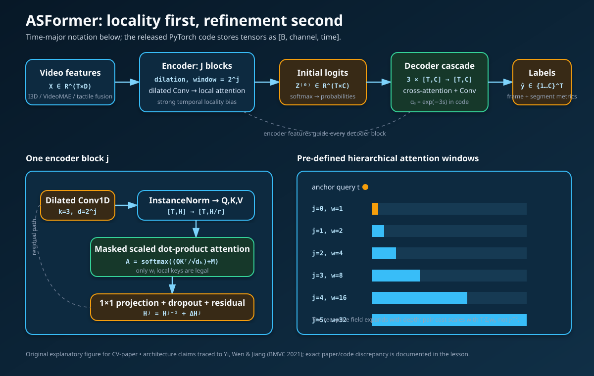
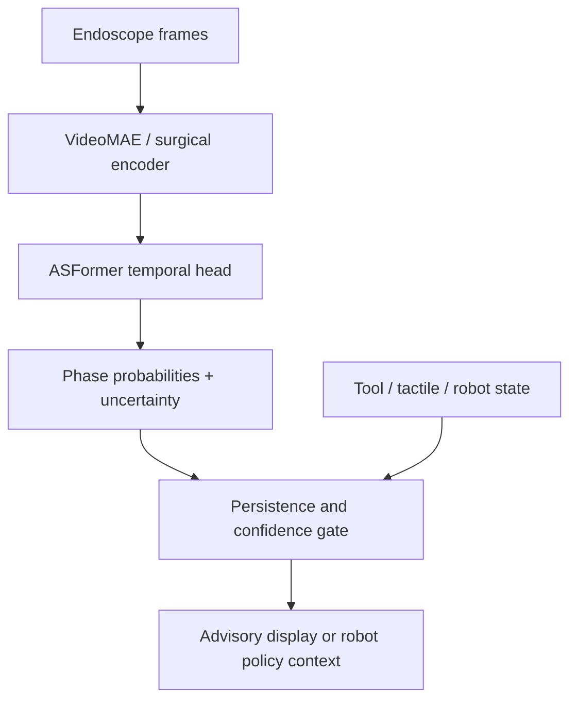

# 2026-10-31 — ASFormer: Local-to-Global Attention for Temporal Action Segmentation

> **Advanced CV lesson.** How to convert a long sequence of visual features into a label at every time step without paying full quadratic attention cost—and why frame accuracy alone can conceal catastrophic over-segmentation.

**Primary paper:** Fangqiu Yi, Hongyu Wen, Tingting Jiang, [“ASFormer: Transformer for Action Segmentation,” BMVC 2021](https://www.bmva-archive.org.uk/bmvc/2021/assets/papers/0183.pdf), [conference record and DOI](https://bmva-archive.org.uk/bmvc/2021/conference/papers/paper_0183.html), [arXiv record](https://arxiv.org/abs/2110.08568).  
**Official implementation:** [ChinaYi/ASFormer](https://github.com/ChinaYi/ASFormer), especially [`model.py`](https://github.com/ChinaYi/ASFormer/blob/main/model.py), [`main.py`](https://github.com/ChinaYi/ASFormer/blob/main/main.py), and [`eval.py`](https://github.com/ChinaYi/ASFormer/blob/main/eval.py).  
**This lesson’s code:** [NumPy mechanism reference, ablations, and surgical-phase application](../../examples/asformer-temporal-segmentation/) · [executed validation](../../examples/asformer-temporal-segmentation/VALIDATION.md).  
**Prerequisite / progression:** [VideoMAE and VideoMAE V2](2026-10-30-videomae-dual-masking.md) explains how to learn clip features; ASFormer explains how to organize those features into a coherent minute-scale phase sequence.

---

## 0. Epistemic labels used throughout

This lesson separates claims that are easy to blur:

- **Paper says** — stated in the BMVC paper or one of its reported tables.
- **Released code does** — directly observable in the authors’ official repository.
- **Inference** — follows from the equations or code, but is not a quoted experimental claim.
- **My interpretation** — engineering guidance or intuition.
- **Unknown** — the primary artifacts do not resolve the issue.

This distinction matters here because the printed paper and released code are not identical in several details. The differences are educational: reading only the architecture figure is not enough to reproduce a modern temporal model.

---

## 1. Research problem

Given an untrimmed video represented by a temporal feature sequence,

$$
\mathbf{X}=[\mathbf{x}_1,\ldots,\mathbf{x}_T]^\top\in\mathbb{R}^{T\times D},
$$

where $T$ is the number of sampled time steps, $D$ is the visual-feature dimension, and $\mathbf{x}_t\in\mathbb{R}^{D}$ is the feature at time $t$, predict

$$
\hat{\mathbf{y}}=(\hat y_1,\ldots,\hat y_T),\qquad \hat y_t\in\{1,\ldots,C\},
$$

where $C$ is the number of action or phase classes and $\hat y_t$ is the predicted class at time $t$.

This is **temporal action segmentation**, not trimmed-video classification and not temporal action detection:

| Task | Input | Output | Central question |
|---|---|---|---|
| Trimmed classification | one short clip | one class | “What is this clip?” |
| Temporal action detection | long video | sparse classed intervals | “Where are action instances?” |
| Temporal action segmentation | long video | one label per sampled frame | “What is happening at every time?” |

**Paper says.** ASFormer operates on pre-extracted framewise features rather than raw RGB and focuses on temporal relations. The paper uses 2048-dimensional I3D features on 50Salads, GTEA, and Breakfast.

**My interpretation.** Today, $\mathbf{X}$ could come from I3D, VideoMAE, DINO-style frame features, a surgical endoscope encoder, or synchronized visual–tactile encoders. ASFormer is the temporal head; it does not solve representation learning by itself.

### 1.1 Why the output is structurally difficult

Suppose 95% of frames belong to long, easy phases and 5% lie near transitions. A classifier can achieve high frame accuracy while flickering between labels:

```text
ground truth:  A A A A A A A A B B B B
prediction:    A A B A A B A A B B A B
```

Eight of twelve frames are correct, yet the prediction contains six segments instead of two. For downstream robotics or workflow monitoring, that fragmentation may be more damaging than a small boundary offset.

Thus a useful temporal segmenter must jointly achieve:

1. correct frame labels;
2. stable within-action predictions;
3. accurate boundaries;
4. plausible segment order and duration;
5. tractable compute for thousands of time steps.

---

## 2. Motivation and prior limitations

### 2.1 Vanilla self-attention is expensive

For one self-attention layer over $T$ time steps, the score matrix has shape $T\times T$. Its pair count is $T^2$. Across $J$ layers, the attention-map storage term is

$$
\mathcal{O}(JT^2),
$$

where $J$ is the number of temporal blocks.

For $T=5{,}400$ sampled frames—six minutes at 15 Hz—one layer contains

$$
T^2=5{,}400^2=29{,}160{,}000
$$

query–key pairs. Ten layers contain 291.6 million pairs before counting gradients, Q/K/V projections, values, or decoder stages.

### 2.2 Small temporal datasets do not reward unrestricted hypotheses

**Paper says.** Action-segmentation datasets are small compared with large language or image datasets. A Transformer with weak inductive bias therefore searches an unnecessarily broad hypothesis family.

A strong fact about many workflows is available for free: neighboring time steps are likely to share a label. A temporal convolution encodes this locality before learning begins.

### 2.3 Long sequences make unstructured attention hard to learn

At initialization, many attention distributions are close to uniform. If every low-level block can attend to hundreds or thousands of locations, no block is assigned a clear temporal scale.

**Paper says.** Low layers should first model local relations; higher layers should gradually enlarge their receptive fields. The authors call this a **pre-defined hierarchical representation pattern**.

### 2.4 One-pass predictions over-segment

MS-TCN and related models demonstrated that multiple refinement stages can improve segment consistency. The relevant primary source is [MS-TCN: Multi-Stage Temporal Convolutional Network for Action Segmentation, CVPR 2019](https://openaccess.thecvf.com/content_CVPR_2019/html/Farha_MS-TCN_Multi-Stage_Temporal_Convolutional_Network_for_Action_Segmentation_CVPR_2019_paper.html), with [official code](https://github.com/yabufarha/ms-tcn).

**Paper says.** ASFormer adopts one encoder for an initial prediction and multiple decoders for iterative refinement, but equips the stages with attention rather than using only temporal convolutions.

---

## 3. Key insight

ASFormer combines three ideas:

1. **Local inductive bias:** every block contains a length-3 dilated temporal convolution.
2. **Hierarchical local attention:** block $j$ attends only inside a window whose size grows exponentially with depth.
3. **Iterative refinement:** an encoder predicts frame labels; successive decoders refine probability sequences with cross-attention and decreasing external guidance.



The architecture is not “global attention plus smoothing.” Convolution and attention are interleaved at every scale. Convolution supplies a strong local prior; attention supplies content-dependent mixing within the permitted temporal footprint.

---

## 4. Full tensor and modality flow

The paper writes time-major tensors. The official PyTorch code uses channel-major tensors. Both describe the same logical objects.

| Object | Lesson notation | Official code layout | Meaning | Precision guidance |
|---|---:|---:|---|---|
| visual features | $\mathbf{X}\in\mathbb{R}^{T\times D}$ | `[B,D,T]` | pre-extracted frame/clip features | FP16/FP32 |
| valid-time mask | $\mathbf{m}\in\{0,1\}^{T}$ | `[B,1,T]` logically | excludes padded time steps | bool/FP32 |
| hidden sequence | $\mathbf{H}^{(j)}\in\mathbb{R}^{T\times H}$ | `[B,H,T]` | temporal representation | FP16/FP32 |
| Q/K channels | $\mathbf{Q},\mathbf{K}\in\mathbb{R}^{T\times d_k}$ | `[B,H/r,T]` | attention descriptors | FP16; accumulate FP32 when needed |
| values | $\mathbf{V}\in\mathbb{R}^{T\times d_v}$ | `[B,H/r,T]` | mixed feature space | FP16/FP32 |
| attention weights | $\mathbf{A}\in\mathbb{R}^{T\times T}$ conceptually | computed blockwise | row-stochastic local weights | softmax preferably FP32 |
| stage logits | $\mathbf{Z}^{(s)}\in\mathbb{R}^{T\times C}$ | `[B,C,T]` | class evidence | FP16/FP32 |
| probabilities | $\mathbf{P}^{(s)}\in[0,1]^{T\times C}$ | `[B,C,T]` | decoder input / confidence | FP32 for logs and calibration |

Here $B$ is batch size, $T$ is sequence length, $D$ is input-feature width, $H$ is hidden width, $r$ is the channel-reduction ratio, $d_k=H/r$ is query/key width, $d_v=H/r$ is value width in the released configuration, $C$ is class count, $j$ is block index, and $s$ is refinement-stage index.

### 4.1 Coordinate and temporal conventions

- Time index $t=0$ is the first sampled feature, not necessarily the first raw video frame.
- If the visual encoder emits one feature every $q$ raw frames, feature $t$ corresponds to raw-frame time approximately $tq/f_{\text{video}}$, where $f_{\text{video}}$ is video frame rate.
- The released data pipeline uses `sample_rate=2` for 50Salads, described as reducing 30 Hz features to 15 Hz, and then repeats predicted labels when writing full-rate results.
- Default ASFormer attention and convolution are bidirectional: they use past and future context. This is offline segmentation unless redesigned and retrained causally.

---

## 5. Method, block by block

### 5.1 Input projection and channel masking

The encoder maps $D$ input channels to $H$ hidden channels:

$$
\mathbf{H}^{(0)}=\mathbf{X}\mathbf{W}_{\text{in}}+\mathbf{b}_{\text{in}},
$$

where $\mathbf{X}\in\mathbb{R}^{T\times D}$ is the input sequence, $\mathbf{W}_{\text{in}}\in\mathbb{R}^{D\times H}$ is a learned $1\times1$ temporal-convolution weight, $\mathbf{b}_{\text{in}}\in\mathbb{R}^{H}$ is its bias, and $\mathbf{H}^{(0)}\in\mathbb{R}^{T\times H}$ is the projected sequence.

**Paper says.** Entire feature channels are randomly dropped at the encoder input with rate 0.3.

**Released code does.** It applies `Dropout2d` after adding a singleton spatial axis, thereby masking channels consistently across time. GTEA increases this channel-masking rate to 0.5.

**My interpretation.** Channel masking is well matched to pre-extracted features: it prevents a temporal head from becoming dependent on a narrow subset of backbone channels.

### 5.2 Dilated temporal convolution

At block $j$, the feed-forward sublayer is a length-3 temporal convolution with dilation

$$
d_j=2^j,
$$

where $d_j$ is the temporal step between kernel taps and $j$ is a zero-based block index in the released code.

For output channel $h$, the pre-activation at time $t$ is

$$
u_{t,h}^{(j)}=
b_h^{(j)}+
\sum_{\delta\in\{-1,0,1\}}
\sum_{g=1}^{H}
W_{h,g,\delta}^{(j)}
H_{t+\delta d_j,g}^{(j-1)},
$$

where $u_{t,h}^{(j)}$ is the convolution output scalar, $b_h^{(j)}$ is the bias for output channel $h$, $\delta$ selects left/center/right kernel taps, $g$ indexes input channels, $W_{h,g,\delta}^{(j)}$ is a learned kernel coefficient, and $H_{t+\delta d_j,g}^{(j-1)}$ is an input hidden value at a dilated neighbor. Zero padding keeps the output length equal to $T$.

The block applies ReLU:

$$
\tilde{\mathbf{H}}^{(j)}=\operatorname{ReLU}\!\left(\operatorname{DConv}_{3,d_j}(\mathbf{H}^{(j-1)})\right),
$$

where $\tilde{\mathbf{H}}^{(j)}\in\mathbb{R}^{T\times H}$ is the locally mixed feature sequence.

Even before attention, a stack with dilations $1,2,4,\ldots$ covers a rapidly expanding neighborhood.

### 5.3 Hierarchical local attention

After instance normalization, learned $1\times1$ projections produce

$$
\mathbf{Q}=\bar{\mathbf{H}}\mathbf{W}_Q,\qquad
\mathbf{K}=\bar{\mathbf{H}}\mathbf{W}_K,\qquad
\mathbf{V}=\bar{\mathbf{H}}\mathbf{W}_V,
$$

where $\bar{\mathbf{H}}\in\mathbb{R}^{T\times H}$ is the normalized block input, $\mathbf{W}_Q,\mathbf{W}_K\in\mathbb{R}^{H\times d_k}$ are query/key projections, $\mathbf{W}_V\in\mathbb{R}^{H\times d_v}$ is the value projection, $\mathbf{Q},\mathbf{K}\in\mathbb{R}^{T\times d_k}$, and $\mathbf{V}\in\mathbb{R}^{T\times d_v}$.

For query time $t$ and key time $\tau$, define a legal-window indicator

$$
M_{t,\tau}^{(j)}=
\begin{cases}
0,&\tau\in\mathcal{N}_j(t),\\
-\infty,&\tau\notin\mathcal{N}_j(t),
\end{cases}
$$

where $\mathcal{N}_j(t)$ is the set of time indices inside block $j$’s local window.

The attention weights are

$$
A_{t,\tau}^{(j)}=
\frac{
\exp\!\left(\mathbf{q}_t^\top\mathbf{k}_\tau/\sqrt{d_k}+M_{t,\tau}^{(j)}\right)
}{
\sum_{r=1}^{T}\exp\!\left(\mathbf{q}_t^\top\mathbf{k}_r/\sqrt{d_k}+M_{t,r}^{(j)}\right)
},
$$

where $\mathbf{q}_t,\mathbf{k}_\tau\in\mathbb{R}^{d_k}$ are one query and one key, $d_k$ is their channel count, and $A_{t,\tau}^{(j)}$ is the normalized contribution of time $\tau$ to time $t$. Because illegal positions receive $-\infty$, their weights are zero.

The attended value is

$$
\mathbf{o}_t^{(j)}=
\sum_{\tau\in\mathcal{N}_j(t)}
A_{t,\tau}^{(j)}\mathbf{v}_\tau,
$$

where $\mathbf{v}_\tau\in\mathbb{R}^{d_v}$ is a value vector and $\mathbf{o}_t^{(j)}\in\mathbb{R}^{d_v}$ is the attention output.

#### Numerical attention example

Let $d_k=2$, and let one query see three legal keys:

$$
\mathbf{q}=[1,0],\quad
\mathbf{k}_0=[1,0],\quad
\mathbf{k}_1=[0,1],\quad
\mathbf{k}_2=[1,1].
$$

Scaled scores are

$$
\frac{1}{\sqrt{2}}[1,0,1]\approx[0.707,0,0.707].
$$

Their softmax is approximately

$$
[0.401,0.198,0.401].
$$

If the values are two-class probability vectors

$$
\mathbf{v}_0=[0.8,0.2],\quad
\mathbf{v}_1=[0.3,0.7],\quad
\mathbf{v}_2=[0.6,0.4],
$$

then

$$
\mathbf{o}\approx
0.401\mathbf{v}_0+0.198\mathbf{v}_1+0.401\mathbf{v}_2
=[0.621,0.379].
$$

The output favors class 1 because both similar neighbors support it, while still preserving uncertainty.

### 5.4 Window hierarchy and complexity

**Paper says.** The attention-window size doubles with depth, synchronized with the dilation schedule. The paper writes $w=2^i$ and reports a nine-block design; its complexity is approximately $\mathcal{O}((2-\epsilon)2^JT)$ rather than $\mathcal{O}(JT^2)$.

If a released-code-style stack has ten widths

$$
(w_0,\ldots,w_9)=(1,2,4,\ldots,512),
$$

then the legal pair count is approximately

$$
T\sum_{j=0}^{9}w_j=T(2^{10}-1)=1023T.
$$

For $T=5{,}400$, this is about 5.52 million pairs, compared with

$$
10T^2=291.6\text{ million}
$$

for ten full-attention layers—a roughly $52.8\times$ reduction in score pairs. This is not an end-to-end memory ratio; activations, values, convolutions, decoder stages, padding, and autograd still consume memory.

### 5.5 Residual block

The official block follows the logical form

$$
\mathbf{R}^{(j)}=
\tilde{\mathbf{H}}^{(j)}+
\alpha_s\operatorname{Attn}^{(j)}(\operatorname{IN}(\tilde{\mathbf{H}}^{(j)}),\mathbf{F}),
$$

$$
\mathbf{H}^{(j)}=
\mathbf{H}^{(j-1)}+
\operatorname{Dropout}\!\left(\mathbf{R}^{(j)}\mathbf{W}_{1\times1}^{(j)}+\mathbf{b}_{1\times1}^{(j)}\right),
$$

where $\tilde{\mathbf{H}}^{(j)}\in\mathbb{R}^{T\times H}$ is the dilated-convolution result, $\operatorname{IN}$ is instance normalization, $\mathbf{F}$ is an optional external feature sequence used in decoder mode, $\alpha_s$ is the attention residual weight for stage $s$, $\mathbf{W}_{1\times1}^{(j)}\in\mathbb{R}^{H\times H}$ is a channel projection, and $\mathbf{H}^{(j)}\in\mathbb{R}^{T\times H}$ is the block output.

The valid-time mask is applied after the residual, preventing padded positions from reappearing through biases.

### 5.6 Encoder output

The encoder maps its final hidden sequence to class logits:

$$
\mathbf{Z}^{(0)}=\mathbf{H}^{(J)}\mathbf{W}_{\text{out}}+\mathbf{b}_{\text{out}},
$$

where $\mathbf{W}_{\text{out}}\in\mathbb{R}^{H\times C}$, $\mathbf{b}_{\text{out}}\in\mathbb{R}^{C}$, and $\mathbf{Z}^{(0)}\in\mathbb{R}^{T\times C}$ contains initial class logits.

The probability input to decoder 1 is

$$
P_{t,c}^{(0)}=
\frac{\exp Z_{t,c}^{(0)}}{\sum_{k=1}^{C}\exp Z_{t,k}^{(0)}},
$$

where $P_{t,c}^{(0)}$ is the encoder probability for class $c$ at time $t$.

### 5.7 Iterative decoders

Each decoder consumes the previous stage’s class probabilities, projects $C$ channels to $H$, applies another hierarchy of temporal blocks, and predicts new class logits. Three decoders yield four supervised outputs: encoder plus decoders 1–3.

The paper defines decreasing external-guidance strength. The released code computes

$$
\alpha_s=\exp(-3s),\qquad s\in\{0,1,2\},
$$

where $s$ is zero-based decoder index. Numerically,

$$
(\alpha_0,\alpha_1,\alpha_2)\approx(1,0.0498,0.00248).
$$

Thus decoder 1 uses strong attention guidance, while later stages rely much more on their temporal convolution and residual state.

#### Critical paper-versus-code audit: decoder Q/K/V

**Paper says.** Query and key are obtained from a concatenation of encoder output and the previous decoder layer, while value comes only from the previous layer. The stated purpose is to let encoder information influence attention weights without disturbing the prediction-derived value space.

**Released code does.** Following the actual call path:

1. `Decoder.forward(x, fencoder, mask)` builds the decoder’s current `feature` from the previous stage’s probabilities.
2. It calls each `AttModule(feature, fencoder, mask)`.
3. `AttModule` calls `AttLayer(instance_norm(out), f, mask)`.
4. In decoder mode, `AttLayer` constructs query and key from its first argument, but value from its second argument.

Therefore Q and K come from the current decoder feature, while V comes from the prior stage’s feature passed as `fencoder`. After each decoder, that feature variable is replaced by the new decoder feature. The code comment claiming “x1 from encoder / x2 from decoder” does not match this call path.

**Unknown.** The primary artifacts do not establish whether the paper prose, the comments, or the observable call path best represents the authors’ final intended decoder. A weight-compatible implementation must follow the released operations; a conceptual reimplementation must state which interpretation it adopts.

**This lesson’s reference does.** It implements the paper’s stated “prediction-only value space” as an auditable probability refiner. It is explicitly not checkpoint-compatible.

---

## 6. Training objective and its reproducibility trap

### 6.1 Printed paper objective

The paper prints a per-stage objective

$$
\mathcal{L}=\mathcal{L}_{\mathrm{cls}}+\lambda\mathcal{L}_{\mathrm{smo}},
$$

where $\mathcal{L}$ is total loss, $\mathcal{L}_{\mathrm{cls}}$ is framewise classification loss, $\mathcal{L}_{\mathrm{smo}}$ is temporal smoothness loss, and $\lambda$ is their balance weight.

The classification term is

$$
\mathcal{L}_{\mathrm{cls}}
=-\frac{1}{T}\sum_{t=1}^{T}\log P_{t,y_t},
$$

where $T$ is sequence length, $y_t$ is the ground-truth class at time $t$, and $P_{t,y_t}$ is the predicted probability of that class.

The printed smoothness term is

$$
\mathcal{L}_{\mathrm{smo}}
=\frac{1}{TC}
\sum_{t=2}^{T}\sum_{c=1}^{C}
\left(P_{t,c}-P_{t-1,c}\right)^2,
$$

where $C$ is class count and $P_{t,c}$ is class-$c$ probability at time $t$. The paper states $\lambda=0.25$. Losses from the encoder and every decoder are summed.

#### Small numerical example

For consecutive probabilities

$$
\mathbf{p}_{t-1}=[0.8,0.15,0.05],\qquad
\mathbf{p}_t=[0.6,0.3,0.1],
$$

the mean squared change over three classes is

$$
\frac{(-0.2)^2+(0.15)^2+(0.05)^2}{3}
=\frac{0.065}{3}\approx0.02167.
$$

If the target at time $t$ is class 1, the classification term is

$$
-\log(0.6)\approx0.51083.
$$

With $\lambda=0.25$, this time-local illustration contributes approximately

$$
0.51083+0.25(0.02167)=0.51625.
$$

### 6.2 Released-code objective

**Released code does.** For every encoder/decoder logit tensor, it adds cross-entropy plus

$$
0.15\;\operatorname{mean}_{t,c}
\left[
\min\left(
\left(\log P_{t,c}-\operatorname{stopgrad}(\log P_{t-1,c})\right)^2,
16
\right)
\right].
$$

Here $0.15$ is the code’s coefficient, $\log P_{t,c}$ is a log-softmax value, `stopgrad` means the previous time step is detached from this smoothness gradient, and $16=4^2$ truncates the squared penalty.

This differs from the printed equation in four ways:

| Detail | Paper | Released code |
|---|---|---|
| compared quantity | probabilities | log probabilities |
| coefficient | 0.25 | 0.15 |
| truncation | none printed | squared difference capped at 16 |
| gradient | symmetric equation | previous time step detached |

For the same example, log-ratio differences are approximately

$$
[\log(0.6/0.8),\log(0.3/0.15),\log(0.1/0.05)]
=[-0.2877,0.6931,0.6931].
$$

Their mean square is approximately $0.3479$, so the code-style addition is $0.15(0.3479)\approx0.0522$ before averaging conventions across a longer sequence. No component is clipped here.

**My interpretation.** Log probabilities penalize relative changes: moving 0.01 to 0.02 matters as much in log-ratio as moving 0.1 to 0.2. Truncation prevents a near-zero class probability from dominating the loss. Detachment makes the temporal target directional.

---

## 7. Why no positional encoding and why one head?

The architecture contains no default sinusoidal or learned absolute positional encoding.

**Paper says.** Dilated temporal convolution already models relative temporal structure; adding absolute positional encoding degraded performance on 50Salads. The paper reports:

| Setting | F1@10 | F1@25 | F1@50 | Edit | Accuracy |
|---|---:|---:|---:|---:|---:|
| no positional encoding | 85.1 | 83.4 | 76.0 | 79.6 | 85.6 |
| positional encoding in encoder | 80.2 | 78.0 | 70.0 | 73.0 | 83.6 |
| positional encoding in decoder | 78.1 | 76.7 | 69.4 | 72.0 | 84.1 |

The paper also found a single attention head comparable to two or three heads, while using less computation and memory.

**Inference.** “No positional encoding” does not mean the network is permutation-invariant. Temporal convolutions, padding boundaries, dilation, and local-window topology all encode order.

---

## 8. Segment metrics: the part many implementations get wrong

### 8.1 Frame accuracy

$$
\operatorname{Acc}=\frac{1}{T}\sum_{t=1}^{T}\mathbf{1}[\hat y_t=y_t],
$$

where $\mathbf{1}[\cdot]$ is one when its condition is true. Accuracy is dominated by long phases.

### 8.2 Edit score

First collapse adjacent duplicate labels. For example,

$$
[A,A,B,B,A]\mapsto[A,B,A].
$$

Let $\operatorname{Lev}(\hat{\mathbf{s}},\mathbf{s})$ be Levenshtein distance between predicted and target segment-label sequences. The normalized score is

$$
\operatorname{Edit}=100\left(1-
\frac{\operatorname{Lev}(\hat{\mathbf{s}},\mathbf{s})}
{\max(|\hat{\mathbf{s}}|,|\mathbf{s}|)}
\right),
$$

where $|\cdot|$ is segment-sequence length. Extra flicker segments incur insertion costs even if most frames remain correct.

### 8.3 Segmental F1@k

Convert each run into a labeled interval. A predicted interval is a true positive if it has the correct class, overlaps an unmatched ground-truth interval, and has temporal intersection-over-union at least $k/100$:

$$
\operatorname{tIoU}(p,g)=
\frac{|p\cap g|}{|p\cup g|},
$$

where $p$ and $g$ are predicted and ground-truth temporal intervals and $|\cdot|$ is duration. Then

$$
F1@k=100\frac{2TP}{2TP+FP+FN},
$$

where $TP$, $FP$, and $FN$ are one-to-one-matched segment counts.

The lesson code implements these metrics from first principles and checks the case where high frame accuracy coexists with a damaged edit score.

---

## 9. Paper evidence and ablations

The following are **paper-reported results**, not results executed for this lesson.

### 9.1 Local convolution is not a cosmetic component

On the encoder-only 50Salads ablation:

| Feed-forward choice | F1@10 | F1@25 | F1@50 | Edit | Accuracy |
|---|---:|---:|---:|---:|---:|
| MLP + positional encoding | 27.6 | 25.3 | 19.9 | 20.0 | 74.2 |
| temporal convolution | 53.1 | 51.4 | 47.0 | 43.3 | 85.7 |

The large segment-metric gap supports the claim that local temporal fusion is central to stable segmentation.

### 9.2 Learned attention did not discover the hierarchy on its own

| Attention schedule | F1@10 | F1@25 | F1@50 | Edit | Accuracy |
|---|---:|---:|---:|---:|---:|
| window 512 in every layer | 64.2 | 61.5 | 55.1 | 59.5 | 76.8 |
| hierarchical windows | 85.1 | 83.4 | 76.0 | 79.6 | 85.6 |

**Paper interpretation.** Constraining early layers to local neighborhoods gives different blocks complementary responsibilities and avoids near-uniform attention.

### 9.3 Refinement depth trades frame accuracy for segment quality

| Stages | F1@10 | F1@25 | F1@50 | Edit | Accuracy |
|---|---:|---:|---:|---:|---:|
| encoder only | 53.1 | 51.4 | 47.0 | 43.3 | 85.7 |
| + one decoder | 79.5 | 77.4 | 71.6 | 71.5 | **86.8** |
| + two decoders | 83.9 | 82.8 | **76.8** | 76.7 | **86.8** |
| + three decoders | **85.1** | **83.4** | 76.0 | **79.6** | 85.6 |
| + four decoders | 84.0 | 82.2 | 75.8 | 76.5 | 84.3 |

Three decoders maximize the reported F1@10, F1@25, and Edit, but not frame accuracy or F1@50. “More refinement” is not monotonically better.

### 9.4 Block count and memory

| Blocks $J$ | F1@10 / 25 / 50 | Edit | Accuracy | Reported peak training memory, batch 1 |
|---:|---:|---:|---:|---:|
| 7 | 82.9 / 81.5 / 74.0 | 76.0 | 84.5 | ~2.1 GB |
| 8 | 84.4 / 82.8 / 75.4 | 78.2 | 85.4 | ~2.5 GB |
| 9 | **85.1 / 83.4 / 76.0** | **79.6** | 85.6 | ~3.5 GB |
| 10 | 84.7 / **83.6 / 76.5** | 79.5 | **86.4** | ~6.1 GB |

The final block nearly doubles reported memory from $J=9$ to $J=10$ because the last local window is the widest.

### 9.5 Reported benchmark results

The paper reports ASFormer on 50Salads as F1@{10,25,50} = 85.1/83.4/76.0, Edit = 79.6, Accuracy = 85.6; on GTEA as 90.1/88.8/79.2, Edit = 84.6, Accuracy = 79.7; and on Breakfast as 76.0/70.6/57.4, Edit = 75.0, Accuracy = 73.5.

**Unknown.** This lesson did not download the datasets or pretrained checkpoints, so it does not claim to reproduce these numbers.

---

## 10. Paper/code configuration audit

| Item | Paper | Released code | Reproduction consequence |
|---|---|---|---|
| encoder/decoder blocks | says nine | `main.py` sets `num_layers=10` | final dilation/window differs |
| decoder count | three | `MyTransformer(3,...)` | consistent |
| hidden width | 64 | `num_f_maps=64` | consistent |
| input width | 2048 I3D | `features_dim=2048` | consistent |
| optimizer | Adam | Adam, weight decay $10^{-5}$ | code adds weight decay detail |
| epochs | 120 | 120 | consistent |
| base learning rate | 0.0005 | 0.0005; Breakfast 0.0001 | dataset override matters |
| smooth loss | probability MSE, $\lambda=0.25$ | truncated log-probability MSE, coefficient 0.15 | materially different gradients |
| decoder Q/K/V | prose describes concat-derived Q/K and prediction-derived V | call path uses current decoder Q/K and prior-stage V | choose explicitly |
| local mask | conceptual sliding window | official README documents a row-indexing bug and suggested one-line fix | new training should apply fix; old checkpoints may require old behavior |
| batch support | not framed as a limitation | sliding attention asserts batch size 1 | batching requires rewrite |

**Paper says / code says tension.** The paper’s complexity discussion uses $J=9$, while the released `main.py` constructs ten blocks indexed 0–9. The paper may be using one-based indexing inconsistently, or the release may reflect a later configuration.

**Unknown.** Without a checkpoint-by-checkpoint configuration manifest, the exact setting that produced every table entry cannot be proven from these artifacts alone.

---

## 11. Runnable implementation in this repository

The accompanying implementation uses only NumPy so every mask, attention matrix, loss, and metric can be inspected:

```bash
cd CV/examples/asformer-temporal-segmentation
python -m pip install -r requirements.txt
python checks.py
python demo.py
python ablation.py
python application.py
```

It contains:

- stable softmax and log-softmax;
- exact local masks;
- masked scaled dot-product attention;
- length-3 dilated temporal mixing;
- local-to-global probability refinement;
- an iterative decoder analogue;
- both loss definitions;
- frame, edit, and segmental-F1 metrics;
- a conservative phase-assistance gate.

### 11.1 Executed tensor trace

The synthetic demo uses $T=200$, $D=12$, and $C=4$:

```text
features=(200, 12), logits=(200, 4), labels=(200,)
attention maps: six arrays of shape (200, 200)
```

The dense arrays are retained only for auditability. A deployment implementation must never allocate $T\times T$ just to store zeros outside the window.

### 11.2 Executed mechanism result

| Output | Accuracy | Edit | F1@50 | Segments |
|---|---:|---:|---:|---:|
| noisy frame classifier | 78.00 | 5.00 | 0.00 | 80 |
| hierarchical encoder analogue | 99.50 | 100.00 | 100.00 | 4 |
| decoder 3 analogue | 98.00 | 100.00 | 100.00 | 4 |

Legal attention pairs were 12,600 versus 240,000 for six full-attention layers, a ratio of 0.0525.

**Inference from this toy only.** Temporal mixing removes isolated label flicker. It is not evidence that the hand-designed NumPy refiner matches learned ASFormer.

### 11.3 Negative ablation retained

Across 20 synthetic seeds, the fixed-width-32 mechanism achieved perfect mean Edit and F1@50, slightly exceeding the hierarchy analogue. That result is retained in [`VALIDATION.md`](../../examples/asformer-temporal-segmentation/VALIDATION.md).

**My interpretation.** A four-phase generator is too simple to test whether learned low layers discover scale. It validates numerical behavior, not the paper’s representation-learning claim. The correct validation of that claim is the paper’s trained ablation or a full controlled reproduction.

---

## 12. Integrated example: surgical-phase assistance

Consider an endoscopic pipeline:



The example gate requires:

1. the requested phase is the argmax class;
2. the label persists for eight time steps;
3. confidence exceeds 0.72;
4. normalized entropy is at most 0.58.

Executed outputs include:

| Case | Decision | Reason |
|---|---|---|
| just after treatment boundary | disabled | insufficient persistence |
| stable middle of treatment | enabled | all temporal checks passed |
| closure while requesting treatment | disabled | wrong phase |

Then the test deliberately replaces 25 time steps with a coherent, confident wrong “closure” distribution. The gate enables the request even though the true phase is treatment.

**Critical limitation.** Confidence and persistence reject flicker, not coherent semantic error. A surgical or robotic system needs independent state sensing, out-of-distribution checks, human authority, and a hazard analysis. This teaching gate is not a medical device.

### 12.1 Visual–tactile and VLA integration

For synchronized visual and tactile features,

$$
\mathbf{x}_t=
[\mathbf{x}_t^{\mathrm{vision}};\mathbf{x}_t^{\mathrm{tactile}};\mathbf{x}_t^{\mathrm{robot}}],
$$

where semicolon denotes channel concatenation and the three vectors contain image, tactile, and robot-state evidence aligned at time $t$. A learned projection can replace concatenation.

Practical requirements:

- calibrate clock offset and sampling rate before fusion;
- carry a modality-validity mask so missing tactile packets are not treated as zeros with physical meaning;
- evaluate phase boundaries under sensor delay;
- keep ASFormer output as **context**, not a direct low-level action command;
- allow VLA policies to abstain when temporal state is uncertain or inconsistent with robot proprioception.

---

## 13. Failure modes and generalization limits

### 13.1 Sampling-rate sensitivity

A window of 512 features spans 34.1 seconds at 15 Hz but 17.1 seconds at 30 Hz and 128 seconds at 4 Hz. Architecture hyperparameters therefore encode a hidden assumption about feature rate.

**Mitigation:** specify windows in seconds, then convert them to feature steps; report both.

### 13.2 Short actions may be smoothed away

Temporal convolution, local attention, and smoothness loss all favor persistence. A rare two-second critical event may disappear between long phases.

**Mitigation:** class-aware or boundary-aware losses, duration-stratified evaluation, and explicit recall for safety-critical micro-actions.

### 13.3 Bidirectional leakage

Offline performance uses future frames. A live system cannot claim the same latency or causality.

**Mitigation:** train with causal masks and causal convolutions, or define an allowed look-ahead buffer and include it in latency reporting. Do not simply zero future attention at deployment; that changes the learned function.

### 13.4 Domain shift in pre-extracted features

Smoke, blood, specular highlights, new tools, camera motion, or unseen operators can change $\mathbf{X}$ before the temporal model sees it. Temporal smoothness may turn a transient visual error into a coherent wrong segment.

**Mitigation:** domain-specific encoder adaptation, feature-drift monitoring, calibration, and independent modalities.

### 13.5 Repeated, skipped, or concurrent actions

ASFormer does not explicitly impose a workflow grammar. It can represent repeated classes, but learned dataset regularities may bias it toward canonical order. A single-label softmax cannot express two concurrent actions.

**Mitigation:** test noncanonical sequences, add multi-label heads where appropriate, or use a separate grammar/state model whose assumptions are explicit.

### 13.6 Boundary annotation uncertainty

Human annotators may disagree on the exact frame where “exposure” becomes “treatment.” Penalizing a one-frame boundary shift as hard error creates label noise.

**Mitigation:** soft boundary targets, tolerance metrics, multi-annotator analysis, and uncertainty-aware labels.

### 13.7 Padding and mask errors

If padded time steps enter Q/K softmax or residual paths, the network can attend to synthetic zeros or bias terms.

**Mitigation:** unit-test that illegal weights are exactly zero and masked outputs remain zero after every residual block. The accompanying checks do both at the mechanism level.

### 13.8 Local-window implementation bug

The official repository README documents a `window_mask` indexing error and recommends changing a slice that writes all rows to one that writes only the current row.

**Mitigation:** apply the published correction for new training, add row-by-row mask tests, and treat old checkpoint compatibility separately.

---

## 14. Computational cost and parameter reasoning

Let $H$ be hidden width, $r$ be projection reduction, $w_j$ be attention width in block $j$, and $T$ be time steps.

Ignoring biases, one block contains approximately:

- dilated convolution: $3H^2$ parameters and $3TH^2$ multiply-accumulates;
- Q/K/V projections: $3H(H/r)$ parameters and $3TH(H/r)$ MACs;
- value output projection: $(H/r)H$ parameters and $T(H/r)H$ MACs;
- post-attention $1\times1$: $H^2$ parameters and $TH^2$ MACs;
- local attention scores and value mixing: order $2Tw_j(H/r)$ MACs.

Thus attention score cost grows linearly with $T$ and $w_j$, while convolution cost grows linearly with $T$ and quadratically with $H$.

For $H=64$ and $r=2$, a rough weight count per block is

$$
3(64)^2+4(64)(32)+(64)^2=24{,}576,
$$

where the three terms are temporal convolution, Q/K/V plus attention output projections, and the post-attention projection. Exact counts include biases and depend on the implementation.

**Inference.** With $H=64$, ASFormer is not parameter-heavy compared with a video backbone. Long-sequence activations and windowed attention kernels are the deployment bottleneck.

---

## 15. ONNX, TensorRT, quantization, and Jetson

### 15.1 Export obstacles

The released implementation targets PyTorch 1.1 and builds sliding windows with Python slicing, concatenation, dynamic padding, and a batch-size-1 assertion. A direct modern ONNX export may fail or create an inefficient graph.

Recommended export rewrite:

1. fix a maximum or bucketed sequence length;
2. represent local windows with `unfold`, gather indices, or a custom plugin;
3. compute block-local score tensors of shape roughly `[B, blocks, w, 2w]`, never `[B,T,T]`;
4. pass an explicit `[B,1,T]` validity mask;
5. test non-multiple-of-window lengths and $w=1$;
6. compare every stage’s logits, not just final argmax.

### 15.2 TensorRT

Conv1D can be represented as 2-D convolution with a singleton spatial dimension. Q/K matmul, softmax, value matmul, and $1\times1$ projections are supported primitives, but dynamic local gather may require a plugin or graph surgery.

Use optimization profiles for realistic $T$ buckets—for example 900, 1800, 3600, and 5400—rather than one enormous dynamic range. Padding every sequence to a global maximum wastes both compute and memory.

### 15.3 FP16 and softmax stability

FP16 convolution and projections are usually reasonable. For attention:

- subtract the row maximum before exponentiation;
- apply masks before softmax;
- prefer FP32 accumulation for long or sharp score rows;
- use a large finite negative value compatible with the runtime if `-inf` is problematic;
- verify that fully padded query rows never reach softmax.

Training losses involving `log_softmax` should remain FP32.

### 15.4 INT8

Calibrate Q/K/V and convolution activations using complete sequences with boundaries, not only interior frames. Boundary features and rare actions may have different ranges.

Evaluate at least:

- final and per-stage frame accuracy;
- Edit and F1@10/25/50;
- boundary displacement;
- short-action recall;
- probability calibration and entropy;
- agreement under variable padding length.

An INT8 engine that preserves frame accuracy but fragments segments is not equivalent.

### 15.5 Jetson-specific engineering

- Keep pre-extracted feature tensors on device when the backbone and temporal head share the GPU.
- Avoid materializing dense masks; generate compact local indices once per length bucket.
- Reuse workspace across decoder stages.
- Measure end-to-end latency including video decoding, backbone inference, feature buffering, temporal head, and post-processing.
- Report look-ahead latency separately from compute latency.
- Monitor thermals: a long offline sequence may be fast once but throttle under continuous use.

---

## 16. Reproduction and validation plan

### Level A — mechanism validation, included here

Run the 34 deterministic checks. They cover normalization, mask legality, dilation, both loss variants, edit distance, segmental F1, tensor shapes, pair counting, refinement behavior, and application gates.

### Level B — official-code reproduction

1. Pin the environment specified by the repository or port carefully to a modern PyTorch release.
2. Record the exact official commit SHA.
3. Decide whether checkpoint compatibility requires the original mask line.
4. Use the official dataset splits and I3D features.
5. Record whether `num_layers=10` is preserved.
6. Train all folds with the official dataset-specific learning rate and sample rate.
7. Evaluate with the official `eval.py`.
8. Report mean and standard deviation across folds and random seeds.

### Level C — paper-claim ablations

Hold all else fixed and compare:

- temporal convolution versus MLP + positional encoding;
- hierarchical windows versus width 512 at all layers;
- zero through four decoders;
- seven through ten blocks;
- printed loss versus released-code loss;
- original versus corrected window mask;
- paper-described decoder versus released call path.

The last three are especially valuable because the primary artifacts do not give a single unambiguous implementation.

### Level D — target-domain validation

For robotics, visual–tactile, or surgical video:

- split by subject, site, procedure, and capture system to prevent leakage;
- stratify by phase duration and visibility;
- include noncanonical, repeated, and aborted workflows;
- measure causal or look-ahead latency;
- perform calibration and coherent-error stress tests;
- validate under sensor dropout and clock offset;
- involve domain experts in boundary and hazard review.

---

## 17. What to remember

1. ASFormer is a temporal segmentation head over pre-extracted features, not a raw-video foundation model.
2. Dilated convolution supplies the local inductive bias that small datasets need.
3. Exponentially growing attention windows allocate temporal scales to different layers and reduce pair cost from quadratic in $T$ to approximately linear in $T$ times the largest window.
4. Decoder stages primarily improve segment consistency; the best frame accuracy and best segment metrics need not occur at the same depth.
5. Always report Edit and segmental F1 alongside frame accuracy.
6. The paper and official code differ in the smoothness loss, block count, decoder dataflow, and mask behavior. Reproduction requires an explicit choice.
7. Offline bidirectional success does not imply online causal performance.
8. A confident, persistent phase prediction can still be coherently wrong; temporal smoothing is not a safety system.

---

## Primary-source ledger

- Yi, Wen, Jiang, [ASFormer paper PDF](https://www.bmva-archive.org.uk/bmvc/2021/assets/papers/0183.pdf) and [BMVC record / DOI](https://bmva-archive.org.uk/bmvc/2021/conference/papers/paper_0183.html) — architecture, equations, datasets, metrics, ablations, and reported results.
- [Official ASFormer repository](https://github.com/ChinaYi/ASFormer) — environment, reproduction commands, checkpoint warning, and documented mask correction.
- [Official `model.py`](https://github.com/ChinaYi/ASFormer/blob/main/model.py) — attention masks, Q/K/V call path, stage schedule, residuals, and released training loss.
- [Official `main.py`](https://github.com/ChinaYi/ASFormer/blob/main/main.py) — ten-layer configuration, feature width, learning rates, sample rates, and channel masking.
- [Official `eval.py`](https://github.com/ChinaYi/ASFormer/blob/main/eval.py) — segment collapsing, Levenshtein edit, and overlap F1 implementation.
- Farha and Gall, [MS-TCN paper](https://openaccess.thecvf.com/content_CVPR_2019/html/Farha_MS-TCN_Multi-Stage_Temporal_Convolutional_Network_for_Action_Segmentation_CVPR_2019_paper.html) and [official repository](https://github.com/yabufarha/ms-tcn) — multi-stage refinement and truncated temporal smoothing precedent.
- Vaswani et al., [Attention Is All You Need](https://arxiv.org/abs/1706.03762) — scaled dot-product attention baseline.

No benchmark value in this lesson is invented: tables marked “paper says” are transcribed from the primary paper, while local executed results are explicitly labeled synthetic mechanism studies.
