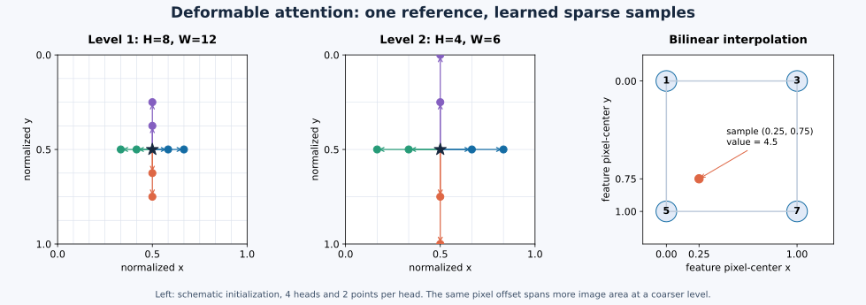
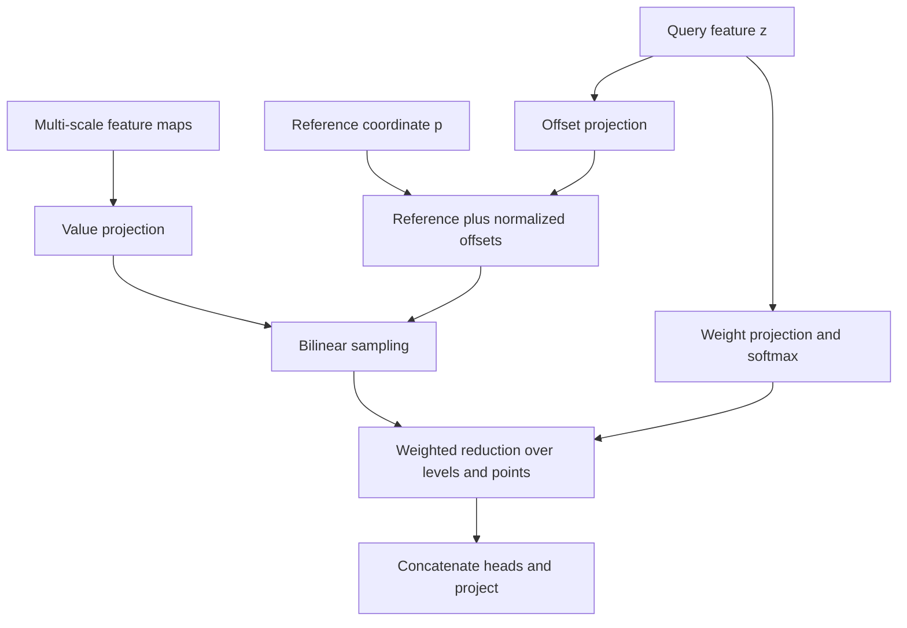

# Multi-scale deformable attention: learn where to look

**Date:** 2026-10-17 (Asia/Shanghai)  
**Category:** Attention and detection  
**Level:** Advanced undergraduate / working CV engineer  
**Prerequisites:** Linear layers, softmax, backpropagation, feature maps, basic attention  
**Code:** [PyTorch implementation and executable checks](../../examples/deformable-attention/)  
**Paper:** [Deformable DETR, Zhu et al., ICLR 2021](https://arxiv.org/abs/2010.04159)

The transferable idea is **differentiable spatial retrieval**: a query predicts
both the places from which to retrieve visual information and the weights used
to combine it. Understanding this operator gives you a practical tool for
reasoning about spatial feature fusion, localization, and geometric bugs.

## 1. The intellectual map

**Paper says:** Deformable DETR addresses slow DETR convergence and the cost of
processing high-resolution features. Its central operator retrieves a small
learned set of samples around a reference location, with a multi-scale extension.
The decoder retains ordinary self-attention between object queries. [S1]

**My interpretation:** Factor a difficult visual search into three decisions:
where to start, where to sample relative to that start, and how to combine the
retrieved evidence. A reference point supplies a spatial prior; offsets provide
adaptation; weights perform selection. They solve different parts of the problem.

| Question | Mechanism | Engineering consequence |
| --- | --- | --- |
| Where does a query begin searching? | Reference coordinate | Define its coordinate frame explicitly |
| Which surrounding evidence matters? | Learned sampling offsets | Gradients must reach coordinates |
| Which scale and sample should dominate? | Joint softmax over levels and points | The normalization axis changes behavior |
| What information is retrieved? | Projected feature values | Values and locations are different tensors |
| What does the output mean? | A query feature vector | A prediction head is still needed |

Nothing here turns an image feature into a robot action by itself. Localization,
calibration, temporal alignment, and control remain explicit downstream modules.

## 2. The motivation, reconstructed numerically

Imagine four unpadded feature levels with shapes 80��120, 40��60, 20��30, and 10��15.
There are

$$
S=9600+2400+600+150=12750
$$

spatial tokens. A dense self-attention score matrix has
$S^2=162562500$ entries **per head**. Eight heads in FP16 would occupy roughly
2.60 GB in decimal units if all those scores were explicitly materialized,
before gradients or other activations. Modern fused dense attention can avoid
materializing the full matrix; this calculation describes the explicit matrix,
not a universal memory requirement. The pairwise arithmetic remains relevant.

For 300 decoder queries, dense image cross-attention compares each query against
12750 positions. With 4 levels and 4 sampling points per level, a deformable head
retrieves 16 positions instead. The ratio of positions consulted is
$12750/16=796.875$. **This is a sampling-count ratio, not a measured speedup.**
Projection layers, interpolation, memory traffic, and kernel launches still cost
time. This distinction matters on an embedded GPU.

The benefit of sparse retrieval depends on whether those selected locations
contain the needed evidence. An efficient search at the wrong coordinates can
be confidently useless.

## 3. One diagram, two coordinate stories



The first two panels are an original schematic, not learned attention from a
trained detector. Each color represents one head. The star is the common
normalized reference. An offset of two feature pixels corresponds to a larger
image-space displacement on a coarser map. The third panel is the exact numeric
interpolation example derived below.

The computation also branches: locations and weights come from the query while
sampled content comes from the feature maps.



## 4. Derive the operator with dimensions

We describe one batch item first. Let $q$ select a query, $m$ a head, $l$ a
feature level, and $k$ a sampling point. Use column vectors in the mathematics;
PyTorch stores feature vectors along the last axis in the query tensor.

| Symbol | Shape or domain | Meaning |
| --- | --- | --- |
| $B,Q$ | Positive integers | Batch size and number of queries |
| $C$ | Positive integer divisible by $M$ | Model channels |
| $M,L,K$ | Positive integers | Heads, levels, samples per head per level |
| $D=C/M$ | Positive integer | Channels retrieved by each head |
| $z_q$ | $\mathbb R^C$ | Query content, possibly including positional context |
| $X^l$ | $\mathbb R^{C\times H_l\times W_l}$ | Input feature map at level $l$ |
| $p_q$ | $[0,1]^2$ | Reference in normalized $(x,y)$ coordinates |
| $\Delta p_{qmlk}$ | $\mathbb R^2$ | Learned offset in level-$l$ feature pixels |
| $a_{qmlk}$ | $\mathbb R$ | Unnormalized sample logit |
| $\alpha_{qmlk}$ | $[0,1]$ | Normalized sample weight |
| $s_{qmlk}$ | $\mathbb R^2$ | Final normalized sampling location |

### 4.1 Predict offsets and weights

Two affine functions produce the sampling policy:

$$
\operatorname{vec}(\Delta p_q)=W_\Delta z_q+b_\Delta,
\qquad W_\Delta\in\mathbb R^{2MLK\times C},
$$

$$
\operatorname{vec}(a_q)=W_a z_q+b_a,
\qquad W_a\in\mathbb R^{MLK\times C}.
$$

The vectorization simply packs head, level, point, and coordinate indices.
There is no discrete index selection here: the offsets are real numbers.

For each query and head, normalize **jointly across the level and point axes**:

$$
\alpha_{qmlk}=\frac{\exp(a_{qmlk})}
{\sum_{l'=1}^{L}\sum_{k'=1}^{K}\exp(a_{qml'k'})}.
$$

Consequently $\sum_{l,k}\alpha_{qmlk}=1$. If $L=2,K=2$ and every logit is zero,
each weight is $1/4$. A softmax performed independently inside each level would
give $1/2$ per point and total mass 2. It would also remove the competition
between levels. This is a different operator even if its shapes still match.

**Official implementation:** The source reshapes weights to an $LK$ axis before
softmax and computes weights directly from query features. It does not form a
dense query-key dot-product matrix. [S2]

### 4.2 Convert feature-pixel offsets to normalized coordinates

For the point-reference case used by our example:

$$
s_{qmlk}=p_q+
\left(\frac{\Delta p_{qmlk,x}}{W_l},
      \frac{\Delta p_{qmlk,y}}{H_l}\right).
$$

The order is **width for x, height for y**. Feature shape metadata is commonly
stored as $(H,W)$, which makes blindly dividing by that metadata incorrect.

For $H=4,W=10,p=(0.5,0.5),\Delta p=(2,1)$:

$$
s=(0.5+2/10,\ 0.5+1/4)=(0.7,0.75).
$$

At a coarser $H=2,W=5$ level, the same offset becomes $(0.9,1.0)$. That sample
reaches the image boundary; it is not guaranteed to be fully inside valid
feature support.

An official historical [bug-fix commit](https://github.com/fundamentalvision/Deformable-DETR/commit/11169a60c33333af00a4849f1808023eba96a931)
corrected precisely this axis ordering. [S6] A square-only test would miss it.

### 4.3 Project values, sample, and combine

Let $V_m^l=W_m^V X^l$ be the head's projected feature map with $D$ channels.
At each fractional location, bilinear interpolation returns a vector in
$\mathbb R^D$. The head output is

$$
h_{qm}=\sum_{l=1}^{L}\sum_{k=1}^{K}
\alpha_{qmlk}\,V_m^l(s_{qmlk})\in\mathbb R^D.
$$

Concatenate heads and apply an output projection:

$$
y_q=W^O\operatorname{concat}(h_{q1},\ldots,h_{qM})+b^O
\in\mathbb R^C.
$$

Our implementation projects the whole map once with a shared 1��1 convolution,
then splits its channels into heads. The projection is shared across levels.
This is equivalent to projecting flattened spatial tokens with a shared linear
map, with a consistent choice of biases. The attention module's output remains
a feature vector; it is neither a probability nor a bounding box.

## 5. Bilinear interpolation is what makes location learning possible

For `align_corners=False`, normalized coordinates $(u,v)$ map to pixel-center
index coordinates as

$$
x=uW-\tfrac12,\qquad y=vH-\tfrac12.
$$

`grid_sample` receives $g=(2u-1,2v-1)$, because its grid convention uses
$[-1,1]$ rather than $[0,1]$. The half-pixel term remains essential. Pixel center
$(j,i)$ corresponds to $u=(j+1/2)/W,v=(i+1/2)/H$. [S4]

Let $i=\lfloor x\rfloor,j=\lfloor y\rfloor$, $d_x=x-i,d_y=y-j$. Within one cell,
write its four scalar feature values as $v_{00},v_{10},v_{01},v_{11}$:

$$
\begin{aligned}
\widetilde v(x,y)={}&(1-d_x)(1-d_y)v_{00}
+d_x(1-d_y)v_{10}\\
&+(1-d_x)d_yv_{01}+d_xd_yv_{11}.
\end{aligned}
$$

This same scalar formula applies independently to every feature channel.

### A complete numerical calculation

Take the 2��2 map with rows $[1,3]$ and $[5,7]$. For $(x,y)=(0.25,0.75)$,
the weights on those values are $0.1875,0.0625,0.5625,0.1875$:

$$
\widetilde v=0.1875(1)+0.0625(3)+0.5625(5)+0.1875(7)=4.5.
$$

The normalized coordinate is $(u,v)=(0.375,0.625)$, hence the actual
`grid_sample` grid coordinate is $(-0.25,0.25)$. These are three descriptions
of the same sample, not three interchangeable numeric pairs.

### Derive the coordinate gradient

Away from cell boundaries:

$$
\frac{\partial\widetilde v}{\partial x}
=(1-d_y)(v_{10}-v_{00})+d_y(v_{11}-v_{01}),
$$

$$
\frac{\partial\widetilde v}{\partial y}
=(1-d_x)(v_{01}-v_{00})+d_x(v_{11}-v_{10}).
$$

For this map, the derivatives are 2 and 4. The chain rule gives a gradient to
offsets. Since $x=(p_x+\Delta x/W)W-1/2$, we have
$\partial x/\partial\Delta x=1$. Offsets measured in feature pixels therefore
have a direct geometric interpretation.

For loss $\mathcal L$, the complete path contains

$$
\frac{\partial\mathcal L}{\partial\Delta x}
=\sum_d\frac{\partial\mathcal L}{\partial h_d}
\alpha\frac{\partial\widetilde v_d}{\partial x},
$$

for a particular head, level, and sample. Matrix projections contribute further
chain-rule factors when computing gradients all the way to $z_q$.

**Inference:** If the local projected feature is constant, its spatial gradient
is zero and this path gives no signal to move the sample. If a sample is far
outside zero-padded support, it can also have zero coordinate gradient. This
explains why useful initial geometry matters; differentiability does not
guarantee a useful search direction everywhere.

Boundary interpolation is not clamping. On a 2��2 all-ones map, $(u,v)=(0,0)$
corresponds to $(x,y)=(-0.5,-0.5)$ and returns $0.25$ with zero padding. Clamping
to the first pixel center would return 1. Our checks verify this distinction.

## 6. Tensor flow: trace a real configuration

For an illustrative $B=2,Q=300,C=256,M=8,L=4,K=4$:

| Tensor | Shape | Interpretation |
| --- | --- | --- |
| Query | `[2,300,256]` | 300 feature vectors per image |
| Reference | `[2,300,2]` | One unpadded normalized coordinate per query |
| Offsets | `[2,300,8,4,4,2]` | A vector for every head/level/point |
| Weights | `[2,300,8,4,4]` | 16-way distribution per query/head |
| Per-level projected values | `[2,256,H_l,W_l]` | Feature content |
| Per-level sampler input | `[16,32,H_l,W_l]` | Batch and heads temporarily folded together |
| Per-level sampling grid | `[16,300,4,2]` | Query and point axes used as output-grid axes |
| Per-level sampled values | `[16,32,300,4]` | 32 channels per head |
| Module output | `[2,300,256]` | Head concatenation followed by projection |

The fake sampler output-height of 300 represents queries. It is not an image
height. This reuse of the grid API is a tensor-layout trick.

With these hyperparameters, the two policy projections contain
$3MLK(C+1)=98688$ parameters including biases. Value and output projections
contain $2C(C+1)=131584$, for **230272 parameters** in this isolated module.
Backbone, residual blocks, normalization, prediction heads, and other decoder
layers are excluded. This is a calculation, not a reported detector size.

## 7. Implementation: make the geometry inspectable

Read [msda.py](../../examples/deformable-attention/msda.py) with the tensor table
beside it. Its implementation follows four explicit operations:

```python
# offsets: [B,Q,M,L,K,2]; reference: [B,Q,2]
locations = reference[:, :, None, None, None, :] + offsets / wh[
    None, None, None, :, None, :]
# wh[l] is (W_l, H_l), not (H_l, W_l).

# Normalize logits over all level-point pairs in a head.
alpha = logits.reshape(B, Q, M, L * K).softmax(dim=-1)
alpha = alpha.reshape(B, Q, M, L, K)

# A level's grid is [B*M,Q,K,2], with normalized coordinates in [-1,1].
sampled = F.grid_sample(per_head, grid, mode="bilinear",
                        padding_mode="zeros", align_corners=False)
```

The complete file handles projection, head layout, aggregation, initialization,
and output projection. It exposes locations and weights for inspection with
`return_details=True`. It uses native PyTorch operations for readability. The
official repository supplies a custom operator and a PyTorch reference path;
our code does not benchmark against its CUDA implementation. [S2, S3]

**Scope:** This teaching module supports unpadded images and 2D point references.
It does not implement padded-batch valid ratios, 4D reference boxes, residual
connections, FFNs, positional embeddings, object matching, or detector losses.
Those are deliberate module boundaries, not implicit defaults.

In a padded detector batch, zeroing padded values is insufficient by itself:
reference coordinates also need a consistent valid-region mapping at each
level. Do not place independently resized or cropped feature maps into this
interface without defining how their coordinates correspond.

## 8. Run an optimization experiment, not just a forward pass

From the repository root:

```bash
cd examples/deformable-attention
python -m pip install -r requirements.txt
python checks.py
python demo.py
python make_figure.py
```

`demo.py` constructs a 24��32 Gaussian feature map with a known peak at feature
pixel $(17,10)$. Its reference starts two pixels left and one pixel below the
peak. We use a single head, level, and sample; freeze the value and output
projections to identity; and optimize only the offset bias to maximize the
sampled response. This isolates one question: can a loss move a fractional
sampling coordinate toward informative evidence?

The objective is

$$
\mathcal L(\Delta p)=-V\left(p+\Delta p/(W,H)\right).
$$

Freezing the value projections is necessary here. If they remained trainable,
the model could increase its output by scaling features rather than locating
the peak. There would be no clean evidence for coordinate learning.

The script checks that the final response exceeds the initial response and
that the learned location is within 0.2 feature pixels of the known peak. It
prints seed, steps, response values, displacement, and localization error.
See [the recorded run](../../examples/deformable-attention/VALIDATION.md).

**Limitation of this experiment:** One global offset is learned for one smooth
synthetic field. It does not demonstrate query-conditioned generalization,
multi-object detection, real-image robustness, or state-of-the-art accuracy.
The richer module is checked separately against a scalar oracle and numerical
gradients.

## 9. Evidence: separate published results from our checks

**Paper says:** On COCO 2017 validation, its Table 1 reports the following
ResNet-50 comparisons. These are original paper values, not new reproductions.
[S1, Table 1]

| Method | Epochs | AP | Small-object AP |
| --- | --- | --- | --- |
| DETR | 500 | 42.0 | 20.5 |
| DETR-DC5 with focal loss and 300 queries | 50 | 36.2 | 16.3 |
| Deformable DETR | 50 | 43.8 | 26.4 |

**My interpretation:** Read the table as an optimization-efficiency comparison
between complete systems. It does not isolate every architectural contribution.
The controlled 50-epoch baseline is more informative than comparing training
epochs alone, but multiple design changes still exist.

For your own reproduction, record the exact checkpoint, configuration, input
size policy, evaluation split, and code commit. Repository checkpoint results
can differ from paper tables; do not merge them into an apparently single run.
The upstream changelog explicitly records a released-code normalization fix.
[S6]

| Hypothesis to test yourself | Controlled change | Metrics and interpretation |
| --- | --- | --- |
| Adaptive geometry matters | Freeze offsets to a fixed pattern | AP, localization error, small-object recall |
| Extra samples help | Compare $K=1,2,4,8$ with other settings fixed | AP versus measured latency and memory |
| Cross-scale choice matters | Compare joint $LK$ normalization with a defined equal-level variant | AP plus per-level weight statistics |
| Fine-scale evidence matters | Remove the finest level and retrain | Small-object AP and feature-memory cost |
| Coordinate precision matters | Compare floating-point policies on identical inputs | Sampling displacement and final task metrics |

Train multiple seeds if resources permit and report variation. A 0.2 AP change
without variability may not identify a robust improvement. Log whether each
ablation changes parameters or compute as well as the mechanism of interest.

**Locally verified:** Six CPU checks cover a hand-calculated bilinear value,
an independent scalar multi-scale oracle, zero-padding boundaries, non-square
coordinate units and normalization, finite-difference gradients, and full-module
backpropagation. These validate implementation behavior on small cases, not
COCO accuracy or Jetson performance.

## 10. Integrated application: visual-tactile contact localization

**My interpretation / proposed application:** Use deformable retrieval to pool
evidence around candidate contact regions in an optical tactile sensor. This
is a proposed engineering design, not a result established by the DETR paper.

Suppose the camera produces an RGB 256��256 elastomer image. A small encoder
returns feature maps of shapes `[B,64,64,64]`, `[B,64,32,32]`, and
`[B,64,16,16]`. Let $Q=16$ candidate queries describe contact hypotheses. Use
$M=4,K=4,L=3$, so each head retrieves 12 points per hypothesis.

| Stage | Input �� output | Contract |
| --- | --- | --- |
| Sensor preprocessing | RGB image �� normalized image | Fixed RGB order, crop, optical calibration, timestamp |
| Encoder | Image �� three feature levels | Channels aligned; maps refer to the same image extent |
| Reference predictor | Query �� normalized $(x,y)$ | Sigmoid output; labels use the same crop and padding convention |
| Deformable module | Query, references, maps �� `[B,16,64]` | Spatial retrieval only |
| Heads | Query features �� contact probability, center, optional force | Separate units and supervision for each target |
| Downstream consumer | Estimates �� controller observation | Calibration and timing supplied outside attention |

A minimal calling pattern, using the supplied module, is:

```python
attention = MultiScaleDeformableAttention(64, heads=4, levels=3, points=4)
reference_head = torch.nn.Linear(64, 2)
contact_head = torch.nn.Linear(64, 1)
force_head = torch.nn.Linear(64, 3)

# query: [B,16,64]; pyramid: three [B,64,H_l,W_l] tensors
reference = reference_head(query).sigmoid()
pooled, debug = attention(query, reference, pyramid, return_details=True)
contact_logit = contact_head(pooled)  # [B,16,1]
force_xyz = force_head(pooled)       # [B,16,3]; define units in the dataset
```

This is an interface sketch; the backbone, query generator, training data, and
loss wiring are not supplied by the sketch. A multi-contact dataset needs
consistent instance assignment, for example matching predicted hypotheses to
annotated contacts. A single-contact dataset can use a simpler supervised head.

For a force branch, a possible objective is

$$
\mathcal L=\lambda_c\mathcal L_{\mathrm{contact}}
+\lambda_p\mathcal L_{\mathrm{center}}
+\lambda_f\mathcal L_{\mathrm{force}},
$$

with force loss applied only where valid force labels exist. Normalize target
scales or choose weights from measured gradient behavior: a force expressed in
newtons and a center expressed in normalized image coordinates have different
numeric scales. Ground-truth force may come from a calibrated external sensor;
sampling attention cannot create missing physical supervision.

First compare against global average pooling and a fixed local crop at equal
backbone capacity. If deformable retrieval improves localization but hurts force
calibration, its spatial selectivity may be discarding distributed deformation
information. The relevant question is performance on the actual sensor task.

For VLMs, the reusable connection is spatial visual retrieval before or within a
multimodal system. Text-conditioned queries would require an explicit learned
interface. This operator alone supplies no language alignment or reasoning.

## 11. Complexity and deployment on an 8 GB Jetson

For the implementation here, with $S=\sum_l H_lW_l$, an approximate arithmetic
budget is

$$
O\left(BSC^2+BQC^2+BQCMLK+BQLKC\right).
$$

The terms correspond to value projection, output projection, policy projections,
and interpolation/reduction, respectively. Constants and implementation layouts
matter. The sampled channel work sums over $M$ heads of width $D$, so $MD=C$;
counting both full $C$ and an additional $M$ in that sampling term would double
count head width.

For $Q=S$ in an image encoder, the spatial pairwise $S^2C$ term of dense
attention is avoided. For a decoder with fixed $Q$, our implementation **still
projects all $S$ feature values**. Do not claim that its entire cost is
independent of feature resolution.

The pure PyTorch example launches operations per feature level. A fused custom
kernel may reduce overhead, but a deployment choice requires measurement on the
target system. No CUDA-extension, ONNX Runtime, TensorRT, FP16, or INT8 execution
was tested for this lesson.

An appropriate deployment sequence is:

1. Save fixed input/query/reference tensors and their FP32 outputs as golden
   samples, including intermediate locations and attention weights.
2. Export using the actual installed toolchain. Inspect whether the graph uses
   supported `GridSample` semantics or a custom operator requiring a runtime
   implementation. Export success alone does not validate execution.
3. Compare preprocessing, coordinate convention, boundary samples, module
   outputs, and end-task predictions between runtimes.
4. Benchmark batch 1 with warm-up and device synchronization. Measure both
   module latency and end-to-end sensor-to-prediction latency, including P50,
   P99, memory, power mode, and thermal state.
5. Evaluate lower precision against the task metric. Consider retaining the
   geometry path in FP32 if measured localization errors justify it.

**Inference:** A normalized coordinate error $\epsilon$ moves a sample about
$W_l\epsilon$ feature pixels horizontally. Quantizing coordinates or offsets can
therefore affect localization differently from quantizing feature values.
Revalidate force estimates and small-object recall; tensor mean error alone
does not express task quality.

## 12. Failure cases worth visualizing

| Symptom | Candidate explanation | Diagnostic |
| --- | --- | --- |
| Good square-image tests, poor rectangular images | Width/height normalization swapped | Use known offsets on a 4��10 map |
| All samples remain uninformative | Flat local features or out-of-support geometry | Plot samples over feature maps and inspect offset gradients |
| Padded batches shift detections | References and valid-region ratios disagree | Compare single-image and padded-batch inference |
| More levels increase output magnitude | Softmax normalized separately per level | Sum weights jointly over $(L,K)$ |
| Lower FLOPs but disappointing FPS | Interpolation traffic or kernel overhead dominates | Profile actual operators on the deployment GPU |
| Contact center good, force estimate poor | Local evidence misses global deformation | Compare against global and hybrid pooling |

Attention weights are not a causal explanation of a final decision. A visible
sampling point only shows where this operation retrieved feature content; the
backbone feature at that point already has its own receptive field.

## 13. Check your understanding

1. Why is dividing offsets by $(H,W)$ incorrect for an $(x,y)$ coordinate pair?
2. With $L=3,K=4$ and zero logits, what is each sample's initial weight?
3. Why can gradients move a bilinear sample but usually cannot move an integer
   index selected by rounding?
4. What changes if you set `align_corners=True` without changing the grid math?
5. Why does the synthetic demo freeze the feature projections?
6. Which measurements would establish an actual benefit for a tactile sensor?

<details>
<summary>Reasoning guide</summary>

1. x counts columns and must be normalized by width; y counts rows and uses height.
2. $1/12$, with total mass 1 per query and head.
3. Bilinear weights vary continuously inside each cell; rounded selection is
   locally constant almost everywhere.
4. The coordinate-to-pixel mapping changes to $(g+1)(W-1)/2$ horizontally,
   replacing the half-pixel convention and shifting sample locations.
5. Otherwise feature amplification can improve the objective without improving
   localization.
6. Compare controlled task accuracy, robustness, calibration, latency, and
   memory against simpler pooling on properly separated sensor data.

</details>

## Sources and scope

The mathematics, numerical examples, illustration, proposed sensor integration,
and teaching code are presented as an explanatory reconstruction. Benchmark
claims are explicitly attributed. No detector was trained in preparing this lesson.

- **[S1]** Zhu et al., [Deformable DETR, arXiv v4](https://arxiv.org/html/2010.04159v4),
  especially equations 2�C3, Tables 1�C2, and Appendix A.1. ICLR 2021.
- **[S2]** Official [attention module](https://github.com/fundamentalvision/Deformable-DETR/blob/11169a60c33333af00a4849f1808023eba96a931/models/ops/modules/ms_deform_attn.py),
  pinned to commit `11169a60c33333af00a4849f1808023eba96a931`.
- **[S3]** Official [PyTorch reference sampling function](https://github.com/fundamentalvision/Deformable-DETR/blob/11169a60c33333af00a4849f1808023eba96a931/models/ops/functions/ms_deform_attn_func.py).
- **[S4]** PyTorch [`grid_sample` documentation](https://docs.pytorch.org/docs/stable/generated/torch.nn.functional.grid_sample.html),
  cross-checked against the installed PyTorch 2.11.0 function docstring.
- **[S5]** Official [detector and reproduction repository](https://github.com/fundamentalvision/Deformable-DETR).
- **[S6]** Official [released-code normalization changelog](https://github.com/fundamentalvision/Deformable-DETR/blob/11169a60c33333af00a4849f1808023eba96a931/docs/changelog.md).

**Unknown / unmeasured here:** Full COCO reproduction, robustness on a real tactile
sensor, the best sample budget for that sensor, and target Jetson latency and
accuracy after export or quantization.
